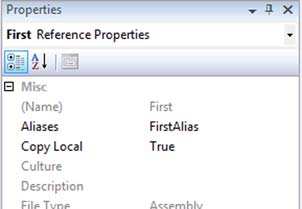

# Chapter 7: Concluding C# 2: the final features

> Source: C# in Depth, Third Edition — Jon Skeet. Original PDF pages 213–237.

[← Table of contents](../README.md)

<!-- PDF page 213 -->

## Concluding C# 2:

## the final features

This chapter covers
Partial types
Static classes
Separate getter/setter property access
Namespace aliases
Pragma directives
Fixed-size buffers
Friend assemblies
So far we’ve looked at the four biggest new features in C# 2: generics, nullable
types, delegate enhancements, and iterator blocks. Each addresses a fairly complex
requirement, which is why we’ve gone into them in some depth. The remaining
new features of C# 2 knock a few rough edges off C# 1. They’re little niggles that
the language designers decided to correct—either areas where the language
needed a bit of improvement for its own sake, or where the experience of working
with code generation and native code could be made more pleasant.

<!-- PDF page 214 -->

Partial types
Over time, Microsoft has received a lot of feedback from the C# community (and
its own developers, no doubt) about areas where C# hasn’t gleamed quite as brightly
as it might. Several smaller changes made it into C# 2 along with the larger ones, alle-
viating some of these small pain points.
None of the features in this chapter is particularly difficult, and we’ll go through
them fairly quickly. Don’t underestimate how important they are, though. Just
because a topic can be explored in a few pages doesn’t mean it’s useless. You’re likely
to use some of these features on a frequent basis. Here’s a quick rundown of the fea-
tures covered in this chapter and their uses, so you know what to expect:
Partial types—The ability to write the code for a type in multiple source files.
This is particularly handy for types where part of the code is autogenerated and
the rest is written manually.
Static classes—For tidying up utility classes so that the compiler can spot when
you’re trying to use them inappropriately, and making your intentions clearer.
Separate getter/setter property access—Finally, the ability to have a public getter and
a private setter for properties! (That’s not the only combination available, but
it’s the most common.)
Namespace aliases—Ways out of sticky situations where type names aren’t unique.
Pragma directives—Compiler-specific instructions for actions such as suppressing
specific warnings for a particular section of code.
Fixed-size buffers—More control over how structs handle arrays in unsafe code.
InternalsVisibleToAttribute (friend assemblies)—A feature spanning language,
framework, and runtime, this allows selected assemblies more access when
required.
You may be itching to get on to the sexy stuff from C# 3 by this point, and I don’t
blame you. Nothing in this chapter is going to set the world on fire—but each of these
features can make your life more pleasant, or dig you out of a hole in some cases. Hav-
ing dampened your expectations somewhat, the first feature is actually pretty nifty.
7.1
Partial types
The first change we’ll look at is in response to the power struggle that was usually
involved when using code generators with C# 1. For Windows Forms, the designer in
Visual Studio required its own regions of code that couldn’t be touched by developers,
within the same file that developers had to edit for user interface functionality. This
was clearly a brittle situation.
In other cases, code generators create source that’s compiled alongside manually
written code. In C# 1, adding extra functionality involved deriving new classes from
the autogenerated ones, which is ugly. There are plenty of other scenarios where hav-
ing an unnecessary link in the inheritance chain can cause problems or reduce encap-
sulation. For instance, if two different parts of your code want to call each other, you

<!-- PDF page 215 -->

Concluding C# 2: the final features
need virtual methods for the parent type to call the child, and protected methods for
the reverse situation, where normally you’d use two private nonvirtual methods.
C# 2 allows more than one file to contribute to a type, and IDEs can extend this
notion so that some of the code used for a type may not even be visible as C# source
code at all. Types built from multiple source files are called partial types.
In this section we’ll also discuss partial methods, which are only relevant in partial
types and allow a rich but efficient way of adding manually written hooks into auto-
generated code. This is actually a C# 3 feature (this time based on feedback about
C# 2), but it’s more logical to discuss it when we examine partial types than to wait
until the next part of the book.
7.1.1
Creating a type with multiple files
Creating a partial type is a cinch—you just need to include the partial contextual
keyword in the declaration for the type in each file it occurs in. A partial type can be
declared within as many files as you like, although all the examples in this section
use two.
The compiler effectively combines all the source files together before compiling.
This means that code in one file can call code in another and vice versa, as shown in
figure 7.1—there’s no need for forward references or other tricks.
You can’t write half of a member in one file and half of it in another—each individ-
ual member has to be completely contained within its own file. You can’t start a method
in one file and finish it in another, for example.1 There are a few obvious restrictions
about the declarations of the type—the declarations have to be compatible. Any file can
specify interfaces to be implemented (and they don’t have to be implemented in that
file), any file can specify the base type, and any file can specify constraints on a type
parameter. But if multiple files specify a base type, those base types have to be the same,
and if multiple files specify type constraints, the constraints have to be identical. The
Example2.cs
Example1.cs

partial class Example
{
void FirstMethod()
{
SecondMethod();
}
partial class Example
{
void SecondMethod()
{
ThirdMethod();
}
}
void ThirdMethod()
{
}
}
Figure 7.1
Code in partial types is able to see all of the members of the type,
regardless of which file each member is in.
1 There’s an exception here: partial types can contain nested partial types spread across the same set of files.

<!-- PDF page 216 -->

Partial types
following listing shows an example of the flexibility afforded (while not doing anything
even remotely useful).
Listing 7.1
Demonstration of mixing declarations of a partial type
// Example1.cs
using System;
Specifies interface
and type parameter
constraint
B
partial class Example<TFirst, TSecond>
: IEquatable<string>
where TFirst : class
{
public bool Equals(string other)
{
return false;
}
}
Implements
IEquatable<string>
C
// Example2.cs
using System;
partial class Example<TFirst, TSecond>
: EventArgs, IDisposable
{
public void Dispose()
{
}
}
Specifies base class
and interface
D
Implements IDisposable
E
I stress that this listing is solely for the purpose of talking about what’s legal in a decla-
ration—the types involved were only picked for convenience and familiarity. You can
see that both declarations (B and D) contribute to the list of interfaces that must be
implemented. In this example, each file implements the interfaces it declares, and
that’s a common scenario, but it would be legal to move the implementation of
IDisposable E to Example1.cs and the implementation of IEquatable<string> C
to Example2.cs. I’ve used the ability to specify interfaces separately from the imple-
mentation myself, encapsulating methods with the same signature generated for mul-
tiple different types into an interface. The code generator doesn’t know about the
interface, so it doesn’t know to declare that the type implements it.
Only the first declaration B specifies any type constraints, and only the second D
specifies a base class. If the first declaration B had specified a base class, it would have
to be EventArgs, and if the second declaration had specified any type constraints,
they’d have to be exactly as in the first. In particular, you can’t specify a type constraint
for TSecond in the second declaration, even though it’s not mentioned in the first.
Both types have to have the same access modifier, if any—you can’t make one declara-
tion internal and the other public, for example. Essentially, the rules around com-
bining files allow flexibility in most cases while encouraging consistency.
In single file types, the initialization of member and static variables is guaranteed
to occur in the order they appear in the file, but there’s no guaranteed order when
multiple files are involved. Relying on the order of declaration within the file is brittle

<!-- PDF page 217 -->

Concluding C# 2: the final features
to start with—it leaves your code open to subtle bugs if a developer decides to “harm-
lessly” move things around—so it’s worth avoiding this situation where you can. You
should particularly avoid it with partial types.
Now that you know what you can and can’t do, let’s take a closer look at why you’d
want to do it.
7.1.2
Uses of partial types
As I mentioned earlier, partial types are primarily useful in conjunction with designers
and other code generators. If a code generator has to modify a file that’s owned by a
developer, there’s always a risk of things going wrong. With the partial types model, a
code generator can own the file where it’ll work and completely overwrite the whole
file every time it wants to.
Some code generators may choose not to generate a C# file at all until the build is
well under way. For instance, Snippy has Extensible Application Markup Language
(XAML) files that describe the user interface. When the project is built, each XAML
file is converted into a C# file in the obj directory (the filenames end with .g.cs to show
they’ve been generated) and compiled along with the partial class providing extra
code for that type (typically event handlers and extra construction code). This com-
pletely prevents developers from tweaking the generated code, at least without going
to the extreme lengths of hacking the build file.
I’ve been careful to use the phrase code generator instead of designer because there
are plenty of code generators around other than designers. For instance, in Visual Stu-
dio, web service proxies are generated as partial classes, and you may have your own
tools that generate code based on other data sources. One reasonably common exam-
ple of this is object-relational mapping (ORM)—some ORM tools use database entity
descriptions from a configuration file (or straight from the database) and generate
partial classes representing those entities. Likewise my .NET port of the Google Proto-
col Buffers serialization framework generates partial classes—a feature that has
proven useful even within the implementation itself.
This makes it straightforward to add behavior to the type—overriding virtual meth-
ods of the base class, adding new members with business logic, and so forth. It’s a
great way of letting the developer and the tool work together, rather than constantly
squabbling about who’s in charge.
One scenario that’s occasionally useful is for one file to be generated containing
multiple partial types, and then some of those types are enhanced in other files, with
one manually generated file per type. To return to the ORM example, the tool could
generate a single file containing all the entity definitions, and some of those entities
could have extra code provided by the developer, using one file per entity. This keeps
the number of automatically generated files low, but still provides good visibility of the
manual code involved.

<!-- PDF page 218 -->

Partial types

GuiPage.xaml.cs
(Handwritten C#)
GuiPage.xaml
(XAML)
Schema/model
(Database, XML, etc.)
XAML to C#
converter
(Build time)
Code generator
(Prebuild)

GuiPage.g.cs
(C#)
Customer.cs
(Handwritten C#)
GeneratedEntities.cs
(C#  — includes partial
Customer class)
C# compilation
C# compilation

GuiPage type
(Part of an assembly)
Customer type
(Part of an assembly)
Using XAML for declarative UI design
Prebuilding partial classes for database entities
Figure 7.2
Comparison between XAML precompilation and autogenerated entity classes
Figure 7.2 shows how the uses of partial types for XAML and entities are similar, but
with slightly different timing involved when it comes to creating the autogenerated
C# code.
A somewhat different use of partial types is as an aid to refactoring. Sometimes a
type gets too big and assumes too many responsibilities. One first step to dividing the
bloated type into smaller, more coherent types can be to split it into a partial type over
two or more files. This can be done with no risk and in an experimental manner, mov-
ing methods between files until each file addresses a single concern. Although the
next step of splitting the type up is still far from automatic, it should be a lot easier to
see the end goal.
One final use to mention: unit testing. Often the set of unit tests for a class can end
up being much larger than the implementation itself. One way to split the tests into
more understandable chunks is to use partial types. You can still easily run all the tests
for a type in one go (since you still have a single test class), but you can easily see the
tests for different areas of functionality in different files. By hand-editing the project
file, you can even have the same parent/child expansion in Solution Explorer as you
see when partial types are used for Visual Studio’s generated code. This won’t be to
everyone’s taste, but I’ve found it to be a useful way of managing tests.
When partial types first appeared in C# 2, no one knew exactly how they’d be used.
One feature that was almost immediately requested was a way to provide optional
extra code for generated methods to call. This need has been addressed by C# 3 with
partial methods.

<!-- PDF page 219 -->

Concluding C# 2: the final features
7.1.3
Partial methods—C# 3 only!
To reiterate my previous explanation, the rest of this part of the book just deals with
C# 2 features, but partial methods don’t fit with any of the other C# 3 features and
they do fit in well when describing partial types. Apologies for any confusion this may
cause.
Back to the feature: sometimes you want to be able to specify behavior in a manu-
ally created file and use that behavior from an automatically generated file. For
instance, in a class that has lots of automatically generated properties, you might want
to be able to specify code to be executed to validate a new value for some of those
properties. Another common scenario is for a code generator to include construc-
tors—manually written code may want to hook into object construction to set default
values, perform some logging, and so forth.
In C# 2, these requirements can only be met either by using events that the manu-
ally generated code can subscribe to, or by making the automatically generated code
assume that the handwritten code will include methods of a particular name—making
all the code fail to compile unless the relevant methods are provided. Alternatively,
the generated code can provide a base class with virtual methods that do nothing by
default. The manually generated code can then derive from the class and override
some or all of the methods.
All of these solutions are somewhat messy. C# 3’s partial methods effectively pro-
vide optional hooks that have no cost whatsoever if they’re not implemented—any calls
to the unimplemented partial methods are removed by the compiler. This allows tools
to be very generous in terms of the hooks they provide. In the compiled code, you
only pay for what you use.
It’s easiest to understand this with an example. The following listing shows a par-
tial type specified in two files, with the constructor in the automatically generated
code calling two partial methods, one of which is implemented in the manually gen-
erated code.
Listing 7.2
A partial method called from a constructor
// Generated.cs
using System;
partial class PartialMethodDemo
{
public PartialMethodDemo()
{
OnConstructorStart();
Console.WriteLine("Generated constructor");
OnConstructorEnd();
}
partial void OnConstructorStart();
partial void OnConstructorEnd();
}
// Handwritten.cs

<!-- PDF page 220 -->

Partial types
using System;
partial class PartialMethodDemo
{
partial void OnConstructorEnd()
{
Console.WriteLine("Manual code");
}
}
As shown in listing 7.2, partial methods are declared just like abstract methods: by pro-
viding the signature without any implementation but using the partial modifier. Sim-
ilarly, the actual implementations just have the partial modifier but are otherwise
like normal methods.
Calling the parameterless constructor of PartialMethodDemo would result in
Generated constructor and then Manual code being printed out. If you examined
the IL for the constructor, you wouldn’t see a call to OnConstructorStart because it
no longer exists—there’s no trace of it anywhere in the compiled type.
Because the method may not exist, partial methods must have a return type of
void, and they can’t take out parameters. They have to be private, but they can be
static and/or generic. If the method isn’t implemented in one of the files, the whole
statement calling it is removed, including any argument evaluations.
If evaluating any of the arguments has a side effect that you want to occur whether
or not the partial method is implemented, you should perform the evaluation sepa-
rately. For instance, suppose you have the following code:
LogEntity(LoadAndCache(id));
Here LogEntity is a partial method, and LoadAndCache loads an entity from the data-
base and inserts it into the cache. You might want to use this instead:
MyEntity entity = LoadAndCache(id);
LogEntity(entity);
That way, the entity is loaded and cached regardless of whether an implementation
has been provided for LogEntity. Of course, if the entity can be loaded equally
cheaply later on, and may not even be required, you should leave the statement in the
first form and avoid an unnecessary load in some cases.
To be honest, unless you’re writing your own code generators, you’re more likely
to be implementing partial methods than declaring and calling them. If you’re only
implementing them, you don’t need to worry about the argument evaluation side of
things.
In summary, partial methods in C# 3 allow generated code to interact with hand-
written code in a rich manner without any performance penalties for situations where
the interaction is unnecessary. This is a natural continuation of the C# 2 partial types
feature, which enables a much more productive relationship between code generators
and developers.

<!-- PDF page 221 -->

Concluding C# 2: the final features
The next feature is entirely different. It’s a way of telling the compiler more about
the intended nature of a type so that it can perform more checking on both the type
itself and any code using it.
7.2
Static classes
The second new feature is in some ways completely unnecessary—it just makes things
tidier and more elegant when you write utility classes.
Everyone has utility classes. I haven’t seen a significant project in either Java or C#
that didn’t have at least one class consisting solely of static methods. The classic exam-
ple in developer code is a type with string helper methods, doing anything from escap-
ing, reversing, smart replacing—you name it. An example from the framework is the
System.Math class.
The key features of a utility class are as follows:
All members are static (except a private constructor).
The class derives directly from object.
Typically there’s no state at all, unless some caching or a singleton is involved.
There are no visible constructors.
The class is sealed if the developer remembers to do so.
The last two points are optional, and if there are no visible constructors (including
protected ones), the class is effectively sealed anyway. Both of them help make the pur-
pose of the class more obvious, though.
The following listing gives an example of a C# 1 utility class. Then we’ll look at how
C# 2 improves matters.
Listing 7.3
A typical C# 1 utility class
public sealed class NonStaticStringHelper
{
private NonStaticStringHelper()
{
}
Seals class to
prevent derivation
B
Prevents instantiation
from other code
C
public static string Reverse(string input)
{
char[] chars = input.ToCharArray();
Array.Reverse(chars);
return new string(chars);
}
}
All methods
are static
D
The class is sealed B so that no one tries to derive from it. Inheritance is supposed to
be about specialization, and there’s nothing to specialize here, as all the members are
static D except the private constructor C. That constructor may seem odd at first
sight—why have it at all if it’s private and never going to be used? The reason is that if
you don’t supply any constructors for a class, the C# 1 compiler will always provide a

<!-- PDF page 222 -->

Static classes
default constructor that’s public and parameterless. In this case, you don’t want any visi-
ble constructors, so you have to provide a private one.
This pattern works reasonably well, but C# 2 makes it explicit and actively prevents
the type from being misused. First, we’ll look at what changes are needed to turn list-
ing 7.3 into a proper static class, as defined in C# 2. As you can see in the following list-
ing, little action is required.
Listing 7.4
The same utility class as in listing 7.3, but converted into a C# 2 static class
using System;
public static class StringHelper
{
public static string Reverse(string input)
{
char[] chars = input.ToCharArray();
Array.Reverse(chars);
return new string(chars);
}
}
You use the static modifier in the class declaration this time instead of sealed, and
you don’t include a constructor at all—those are the only code differences. The C# 2
compiler knows that a static class shouldn’t have any constructors, so it doesn’t pro-
vide a default one.
In fact, the compiler enforces a number of constraints on the class definition:
It can’t be declared as abstract or sealed, although it’s implicitly both.
It can’t specify any implemented interfaces.
It can’t specify a base type.
It can’t include any nonstatic members, including constructors.
It can’t include any operators.
It can’t include any protected or protected internal members.
It’s worth noting that although all the members must be static, you have to explicitly
make them static. Although nested types are implicitly static members of the enclos-
ing class, the nested type itself can be a nonstatic type if that’s required.
The compiler doesn’t just put constraints on the definition of static classes—it also
guards against their misuse. Because it knows that there can never be any instances of
the class, it prevents any use that would require one. For instance, all of the following
are invalid when StringHelper is a static class:
StringHelper variable = null;
StringHelper[] array = null;
public void Method1(StringHelper x) {}
public StringHelper Method1() { return null; }
List<StringHelper> x = new List<StringHelper>();

<!-- PDF page 223 -->

Concluding C# 2: the final features
None of these is prevented if the class follows the C# 1 pattern, but all of them are
essentially useless. In short, static classes in C# 2 don’t allow you to do anything you
couldn’t do before, but they prevent you from doing things that you shouldn’t have
been doing anyway. They also explicitly state your intentions. By making a class static,
you’re saying that you definitely don’t want any instances to be created. It’s not just a
quirk of the implementation; it’s a design choice.
The next feature on the list has a more positive feel. It’s aimed at a specific—
although widely encountered—situation, and allows a solution that’s neither ugly nor
breaks encapsulation, which was the choice available in C# 1.
7.3
Separate getter/setter property access
I’ll admit to being bemused when I first saw that C# 1 didn’t allow you to have a public
getter and a private setter for properties. This isn’t the only combination of access
modifiers that’s prohibited by C# 1, but it’s the most commonly desired one. In fact, in
C# 1 both the getter and the setter need to have the same accessibility—it’s declared
as part of the property declaration rather than as part of the getter or setter.
There are perfectly good reasons to want different accessibility for the getter and
the setter. Often you may want some validation, logging, locking, or other code to be
executed when changing a variable that backs the property, but you don’t want to
make the property writable to code outside the class. In C# 1 the alternatives were
either to break encapsulation by making the property publicly writable against your
better judgment or to write a SetXXX() method in the class to do the setting, which
frankly looks ugly when you’re used to real properties.
C# 2 fixes the problem by allowing either the getter or the setter to explicitly have
more restrictive access than that declared for the property itself. This is most easily
seen with an example:
string name;
public string Name
{
get { return name; }
private set
{
// Validation, logging etc here
name = value;
}
}
In this case, the Name property is effectively read-only to all other types,2 but you can
use the familiar property syntax for setting the property within the type itself. The
same syntax is also available for indexers as well as properties. You could make the set-
ter more public than the getter (a protected getter and a public setter, for example),
but that’s a pretty rare situation, in the same way that write-only properties are few and
far between compared with read-only properties.
2 Except nested types, which always have access to private members of their enclosing types.

<!-- PDF page 224 -->

Namespace aliases
TRIVIA: THE ONLY PLACE WHERE “PRIVATE” IS REQUIRED
Everywhere else in C#,
the default access modifier in any given situation is the most private one possi-
ble. For example, if something can be declared to be private, it will default to
private if you don’t specify any access modifiers. This is a nice element of lan-
guage design, because it’s hard to get it wrong accidentally; if you want some-
thing to be more public than it is, you’ll notice when you try to use it. But if
you accidentally make something too public, the compiler can’t help you spot
the problem. Specifying the access of a property getter or setter is the one
exception to this rule—if you don’t specify anything, the default is to give the
getter or setter the same access as the overall property itself.
Note that you can’t declare the property itself to be private and make the getter pub-
lic—you can only make a particular getter or setter more private than the property.
Also, you can’t specify an access modifier for both the getter and the setter—that
would be silly, as you could declare the property itself to be whichever is the more
public of the two modifiers.
This aid to encapsulation is extremely welcome. There’s still nothing in C# 2 to
stop other code in the same class from bypassing the property and going directly to
whatever fields are backing it, unfortunately. As you’ll see in the next chapter, C# 3
fixes this in one particular case, but not in general.
We’ll now move from a feature you may want to use regularly to one that you’ll
want to avoid most of the time—it allows your code to be absolutely explicit in terms
of which types it’s referring to, but at a significant cost to readability.
7.4
Namespace aliases
Namespaces are primarily intended as a means of organizing types into a useful hier-
archy. They also allow you to keep fully qualified names of types distinct even when the
unqualified names may be the same. This shouldn’t be seen as an invitation to reuse
unqualified type names without good cause, but there are times when it’s the natural
thing to do.
An example of this is the unqualified name Button. There are two classes with that
name in the .NET 2.0 Framework: System.Windows.Forms.Button and System.Web.UI
.WebControls.Button. Although they’re both called Button, it’s easy to tell them apart
by their namespaces. This mirrors real life closely—you may know several people
called Jon, but you’re unlikely to know anyone else called Jon Skeet. If you’re talking
with friends in a particular context, you may be able to use just the name Jon without
specifying which one you’re talking about, but in other contexts you may need to pro-
vide more exact information.
The using directive of C# 1 (not to be confused with the using statement that calls
Dispose automatically) was available in two flavors: one created an alias for a
namespace or type (for example, using Out = System.Console;) and the other intro-
duced a namespace into the list of contexts the compiler would search when looking
for a type (for example, using System.IO;). By and large, this was adequate, but there

<!-- PDF page 225 -->

Concluding C# 2: the final features
were a few situations that the language couldn’t cope with. In some other cases, auto-
matically generated code would have to go out of its way to make absolutely sure that
the right namespaces and types were being used whatever happened.
C# 2 fixes these problems, bringing additional expressiveness to the language. You
can now write code that’s guaranteed to mean what you want it to regardless of which
other types, assemblies, and namespaces are introduced. These extreme measures are
rarely needed outside automatically generated code, but it’s nice to know that they’re
there when you need them.
In C# 2 there are three types of aliases: the namespace aliases of C# 1, the global
namespace alias, and extern aliases. We’ll start off with the one type of alias that was
already present in C# 1, but we’ll introduce a new way of using aliases to ensure that
the compiler knows to treat it as an alias rather than checking to see whether it’s the
name of another namespace or type.
7.4.1
Qualifying namespace aliases
Even in C# 1, it was a good idea to avoid namespace aliases wherever possible. Every so
often you might find that one type name clashed with another—as with the previous
Button example—so you either had to specify the full name including the namespace
every time you used it, or you needed an alias that distinguished the two, in some ways
acting like a shortened form of the namespace. The following listing shows an exam-
ple where the two types of Button are used, qualified by an alias.
Listing 7.5
Using aliases to distinguish between different Button types
using System;
using WinForms = System.Windows.Forms;
using WebForms = System.Web.UI.WebControls;
class Test
{
static void Main()
{
Console.WriteLine(typeof(WinForms.Button));
Console.WriteLine(typeof(WebForms.Button));
}
}
Listing 7.5 compiles without any errors or warnings, although it’s still not as pleasant
as it would be if you only needed to deal with one kind of Button to start with. There’s
a problem, though—what if someone were to introduce a type or namespace called
WinForms or WebForms? The compiler wouldn’t know what WinForms.Button meant
and would use the type or namespace in preference to the alias. You want to be able to
tell the compiler that you need it to treat WinForms as an alias, even though it’s avail-
able elsewhere.
C# 2 introduces the ::namespace alias qualifier syntax to do this, as shown in the fol-
lowing listing.

<!-- PDF page 226 -->

Namespace aliases
Listing 7.6
Using :: to tell the compiler to use aliases
using System;
using WinForms = System.Windows.Forms;
using WebForms = System.Web.UI.WebControls;
class WinForms {}
class Test
{
static void Main()
{
Console.WriteLine(typeof(WinForms::Button));
Console.WriteLine(typeof(WebForms::Button));
}
}
Instead of WinForms.Button, listing 7.6 uses WinForms::Button, and the compiler is
happy. If you change the :: back to . you’ll get a compilation error.
So if you use :: everywhere you use an alias, you’ll be fine, right? Well, not quite...
7.4.2
The global namespace alias
There’s one part of the namespace hierarchy that you can’t define your own alias for:
the root of it, or the global namespace. Suppose you have two classes, both named
Configuration—one within a namespace of MyCompany and the other with no
namespace specified at all. How can you refer to the root Configuration class from
within the MyCompany namespace? You can’t use a normal alias, and if you just specify
Configuration, the compiler will use MyCompany.Configuration.
In C# 1, there was no way of getting around this. Again, C# 2 comes to the rescue,
allowing you to use global::Configuration to tell the compiler exactly what you
want. The following listing demonstrates both the problem and the solution.
Listing 7.7
Use of the global namespace alias to specify the desired type exactly
using System;
class Configuration {}
namespace Chapter7
{
class Configuration {}
class Test
{
static void Main()
{
Console.WriteLine(typeof(Configuration));
Console.WriteLine(typeof(global::Configuration));
Console.WriteLine(typeof(global::Chapter7.Test));
}
}
}

<!-- PDF page 227 -->

Concluding C# 2: the final features
Most of listing 7.7 just sets up the situation—the three lines within Main are the inter-
esting ones. The first line prints Chapter7.Configuration as the compiler resolves
Configuration to that type before moving out to the namespace root. The second
line indicates that the type has to be in the global namespace, so it simply prints
Configuration. I included the third line to demonstrate that by using the global alias,
you can still refer to types within namespaces, but you have to specify the fully quali-
fied name.
At this point, you can get to any uniquely named type, using the global namespace
alias if necessary. If you ever write a code generator where the code doesn’t need to be
readable, you might want to use this feature liberally to make sure that you always
refer to the correct type regardless of any other types that are present by the time the
code is compiled. But what do you do if the type’s name isn’t unique even when you
include its namespace? The plot thickens...
7.4.3
Extern aliases
At the start of this section, I referred to human names as examples of namespaces and
contexts. I specifically said that you’re unlikely to know more than one person called
Jon Skeet. But I know that there is more than one person with my name, and it’s not
beyond the realm of possibility that you might know two or more of us. In this case, in
order to specify which one you mean, you’d have to provide some more information
beyond just the full name—the reason you know the particular person, or the country
they live in, or something similarly distinctive.
C# 2 lets you specify that extra information in the form of an extern alias—a name
that exists not only in your source code, but also in the parameters you pass to the
compiler. For the Microsoft C# compiler, this means specifying the assembly that
contains the types in question. Suppose that two assemblies—First.dll and
Second.dll—both contain a type called Demo.Example. You can’t just use the fully
qualified name to distinguish them, as they both have the same fully qualified name.
Instead, you can use extern aliases to specify which you mean. The following listing
shows an example of the C# code involved, along with the command line needed to
compile it.
Listing 7.8
Working with different types of the same type in different assemblies
// Compile with
// csc Test.cs /r:FirstAlias=First.dll /r:SecondAlias=Second.dll
extern alias FirstAlias;
extern alias SecondAlias;
Specifies two extern aliases
B
using System;
using FD = FirstAlias::Demo;
Refers to extern alias
with namespace alias
C
class Test
{
static void Main()

<!-- PDF page 228 -->

Pragma directives
Uses namespace alias
D
{
Console.WriteLine(typeof(FD.Example));
Console.WriteLine(typeof(SecondAlias::Demo.Example));
}
}
Uses extern
alias directly
E
The code in listing 7.8 is straightforward. The first thing you have to do is introduce
the two extern aliases B. After that, you can use them either via namespace aliases (C
and D) or directly E. In fact, a normal using directive without an alias (such as
using FirstAlias::Demo;) would’ve allowed you to use the name Example without
any further qualification at all. One extern alias can cover multiple assemblies, and
several extern aliases can all refer to the same assembly, although I’d think carefully
before using either of these features, and particularly before combining them.
To specify an extern alias in Visual Studio, just select the assembly reference within
Solution Explorer and modify the Aliases value in the Properties window, as shown in
figure 7.3.
Hopefully I don’t need to persuade you to
avoid this kind of situation whenever you can. It
can be necessary to work with assemblies from dif-
ferent third parties who happen to have used the
same fully qualified type names, at which point
you’d otherwise be stuck. Where you have more
control over the naming, though, make sure that
your names never lead you into this territory.
The next feature is almost a metafeature. The
exact functionality it provides depends on which
compiler you’re using, because its purpose is to
enable control over compiler-specific features.
We’ll concentrate on the Microsoft compiler.

Figure 7.3
Part of the Properties
window of Visual Studio 2010, showing
an extern alias of FirstAlias for the
First.dll reference
7.5
Pragma directives
Describing pragma directives in general is extremely easy: a pragma directive is a pre-
processing directive represented by a line beginning with #pragma. The rest of the line
can contain any text at all. The result of a pragma directive can’t change the behavior
of the program to contravene anything within the C# language specification, but it
can do anything outside the scope of the specification. If the compiler doesn’t under-
stand a particular pragma directive, it can issue a warning, but not an error.
That’s basically everything the specification has to say on the subject. The Micro-
soft C# compiler understands two pragma directives: warnings and checksums.
7.5.1
Warning pragmas
Occasionally, the C# compiler issues warnings that are justifiable but annoying. The
correct response to a compiler warning is almost always to fix your code—it's rarely
made any worse by fixing the cause of the warning, and usually it’s improved.

<!-- PDF page 229 -->

Concluding C# 2: the final features
But sometimes there’s a good reason to ignore a warning, and that’s what warn-
ing pragmas are available for. As an example, you’ll create a private field that’s never
read from or written to. It’s almost always going to be useless...unless you happen to
know that it’ll be used by reflection. The following listing is a complete class demon-
strating this.
Listing 7.9
Class containing an unused field
public class FieldUsedOnlyByReflection
{
int x;
}
If you try to compile listing 7.9, you’ll get a warning message like this:
FieldUsedOnlyByReflection.cs(3,9): warning CS0169:
The private field 'FieldUsedOnlyByReflection.x' is never used
That’s the output from the command-line compiler. In the Error List window of Visual
Studio, you can see the same information (plus the project it’s in) except that you don’t
get the warning number (CS0169). To find the number, you need to either select the
warning and bring up the help related to it, or look in the Output window, where the
full text is shown. You need the number in order to make the code compile without
warnings, as shown in the following listing.
Listing 7.10
Disabling (and restoring) warning CS0169
public class FieldUsedOnlyByReflection
{
#pragma warning disable 0169
int x;
#pragma warning restore 0169
}
Listing 7.10 is self-explanatory—the first pragma disables the specified warning, and
the second one restores it. It’s good practice to disable warnings for as short a time as
you can, so that you don’t miss any warnings you genuinely ought to fix. If you want
to disable or restore multiple warnings in a single line, just use a comma-separated list
of warning numbers. If you don’t specify any warning numbers at all, the result is to
disable or restore all warnings in one fell swoop, but that’s a bad idea in almost every
imaginable scenario.
7.5.2
Checksum pragmas
You’re unlikely to need the second form of pragma recognized by the Microsoft com-
piler. It supports the debugger by allowing it to check that it’s found the right source
file. Normally when a C# file is compiled, the compiler generates a checksum from
the file and includes it in the debugging information. When the debugger needs to
locate a source file and finds multiple potential matches, it can generate the check-
sum itself for each of the candidate files and see which is correct.

<!-- PDF page 230 -->

Fixed-size buffers in unsafe code
When an ASP.NET page is converted into C#, the generated file is what the C# com-
piler sees. The generator calculates the checksum of the .aspx page and uses a check-
sum pragma to tell the C# compiler to use that checksum instead of calculating one
from the generated page.
The syntax of the checksum pragma is
#pragma checksum "filename" "{guid}" "checksum bytes"
The GUID indicates which hashing algorithm has been used to calculate the check-
sum. The documentation for the CodeChecksumPragma class gives GUIDs for SHA-1 and
MD5, should you ever wish to implement your own dynamic compilation framework
with debugger support.
It’s possible that future versions of the C# compiler will include more pragma
directives, and other compilers (such as the Mono compiler, mcs) could have their
own support for different features. Consult your compiler documentation for the
most up-to-date information.
The next feature is another one that you may never use, but if you ever do, it’s
likely to make your life somewhat simpler.
7.6
Fixed-size buffers in unsafe code
When calling into native code with P/Invoke, it’s not unusual to find yourself dealing
with a structure that’s defined to have a buffer of a particular length within it. Prior to
C# 2, such structures were difficult to handle directly, even with unsafe code. Now you
can declare a buffer of the right size to be embedded directly with the rest of the data
for the structure.
This capability isn’t just available for calling native code, although that’s its primary
use. You could use it to easily populate a data structure directly corresponding to a file
format, for instance. The syntax is simple, and once again we’ll demonstrate it with an
example. To create a field that embeds an array of 20 bytes within its enclosing struc-
ture, you’d use
fixed byte data[20];
This would allow data to be used as if it were a byte* (a pointer to byte data),
although the implementation used by the C# compiler is to create a new nested type
within the declaring type and apply the new FixedBuffer attribute to the variable
itself. The CLR then takes care of allocating the memory appropriately.
One downside of this feature is that it’s only available within unsafe code: the enclos-
ing structure has to be declared in an unsafe context, and you can only use the fixed-
size buffer member within an unsafe context. This limits the situations in which it’s use-
ful, but it can still be a nice trick to have up your sleeve. Also, fixed-size buffers are only
applicable to primitive types and can’t be members of classes (only structures).
There are remarkably few Windows APIs where this feature is directly useful.
Numerous situations call for a fixed array of characters—the TIME_ZONE_INFORMATION

<!-- PDF page 231 -->

Concluding C# 2: the final features
structure, for example—but unfortunately fixed-size buffers of characters appear to
be handled poorly by P/Invoke, with the marshaler getting in the way.
The following listing shows one example, though—a console application that dis-
plays the colors available in the current console window. It uses an API function, Get-
ConsoleScreenBufferEx, that was introduced in Windows Vista and Windows Server
2008 and that retrieves extended console information. The following listing displays
all 16 colors in hexadecimal format (bbggrr).
Listing 7.11
Demonstration of fixed-size buffers to obtain console color information
using System;
using System.Runtime.InteropServices;
struct COORD
{
public short X, Y;
}
struct SMALL_RECT
{
public short Left, Top, Right, Bottom;
}
unsafe struct CONSOLE_SCREEN_BUFFER_INFOEX
{
public int StructureSize;
public COORD ConsoleSize, CursorPosition;
public short Attributes;
public SMALL_RECT DisplayWindow;
public COORD MaximumWindowSize;
public short PopupAttributes;
public int FullScreenSupported;
public fixed int ColorTable[16];
}
static class FixedSizeBufferDemo
{
const int StdOutputHandle = -11;
[DllImport("kernel32.dll")]
static extern IntPtr GetStdHandle(int nStdHandle);
[DllImport("kernel32.dll")]
static extern bool GetConsoleScreenBufferInfoEx
(IntPtr handle, ref CONSOLE_SCREEN_BUFFER_INFOEX info);
unsafe static void Main()
{
IntPtr handle = GetStdHandle(StdOutputHandle);
CONSOLE_SCREEN_BUFFER_INFOEX info;
info = new CONSOLE_SCREEN_BUFFER_INFOEX();
info.StructureSize = sizeof(CONSOLE_SCREEN_BUFFER_INFOEX);
GetConsoleScreenBufferInfoEx(handle, ref info);
for (int i=0; i < 16; i++)
{

<!-- PDF page 232 -->

Exposing internal members to selected assemblies
Console.WriteLine ("{0:x6}", info.ColorTable[i]);
}
}
}
Listing 7.11 uses fixed-size buffers for the table of colors. Before fixed-size buffers, you
could have used the API either with a field for each color table entry or by marshaling
a normal array as UnmanagedType.ByValArray. But this would’ve created a separate
array on the heap instead of keeping the information all within the structure. That’s
not a problem here, but in some high-performance situations it’s nice to be able to
keep lumps of data together. On a different performance note, if the buffer is part of
a data structure on the managed heap, you have to pin it before accessing it. If you do
this a lot, it can significantly affect the garbage collector. Stack-based structures don’t
have this problem, of course.
I don’t claim that fixed-size buffers are a hugely important feature in C# 2—at
least, not to most people. I’ve included them here for completeness, and doubtless
someone, somewhere, will find them invaluable.
The final feature we’ll look at can barely be called a C# 2 language feature at all,
but it just about counts.
7.7
Exposing internal members to selected assemblies
Some features are obviously in the language—iterator blocks, for example. Some fea-
tures obviously belong to the runtime, such as JIT compiler optimizations. Some
clearly sit in both camps, such as generics. This last feature has a toe in both but is suf-
ficiently odd that it doesn’t merit a mention in either specification. In addition, it uses
a term that has different meanings in C++ and VB.NET, adding a third meaning to the
mix. To be fair, all the terms are used in the context of access permissions, but they
have different effects.
7.7.1
Friend assemblies in the simple case
In .NET 1.1 it was entirely accurate to say that something defined to be internal
(whether a type, a method, a property, a variable, or an event) could only be accessed
within the same assembly in which it was declared.3 In .NET 2.0 that’s still mostly true,
but there’s a new attribute that lets you bend the rules slightly: InternalsVisible-
ToAttribute, usually referred to as just InternalsVisibleTo. (When applying an attri-
bute whose name ends with Attribute, the C# compiler will apply the suffix
automatically.)
InternalsVisibleTo can only be applied to an assembly (not a specific member),
and you can apply it multiple times to the same assembly. I’ll call the assembly con-
taining the attribute the source assembly, although this is unofficial terminology. When
you apply the attribute, you have to specify another assembly, known as the friend
assembly. The result is that the friend assembly can see all the internal members of the
3 Using reflection when running with suitable permissions doesn’t count.

<!-- PDF page 233 -->

Concluding C# 2: the final features
source assembly as if they were public. This may sound alarming, but it can be useful,
as you’ll see in a minute.
The following listing shows this with three classes in three different assemblies.
Listing 7.12
Demonstration of friend assemblies
// Compiled to Source.dll
using System.Runtime.CompilerServices;
[assembly:InternalsVisibleTo("FriendAssembly")]
public class Source
{
internal static void InternalMethod() {}
Grants
additional
access
public static void PublicMethod() {}
}
// Compiled to FriendAssembly.dll
public class Friend
{
static void Main()
{
Source.InternalMethod();
Source.PublicMethod();
}
}
Uses additional
access within
FriendAssembly
// Compiled to EnemyAssembly.dll
public class Enemy
{
static void Main()
{
// Source.InternalMethod();
Source.PublicMethod();
}
}
EnemyAssembly has
no special access
B
Access public
method as normal
In listing 7.12, a special relationship exists between FriendAssembly.dll and Source.dll,
although it only operates one way: Source.dll has no access to internal members of
FriendAssembly.dll. If you were to uncomment the line at B, the Enemy class would
fail to compile.
Why on earth would you want to open up your well-designed assembly to certain
assemblies to start with?
7.7.2
Why use InternalsVisibleTo?
I rarely use InternalsVisibleTo between two production assemblies. I can see how it
could be useful, and I’ve certainly used it for extra access when writing tools, but my
primary use of it has always been unit testing.
Some say you should only test the public interface to code. Personally I’m happy to
test whatever I can in the simplest manner possible. Friend assemblies make that a lot
easier: suddenly it’s trivial to test code that only has internal access without taking the
dubious step of making members public just for the sake of testing or including the

<!-- PDF page 234 -->

Exposing internal members to selected assemblies
test code within the production assembly. (It does occasionally mean making mem-
bers internal for the sake of testing where they might otherwise be private, but that’s
less worrying.)
The only downside to this is that the name of your test assembly lives on in your
production assembly. In theory, this could represent a security attack vector if your
assemblies aren’t signed and if your code normally operates under a restricted set of
permissions. (Anyone with full trust could use reflection to access the members in the
first place. You could do that yourself for unit tests, but it’s much nastier.) If this ever
ends up as a genuine issue for anyone, I’ll be very surprised. But it does bring the
option of signing assemblies into the picture. Just when you thought this was a nice,
simple little feature...
7.7.3
InternalsVisibleTo and signed assemblies
If a friend assembly is signed, the source assembly needs to specify the public key of
the friend assembly, to make sure it’s trusting the right code. You need the full public
key, not just the public key token.
For instance, consider the following command line and output (rewrapped and
modified slightly for formatting) used to discover the public key of a signed Friend-
Assembly.dll:
c:\Users\Jon\Test>sn -Tp FriendAssembly.dll
Microsoft (R) .NET Framework Strong Name Utility Version 3.5.21022.8
Copyright (c) Microsoft Corporation. All rights reserved.
Public key is
000100a51372c81ccfb8fba9c5fb84180c4129e50f0facdce932cf31fe
563d0fe3cb6b1d5129e28326060a3a539f287aaf59affc5aabc4d8f981
e1a82479ab795f410eab22e3266033c633400463ee7513378bb4ef41fc
0cae5fb03986d133677c82a865b278c48d99dc251201b9c43edd7bedef
d4b5306efd0dec7787ec6b664471c2
Public key token is 647b99330b7f792c
The source code for the Source class would now need to have this as the attribute:
[assembly:InternalsVisibleTo("FriendAssembly,PublicKey=" +
"0024000004800000940000000602000000240000525341310004000001" +
"000100a51372c81ccfb8fba9c5fb84180c4129e50f0facdce932cf31fe" +
"563d0fe3cb6b1d5129e28326060a3a539f287aaf59affc5aabc4d8f981" +
"e1a82479ab795f410eab22e3266033c633400463ee7513378bb4ef41fc" +
"0cae5fb03986d133677c82a865b278c48d99dc251201b9c43edd7bedef" +
"d4b5306efd0dec7787ec6b664471c2")]
Unfortunately, you need to either have the public key on one line or use string concat-
enation—whitespace in the public key will cause a compilation failure. It’d be a lot
more pleasant to look at if you could specify the token instead of the whole key, but
fortunately this ugliness is usually confined to AssemblyInfo.cs, so you won’t need to
see it often.

<!-- PDF page 235 -->

Concluding C# 2: the final features
In theory, it’s possible to have an unsigned source assembly and a signed friend
assembly. In practice, that’s not terribly useful, as the friend assembly typically wants to
have a reference to the source assembly, and you can’t refer to an unsigned assembly
from one that’s signed. Likewise, a signed assembly can’t specify an unsigned friend
assembly, so typically you end up with both assemblies being signed if either one of
them is.
7.8
Summary
This completes our tour of the new features in C# 2. The topics we’ve looked at in this
streamline development, and “hope you don’t need it” features that can get you out of
tricky situations when you need them. To make an analogy between C# 2 and improve-
ments to a house, the major features from our earlier chapters are comparable to full-
scale additions. Some of the features we’ve seen in this chapter (such as partial types
and static classes) are more like redecorating a bedroom, and features such as
namespace aliases are akin to fitting smoke alarms—you may never see a benefit, but
it’s nice to know they’re there if you ever need them.
The range of features in C# 2 is broad—the designers tackled many of the areas
where developers were feeling pain, without any one overarching goal. That’s not to
say the features don’t work well together—nullable value types wouldn’t be feasible
without generics, for instance—but there’s no one aim that every feature contributes
to, unless you count general productivity.
Now that we’ve finished examining C# 2, it’s time to move on to C# 3, where the
picture is very different. Nearly every feature in C# 3 forms part of the grand picture
of LINQ, a conglomeration of technologies that massively simplifies many tasks.

<!-- PDF page 236 -->

## Part 3

## C# 3: Revolutionizing

## data access

## There’s no doubt that C# 2 is a significant improvement over C# 1. The ben-

efits of generics, in particular, are fundamental to other changes, not just in C# 2
but also in C# 3. But C# 2 is in some sense a piecemeal collection of features.
Don’t get me wrong: they fit together nicely enough, but they address a set of
individual issues. That was appropriate at that stage of C#’s development, but
C# 3 is different.
Almost every feature in C# 3 enables one specific technology: LINQ. Many of
the features are useful outside this context, and you certainly shouldn’t confine
yourself to only using them when you happen to be writing a query expression,
but it’d be equally silly not to recognize the complete picture created by the set
of jigsaw puzzle pieces presented in the following five chapters.
When I originally wrote about C# 3 and LINQ in 2007, I was highly impressed
on a somewhat academic level. The more deeply you study the language, the
more clearly you see the harmony between the various elements that have been
introduced. The elegance of query expressions—and in particular the ability to
use the same syntax for both in-process queries and providers like LINQ to
SQL—was very appealing. LINQ had a great deal of promise.
Now, years later, I can look back on the promises and see how they’ve played
out. In my experience with the community—particularly on Stack Overflow—it’s
obvious that LINQ has been widely adopted and really has changed how we
approach many data-oriented tasks. Database providers aren’t restricted to those
from Microsoft—LINQ to NHibernate and SubSonic are just two of the other

<!-- PDF page 237 -->

options available. Microsoft hasn’t stopped innovating around LINQ either; in
handling data that still use the familiar LINQ operators. And then there’s LINQ to
Objects—the simplest, most predictable, almost mundane LINQ provider, and the one
that’s most pervasive in industry. The days of writing yet another filtering loop, yet
another piece of code to find some maximum value, yet another check to see whether
any items in a collection satisfy some condition have gone—and good riddance.
Despite the broad adoption of LINQ, I still see a number of questions that make it
clear that some developers regard LINQ as a sort of magic black box. What’s going to
happen when I use a query expression, compared with using extension methods
directly? When does the data actually get read? How can I make it work more effi-
ciently? Though you can learn a lot of LINQ just by playing with it and looking at
examples in blog posts, you’ll get a great deal more out of it by seeing how it all works
at a language level and then learning about what the various libraries do for you.
This is not a book about LINQ—I’m still concentrating on the language features
that enable LINQ, rather than going into details of concurrency considerations for the
Entity Framework and so on. But once you’ve seen the language elements individually
and how they fit together, you’ll be in a much better position to learn the details of
specific providers.
