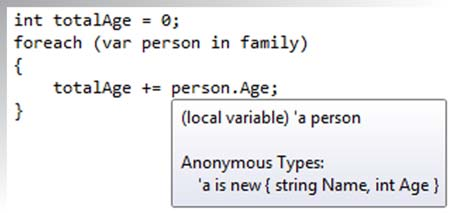
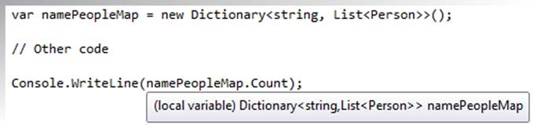

# Chapter 8: Cutting fluff with a smart compiler

> Source: C# in Depth, Third Edition — Jon Skeet. Original PDF pages 238–262.

[← Table of contents](../README.md)

<!-- PDF page 238 -->

## Cutting fluff

## with a smart compiler

This chapter covers
Automatically implemented properties
Implicitly typed local variables
Object and collection initializers
Implicitly typed arrays
Anonymous types
We’ll start looking at C# 3 in the same way that we finished looking at C# 2—with a
collection of relatively simple features. These are just the first small steps on the
path to LINQ. Each of them can be used outside that context, but almost all are
important for simplifying code to the extent that LINQ requires in order to be
effective.
One important point to note is that although two of the biggest features of
C# 2—generics and nullable types—required CLR changes, there were no signifi-
cant changes to the CLR that shipped with .NET 3.5. There were some tweaks, but
nothing fundamental. The framework grew to support LINQ, and a few more fea-
tures were introduced to the base class library, but that’s a different matter. It’s

<!-- PDF page 239 -->

Cutting fluff with a smart compiler
worth being clear in your mind which changes are only in the C# language, which are
library changes, and which are CLR changes.
Almost all of the new features exposed in C# 3 are due to the compiler being will-
ing to do more work for you. You saw some evidence of this in part of the book—par-
ticularly with anonymous methods and iterator blocks—and C# 3 continues in the
same vein. In this chapter, you’ll meet the following features that are new to C# 3:
Automatically implemented properties—Remove the drudgery of writing simple
properties backed directly by fields
Implicitly typed local variables—Reduce redundancy from local variable declara-
tions by inferring the variable type from the initial value
Object and collection initializers—Simplify the creation and initialization of objects
in single expressions
Implicitly typed arrays—Reduce redundancy from array-creation expressions by
inferring the array type from the contents
Anonymous types—Enable the creation of ad hoc types to contain simple
properties
In addition to describing what the new features do, I’ll make recommendations
about their use. Many of the features of C# 3 require a certain amount of discretion
and restraint on the part of the developer. That’s not to say they’re not powerful and
incredibly useful—quite the opposite—but the temptation to use the latest and
greatest funky syntax shouldn’t be allowed to overrule the drive toward clear and
readable code.
The considerations I’ll discuss in this chapter (and the rest of the book) will rarely
be black and white. Perhaps more than ever before, readability is in the eye of the
beholder, and as you become more comfortable with the new features, they’re likely
to become more readable to you. I should stress, though, that unless you have good
reason to suppose you’ll be the only one to ever read your code, you should consider
the needs and views of your colleagues carefully.
That’s enough navel gazing for the moment. We’ll start off with a feature that
shouldn’t cause any controversy. Simple but effective, automatically implemented
properties just make life better.
8.1
Automatically implemented properties
The first feature we’ll discuss is probably the simplest in the whole of C# 3. It’s even
simpler than any of the new features in C# 2. Despite that—or possibly because of
that—it’s also immediately applicable in many, many situations. When you read about
iterator blocks in chapter 6, you may not immediately have thought of any areas of
your current code base that could be improved by using them, but I’d be surprised to
find any nontrivial C# 2 program that couldn’t be modified to use automatically
implemented properties. This fabulously simple feature allows you to express trivial
properties with less code than before.

<!-- PDF page 240 -->

Automatically implemented properties

public string Name { get; set; }
...is compiled as...

private string <Name>k__BackingField;
public string Name
{
get { return <Name>k__BackingField; }
set { <Name>k__BackingField = value; }
}
Figure 8.1
Transformation of an
automatically implemented property
What do I mean by a trivial property? I mean one that’s read/write and that stores its
value in a straightforward private variable without any validation or other custom
code. Trivial properties only take a few lines of code, but that’s still a lot when you con-
sider that you’re expressing a very simple concept. C# 3 reduces the verbosity by
applying a simple compile-time transformation, as shown in figure 8.1.
The code at the bottom of figure 8.1 isn’t quite valid C#, of course. The field has an
unspeakable name to prevent naming collisions, in the same way as you’ve seen before
for anonymous methods and iterator blocks. But that’s effectively the code that’s gen-
erated by the automatically implemented property at the top.
Where previously you might have been tempted to use a public variable for the sake
of simplicity, there’s now even less excuse for not using a property instead. This is par-
ticularly true for throwaway code, which we all know tends to live far longer than
anticipated.
TERMINOLOGY: AUTOMATIC PROPERTY OR AUTOMATICALLY IMPLEMENTED
PROPERTY?
When automatically implemented properties were first dis-
cussed, long before the full C# 3 specification was published, they were
called automatic properties. Personally, I find this less of a mouthful than
the full name, and it’s more widely used in the community. There’s no
risk of ambiguity, so for the rest of this book, I’ll use automatic property and
automatically implemented property synonymously.
The feature of C# 2 that allows you to specify different access for the getter and the
setter is still available here, and you can also create static automatic properties. But
static automatic properties are almost always pointless. Although most types don’t
claim to have thread-safe instance members, publicly visible static members usually
should be thread-safe, and the compiler doesn’t do anything to help you in this
respect. The following listing gives an example of a safe, but useless, static automatic

<!-- PDF page 241 -->

Cutting fluff with a smart compiler
property that counts how many instances of a class have been created, along with
instance properties for the name and age of a person.
Listing 8.1
Counting instances awkwardly with a static automatic property
public class Person
{
public string Name { get; private set; }
public int Age { get; private set; }
Declares properties
with public getters
private static int InstanceCounter { get; set; }
private static readonly object counterLock = new object();
Declares private
static property
and lock
public InstanceCountingPerson(string name, int age)
{
Name = name;
Age = age;
lock (counterLock)
{
InstanceCounter++;
}
}
}
Uses lock for safe
property access
In this listing, you use a lock to make sure you don’t have threading problems, and
you’d also need to use the same lock whenever you accessed the property. There are
better alternatives here involving the Interlocked class, but they require access to
fields. In short, the only scenario in which I can see static automatic properties being
useful is where the getter is public, the setter is private, and the setter is only called
within the type initializer.
The other properties in listing 8.1, representing the name and age of the person,
tell a much happier tale—using automatic properties is a no-brainer here. Where you
have properties that you’d have implemented trivially in previous versions of C#,
there’s no benefit in not using automatic properties.1
One slight wrinkle occurs if you use automatic properties when writing your own
structs: all of your constructors need to explicitly call the parameterless constructor—
this()—so that the compiler knows that all the fields have been definitely assigned.
You can’t set the fields directly because they’re anonymous, and you can’t use the prop-
erties until all the fields have been set. The only way of proceeding is to call the param-
eterless constructor, which will set the fields to their default values. For example, if you
wanted to create a struct with a single integer property, this wouldn’t be valid:
public struct Foo
{
public int Value { get; private set; }
1 Certainly for read/write properties, anyway. If you’re creating a read-only property, you may choose to use a
read-only backing field and a property with just a getter to return it. This prevents you from accidentally writ-
ing to the property within the class, which would be possible with a “public read, private write” automatic
property.

<!-- PDF page 242 -->

Implicit typing of local variables
public Foo(int value)
{
this.Value = value;
}
}
But it’s fine if you explicitly chain to the parameterless constructor:
public struct Foo
{
public int Value { get; private set; }
public Foo(int value) : this()
{
this.Value = value;
}
}
That’s all there is to automatically implemented properties. There are no bells and
whistles to them. For instance, there’s no way of declaring them with initial default val-
ues, and no way of making them genuinely read-only (a private setter is as close as you
can get).
If all the C# 3 features were that simple, we could cover everything in a single chap-
ter. Of course, that’s not the case, but there are some features that don’t take too much
explanation. The next topic removes duplicate code in another common but specific
situation—declaring local variables.
8.2
Implicit typing of local variables
In chapter 2 we discussed the nature of the C# 1 type system. In particular, I stated
that it was static, explicit, and safe. That’s still true in C# 2, and in C# 3 it’s still almost
completely true. The static and safe parts are still true (ignoring explicitly unsafe
code, just as we did in chapter 2), and most of the time it’s still explicitly typed—but
you can ask the compiler to infer the types of local variables for you.2
8.2.1
Using var to declare a local variable
In order to use implicit typing, all you need to do is replace the type part of a normal
local variable declaration with var. Certain restrictions exist (we’ll come to those in a
moment), but essentially it’s as easy as changing this:
MyType variableName = someInitialValue;
to this:
var variableName = someInitialValue;
The results of the two lines (in terms of compiled code) are exactly the same, assuming
that the type of someInitialValue is MyType. The compiler simply takes the compile-
time type of the initialization expression and makes the variable have that type too.
2 C# 4 changes the game yet again, allowing you to use dynamic typing where you want to, as you’ll see in chap-
ter 14. One step at a time—C# was still fully statically typed up to and including version 3.

<!-- PDF page 243 -->

Cutting fluff with a smart compiler

Figure 8.2
Hovering over var in
Visual Studio displays the type of
the declared variable.
The type can be any normal .NET type, including generics, delegates, and interfaces.
The variable is still statically typed; you just haven’t written the name of the type in
your code.
This is important to understand, as it goes to the heart of what a lot of developers
initially fear when they see this feature—that var makes C# dynamic or weakly typed.
That’s not true at all. The best way of explaining this is to show you some invalid code:

INVALID
var stringVariable = "Hello, world.";
stringVariable = 0;
That doesn’t compile because the type of stringVariable is System.String, and you
can’t assign the value 0 to a string variable. In many dynamic languages, the code
would have compiled, leaving the variable with no particularly useful type as far as the
compiler, IDE, or runtime environment is concerned. Using var is not like using a
VARIANT type from COM or VB6. The variable is statically typed; the type has just been
inferred by the compiler. I apologize if I seem to be laboring this point somewhat, but
it’s incredibly important, and it’s been the cause of a lot of confusion.
In Visual Studio, you can tell which type the compiler has used for the variable by
hovering over the var part of the declaration, as shown in figure 8.2. Note how the
type parameters for the generic Dictionary type are also explained. If this looks
familiar, that’s because it’s exactly the same behavior you get when you declare local
variables explicitly.
Tooltips aren’t just available at the point of declaration, either. As you’d probably
expect, the tooltip displayed when you hover over the variable name later on in the
code indicates the type of the variable too. This is shown in figure 8.3, where the same
declaration is used and then I’ve hovered over a use of the variable. Again, that’s
exactly the same behavior as you’d see with a normal local variable declaration.

Figure 8.3
Hovering over the use of an implicitly typed local variable displays its type.

<!-- PDF page 244 -->

Implicit typing of local variables
There are two reasons for bringing up Visual Studio in this context. The first is that
it’s more evidence of the static typing involved—the compiler clearly knows the type
of the variable. The second is to point out that you can easily discover the type
involved, even from deep within a method. This’ll be important when we talk about
the pros and cons of using implicit typing in a minute. First, though, I ought to men-
tion some limitations.
8.2.2
Restrictions on implicit typing
You can’t use implicit typing for every variable in every case. You can only use it when
all of the following points are true:
The variable being declared is a local variable, rather than a static or instance
field.
The variable is initialized as part of the declaration.
The initialization expression isn’t a method group or anonymous function3
(without casting).
The initialization expression isn’t null.
Only one variable is declared in the statement.
The type you want the variable to have is the compile-time type of the initializa-
tion expression.
The initialization expression doesn’t involve the variable being declared.4
The third and fourth points are interesting. You can’t write this:

var starter = delegate() { Console.WriteLine(); };

INVALID
That’s because the compiler doesn’t know what type to use. You can write this:
var starter = (ThreadStart) delegate() { Console.WriteLine(); };
But if you’re going to do that, you’d be better off explicitly declaring the variable in
the first place. The same is true in the null case—you could cast the null appropri-
ately, but there’d be no point.
Note that you can use the result of method calls or properties as the initialization
expression—you’re not limited to constants and constructor calls. For instance, you
could use this:
var args = Environment.GetCommandLineArgs();
In that case, args would be of type string[]. In fact, initializing a variable with the
result of a method call is likely to be the most common situation where implicit typing
is used, as part of LINQ. You’ll see all that later on—just bear it in mind as the exam-
ples progress.
3 The term anonymous function covers both anonymous methods and lambda expressions, which we’ll delve into
in chapter 9.
4 It’d be highly unusual to do so anyway, but with normal declarations it’s possible if you try hard enough.

<!-- PDF page 245 -->

Cutting fluff with a smart compiler
It’s also worth noting that you are allowed to use implicit typing for the local vari-
ables declared in the first part of a using, for, or foreach statement. For example, the
following are all valid (with appropriate bodies, of course):
for (var i = 0; i < 10; i++)
using (var x = File.OpenText("test.dat"))
foreach (var s in Environment.GetCommandLineArgs())
These variables would end up with types of int, StreamReader, and string, respectively.
Of course, just because you can do this doesn’t mean you should. Let’s look at the
reasons for and against using implicit typing.
8.2.3
Pros and cons of implicit typing
The question of when it’s a good idea to use implicit typing is the cause of a lot of
community discussion. Views range from “everywhere” to “nowhere” with plenty of
more balanced approaches between the two. You’ll see in section 8.5 that in order to
use another of C# 3’s features—anonymous types—you often need to use implicit typ-
ing. You could avoid anonymous types as well, of course, but that’s throwing the baby
out with the bathwater.
The main reason for using implicit typing (leaving anonymous types aside for the
moment) is not that it reduces the number of keystrokes required to enter the code,
but that it makes the code less cluttered (and therefore more readable) on the screen.
In particular, when generics are involved, the type names can get very long. Figures
8.2 and 8.3 used a type of Dictionary<string, List<Person>>, which is 33 charac-
ters. By the time you have that twice on a line (once for the declaration and once for
the initialization), you end up with a massive line just for declaring and initializing a
single variable. An alternative is to use an alias, but that puts the real type involved a
long way (conceptually at least) from the code that uses it.
When reading the code, there’s no point in seeing the same long type name twice
on the same line when it’s obvious that they should be the same. If the declaration isn’t
visible on the screen, you’re in the same boat whether implicit typing was used or not
(all the ways you’d use to find out the variable type are still valid), and if it is visible,
the expression used to initialize the variable tells you the type anyway.
Additionally, using var changes the emphasis of the code. Sometimes you want the
reader to pay close attention to the precise types involved because they’re significant.
For example, even though the generic SortedList and SortedDictionary types have
similar APIs, they have different performance characteristics, and that may be impor-
tant for your particular piece of code. Other times, all you really care about is the
operations that are being performed; you wouldn’t really mind if the expression used
to initialize the variable changed, as long as you could achieve the same goals.5 Using
5 I realize this sounds a little like duck typing: “As long as it can quack, I’m happy.” The difference is that you’re
still checking quackability at compile time, not execution time.

<!-- PDF page 246 -->

Implicit typing of local variables
var allows the reader to focus on the use of a variable rather than the declaration—the
what rather than the how of the code.
All of this sounds good, so what are the arguments against implicit typing? Para-
doxically enough, readability is the most important one, despite also being an argu-
ment in favor of implicit typing! By not being explicit about what type of variable
you’re declaring, you may be making it harder to work it out when reading the code.
It breaks the “state what you’re declaring, then what value it’ll start off with” mindset
that keeps the declaration and the initialization separate. To what extent that’s an
issue depends on both the reader and the initialization expression involved.
If you’re explicitly calling a constructor, it’ll always be pretty obvious what type
you’re creating. If you’re calling a method or using a property, it depends on how
obvious the return type is when looking at the call. Integer literals are an example
where it’s harder to guess the type of an expression than you might suppose. How
quickly can you work out the type of each of the variables declared here?
var a = 2147483647;
var b = 2147483648;
var c = 4294967295;
var d = 4294967296;
var e = 9223372036854775807;
var f = 9223372036854775808;
The answers are int, uint, uint, long, long, and ulong, respectively—the type used
depends on the value of the expression. There’s nothing new here in terms of the
handling of literals—C# has always behaved like this—but implicit typing makes it eas-
ier to write obscure code in this case.
The argument that’s rarely explicitly stated but that I believe is behind a lot of the
concern over implicit typing is, “It just doesn’t feel right.” If you’ve been writing in a C-
like language for years and years, there’s something unnerving about the whole busi-
ness, however much you tell yourself that it’s still static typing under the covers. This
may not be a rational concern, but that doesn’t make it any less real. If you’re uncom-
fortable, you’re likely to be less productive. If the advantages don’t outweigh your neg-
ative feelings, that’s fine. Depending on your personality, you may try to push yourself
to become more comfortable with implicit typing, but you certainly don’t have to.
8.2.4
Recommendations
Here are some recommendations based on my experience with implicit typing. That’s
all they are—recommendations—and you should feel free to take them with a pinch
of salt:
If it’s important that someone reading the code knows the type of the variable
at a glance, use explicit typing.
If the variable is directly initialized with a constructor and the type name is long
(which often occurs with generics), consider using implicit typing.

<!-- PDF page 247 -->

Cutting fluff with a smart compiler
If the precise type of the variable isn’t important, but its general nature is clear
from the context, use implicit typing to de-emphasize how the code achieves its
aim and concentrate on the higher level of what it’s achieving.
Consult your teammates on the matter when embarking on a new project.
When in doubt, try a line both ways and go with your gut feelings.
I used to use explicit typing for production code, except in situations where there was
a clear and significant benefit to using implicit typing. Most of my uses of implicit typ-
ing were in test code (and throwaway code). Nowadays I’m more ambivalent and
frankly inconsistent. I’ll happily use implicit typing in production code just for a bit of
added simplicity, even when the type names involved aren’t too onerous. Although
consistency in some aspects of coding style is quite important, I haven’t found this
mix-and-match approach to cause any problems.
Effectively, my recommendation boils down to not using implicit typing just
because it saves a few keystrokes. Where it keeps the code tidier, allowing you to con-
centrate on the most important elements of the code, go for it. I’ll use implicit typing
extensively in the rest of the book, for the simple reason that code is harder to format
in print than on a screen—not as much width is available.
We’ll come back to implicit typing when we look at anonymous types, as they cre-
ate situations where you’re forced to ask the compiler to infer the types of some vari-
ables. Before that, let’s look at how C# 3 makes it easier to construct and populate a
new object in one expression.
8.3
Simplified initialization
One would’ve thought that object-oriented languages would’ve streamlined object
creation long ago. After all, before you start using an object, something has to create it,
whether it’s through your code directly or a factory method of some sort. Despite this,
few language features in C# 2 are geared toward making life easier when it comes to
initialization. If you can’t do what you want using constructor arguments, you’re basi-
cally out of luck—you need to create the object, and then manually initialize it with
property calls and the like.
This is particularly annoying when you want to create a whole bunch of objects in
one go, such as in an array or other collection. Without a single-expression way of ini-
tializing an object, you’re forced to either use local variables for temporary manipula-
tion or create a helper method that performs the appropriate initialization based on
parameters.
C# 3 comes to the rescue in a number of ways, as you’ll see in this section.
8.3.1
Defining some sample types
The expressions we’ll use in this section are called object initializers. These are just ways
of specifying initialization that should occur after an object has been created. You can
set properties, set properties of properties (don’t worry, it’s simpler than it sounds),
and add to collections that are accessible via properties.

<!-- PDF page 248 -->

Simplified initialization
To demonstrate all this, we’ll use a Person class again. It has the name and age
we’ve used before, exposed as writable properties. We’ll provide both a parameterless
constructor and one that accepts the name as a parameter. We’ll also add a list of
friends and the person’s home location, both of which are accessible as read-only
properties but can still be modified by manipulating the retrieved objects. A simple
Location class provides Country and Town properties to represent the person’s home.
The following listing shows the complete code for the classes.
Listing 8.2
A fairly simple Person class used for further demonstrations
public class Person
{
public int Age { get; set; }
public string Name { get; set; }
List<Person> friends = new List<Person>();
public List<Person> Friends { get { return friends; } }
Location home = new Location();
public Location Home { get { return home; } }
public Person() { }
public Person(string name)
{
Name = name;
}
}
public class Location
{
public string Country { get; set; }
public string Town { get; set; }
}
Listing 8.2 is straightforward, but it’s worth noting that both the list of friends and the
home location are created in a blank way when the person is created, rather than
being left as null references. The friends and home location properties are read-only,
too. That’ll be important later on—but for the moment let’s look at the properties
representing the name and age of a person.
8.3.2
Setting simple properties
Now that you have a Person type, it’s time to create some instances of it using the new
features of C# 3. In this section, we’ll look at setting the Name and Age properties—
we’ll come to the others later.
Object initializers are most commonly used to set properties, but everything shown
here also applies to fields. In a well-encapsulated system, though, you’re unlikely to
have access to fields unless you’re creating an instance of a type within that type’s own
code. It’s worth knowing that you can use fields, of course—so for the rest of the sec-
tion, just read property and field whenever the text says property.

<!-- PDF page 249 -->

Cutting fluff with a smart compiler
With that out of the way, let’s get down to business. Suppose you want to create a
person called Tom, who is 9 years old. Prior to C# 3, there were two ways this could be
achieved:
Person tom1 = new Person();
tom1.Name = "Tom";
tom1.Age = 9;
Person tom2 = new Person("Tom");
tom2.Age = 9;
The first version uses the parameterless constructor and then sets both properties.
The second version uses the constructor overload, which sets the name, and then sets
the age afterward. Both of these options are still available in C# 3, but there are other
alternatives:
Person tom3 = new Person() { Name = "Tom", Age = 9 };
Person tom4 = new Person { Name = "Tom", Age = 9 };
Person tom5 = new Person("Tom") { Age = 9 };
The part in braces at the end of each line is the object initializer. Again, it’s just com-
piler trickery. The IL used to initialize tom3 and tom4 is identical, and is nearly the
same as that used for tom1.6 Predictably, the code for tom5 is nearly the same as for
tom2. Note how the initialization of tom4 omits the parentheses for the constructor.
You can use this shorthand for types with a parameterless constructor, which is what
gets called in the compiled code.
After the constructor has been called, the specified properties are set in the obvi-
ous way. They’re set in the order specified in the object initializer, and you can only
specify a particular property once—you can’t set the Name property twice, for example.
(You could call the constructor taking the name as a parameter, and then set the Name
property. It would be pointless, but the compiler wouldn’t stop you from doing it.)
The expression used as the value for a property can be any expression that isn’t itself
an assignment—you can call methods, create new objects (potentially using another
object initializer), pretty much anything.
You may be wondering just how useful this is—you’ve saved one or two lines of
code, but surely that’s not a good enough reason to make the language more compli-
cated, is it? There’s a subtle point here, though: you haven’t just created an object in
one line—you’ve created it in one expression. That difference can be very important.
Suppose you want to create an array of type Person[] with some predefined data
in it. Even without using the implicit array typing you’ll see later, the code is neat and
readable:
6 In fact, tom1’s new value isn’t assigned until all the properties have been set. A temporary local variable is
used until then. This is rarely important but worth knowing to avoid confusion if you happen to break into
the debugger halfway through the initializer.

<!-- PDF page 250 -->

Simplified initialization
Person[] family = new Person[]
{
new Person { Name = "Holly", Age = 36 },
new Person { Name = "Jon", Age = 36 },
new Person { Name = "Tom", Age = 9 },
new Person { Name = "William", Age = 6 },
new Person { Name = "Robin", Age = 6 }
};
In a simple example like this, you could’ve written a constructor taking both the name
and age as parameters and initialized the array in a similar way in C# 1 or 2. But appro-
priate constructors aren’t always available, and if there are several constructor param-
eters, it’s often not clear which one means what, just from the position. By the time a
constructor needs to take five or six parameters, I often find myself relying on Intelli-
Sense more than I want to. Using the property names is a great boon to readability in
such cases.7
This form of object initializer is the one you’ll probably use most often. But there
are two other forms—one for setting subproperties, and one for adding to collections.
Let’s look at subproperties—properties of properties—first.
8.3.3
Setting properties on embedded objects
So far it’s been easy to set the Name and Age properties, but you can’t set the Home
property in the same way—it’s read-only. You can set the town and the country of a
person, though, by first fetching the Home property and then setting properties on the
result. The language specification refers to this as setting the properties of an embedded
object.
Just to make it clear, what we’re talking about is the following C# 1 code:
Person tom = new Person("Tom");
tom.Age = 9;
tom.Home.Country = "UK";
tom.Home.Town = "Reading";
When you’re populating the home location, each statement is doing a get to retrieve
the Location instance, and then a set on the relevant property on that instance.
There’s nothing new in that, but it’s worth slowing your mind down to look at it care-
fully; otherwise it’s easy to miss what’s going on behind the scenes.
C# 3 allows all of this to be done in one expression, as shown here:
Person tom = new Person("Tom")
{
Age = 9,
Home = { Country = "UK", Town = "Reading" }
};
7 C# 4 provides an alternative approach here using named arguments, which you’ll meet in chapter 13.

<!-- PDF page 251 -->

Cutting fluff with a smart compiler
The compiled code for these snippets is effectively the same. The compiler spots that
to the right side of the = sign is another object initializer, and it applies the properties
to the embedded object appropriately.
The absence of the new keyword in the part initializing Home is significant. If you
need to work out where the compiler is going to create new objects and where it’s
going to set properties on existing ones, look for occurrences of new in the initializer.
Every time a new object is created, the new keyword appears somewhere.
FORMATTING OBJECT INITIALIZER CODE
As with almost all C# features, object
initializers are whitespace-independent. You can collapse the whitespace in
the object initializer, putting it all on one line if you like. It’s up to you to
work out where the sweet spot is in balancing long lines against lots of lines.
We’ve dealt with the Home property, but what about Tom’s friends? There are proper-
ties you can set on a List<Person>, but none of them will add entries to the list. It’s
time for the next feature—collection initializers.
8.3.4
Collection initializers
Creating a collection with some initial values is an extremely common task. Until C# 3
arrived, the only language feature that gave any assistance was array creation, and
even that was clumsy in many situations. C# 3 has collection initializers, which allow you
to use the same type of syntax as array initializers but with arbitrary collections and
with more flexibility.
CREATING NEW COLLECTIONS WITH COLLECTION INITIALIZERS
As a first example, let’s use the now-familiar List<T> type. In C# 2, you could populate
a list either by passing in an existing collection or by calling Add repeatedly after creat-
ing an empty list. Collection initializers in C# 3 take the latter approach.
Suppose we want to populate a list of strings with some names—here’s the C# 2
code (on the left) and the close equivalent in C# 3 (on the right):
List<string> names = new List<string>();
names.Add("Holly");
names.Add("Jon");
names.Add("Tom");
names.Add("Robin");
names.Add("William");
var names = new List<string>
{
"Holly", "Jon", "Tom",
"Robin", "William"
};
Just as with object initializers, you can specify constructor arguments if you want, or
use a parameterless constructor either explicitly or implicitly. The use of implicit typ-
ing here was partly for space reasons—the names variable could equally well have been
declared explicitly. Reducing the number of lines of code (without reducing readabil-
ity) is nice, but there are two bigger benefits of collection initializers:
The create-and-initialize part counts as a single expression.
There’s a lot less clutter in the code.

<!-- PDF page 252 -->

Simplified initialization
The first point becomes important when you want to use a collection as either an
argument to a method or as one element in a larger collection. That happens relatively
rarely (although often enough to still be useful). The second point is the real reason
this is a killer feature in my view. If you look at the code on the right, you can easily see
the information you need, with each piece of information written only once. The vari-
able name occurs once, the type being used occurs once, and each of the elements of
the initialized collection appears once. It’s all extremely simple, and much clearer
than the C# 2 code, which contains a lot of fluff around the useful bits.
Collection initializers aren’t limited to just lists. You can use them with any type
that implements IEnumerable, as long as it has an appropriate Add method for each
element in the initializer. You can use an Add method with more than one parameter
by putting the values within another set of braces. The most common use for this is
creating dictionaries. For example, if you wanted a dictionary mapping names to ages,
you could use the following code:
Dictionary<string,int> nameAgeMap = new Dictionary<string,int>
{
{ "Holly", 36 },
{ "Jon", 36 },
{ "Tom", 9 }
};
In this case, the Add(string, int) method would be called three times. If multiple
Add methods are available, different elements of the initializer can call different over-
loads. If no compatible overload is available for a specified element, the code will fail
to compile. There are two interesting points about the design decision here:
The fact that the type has to implement IEnumerable is never used by the
compiler.
The Add method is only found by name—there’s no interface requirement
specifying it.
These are both pragmatic decisions. Requiring IEnumerable to be implemented is a
reasonable attempt to check that the type really is a collection of some sort, and using
any accessible overload of the Add method (rather than requiring an exact signature)
allows for simple initializations, such as the earlier dictionary example.
An early draft of the C# 3 specification required ICollection<T> to be imple-
mented instead, and the implementation of the single-parameter Add method (as
specified by the interface) was called rather than allowing different overloads. This
sounds more pure, but there are far more types that implement IEnumerable than
ICollection<T>, and using the single-parameter Add method would be inconvenient.
For example, in this case it would’ve forced you to explicitly create an instance of a
KeyValuePair<string,int> for each element of the initializer. Sacrificing a bit of aca-
demic purity has made the language far more useful in real life.

<!-- PDF page 253 -->

Cutting fluff with a smart compiler
POPULATING COLLECTIONS WITHIN OTHER OBJECT INITIALIZERS
So far we’ve only looked at collection initializers used in a standalone fashion to cre-
ate whole new collections. They can also be combined with object initializers to popu-
late embedded collections. To demonstrate this, we’ll go back to the Person example.
The Friends property is read-only, so you can’t create a new collection and specify
that as the collection of friends, but you can add to whatever collection is returned by
the property’s getter. The way you do this is similar to the syntax you’ve already seen
for setting properties of embedded objects, but you just specify a collection initializer
instead of a sequence of properties.
Let’s see this in action by creating another Person instance for Tom, this time with
some of his friends.
Listing 8.3
Building up a rich object using object and collection initializers
Person tom = new Person
{
Name = "Tom",
Age = 9,
Home = { Town = "Reading", Country = "UK" },
Friends =
{
new Person { Name = "Alberto" },
new Person("Max"),
new Person { Name = "Zak", Age = 7 },
new Person("Ben"),
new Person("Alice"),
{
Age = 9,
Home = { Town = "Twyford", Country = "UK" }
}
}
};
Implicitly calls
parameterless
constructor
Sets
properties
directly
Initializes embedded object
Initializes collection
with further object
initializers
Listing 8.3 uses all the features of object and collection initializers we’ve come across.
The main part of interest is the collection initializer, which itself uses lots of different
forms of object initializers internally. Note that you’re not creating a new collection
here, just adding to an existing one. (If the property had a setter, you could create a
new collection and still use collection initializer syntax.)
You could’ve gone further, specifying friends of friends, friends of friends of
friends, and so forth. But you couldn’t specify that Tom is Alberto’s friend. While
you’re still initializing an object, you don’t have access to it, so you can’t express cyclic
relationships. This can be awkward in a few cases, but it usually isn’t a problem.
Collection initialization within object initializers works as a sort of cross between
standalone collection initializers and setting embedded object properties. For each
element in the collection initializer, the collection property getter (Friends, in this
case) is called, and then the appropriate Add method is called on the returned value.
The collection isn’t cleared in any way before elements are added. For example, if you
were to decide that a person should always be his own friend, and added this to the

<!-- PDF page 254 -->

Simplified initialization
list of friends within the Person constructor, using a collection initializer would only
add extra friends.
As you can see, the combination of collection and object initializers can be used to
populate whole trees of objects. But when and where is this likely to actually happen?
8.3.5
Uses of initialization features
Trying to pin down exactly where these features are useful is reminiscent of being in a
Monty Python sketch about the Spanish Inquisition—every time you think you have a
reasonably complete list, another common example pops up. I’ll just mention three
examples, which I hope will encourage you to consider where else you might use them.
CONSTANT COLLECTIONS
It’s not uncommon for me to want some kind of collection (often a map) that’s effec-
tively constant. Of course, it can’t be a constant as far as the C# language is concerned,
but it can be declared static and read-only, with big warnings to say that it shouldn’t be
changed. (It’s usually private, so that’s good enough. Alternatively, you can use Read-
OnlyCollection<T>.) Typically, this used to involve writing a static constructor or a
helper method, just to populate the map. With C# 3’s collection initializers, it’s easy to
set the whole thing up inline.
SETTING UP UNIT TESTS
When writing unit tests, I frequently want to populate an object just for one test, often
passing it in as an argument to the method I’m trying to test at the time. Writing all of
the initialization longhand can be long-winded and also hides the essential structure
of the object from the reader of the code, just as XML creation code can often obscure
what the document would look like if you viewed it (appropriately formatted) in a text
editor. With appropriate indentation of object initializers, the nested structure of the
object hierarchy can become obvious in the very shape of the code, as well as make
the values stand out more than they would otherwise.
THE BUILDER PATTERN
For various reasons, sometimes you want to specify a lot of values for a single method
or constructor call. The most common situation in my experience is creating an
immutable object. Instead of having a huge set of parameters (which can become a
readability problem as the meaning of each argument becomes unclear8), you can use
the builder pattern—create a mutable type with appropriate properties, and then pass
an instance of the builder into the constructor or method. The framework Process-
StartInfo type is a good example of this—the designers could have overloaded
Process.Start with many different sets of parameters, but using ProcessStartInfo
makes everything clearer.
Object and collection initializers allow you to create the builder object in a clearer
manner—you can even specify it inline when you call the original member if you
want. Admittedly, you still have to write the builder type in the first place, but auto-
matic properties help on that front.
8 Named arguments in C# 4 help in this area, admittedly.

<!-- PDF page 255 -->

Cutting fluff with a smart compiler
<INSERT YOUR FAVORITE USE HERE>
Of course, there are uses beyond these three in ordinary code, and I don’t want to put
you off using the new features elsewhere. There’s little reason not to use them, other
than possibly confusing developers who aren’t familiar with C# 3 yet. You may decide
that using an object initializer just to set one property (as opposed to explicitly setting
it in a separate statement) is over the top—that’s a matter of aesthetics, and I can’t give
you much objective guidance there. As with implicit typing, it’s a good idea to try the
code both ways, and learn to predict your own (and your team’s) reading preferences.
So far we’ve looked at a fairly diverse range of features: implementing properties
easily, simplifying local variable declarations, and populating objects in single expres-
sions. In the remainder of this chapter, we’ll gradually bring these topics together,
using more implicit typing and more object population, and creating whole types with-
out giving any implementation details.
The next topic appears to be quite similar to collection initializers when you look
at code using it. I mentioned earlier that array initialization was a bit clumsy in C# 1
and 2. I’m sure it won’t surprise you to learn that it’s been streamlined for C# 3. Let’s
take a look.
8.4
Implicitly typed arrays
In C# 1 and 2, initializing an array as part of a variable declaration and initialization
statement was quite neat, but if you wanted to do it anywhere else, you had to specify
the exact array type involved. For example, this compiles without any problem:
string[] names = {"Holly", "Jon", "Tom", "Robin", "William"};
This doesn’t work for parameters, though—suppose you wanted to make a call to
MyMethod, declared as void MyMethod(string[] names). This code won’t work:

MyMethod({"Holly", "Jon", "Tom", "Robin", "William"});

INVALID
Instead, you have to tell the compiler what type of array you want to initialize:
MyMethod(new string[] {"Holly", "Jon", "Tom", "Robin", "William"});
C# 3 allows something in between:
MyMethod(new[] {"Holly", "Jon", "Tom", "Robin", "William"});
Clearly the compiler needs to work out what type of array to use. It starts by forming a
set containing all the compile-time types of the expressions inside the braces. If
there’s exactly one type in that set that all the others can be implicitly converted to,
that’s the type of the array. Otherwise (or if all the values are typeless expressions,
such as constant null values or anonymous methods, with no casts) the code won’t
compile.
Note that only the types of the expressions are considered as candidates for the
overall array type. This means that occasionally you might have to explicitly cast a
value to a less-specific type. For instance, this won’t compile:

INVALID

new[] { new MemoryStream(), new StringWriter() }

<!-- PDF page 256 -->

Anonymous types
There’s no conversion from MemoryStream to StringWriter or vice versa. Both are
implicitly convertible to object and IDisposable, but the compiler only considers
types that are in the original set produced by the expressions themselves. If you
change one of the expressions in this situation so that its type is either object or
IDisposable, the code compiles:
new[] { (IDisposable) new MemoryStream(), new StringWriter() }
The type of this last expression is implicitly IDisposable[]. Of course, at that point
you might as well explicitly state the type of the array just as you would in C# 1 and 2,
to make it clearer what you’re trying to achieve.
Compared with the earlier features, implicitly typed arrays are a bit of an anticli-
max. I find it hard to get excited about them, even though they do make life simpler in
cases where an array is passed as an argument. The designers haven’t gone mad,
though—there’s one important situation in which this implicit typing is absolutely
crucial. That’s when you don’t know (and can’t know) the name of the type of the ele-
ments of the array. How can you possibly get into this peculiar state? Read on…
8.5
Anonymous types
Implicit typing, object and collection initializers, and implicit array typing are all use-
ful in their own right, to a greater or lesser extent. But they also serve a higher pur-
pose—they make it possible to work with this chapter’s final feature, anonymous types.
In turn, anonymous types serve the higher purpose of LINQ.
8.5.1
First encounters of the anonymous kind
It’s much easier to explain anonymous types when you already have some idea of what
they are through an example. I’m sorry to say that without the use of extension meth-
ods and lambda expressions, the examples in this section are likely to be a little con-
trived, but there’s a chicken-and-egg situation here: anonymous types are most useful
within the context of the more advanced features, but we need to cover the building
blocks before we can look at much of the bigger picture. Stick with it—it will make
sense in the long run, I promise.
Let’s pretend we didn’t have the Person class, and the only properties we cared
about were the name and age. The following listing shows how you could still build
objects with those properties, without ever declaring a type.
Listing 8.4
Creating objects of an anonymous type with Name and Age properties
var tom= new { Name = "Tom", Age = 9 };
var holly = new { Name = "Holly", Age = 36 };
var jon = new { Name = "Jon", Age = 36 } ;
Console.WriteLine("{0} is {1} years old", jon.Name, jon.Age);
As you can tell from listing 8.4, the syntax for initializing an anonymous type is similar
to the object initializers you saw in section 8.3.2—it’s just that the name of the type is

<!-- PDF page 257 -->

Cutting fluff with a smart compiler
missing between new and the opening brace. Here you’re using implicitly typed local
variables because that’s all you can use (other than object of course)—you don’t have
a type name to declare the variable with. As you can see from the last line, the type has
properties for Name and Age, both of which can be read and which will have the values
specified in the anonymous object initializer used to create the instance, so in this case
the output is Jon is 36 years old. The properties have the same types as the expres-
sions in the initializers—string for Name and int for Age. Just as in normal object ini-
tializers, the expressions used in anonymous object initializers can call methods or
constructors, fetch properties, perform calculations—whatever you need to do.
You might now be starting to see why implicitly typed arrays are important. Sup-
pose you want to create an array containing the whole family, and then iterate
through it to work out the total age.9 The following listing does just that, and it dem-
onstrates a few other interesting features of anonymous types at the same time.
Listing 8.5
Populating an array using anonymous types and then finding the total age
var family = new[]
{
new { Name = "Holly", Age = 36 },
new { Name = "Jon", Age = 36 },
new { Name = "Tom", Age = 9 },
new { Name = "Robin", Age = 6 },
new { Name = "William", Age = 6 }
};
Uses an implicitly typed
array initializer
B
Uses same
anonymous type
five times
C
Uses implicit
typing for person
D
int totalAge = 0;
foreach (var person in family)
{
totalAge += person.Age;
}
Console.WriteLine("Total age: {0}", totalAge);
Sums ages
E
Putting together listing 8.5 and what you learned about implicitly typed arrays in sec-
tion 8.4, you can deduce something important: all the people in the family are of the same
type. If each use of an anonymous object initializer C referred to a different type, the
compiler couldn’t infer an appropriate type for the array B. Within any given assem-
bly, the compiler treats two anonymous object initializers as the same type if there are
the same number of properties, with the same names and types in the same order. In
other words, if you swapped the Name and Age properties in one of the initializers,
there’d be two different types involved; likewise, if you introduced an extra property
in one line, or used a long instead of an int for the age of one person, another anon-
ymous type would’ve been introduced. At that point, the type inference for the array
would fail.
9 If you already know LINQ, you may feel that this is a quaint way of summing the ages. I agree, calling
family.Sum(p => p.Age) would be a lot neater—but let’s take things one step at a time.

<!-- PDF page 258 -->

Anonymous types

Figure 8.4
Hovering over a
variable that’s declared
(implicitly) to be of an anonymous
type shows the details of that
anonymous type.
IMPLEMENTATION DETAIL: HOW MANY TYPES?
If you ever decide to look at the
IL (or decompiled C#) for an anonymous type generated by Microsoft’s com-
piler, be aware that although two anonymous object initializers with the same
property names in the same order but using different property types will pro-
duce two different types, they’ll actually be generated from a single generic
type. The generic type is parameterized, but the closed, constructed types will
be different because they’ll be given different type arguments for the differ-
ent initializers.
Notice that you can use a foreach statement to iterate over the array, just as you would
any other collection. The type involved is inferred D, and the type of the person vari-
able is the same anonymous type you used in the array. Again, you can use the same
variable for different instances because they’re all of the same type.
Listing 8.5 also proves that the Age property really is strongly typed as an int—
otherwise trying to sum the ages E wouldn’t compile. The compiler knows about the
anonymous type, and Visual Studio is even willing to share the information via tool-
tips, in case you’re uncertain. Figure 8.4 shows the result of hovering over the person
part of the person.Age expression from listing 8.5.
Now that you’ve seen anonymous types in action, let’s go back and look at what the
compiler is actually doing.
8.5.2
Members of anonymous types
Anonymous types are created by the compiler and included in the compiled assembly
in the same way as the extra types for anonymous methods and iterator blocks. The
CLR treats them as perfectly ordinary types, and so they are—if you later move from
an anonymous type to a normal, manually coded type with the behavior described in
this section, you shouldn’t see anything change.
Anonymous types contain the following members:
A constructor taking all the initialization values. The parameters are in the
same order as they were specified in the anonymous object initializer, and they
have the same names and types.
Public read-only properties.
Private read-only fields backing the properties.
Overrides for Equals, GetHashCode, and ToString.

<!-- PDF page 259 -->

Cutting fluff with a smart compiler
That’s it. There are no implemented interfaces, no cloning or serialization capabili-
ties—just a constructor, some properties, and the normal methods from object.
The constructor and the properties do the obvious things. Equality between two
instances of the same anonymous type is determined in the natural manner, compar-
ing each property value in turn using the property type’s Equals method. The hash
code generation is similar, calling GetHashCode on each property value in turn and
combining the results. The exact method for combining the various hash codes
together to form one composite hash is unspecified, and you shouldn’t write code
that depends on it anyway—you just need to be confident that two equal instances will
return the same hash, and two unequal instances will usually return different hashes.
All of this only works if the Equals and GetHashCode implementations of all the differ-
ent types involved as properties conform to the normal rules, of course.
Because the properties are read-only, all anonymous types are immutable as long
as the types used for their properties are immutable. This provides you with all the
normal benefits of immutability—being able to pass values to methods without fear of
them changing, simple sharing of data across threads, and so forth.
VB ANONYMOUS TYPE PROPERTIES ARE MUTABLE BY DEFAULT
Anonymous types
are also available in Visual Basic 9 onward. But, by default, their properties
are mutable; you need to declare any properties you want to be immutable
with the Key modifier. Only properties declared as keys are used in hashing
and equality comparisons. This is easy to overlook when converting code
from one language to another.
We’re almost done with anonymous types now. But there’s one slight wrinkle still to
talk about—a shortcut for a situation that’s fairly common in LINQ.
8.5.3
Projection initializers
The anonymous object initializers you’ve seen so far have all been lists of name/value
pairs—Name="Jon", Age=36 and the like. As it happens, I’ve always used constants
because they make for smaller examples, but in real code you often want to copy prop-
erties from an existing object. Sometimes you’ll want to manipulate the values in some
way, but often a straight copy is enough.
Again, without LINQ it’s hard to give convincing examples of this, but let’s go back
to our Person class and suppose we had a good reason to want to convert a collection of
Person instances into a similar collection where each element has just a name and a
flag to say whether that person is an adult. Given an appropriate person variable, you
could use something like this:
new { Name = person.Name, IsAdult = (person.Age >= 18) }
That works, and for just a single property the syntax for setting the name (the part in
bold) isn’t too clumsy, but if you were copying several properties it would get tiresome.
C# 3 provides a shortcut: if you don’t specify the property name, but just the
expression to evaluate for the value, it’ll use the last part of the expression as the

<!-- PDF page 260 -->

Anonymous types
name, provided it’s a simple field or property. This is called a projection initializer. It
means you can rewrite the previous code as follows:
new { person.Name, IsAdult = (person.Age >= 18) }
It’s common for all the bits of an anonymous object initializer to be projection initial-
izers—it typically happens when you’re taking some properties from one object and
some properties from another, often as part of a join operation. Anyway, I’m getting
ahead of myself.
The following listing shows the previous code in action, using the List<T>
.ConvertAll method and an anonymous method.
Listing 8.6
Transformation from Person to a name and adulthood flag
List<Person> family = new List<Person>
{
new Person { Name = "Holly", Age = 36 },
new Person { Name = "Jon", Age = 36 },
new Person { Name = "Tom", Age = 9 },
new Person { Name = "Robin", Age = 6 },
new Person { Name = "William", Age = 6 }
};
var converted = family.ConvertAll(delegate(Person person)
{ return new { person.Name, IsAdult = (person.Age >= 18) }; }
);
foreach (var person in converted)
{
Console.WriteLine("{0} is an adult? {1}",
person.Name, person.IsAdult);
}
In addition to the use of a projection initializer for the Name property, listing 8.6 shows
the value of delegate type inference and anonymous methods. Without them, you
couldn’t have retained the strong typing of converted, because you wouldn’t have
been able to specify what the TOutput type parameter of Converter should be. As it is,
you can iterate through the new list and access the Name and IsAdult properties as if
you were using any other type.
Don’t spend too long thinking about projection initializers at this point—the
important thing is to be aware that they exist so you won’t get confused when you see
them later. In fact, that advice applies to this entire section on anonymous types, so
without going into details, let’s look at why they’re present at all.
8.5.4
What’s the point?
I hope you’re not feeling cheated at this point, but I sympathize if you are. Anony-
mous types are a fairly complex solution to a problem we haven’t really encountered
yet. But I bet you have seen part of the problem before, really.
If you’ve ever done any real-life work involving databases, you’ll know that you
don’t always want all of the data that’s available on all the rows that match your query

<!-- PDF page 261 -->

Cutting fluff with a smart compiler
criteria. Often it’s not a problem to fetch more than you need, but if you only need 2
columns out of the 50 in the table, you wouldn’t bother to select all 50, would you?
The same problem occurs in nondatabase code. Suppose you have a class that
reads a log file and produces a sequence of log lines with many fields. Keeping all of
the information might be far too memory-intensive if you only care about a couple of
fields from the log. LINQ lets you filter that information easily.
But what’s the result of that filtering? How can you keep some data and discard the
rest? How can you easily keep some derived data that isn’t directly represented in the
original form? How can you combine pieces of data that may not initially have been
consciously associated, or that may only have a relationship in a particular situation?
Effectively, you want a new data type, but manually creating such a type in every situa-
tion is tedious, particularly when you have tools such as LINQ available that make the
rest of the process so simple. Figure 8.5 shows the three elements that make anony-
mous types a powerful feature.
If you find yourself creating a type that’s only used in a single method, and that
only contains fields and trivial properties, consider whether an anonymous type would
be appropriate. I suspect that usually, when you find yourself leaning toward anony-
mous types, you could also use LINQ to help you.
If you find yourself using the same sequence of properties for the same purpose in
several places, though, you might want to consider creating a normal type for the pur-
pose, even if it still just contains trivial properties. Anonymous types naturally infect
whatever code they’re used in with implicit typing, which is often fine, but can be a
nuisance at other times. In particular, it means you can’t easily create a method to
return an instance of that type in a strongly typed way. As with the previous features,
use anonymous types when they genuinely make the code simpler to work with, not
just because they’re new and cool.

Avoiding excessive
dat accumulation
A
A
A
dat accumulation
Avoiding excessive
data accumulation

voiding excessive

Anonymous
types
Anonymous
types
Anonymous

types

Figure 8.5
Anonymous types allow you to
keep just the data you need for a particular
situation, in a form that’s tailored to that
situation, without the tedium of writing a
fresh type each time.

Tailoring data
encapsulation to
one situation
Tailoring data
encapsulation to
one situation

Tailoring data

Avoiding manual
“turn the handle”
coding
Avoiding manual
Avoiding manual
turn-the-handle
coding

encapsulation to

“
turn the handle”
coding

one situation

<!-- PDF page 262 -->

Summary
8.6
Summary
What a seemingly mixed bag of features! You’ve seen four features that are quite simi-
lar, at least in syntax: object initializers, collection initializers, implicitly typed arrays,
and anonymous types. The other two features—automatic properties and implicitly
typed local variables—are somewhat different. Likewise, most of the features would’ve
been useful individually in C# 2, whereas implicitly typed arrays and anonymous types
only pay back the cost of learning about them when the rest of the C# 3 features are
brought into play.
So what do these features really have in common? They all relieve the developer of
tedious coding. I’m sure you don’t enjoy writing trivial properties any more than I do, or
setting several properties, one at a time, using a local variable—particularly when
you’re trying to build up a collection of similar objects. Not only do the new features
of C# 3 make it easier to write the code, they also make it easier to read it, at least when
they’re applied sensibly.
In the next chapter, we’ll look at a major new language feature, along with a frame-
work feature it provides direct support for. If you thought anonymous methods made
creating delegates easy, just wait until you see lambda expressions.
