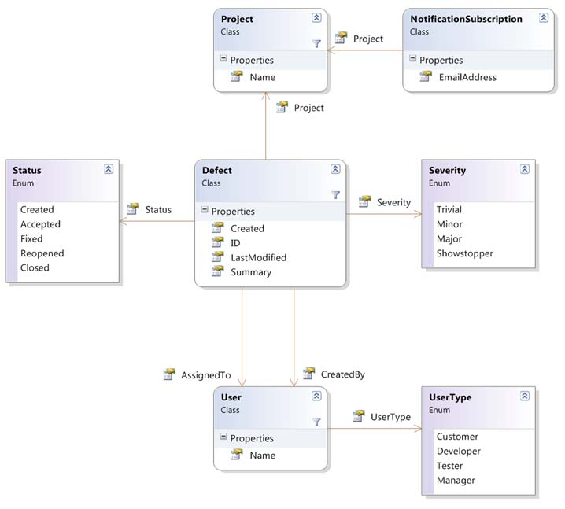

# Chapter 11: Query expressions and LINQ to Objects

> Source: C# in Depth, Third Edition — Jon Skeet. Original PDF pages 316–358.

[← Table of contents](../README.md)

<!-- PDF page 316 -->

## Query expressions

## and LINQ to Objects

This chapter covers
Streaming sequences of data and deferred execution
Standard query operators and query expression
translation
Range variables and transparent identifiers
Projecting, filtering, and sorting
Joining and grouping
Choosing which syntax to use
You may be tired of all the hyperbole around LINQ by now. You’ve already seen
some examples in the book, and you’ve almost certainly read a lot about it on the
web. This is where we separate myth from reality:

LINQ doesn’t turn the most complicated query into a one-liner.

LINQ doesn’t mean you never need to look at raw SQL again.

LINQ doesn’t magically imbue you with architectural genius.

<!-- PDF page 317 -->

Query expressions and LINQ to Objects
Given all that, LINQ is still the best way of expressing queries that I’ve seen within an
object-oriented environment. It’s not a silver bullet, but it’s a very powerful tool to
have in your development armory. We’ll explore two distinct aspects of LINQ: the
framework support and the compiler translation of query expressions. The latter can
look odd to start with, but I’m sure you’ll learn to love them.
Query expressions are effectively preprocessed by the compiler into “normal”
C# 3, which is then compiled in an ordinary way. This is a neat way of integrating que-
ries into the language without changing the specification in more than one small sec-
tion. Most of this chapter is a list of the preprocessing translations performed by the
compiler, as well as the effects achieved when the result uses the Enumerable exten-
sion methods.
You won’t see any SQL or XML here—that awaits you in chapter 12. But with this
LINQ providers do when you meet them. Call me a spoilsport, but I want to take away
some of their magic. Even without the air of mystery, LINQ is still very cool.
First let’s consider the basis of LINQ, and how we’ll go about exploring it.
11.1
Introducing LINQ
With a topic as large as LINQ, you need a certain amount of background before you’re
ready to see it in action. In this section we’ll look at a few of the core principles behind
LINQ and at the data model we’ll use for the examples in this chapter and the next. I
know you’re likely to be itching to get into the code, so I’ll keep this fairly brief.
11.1.1 Fundamental concepts in LINQ
One of the problems with reducing the impedance mismatch between two data mod-
els is that it usually involves creating yet another model to act as the bridge. This sec-
tion describes the LINQ model, beginning with its most important aspect: sequences.
SEQUENCES
You’re already familiar with the concept of a sequence: it’s encapsulated by the
IEnumerable and IEnumerable<T> interfaces, and we looked at those fairly closely in
fetch them one at a time until either you’re no longer interested or the sequence runs
out of data.
The key difference between a sequence and other collection data structures, such
as lists and arrays, is that when you’re reading from a sequence, you don’t generally
know how many more items are waiting, and you don’t have access to arbitrary
items—just the current one. Indeed, some sequences could be never-ending; you
could easily have an infinite sequence of random numbers, for example. Lists and
arrays can act as sequences, just as List<T> implements IEnumerable<T>, but the
reverse isn’t always true. You can’t have an infinite array or list, for example.
Sequences are LINQ’s bread and butter. When you read a query expression, you
should think about the sequences involved; there’s always at least one sequence to

<!-- PDF page 318 -->

Introducing LINQ
start with, and it’s usually transformed into other sequences along the way, possibly
being joined with yet more sequences. LINQ query examples on the web frequently
have little explanation, but when you take them apart by looking at each sequence in
turn, things make a lot more sense. As well as being an aid to reading code, this
approach can also help a lot when writing it. Thinking in sequences can be tricky—it’s
a bit of a mental leap sometimes—but if you can get there, it’ll help you immeasurably
when you’re working with LINQ.
As a simple example, let’s take a query expression running against a list of people.
We’ll apply a filter first, and then a projection, so that we end up with a sequence of
the names of adults:
var adultNames = from person in people
where person.Age >= 18
select person.Name;
Figure 11.1 shows this query expression graphically, breaking it down into its individ-
ual steps.
Each arrow represents a sequence—the description is on the left side and some
sample data is on the right. Each box is a step in the query expression. Initially, you
have the whole family (as Person objects); then, after filtering, the sequence only
contains adults (again, as Person objects); and the final result has the names of
those adults as strings. Each time, you take one sequence and apply an operation to
produce a new sequence. The result isn’t the strings Holly and Jon—instead, it’s an
IEnumerable<string>, which, when asked for its elements one by one, will first yield
Holly and then Jon.

from person in people

Name="Holly", Age=36
Name="Tom", Age=9
Name="Jon", Age=36
Name="William", Age=6
Name="Robin", Age=6
All Person objects
in people

where person.Age >= 18

All Person objects with
an age of at least 18
Name="Holly", Age=36
Name="Jon", Age=36

select person.Name

Names of people with
an age of at least 18
"Holly"
"Jon"
Figure 11.1
A simple query expression
broken down into the sequences and
transformations involved
(Result of query)

<!-- PDF page 319 -->

Query expressions and LINQ to Objects
This example was straightforward to start with, but we’ll apply the same technique
later to more complicated query expressions in order to understand them more easily.
Some advanced operations involve more than one sequence as input, but it’s still a lot
less to worry about than trying to understand the whole query in one go.
And why are sequences so important? They’re the basis for a streaming model for
data handling—one that allows you to fetch and process data only when you need it.
DEFERRED EXECUTION AND STREAMING
When the query expression shown in figure 11.1 is created, no data is processed. The
original list of people isn’t accessed at all.1 Instead, a representation of the query is
built up in memory. Delegate instances are used to represent the predicate testing for
adulthood and the conversion from a person to that person’s name. The wheels only
start turning when the resulting IEnumerable<string> is asked for its first element.
This aspect of LINQ is called deferred execution. When the first element of the result
is requested, the Select transformation asks the Where transformation for its first ele-
ment. The Where transformation asks the list for its first element, checks whether the
predicate matches (which it does, in this case), and returns that element back to
Select. That in turn extracts the name and returns it as the result.
HAVEN’T WE SEEN THIS BEFORE?
You may be getting a sense of déjà vu here,
because I did mention all of this in chapter 10. But it’s such an important
topic that it’s worth covering a second time, in more detail.
That’s a mouthful, but a sequence diagram makes it all much clearer. I’ll collapse the
calls to MoveNext and Current to a single fetch operation; it makes the diagram a lot
simpler. Just remember that each time the fetch occurs, it’s effectively checking for
the end of the sequence as well. Figure 11.2 shows the first few stages of the sample
query expression in operation, when you print out each element of the result using a
foreach loop.
As you can see in figure 11.2, only one element of data is processed at a time. If you
decided to stop printing output after Holly, you’d never execute any of the operations
on the other elements of the original sequence. Although several stages are involved
here, processing data in a streaming manner like this is efficient and flexible. Regard-
less of how much source data there is, you don’t need to know about more than one
element at any point in time.
This is a best-case scenario. There are times where in order to fetch the first result
of a query, you have to evaluate all of the data from the source. We’ve already looked
at one example of this in the previous chapter: the Enumerable.Reverse method
needs to fetch all the data available in order to return the last original element as the
first element of the resulting sequence. This makes Reverse a buffering operation,
which can have a huge effect on the efficiency (or even feasibility) of your overall
1 The various parameters involved are checked for nullity, though. This is important to bear in mind if you
implement your own LINQ operators, as you’ll see in chapter 12.

<!-- PDF page 320 -->

Introducing LINQ

Caller
(foreach)
Select
Where
List
Fetch
Fetch
Fetch
Return {"Holly", 36}
Check: Age >= 18? Yes
Return {"Holly", 36}
Transform:
{"Holly", 36} => "Holly"
Return "Holly"
Print "Holly"
Fetch
Fetch
Fetch
Return {"Tom", 9}
Check: Age >= 18? No
Fetch
Return {"Jon", 36}
Check: Age >= 18? Yes
Return {"Jon", 36}
Transform:
{"Jon", 36} => "Jon"
Return "Jon"
Print "Jon"
(and so on)
Figure 11.2
Sequence diagram of the execution of a query expression
operation. If you can’t afford to have all the data in memory at one time, you can’t use
buffering operations.
Just as streaming depends on which operation you perform, some transformations
take place as soon as you call them, rather than using deferred execution. This is
called immediate execution. Generally speaking, operations that return another
sequence (usually an IEnumerable<T> or IQueryable<T>) use deferred execution,
whereas operations that return a single value use immediate execution.
The operations that are widely available in LINQ are known as the standard query
operators—let’s take a brief look at them now.

<!-- PDF page 321 -->

Query expressions and LINQ to Objects
STANDARD QUERY OPERATORS
LINQ’s standard query operators are a collection of transformations whose meanings are
well understood. LINQ providers are encouraged to implement as many of these oper-
ators as possible, making the implementation obey the expected behavior. This is cru-
cial in providing a consistent query framework across multiple data sources. Of
course, some LINQ providers may expose more functionality, and some of the opera-
tors may not map appropriately to the target domain of the provider, but at least the
opportunity for consistency is there.
IMPLEMENTATION-SPECIFIC DETAILS OF STANDARD OPERATORS
Just because the
standard query operators have common general meanings doesn’t mean
they’ll work exactly the same way for every implementation. For example,
some LINQ providers may load the data for a whole query as soon as they
need the first item—if you’re accessing a web service, that may make perfect
sense. Likewise, a query that works in LINQ to Objects may have subtly differ-
ent semantics in LINQ to SQL. This doesn’t mean that LINQ has failed, just
that you need to consider which data source you’re accessing when you write
a query. There’s still a huge advantage in having a single set of query opera-
tors and a consistent query syntax, even though it’s not a panacea.
C# 3 has support for some of the standard query operators built into the language via
query expressions, but you can always choose to call them manually if you find that
makes the code clearer. You may be interested to know that VB9 has more of the oper-
ators present in the language; as ever, there’s a trade-off between the added complex-
ity of including a feature in the language and the benefits that feature brings.
Personally, I think the C# team has done an admirable job; I’ve always been a fan of a
relatively small language with a large library behind it.
OPERATOR OVERLOADING
The term operator is used to describe both query
operators (methods such as Select and Where) and the familiar operators
such as addition, equality, and so on. Usually it should be obvious which one I
mean from the context—if I’m talking about LINQ, operator will almost always
refer to a method used as part of a query.
You’ll see some of these operators in the examples as we go through this chapter and
the next, but I don’t aim to give a comprehensive guide to them here; this book is pri-
marily about C#, not the whole of LINQ. You don’t need to know all of the operators in
order to be productive in LINQ, but your experience is likely to grow over time. Appen-
dix A gives a brief description of each of the standard query operators, and MSDN gives
more details of each specific overload. When you run into a problem, check the list: if
it feels like there ought to be a built-in method to help you, there probably is! That’s not
always the case, though—I founded the MoreLINQ open source project to add some
extra operators to LINQ to Objects (see http://code.google.com/p/morelinq/). Like-
wise the Reactive Extensions package (see http://mng.bz/R7ip) has additions for the

<!-- PDF page 322 -->

Introducing LINQ
pull model of LINQ to Objects as well as the push model we’ll look at later. If the stan-
dard operators fail you, check both projects before building your own solution. It’s not
a disaster if you do have to write your own operator, though; it can be a lot of fun. In
Having mentioned examples, it’s time I introduced the data model that most of
the rest of the sample code in this chapter will use.
11.1.2 Defining the sample data model
In section 10.3.4 I gave a brief example of defect tracking as a real use for extension
methods and lambda expressions. We’ll use the same idea for almost all of the sample
code in this chapter—it’s a fairly simple model, but one that can be manipulated in
many different ways to give useful information. Defect tracking is also a domain that
most professional developers are all too familiar with, unfortunately.
Our fictional setting is SkeetySoft, a small software company with big ambitions.
The founders have decided to create an office suite, a media player, and an instant
messaging application. After all, there are no big players in those markets, are there?
The development department of SkeetySoft consists of five people: two developers
(Deborah and Darren), two testers (Tara and Tim), and a manager (Mary). There’s
currently a single customer: Colin. The aforementioned products are SkeetyOffice,
SkeetyMediaPlayer, and SkeetyTalk, respectively.2 We’ll look at defects logged during
May 2013, using the data model shown in figure 11.3.
As you can see, there’s not a lot of data being recorded here. In particular, there’s
no real history to the defects, but there’s enough here to let you work with the query
expression features of C# 3.
For the purposes of this chapter, all the data is stored in memory. You have a class
named SampleData with properties AllDefects, AllUsers, AllProjects, and All-
Subscriptions, which each return an appropriate type of IEnumerable<T>. The
Start and End properties return DateTime instances for the start and end of May,
respectively, and there are nested classes Users and Projects within SampleData to
provide easy access to a particular user or project. The one type that may not be
immediately obvious is NotificationSubscription; the idea behind this is to send
an email to the specified address every time a defect is created or changed in the rel-
evant project.
There are 41 defects in the sample data, created using C# 3 object initializers. All
of the code is available on the book’s website, along with the sample data.
Now that the preliminaries are dealt with, let’s get cracking with some queries!
2 The marketing department of SkeetySoft isn’t particularly creative.

<!-- PDF page 323 -->

Query expressions and LINQ to Objects

Figure 11.3
Class diagram of the SkeetySoft defect data model
11.2
Simple beginnings: selecting elements
We’ve already discussed some general LINQ concepts—I’ll introduce the concepts
that are specific to C# 3 as they arise in the course of the chapter. We’ll start with a sim-
ple query (even simpler than the one you saw earlier) and work up to some compli-
cated ones, not only building up your understanding of what the C# 3 compiler is
doing, but also teaching you how to read LINQ code.
All of the examples will follow the pattern of defining a query and then printing
the results to the console. We won’t look at binding queries to data grids or anything
like that—it’s all important, but not directly relevant to learning C# 3.
You can use a simple expression that prints out all the users as the starting point
for examining what the compiler is doing behind the scenes and learning about range
variables.

<!-- PDF page 324 -->

Simple beginnings: selecting elements
11.2.1 Starting with a source and ending with a selection
Every query expression in C# 3 starts off in the same way—stating the source of a
sequence of data:
from element in source
The element part is just an identifier, with an optional type name before it. Most of
the time you won’t need the type name, and we won’t have one for the first example.
The source part is a normal expression. Lots of different things can happen after that
first clause, but sooner or later you always end with a select clause or a group clause.
We’ll start off with a select clause to keep things nice and simple. The syntax for a
select clause is also easy:
select expression
The select clause is known as a projection.
Combining the two together and using a trivial expression gives a simple (and
practically useless) query, as shown in the following listing.
Listing 11.1
Trivial query to print the list of users
var query = from user in SampleData.AllUsers
select user;
foreach (var user in query)
{
Console.WriteLine(user);
}
The query expression is the part in bold. I’ve overridden ToString for each of the
entities in the model, so the results of listing 11.1 are as follows:
User: Tim Trotter (Tester)
User: Tara Tutu (Tester)
User: Deborah Denton (Developer)
User: Darren Dahlia (Developer)
User: Mary Malcop (Manager)
User: Colin Carton (Customer)
You may be wondering how useful this is as an example; after all, you could just use
SampleData.AllUsers directly in the foreach statement. But we’ll use this query
expression—trivial though it is—to introduce two new concepts. First we’ll look at the
general nature of the translation process the compiler uses when it encounters a query
expression, and then we’ll discuss range variables.
11.2.2 Compiler translations as the basis of query expressions
The C# 3 query expression support is based on the compiler translating query expres-
sions into normal C# code. It does this in a mechanical manner that doesn’t try to
understand the code, apply type inference, check the validity of method calls, or per-
form any of the normal business of a compiler. That’s all done later, after the transla-
tion. In many ways, this first phase can be regarded as a preprocessor step.

<!-- PDF page 325 -->

Query expressions and LINQ to Objects
The compiler translates listing 11.1 into the following code before doing the real
compilation.
Listing 11.2
The query expression of listing 11.1 translated into a method call
var query = SampleData.AllUsers.Select(user => user);
foreach (var user in query)
{
Console.WriteLine(user);
}
The C# 3 compiler translates the query expression into exactly this code before prop-
erly compiling it further. In particular, it doesn’t assume that it should use Enumerable
.Select, or that List<T> will contain a method called Select. It merely translates the
code and then lets the next phase of compilation deal with finding an appropriate
method—whether as a straightforward member or as an extension method.3 The
parameter can be a suitable delegate type or an Expression<T> for an appropriate
type T.
This is where it’s important that lambda expressions can be converted into both
delegate instances and expression trees. All the examples in this chapter will use dele-
gates, but you’ll see how expression trees are used when we look at the other LINQ
providers in chapter 12. When I present the signatures for some of the methods called
by the compiler later on, remember that these are just the ones called in LINQ to
Objects—whenever the parameter is a delegate type (which most of them are), the
compiler will use a lambda expression as the argument and then try to find a method
with a suitable signature.
It’s also important to remember that wherever a normal variable (such as a local
variable within the method) appears within a lambda expression after translation has
been performed, it’ll become a captured variable in the same way that you saw back in
which variables will be captured, you could easily be confused by the results of your
queries.
The language specification gives details of the query expression pattern, which must
be implemented for all query expressions to work, but this isn’t defined as an inter-
face as you might expect. That makes a lot of sense: it allows LINQ to be applied to
interfaces such as IEnumerable<T> using extension methods. This chapter tackles
each element of the query expression pattern, one at a time. If you want to see exactly
how the language specification defines each translation, see section 7.16 (“Query
Expressions”).
3 It’s even more general than that—the compiler doesn’t require Select to be a method or SampleData
.AllUsers to be a property access. So long as the translated code compiles, it’s happy. In almost every sensi-
ble case, you’ll access either standard or extension methods, but I have a blog post with some particularly odd
queries that the compiler’s perfectly happy with (see http://mng.bz/7E3i). I haven’t found queries like this
to be useful in practice, but I do like this example as a way of hammering home how mechanical the transla-
tion process is and how it doesn’t care about the meaning of the translated code.

<!-- PDF page 326 -->

Simple beginnings: selecting elements
Listing 11.3 illustrates how the compiler translation works: it provides a dummy
implementation of both Select and Where, with Select as a normal instance method
and Where as an extension method. Our original simple query expression only con-
tained a select clause, but this one includes a where clause to show both kinds of
methods in use. This is a full listing rather than a snippet as extension methods can
only be declared in top-level static classes.
Listing 11.3
Compiler translation calling methods on a dummy LINQ implementation
static class Extensions
{
public static Dummy<T> Where<T>(this Dummy<T> dummy,
Func<T,bool> predicate)
{
Console.WriteLine("Where called");
return dummy;
}
}
Declares Where
extension method
B
class Dummy<T>
{
public Dummy<U> Select<U>(Func<T,U> selector)
{
Console.WriteLine("Select called");
return new Dummy<U>();
}
}
Declares Select
instance method
C
class TranslationExample
{
static void Main()
{
var source = new Dummy<string>();
var query = from dummy in source
where dummy.ToString() == "Ignored"
select "Anything";
}
}
Creates source
to be queried
D
Calls methods
via a query
expression
E
When you run listing 11.3, it prints Where called and then Select called, just as
you’d expect, because the query expression has been translated into this code:
var query = source.Where(dummy => dummy.ToString() == "Ignored")
.Select(dummy => "Anything");
Of course, you’re not doing any querying or transformation here, but it shows how
the compiler is translating the query expression. If you’re puzzled as to why the
lambda expression in the Select call returns "Anything" instead of just dummy, it’s
because a projection of dummy (which is a do-nothing projection) would be removed
by the compiler in this particular case. We’ll look at that in section 11.3.2, but for the
moment the important idea is the overall type of translation involved. You only need
to learn what translations the C# compiler will use, and then you can take any query

<!-- PDF page 327 -->

Query expressions and LINQ to Objects
expression, convert it into the form that doesn’t use query expressions, and then look
at what it’s doing from that point of view.
Note that you don’t implement IEnumerable<T> at all in Dummy<T>. The translation
from query expressions to normal code doesn’t depend on it, but in practice most
LINQ providers will expose data either as IEnumerable<T> or IQueryable<T> (which
we’ll look at in chapter 12). The fact that the translation doesn’t depend on any par-
ticular types but merely on the method names and parameters is a sort of compile-
time form of duck typing. This is similar to the way that the collection initializers pre-
sented in chapter 8 find a public method called Add using normal overload resolution
rather than using an interface containing an Add method with a particular signature.
Query expressions take this idea one step further—the translation occurs early in the
compilation process in order to allow the compiler to pick either instance methods or
extension methods. You could even consider the translation to be the work of a sepa-
rate preprocessing engine.
You may think I’m banging on about this a lot, but it’s all part of removing the mist
that sometimes shrouds LINQ. If you rewrite a query expression as a series of method
calls, effectively doing what the compiler would’ve done, you won’t change the perfor-
mance and your query won’t behave any differently. They’re just two different ways of
representing the same code.
WHY FROM...WHERE...SELECT INSTEAD OF SELECT...FROM...WHERE?
Many devel-
opers find the order of the clauses in query expressions confusing to start
with. It looks just like SQL—except back to front. If you look back to the trans-
lation into methods, you’ll see the main reason behind it. The query expres-
sion is processed in the same order that it’s written: you start with a source in
the from clause, then filter it in the where clause, and then project it in the
select clause. Another way of looking at it is to consider the diagrams
throughout this chapter. The data flows from top to bottom, and the boxes
appear in the diagram in the same order as their corresponding clauses
appear in the query expression. Once you get over any initial discomfort due
to unfamiliarity, you may find this approach appealing—I know I do. You may
even find yourself asking the equivalent question about SQL.
You now know that a source level translation is involved, but there’s another crucial
concept to understand before we move on any further.
11.2.3 Range variables and nontrivial projections
Let’s look back at this chapter’s original query expression in more depth. We haven’t
examined the identifier in the from clause or the expression in the select clause.
Figure 11.4 shows the query expression again, with each part labeled to explain its
purpose.
The contextual keywords are easy to explain—they specify to the compiler what you
want to do with the data. Likewise, the source expression is a normal C# expression—
a property in this case, but it could just as easily have been a method call or a variable.

<!-- PDF page 328 -->

Simple beginnings: selecting elements
The tricky bits are the range variable
declaration and the projection expres-
sion. Range variables aren’t like any other
type of variable. In some ways they’re not
variables at all! They’re only available in
query expressions, and they’re effectively
present to propagate context from one
expression to another. They represent
one element of a particular sequence at a
time, and they’re used in the compiler
translation to allow other expressions to
be turned into lambda expressions easily.
You’ve already seen that the original
query expression was turned into
Range variable
declaration
Source expression
(normal code)
from user in SampleData.AllUsers
select user
Query expression
contextual keywords
Expression using
range variable
Figure 11.4
A simple query expression broken
down into its constituent parts
SampleData.AllUsers.Select(user => user)
The left side of the lambda expression—the part that provides the parameter name—
comes from the range variable declaration. The right side comes from the select
clause. The translation is as simple as that (in this case). It all works out okay because
the same name is used on both sides.
Suppose you’d written the query expression like this:
from user in SampleData.AllUsers
select person
In that case, the translated version would’ve been
SampleData.AllUsers.Select(user => person)
At that point, the compiler would’ve complained because it wouldn’t have known
what person referred to.
Now that you know how simple the process is, it becomes easier to understand a
query expression that has a slightly more complicated projection. The following list-
ing prints out just the names of our users.
Listing 11.4
Query selecting just the names of the users
IEnumerable<string> query = from user in SampleData.AllUsers
select user.Name;
foreach (string name in query)
{
Console.WriteLine(name);
}
This time you’re using user.Name as the projection, and the result is a sequence of
strings, not of User objects. (I’ve used an explicitly typed variable to emphasize this
point.) The translation of the query expression follows the same rules as before, and
becomes

<!-- PDF page 329 -->

Query expressions and LINQ to Objects
SampleData.AllUsers.Select(user => user.Name)
The compiler allows this, because the chosen Select extension method from
Enumerable has this signature:4
static IEnumerable<TResult> Select<TSource,TResult>
(this IEnumerable<TSource> source,
Func<TSource,TResult> selector)
The type inference described in chapter 9 kicks in, converting the lambda expression
into a Func<TSource,TResult>. First it infers that TSource is User due to the type of
SampleData.AllUsers. At that point, it knows about the parameter type for the
lambda expression, so it can resolve user.Name as a property access expression return-
ing type string, thus inferring that TResult is string. This is why lambda expressions
allow implicitly typed parameters, and why there are such complicated type inference
rules; these are the gears and pistons of the LINQ engine.
WHY DO YOU NEED TO KNOW ALL THIS?
You can almost ignore what’s going on
with range variables a lot of the time. You may have seen many, many queries
and understood what they achieve without ever knowing about what’s going
on behind the scenes. That’s fine when things are working (as they tend to
with examples in tutorials), but when things go wrong, it pays to know about
the details. If you have a query expression that won’t compile because the
compiler is complaining that it doesn’t know about a particular identifier, you
should look at the range variables involved.
So far we’ve only looked at implicitly typed range variables. What happens when you
include a type in the declaration? The answer lies in the Cast and OfType standard
query operators.
11.2.4 Cast, OfType, and explicitly typed range variables
Most of the time, range variables can be implicitly typed; you’re likely to be working
with generic collections where the specified type is all you need. What if that weren’t
the case, though? What if you had an ArrayList, or perhaps an object[] that you
wanted to perform a query on? It would be a pity if LINQ couldn’t be applied in those
situations. Fortunately, there are two standard query operators that come to the res-
cue: Cast and OfType. Only Cast is supported directly by the query expression syntax,
but we’ll look at both in this section.
The two operators are similar: both take an arbitrary untyped sequence (they’re
extension methods on the nongeneric IEnumerable type) and return a strongly typed
sequence. Cast does this by casting each element to the target type (and failing on any
element that isn’t of the right type), and OfType does a test first, skipping any ele-
ments of the wrong type.
4 In order to allow all the methods’ signatures in this chapter to fit on the printed page, I’ve omitted the public
modifier. In reality they are all public though.

<!-- PDF page 330 -->

Simple beginnings: selecting elements
The following listing demonstrates both of these operators, used as simple exten-
sion methods from Enumerable. For a change, we won’t use the SkeetySoft defect sys-
tem for sample data—after all, that’s all strongly typed! Instead, we’ll use two
ArrayList objects.
Listing 11.5
Using Cast and OfType to work with weakly typed collections
ArrayList list = new ArrayList { "First", "Second", "Third" };
IEnumerable<string> strings = list.Cast<string>();
foreach (string item in strings)
{
Console.WriteLine(item);
}
list = new ArrayList { 1, "not an int", 2, 3 };
IEnumerable<int> ints = list.OfType<int>();
foreach (int item in ints)
{
Console.WriteLine(item);
}
The first list contains only strings, so it’s safe to use Cast<string> to obtain a
sequence of strings. The second list has mixed content, so in order to fetch just the
integers from it you use OfType<int>. If you’d used Cast<int> on the second list, an
exception would’ve been thrown when you tried to cast “not an int” to int. Note that
this would only have happened after you’d returned 1—both operators stream their
data, converting elements as they fetch them.
IDENTITY, REFERENCE, AND UNBOXING CONVERSIONS ONLY
The behavior of Cast
changed subtly in .NET 3.5 SP1. In the original .NET 3.5, it would perform
more conversions, so using Cast<int> on a List<short> would convert each
short into a int as it was fetched. In .NET 3.5 service pack 1 and all later
releases, this will throw an exception. If you want any conversion other than a
reference conversion or an unboxing conversion (or the no-op identity con-
version), use a Select projection instead. OfType only performs these conver-
sions too, but it doesn’t throw an exception if they fail.
When you introduce a range variable with an explicit type, the compiler uses a call
to Cast to make sure the sequence used by the rest of the query expression is of
the appropriate type. The following listing shows this, with a projection using
the Substring method to prove that the sequence generated by the from clause is a
sequence of strings.
Listing 11.6
Using an explicitly typed range variable to automatically call Cast
ArrayList list = new ArrayList { "First", "Second", "Third"};
var strings = from string entry in list
select entry.Substring(0, 3);
foreach (string start in strings)

<!-- PDF page 331 -->

Query expressions and LINQ to Objects
{
Console.WriteLine(start);
}
The output of listing 11.6 is Fir, Sec, Thi, but what’s more interesting is the translated
query expression:
list.Cast<string>().Select(entry => entry.Substring(0,3));
Without the cast, you wouldn’t be able to call Select at all, because the extension
method is only defined for IEnumerable<T> rather than IEnumerable. Even when
you’re using a strongly typed collection, you might still want to use an explicitly typed
range variable. For instance, you could have a collection that’s defined to
be a List<ISomeInterface> but you know that all the elements are instances of
MyImplementation. Using a range variable with an explicit type of MyImplementation
allows you to access all the members of MyImplementation without manually insert-
ing casts all over the code.
We’ve covered a lot of important conceptual ground so far, even though we
haven’t achieved any impressive results. To recap the most important points briefly:

LINQ is based on sequences of data, which are streamed wherever possible.
Creating a query doesn’t usually execute it; most operations use deferred
execution.
Query expressions in C# 3 involve a preprocessing phase that converts the
expression into normal C#, which is then compiled properly with all the normal
rules of type inference, overloading, lambda expressions, and so forth.
The variables declared in query expressions don’t act like anything else; they’re
range variables that allow you to refer to data consistently within the query
expression.
I know that there’s been a lot of somewhat abstract information to take in. Don’t
worry if you’re beginning to wonder if LINQ is worth all this trouble. I promise you
that it is. With a lot of the groundwork out of the way, we can start doing genuinely
useful things—such as filtering data and then ordering it.
11.3
Filtering and ordering a sequence
You may be surprised to learn that filtering and ordering are two of the simplest oper-
ations to explain in terms of compiler translations. This is because they always return a
sequence with the same element type as their input, which means you don’t need to
worry about any new range variables being introduced. It also helps that you’ve seen
the corresponding extension methods in chapter 10.
11.3.1 Filtering using a where clause
It’s remarkably easy to understand the where clause. The syntax is just
where filter-expression

<!-- PDF page 332 -->

Filtering and ordering a sequence
The compiler translates this into a call to the Where method with a lambda expression,
which uses the appropriate range variable as the parameter and the filter expression
as the body. The filter expression is applied as a predicate to each element of the
incoming stream of data, and only those that return true are present in the resulting
sequence.
Using multiple where clauses results in multiple chained Where calls—only ele-
ments that match all of the predicates are part of the resulting sequence. The following
listing demonstrates a query expression that finds all open defects assigned to Tim.
Listing 11.7
Query expression using multiple where clauses
User tim = SampleData.Users.TesterTim;
var query = from defect in SampleData.AllDefects
where defect.Status != Status.Closed
where defect.AssignedTo == tim
select defect.Summary;
foreach (var summary in query)
{
Console.WriteLine(summary);
}
The query expression in listing 11.7 is translated into this:
SampleData.AllDefects.Where (defect => defect.Status != Status.Closed)
.Where(defect => defect.AssignedTo == tim)
.Select(defect => defect.Summary)
The output of listing 11.7 is as follows:
Installation is slow
Subtitles only work in Welsh
Play button points the wrong way
Webcam makes me look bald
Network is saturated when playing WAV file
Of course, you could write a single where clause that combined the two conditions as an
alternative to using multiple where clauses. In some cases this might improve perfor-
mance, but it’s worth bearing the readability of the query expression in mind too, and
this is likely to be fairly subjective. My personal inclination is to combine conditions that
are logically related but keep others separate. In this case both parts of the expression
deal directly with a defect (as that’s all our sequence contains), so it’d be reasonable to
combine them. As before, it’s worth trying both forms to see which is clearer.
In a moment you’ll start applying some ordering rules to the query, but first we
should look at a small detail to do with the select clause.
11.3.2 Degenerate query expressions
While we have a fairly simple translation to work with, let’s revisit a point I glossed
over earlier in section 11.2.2 when I first introduced the compiler translations. So far,
all our translated query expressions have included a call to Select. What happens if

<!-- PDF page 333 -->

Query expressions and LINQ to Objects
the select clause does nothing, effectively returning the same sequence it’s given?
The answer is that the compiler removes that call to Select, but only if there are other
operations being performed within the query expression.
For example, the following query expression just selects all the defects in the system:
from defect in SampleData.AllDefects
select defect
This is known as a degenerate query expression. The compiler deliberately generates a call
to Select even though it seems to do nothing:
SampleData.AllDefects.Select(defect => defect)
There’s a big difference between this and using SampleData.AllDefects as a simple
expression, though. The items returned by the two sequences are the same, but the
result of the Select method is just the sequence of items, not the source itself. The
result of a query expression is never the same object as the source data, unless the LINQ
provider has been poorly coded. This can be important from a data integrity point of
view—a provider can return a mutable result object, knowing that changes to the
returned data sequence won’t affect the master, even in the face of a degenerate query.
When other operations are involved, there’s no need for the compiler to keep
no-op select clauses. For example, suppose you change the query expression in
listing 11.7 to select the whole defect rather than just the name:
from defect in SampleData.AllDefects
where defect.Status != Status.Closed
where defect.AssignedTo == SampleData.Users.TesterTim
select defect
You now don’t need the final call to Select, so the translated code is just this:
SampleData.AllDefects.Where(defect => defect.Status != Status.Closed)
.Where(defect => defect.AssignedTo == tim)
These rules rarely get in the way when you’re writing query expressions, but they can
cause confusion if you decompile the code with a tool such as Reflector—it can be sur-
prising to see the Select call go missing for no apparent reason.
With that knowledge in hand, it’s time to improve the query so that you know what
Tim should work on next.
11.3.3 Ordering using an orderby clause
It’s not uncommon for developers and testers to be asked to work on the most critical
defects before they tackle more trivial ones. You can use a simple query to tell Tim the
order in which he should tackle the open defects assigned to him. The following list-
ing does exactly this using an orderby clause, printing out all the details of the defects
in descending order of priority.

<!-- PDF page 334 -->

Filtering and ordering a sequence
Listing 11.8
Sorting by the severity of a defect, from high to low priority
User tim = SampleData.Users.TesterTim;
var query = from defect in SampleData.AllDefects
where defect.Status != Status.Closed
where defect.AssignedTo == tim
orderby defect.Severity descending
select defect;
foreach (var defect in query)
{
Console.WriteLine("{0}: {1}", defect.Severity, defect.Summary);
}
The output of listing 11.8 shows that you’ve sorted the results appropriately:
Showstopper: Webcam makes me look bald
Major: Subtitles only work in Welsh
Major: Play button points the wrong way
Minor: Network is saturated when playing WAV file
Trivial: Installation is slow
You have two major defects. Which order should those be tackled in? Currently no
clear ordering is involved.
Let’s change the query so that after sorting by severity in descending order, you
sort by last modified time in ascending order. This means that Tim will test the defects
that were fixed a long time ago before those addressed more recently. This just
requires an extra expression in the orderby clause, as shown in the following listing.
Listing 11.9
Ordering by severity and then last modified time
User tim = SampleData.Users.TesterTim;
var query = from defect in SampleData.AllDefects
where defect.Status != Status.Closed
where defect.AssignedTo == tim
orderby defect.Severity descending, defect.LastModified
select defect;
foreach (var defect in query)
{
Console.WriteLine("{0}: {1} ({2:d})",
defect.Severity, defect.Summary, defect.LastModified);
}
The results of listing 11.9 are shown here. Note how the order of the two major
defects has been reversed:
Showstopper: Webcam makes me look bald (05/27/2013)
Major: Play button points the wrong way (05/17/2013)
Major: Subtitles only work in Welsh (05/23/2013)
Minor: Network is saturated when playing WAV file (05/31/2013)
Trivial: Installation is slow (05/15/2013)

<!-- PDF page 335 -->

Query expressions and LINQ to Objects
That’s what the query expression looks like, but what does the compiler do? It simply
calls the OrderBy and ThenBy methods (or OrderByDescending/ThenByDescending
for descending orders). Your query expression is translated into this:
SampleData.AllDefects.Where(defect => defect.Status != Status.Closed)
.Where(defect => defect.AssignedTo == tim)
.OrderByDescending(defect => defect.Severity)
.ThenBy(defect => defect.LastModified)
Now that you’ve seen an example, we can look at the general syntax of orderby
clauses. They’re basically the contextual keyword orderby followed by one or more
orderings. An ordering is just an expression (which can use range variables) optionally
followed by ascending or descending, which have the obvious meanings. (The
default order is ascending.) The translation for the primary ordering is a call to
OrderBy or OrderByDescending, followed by as many calls to ThenBy or ThenBy-
Descending as you have subsequent orderings.
The difference between OrderBy and ThenBy is simple: OrderBy assumes it has pri-
mary control over the ordering, whereas ThenBy understands that it’s subservient to
one or more previous orderings. For LINQ to Objects, ThenBy is only defined as an
extension method for IOrderedEnumerable<T>, which is the type returned by OrderBy
(and by ThenBy itself, to allow further chaining).
It’s important to note that although you can use multiple orderby clauses, each
one will start with its own OrderBy or OrderByDescending clause, which means the last
one will effectively win. I’ve yet to see a situation in which this is useful unless you do
something else to the query between orderby clauses; you should almost always use a
single clause containing multiple orderings instead.
As noted in chapter 10, applying an ordering requires all the data to be loaded (at
least for LINQ to Objects)—you can’t order an infinite sequence, for example. Hope-
fully the reason for this is obvious: you don’t know which element should come at the
start of the resulting sequence until you’ve seen all the elements.
We’re about halfway through learning about query expressions, and you may be
surprised that we haven’t looked at any joins yet. Obviously they’re important in LINQ,
just as they’re important in SQL, but they’re also complicated. I promise we’ll get to
them in due course, but in order to introduce just one new concept at a time, we’ll
detour through let clauses first. That way we can discuss transparent identifiers
before we hit joins.
11.4
Let clauses and transparent identifiers
Most of the rest of the operators we still need to look at involve transparent identifiers.
Just like range variables, you can get along perfectly well without understanding trans-
parent identifiers if you only want to have a fairly shallow grasp of query expressions.
If you’ve bought this book, though, you probably want to know C# at a deeper level,
which will (among other things) enable you to look compilation errors in the face and
know what they’re talking about.

<!-- PDF page 336 -->

Let clauses and transparent identifiers
You don’t need to know everything about transparent identifiers, but I’ll teach you
enough so that if you see one in the language specification, you won’t feel like run-
ning and hiding. You’ll also understand why they’re needed at all—and that’s where
an example will come in handy. The let clause is the simplest transformation avail-
able that uses transparent identifiers.
11.4.1 Introducing an intermediate computation with let
A let clause introduces a new range variable with a value that can be based on other
range variables. The syntax is as easy as pie:
let identifier = expression
To explain this operator in terms that don’t use any other complicated operators, I’ll
resort to a very artificial example. Suspend your disbelief, and imagine that finding
the length of a string is a costly operation. Now imagine that you have a completely
bizarre system requirement to order your users by the lengths of their names and then
display the name and its length. Yes, I know it’s unlikely. The following listing shows
one way of doing this without a let clause.
Listing 11.10
Sorting by the lengths of user names without a let clause
var query = from user in SampleData.AllUsers
orderby user.Name.Length
select user.Name;
foreach (var name in query)
{
Console.WriteLine("{0}: {1}", name.Length, name);
}
That works fine, but it uses the dreaded Length property twice—once to sort the
users, and once in the display side. Surely not even the fastest supercomputer could
cope with finding the lengths of six strings twice! No, you need to avoid that redundant
computation.
You can do so with the let clause, which evaluates an expression and introduces it
as a new range variable. The following code achieves the same result as listing 11.10,
but only uses the Length property once per user.
Listing 11.11
Using a let clause to remove redundant calculations
var query = from user in SampleData.AllUsers
let length = user.Name.Length
orderby length
select new { Name = user.Name, Length = length };
foreach (var entry in query)
{
Console.WriteLine("{0}: {1}", entry.Length, entry.Name);
}

<!-- PDF page 337 -->

Query expressions and LINQ to Objects
Listing 11.11 introduces a new range variable called length, which contains the
length of the user’s name (for the current user in the original sequence). You then
use that new range variable both for sorting and the projection at the end. Have you
spotted the problem yet? You need to use two range variables, but the lambda expres-
sion passed to Select only takes one parameter! This is where transparent identifiers
come on the scene.
11.4.2 Transparent identifiers
In listing 11.11 you have two range variables involved in the final projection, but
the Select method only acts on a single sequence. How can you combine the range
variables?
The answer is to create an anonymous type that contains both variables, and then
to apply a clever translation to make it look as if you actually have two parameters for
the select and orderby clauses. Figure 11.5 shows the sequences involved.
The let clause achieves its objectives by using another call to Select, creating an
anonymous type for the resulting sequence, and effectively creating a new range

from user in
SampleData.AllUsers

User: { Name="Tim Trotter" ... }
User: { Name="Tara Tutu" ... }
User: { Name="Dave Denton" ... }
...

let length = user.Name.Length

user=User: { Name="Tim Trotter" ... }, length=11
user=User: { Name="Tara Tutu" ... }, length=9
user=User: { Name="Dave Denton" ... }, length=11
...
Two range variables:
user and length

orderby length

user=User: { Name="Tara Tutu" ... }, length=9
user=User: { Name="Tim Trotter" ...}, length=11
user=User: { Name="Dave Denton" ... }, length=11
...
Same sequence,
ordered by length

select new { Name=user.Name,
Length=length }

{ Name "Tara Tutu
{ Name="Tara Tutu", Length=9 }
{ Name="Tim Trotter", Length=11 }
{ Name="Dave Denton", Length=11 }
...

Name and length in
an anonymous type
Figure 11.5
Sequences involved
in listing 11.11, where a let
clause introduces the length
range variable
(Result of query)

<!-- PDF page 338 -->

Joins
variable whose name can never be seen or used in source code. The query expression
from listing 11.11 is translated into something like this:
SampleData.AllUsers
.Select(user => new { user, length = user.Name.Length })
.OrderBy(z => z.length)
.Select(z => new { Name = z.user.Name, Length = z.length })
Each part of the query has been adjusted appropriately: where the original query
expression referenced user or length directly, if the reference occurs after the let
clause, it’s replaced by z.user or z.length. The choice of z as the name here is arbi-
trary—it’s all hidden by the compiler.
ANONYMOUS TYPES ARE AN IMPLEMENTATION DETAIL
Strictly speaking, it’s up
to the C# compiler implementation to decide how to group together differ-
ent range variables to make transparent identifiers work. The Microsoft
implementation uses anonymous types, and the specification shows the trans-
lations in those terms as well, so I’ve followed the trend. Even if another com-
piler chose a different approach, it shouldn’t affect the results.
If you consult the language specification about let clauses (section 7.16.2.4), you’ll
see that the translation it describes is from one query expression to another. It uses an
asterisk (*) to represent the transparent identifier introduced. The transparent identi-
fier is then erased as a final step in translation. I won’t use that notation in this chapter,
as it’s hard to come to grips with and unnecessary at the level of detail we’re going
into. Hopefully with this background the specification won’t be quite as impenetrable
as it might be otherwise, should you need to refer to it.
The good news is that we can now look at the rest of the translations making up
C# 3’s query expression support. I won’t go into the details of every transparent iden-
tifier introduced, but I’ll mention the situations in which they occur. Let’s look at the
support for joins first.
11.5
Joins
If you’ve ever read anything about SQL, you probably have an idea what a database join
is. It takes two tables (or views, or table-valued functions, and so forth) and creates a
result by matching one set of rows against another set of rows. A LINQ join is similar,
except it works on sequences. Three types of join are available, although not all of
them use the join keyword in the query expression. We’ll start with the join that’s
closest to a SQL inner join.
11.5.1 Inner joins using join clauses
Inner joins involve two sequences. One key selector expression is applied to each ele-
ment of the first sequence, and another key selector (which may be totally different) is
applied to each element of the second sequence. The result of the join is a sequence
of all the pairs of elements where the key from the first element is the same as the key
from the second element.

<!-- PDF page 339 -->

Query expressions and LINQ to Objects
TERMINOLOGY CLASH! INNER AND OUTER SEQUENCES
The MSDN documentation
for the Join method used to evaluate inner joins calls the sequences involved
inner and outer, and the real method parameters are based on these names
too. This has nothing to do with inner joins and outer joins—it’s just a way of
differentiating between the sequences. You can think of them as first and sec-
ond, left and right, Bert and Ernie—anything you like that helps you. I’ll use
left and right for this chapter, so that it’s clear which is which in the diagrams.
Usually, outer corresponds with left and inner corresponds with right.
The two sequences can be anything you like; the right sequence can even be the same
as the left sequence, if that’s useful. (Imagine finding pairs of people who were born
on the same day, for example.) The only thing that matters is that the two key selector
expressions must result in the same type of key.5
You can’t join a sequence of people to a sequence of cities by saying that the birth
date of the person is the same as the population of the city—it doesn’t make any
sense. But one important possibility is to use an anonymous type for the key; this
works because anonymous types implement equality and hashing appropriately. If you
need to effectively create a multicolumn key, anonymous types are the way to go. This
is also applicable for the grouping operations we’ll look at later.
The syntax for an inner join looks more complicated than it is:
[query selecting the left sequence]
join right-range-variable in right-sequence
on left-key-selector equals right-key-selector
Seeing equals as a contextual keyword rather than using symbols can be disconcert-
ing, but it makes it easier to distinguish the left key selector from the right key selec-
tor. Often (but not always) at least one of the key selectors is a trivial one that just
selects the exact element from that sequence. The contextual keyword is used by the
compiler to separate the key selectors into different lambda expressions. The query
processor’s ability to obtain the keys for each value (on each side of the join) is impor-
tant both for performance in LINQ to Objects and for the feasibility of translating the
query into other forms, such as SQL.
Let’s look at an example from our defect system. Suppose you’ve just added the
notification feature and want to send the first batch of emails for all the existing
defects. You need to join the list of notifications against the list of defects where their
projects match. The following listing performs just such a join.
Listing 11.12
Joining the defects and notification subscriptions based on project
var query = from defect in SampleData.AllDefects
join subscription in SampleData.AllSubscriptions
on defect.Project equals subscription.Project
5 It’s also valid for there to be two key types involved, with an implicit conversion from one to the other. One
of the types must be a better choice than the other, in the same way that the compiler infers the type of an
implicitly typed array. In my experience, you rarely need to consciously consider this detail.

<!-- PDF page 340 -->

Joins
select new { defect.Summary, subscription.EmailAddress };
foreach (var entry in query)
{
Console.WriteLine("{0}: {1}", entry.EmailAddress, entry.Summary);
}
Listing 11.12 will show each of the media player defects twice—once for mediabugs
@skeetysoft.com and once for theboss@skeetysoft.com (because the boss really cares
about the media player project).
In this particular case, you could easily have made the join the other way around,
reversing the left and right sequences. The result would’ve been the same entries but
in a different order. The implementation in LINQ to Objects returns entries such that
all the pairs using the first element of the left sequence are returned (in the order of
the right sequence), then all the pairs using the second element of the left sequence,
and so on. The right sequence is buffered, but the left sequence is streamed, so if you
want to join a massive sequence to a tiny one, it’s worth using the tiny one as the right
sequence if you can. The operation is still deferred: it waits until you ask for the first
pair before reading any data from either sequence. At that point, it reads the entirety
of the right sequence in order to build a lookup from keys to the values producing
those keys. After that, it doesn’t need to read from the right sequence again, and can
begin to iterate over the left sequence, yielding pairs appropriately.
One error that might trip you up is putting the key selectors the wrong way
around. In the left key selector, only the left sequence range variable is in scope; in the
right key selector, only the right range variable is in scope. If you reverse the left and
right sequences, you have to reverse the left and right key selectors too. Fortunately,
the compiler knows that this is a common mistake and suggests the appropriate
course of action.
Just to make it more obvious what’s going on, figure 11.6 shows the sequences as
they’re processed.
Often you’ll want to filter the sequence, and filtering before the join occurs is
more efficient than filtering it afterward. At this stage, the query expression is simpler
if the left sequence is the one requiring filtering. For instance, if you wanted to show
only defects that are closed, you could use this query expression:
from defect in SampleData.AllDefects
where defect.Status == Status.Closed
join subscription in SampleData.AllSubscriptions
on defect.Project equals subscription.Project
select new { defect.Summary, subscription.EmailAddress }
You can perform the same query with the sequences reversed, but it’s messier:
from subscription in SampleData.AllSubscriptions
join defect in (from defect in SampleData.AllDefects
where defect.Status == Status.Closed
select defect)
on subscription.Project equals defect.Project
select new { defect.Summary, subscription.EmailAddress }

<!-- PDF page 341 -->

Query expressions and LINQ to Objects

from defect in SampleData.AllDefects

Defect: { ID=1, Project=Media player, Summary="MP3 files ..." ... }
Defect: { ID=2, Project=Media player, Summary="Text is too big", ...}
Defect: { ID=3, Project=Talk, Summary="Sky is wrong ..." ...}
...
All known defects
from subscription in
SampleData.AllSubscriptions
All subscriptions
NotificationSubscription sequence:
{ Media player, "media-bugs@..." },
{ Talk, "talk-bugs@..." },
{ Office, "office-bugs@..." }
{ Media player, "theboss@..."}

join subscription in SampleData.AllSubscriptions
on defect.Project equals subscription.Project

Defects and subscriptions
in two range variables;
each can appear multiple
times if the join matches
more than once
defect = { ID=1 ... }, subscription = { Media player, "media-bugs@..." }
defect = { ID=1 ... }, subscription = { Media player, "theboss@..." }
defect = { ID=2 ... }, subscription = { Media player, "media-bugs@..." }
defect = { ID=2 ... }, subscription = { Media player, "theboss@..." }
defect = { ID=3 ... }, subscription = { Talk, "talk-bugs@..." }

select new { defect.Summary,
subscription.EmailAddress }

{ Summary="MP3 files ...", EmailAddress="media-bugs@..." }
{ Summary="MP3 files ...", EmailAddress="theboss@..." }
{ Summary="Text is too big", EmailAddress="media-bugs@..." }
{ Summary="Text is too big", EmailAddress="theboss@... }
{ Summary="Sky is wrong ...", EmailAddress="talk-bugs@..." }
The same sequence
projected into an
anonymous type
(Result of query)
Figure 11.6
The join from listing 11.12 in graphical form, showing two different sequences
(defects and subscriptions) used as data sources
Note how you can use one query expression inside another—the language specifica-
tion describes many of the compiler translations in these terms. Nested query expres-
sions are useful but hurt readability as well; it’s often worth looking for an alternative,
or using a variable for the sequence on the right in order to make the code clearer.
ARE INNER JOINS USEFUL IN LINQ TO OBJECTS?
Inner joins are used all the time
in SQL. They’re effectively the way that you navigate from one entity to a
related one, usually joining a foreign key in one table to the primary key in
another. In the object-oriented model, you tend to navigate from one object
to another via references. For instance, retrieving the summary of a defect
and the name of the user assigned to work on it would require a join in SQL—
in C# you often just use a chain of properties. If you’d had a reverse associa-
tion from Project to the list of NotificationSubscription objects associ-
ated with it in the model, you wouldn’t have needed the join to achieve the

<!-- PDF page 342 -->

Joins
goal of this example, either. That’s not to say that inner joins aren’t some-
times useful within object-oriented models, but they don’t naturally occur as
often as in relational models.
Inner joins are translated by the compiler into calls to the Join method, like this:
leftSequence.Join(rightSequence,
leftKeySelector,
rightKeySelector,
resultSelector)
The signature of the overload used for LINQ to Objects is as follows (this is the real sig-
nature, with the real parameter names—hence the inner and outer references):
static IEnumerable<TResult> Join<TOuter,TInner,TKey,TResult> (
this IEnumerable<TOuter> outer,
IEnumerable<TInner> inner,
Func<TOuter,TKey> outerKeySelector,
Func<TInner,TKey> innerKeySelector,
Func<TOuter,TInner,TResult> resultSelector
)
The first three parameters are self-explanatory when you’ve remembered to treat inner
and outer as right and left, respectively, but the last one is more interesting. It’s a projec-
tion from two elements (one from the left sequence and one from the right
sequence) into a single element of the resulting sequence.
When the join is followed by anything other than a select clause, the C# 3 com-
piler introduces a transparent identifier in order to make the range variables used in
both sequences available for later clauses, and creates an anonymous type and a sim-
ple mapping to use for the resultSelector parameter.
But if the next part of the query expression is a select clause, the projection from
the select clause is used directly as the resultSelector parameter—there’s no point
in creating a pair and then calling Select when you can do the transformation in one
step. You can still think about it as a “join” step followed by a “select” step, despite the
two being squished into a single method call. This leads to a more consistent mental
model in my view, and one that’s easier to reason about. Unless you’re looking at the
generated code, just ignore the optimization the compiler is performing for you.
The good news is that, having learned about inner joins, you’ll find the next type
of join much easier to approach.
11.5.2 Group joins with join...into clauses
You’ve seen that the result sequence from a normal join clause consists of pairs of ele-
ments, one from each of the input sequences. A group join looks similar in terms of the
query expression but has a significantly different outcome. Each element of a group
join result consists of an element from the left sequence (using its original range vari-
able) and a sequence of all the matching elements of the right sequence, exposed as a
new range variable specified by the identifier coming after into in the join clause.

<!-- PDF page 343 -->

Query expressions and LINQ to Objects
Let’s change the previous example to use a group join. The following listing again
shows all the defects and the notifications required for each of them, but it breaks
them out in a per-defect manner. Pay particular attention to how the results are dis-
played with a nested foreach loop.
Listing 11.13
Joining defects and subscriptions with a group join
var query = from defect in SampleData.AllDefects
join subscription in SampleData.AllSubscriptions
on defect.Project equals subscription.Project
into groupedSubscriptions
select new { Defect = defect,
Subscriptions = groupedSubscriptions };
foreach (var entry in query)
{
Console.WriteLine(entry.Defect.Summary);
foreach (var subscription in entry.Subscriptions)
{
Console.WriteLine (" {0}", subscription.EmailAddress);
}
}
The Subscriptions property of each entry is the embedded sequence of subscrip-
tions matching that entry’s defect. Figure 11.7 shows how the two initial sequences are
combined.
One important difference between an inner join and a group join—and between a
group join and a normal grouping—is that a group join has a one-to-one correspon-
dence between the left sequence and the result sequence, even if some of the ele-
ments in the left sequence don’t match any elements of the right sequence. This can
be important and is sometimes used to simulate a left outer join from SQL. The embed-
ded sequence is empty when the left element doesn’t match any right elements. As
with an inner join, a group join buffers the right sequence but streams the left one.
Listing 11.14 shows an example of this, counting the number of defects created on
each day in May. It uses a DateTimeRange type to generate a sequence of dates in May
as the left sequence, and a projection that calls Count() on the embedded sequence
in the result of the group join.6
Listing 11.14
Counting the number of defects raised on each day in May
var dates = new DateTimeRange(SampleData.Start, SampleData.End);
var query = from date in dates
join defect in SampleData.AllDefects
on date equals defect.Created.Date
into joined
select new { Date = date, Count = joined.Count() };
6 This is a simple implementation for the sake of the example—not a full-blown, general-purpose range.

<!-- PDF page 344 -->

Joins
foreach (var grouped in query)
{
Console.WriteLine("{0:d}: {1}", grouped.Date, grouped.Count);
}
The Count() method uses immediate execution, iterating through all the elements of
the sequence it’s called on—but you’re only calling it in the projection part of the
query expression, so it becomes part of a lambda expression. This means you still have
deferred execution; nothing is evaluated until you start the foreach loop.

from defect in SampleData.AllDefects

Defect: { ID=1, Project=Media player, ... }
Defect: { ID=2, Project=Media player, ...}
Defect: { ID=3, Project=Talk, ...}
...
All known defects
from subscription in
SampleData.AllSubscriptions

join subscription in SampleData.AllSubscriptions
on defect.Project equals subscription.Project
into groupedSubscriptions

(NotificationSubscription sequence)

defect = Defect: { ID=1, Project=Media player ... },
groupedSubscriptions=
{ Media player, "media-bugs@..." ... }
{ Media player, "theboss@..." ...}
d f
f
{
Two range variables:
defect is only a single
defect per sequence entry,
but groupedSubscriptions
has all the matching
subscriptions
defect = Defect: { ID=2, Project=Media player ... },
groupedSubscriptions=
{ Media player, "media-bugs@..." ... }
{ Media player, "theboss@..." ...}
defect = Defect: { ID=3, Project=Talk ... },
groupedSubscriptions=
{ Talk, "talk-bugs@..." ... }
...

select new { Defect = defect,
Subscriptions = groupedSubscriptions }

{ Defect=Defect: { ID=1, Project=Media player ... },
Subscriptions=
{ Media player, "media-bugs@..." ... }
{ Media player, "theboss@..." ...}
f
f
The same sequence
projected into an
anonymous type
{ Defect=Defect: { ID=2, Project=Media player ... },
Subscriptions=
{ Media player, "media-bugs@..." ... }
{ Media player, "theboss@..." ...}
{ Defect=Defect: { ID=3, Project=Talk ... },
Subscriptions=
{ Talk, "talk-bugs@..." ... }
...
(Result of query)
Figure 11.7
Sequences involved in the group join from listing 11.13. The short arrows indicate
embedded sequences within the result entries. In the output, some entries contain multiple email
addresses for the same defect.

<!-- PDF page 345 -->

Query expressions and LINQ to Objects
Here’s the first part of the results of listing 11.14, showing the number of defects cre-
ated each day in the first week of May:
05/01/2013: 1
05/02/2013: 0
05/03/2013: 2
05/04/2013: 1
05/05/2013: 0
05/06/2013: 1
05/07/2013: 1
The compiler translation involved for a group join is simply a call to the GroupJoin
method in the same way that an inner join translates to a call to Join. Here’s the signa-
ture for Enumerable.GroupJoin:
static IEnumerable<TResult> GroupJoin<TOuter,TInner,TKey,TResult>(
this IEnumerable<TOuter> outer,
IEnumerable<TInner> inner,
Func<TOuter,TKey> outerKeySelector,
Func<TInner,TKey> innerKeySelector,
Func<TOuter,IEnumerable<TInner>,TResult> resultSelector
)
This is exactly the same as for inner joins, except that the resultSelector parameter
has to work with a sequence of right-hand elements, not just a single one. As with
inner joins, if a group join is followed by a select clause, the projection is used as the
result selector of the GroupJoin call; otherwise, a transparent identifier is introduced.
In this case you have a select clause immediately after the group join, so the trans-
lated query looks like this:
dates.GroupJoin(SampleData.AllDefects,
date => date,
defect => defect.Created.Date,
(date, joined) => new
{ Date = date,
Count = joined.Count() })
The final type of join is known as a cross join, but it’s not as straightforward as it might
initially seem.
11.5.3 Cross joins and flattening sequences using multiple from clauses
So far all our joins have been equijoins—a match has been performed between ele-
ments of the left and right sequences. Cross joins don’t perform any matching
between the sequences; the result contains every possible pair of elements. This is
achieved by simply using two (or more) from clauses. For the sake of sanity, we’ll only
consider two from clauses for the moment—when there are more, just mentally per-
form a cross join on the first two from clauses, then cross join the resulting sequence
with the next from clause, and so on. Each extra from clause adds its own range vari-
able via a transparent identifier.

<!-- PDF page 346 -->

Joins
The following listing shows a simple (but useless) cross join in action, producing a
sequence where each entry consists of a user and a project. I’ve deliberately picked
two completely unrelated initial sequences to show that no matching is performed.
Listing 11.15
Cross joining users against projects
var query = from user in SampleData.AllUsers
from project in SampleData.AllProjects
select new { User = user, Project = project };
foreach (var pair in query)
{
Console.WriteLine("{0}/{1}",
pair.User.Name,
pair.Project.Name);
}
The output of listing 11.15 begins like this:
Tim Trotter/Skeety Media Player
Tim Trotter/Skeety Talk
Tim Trotter/Skeety Office
Tara Tutu/Skeety Media Player
Tara Tutu/Skeety Talk
Tara Tutu/Skeety Office
Figure 11.8 shows the sequences involved to get this result.
If you’re familiar with SQL, you’re probably comfortable so far—it looks just like a
Cartesian product obtained from a query specifying multiple tables. But more power
is available when you want it: the right sequence can depend on the current value of
the left sequence. In other words, each element of the left sequence is used to gener-
ate a right sequence, and then that left element is paired with each element of the
new sequence. When this is the case, it’s not a cross join in the normal sense of the
term. Instead, it’s effectively flattening a sequence of sequences into one single
sequence. The query expression translation is the same whether or not you’re using a
true cross join, so you need to understand the more complicated scenario in order to
understand the translation process.
Before we dive into the details, let’s see the effect it produces. The following listing
shows a simple example, using sequences of integers.
Listing 11.16
Cross join where the right sequence depends on the left element
var query = from left in Enumerable.Range(1, 4)
from right in Enumerable.Range(11, left)
select new { Left = left, Right = right };
foreach (var pair in query)
{
Console.WriteLine("Left={0}; Right={1}",
pair.Left, pair.Right);
}

<!-- PDF page 347 -->

Query expressions and LINQ to Objects

from user in SampleData.AllUsers

User: { Name="Tim Trotter" ... }
User: { Name="Tara Tutu" ... }
User: { Name="Dave Denton" ... }
User: { Name="Darren Dahlia" ...}
User: { Name="Mary Malcop" ...}
User: { Name="Colin Carton" ...}
All users

}

SampleData.AllProjects

from project in SampleData.AllProjects

Project: { Name="Skeety Media Player }
Project: { Name="Skeety Talk" }
Project: { Name="Skeety Office" }

user = User (Tim Trotter), project = Project (Media Player)
user = User (Tim Trotter), project = Project (Talk)
user = User (Tim Trotter), project = Project (Office)
user = User (Tara Tutu), project = Project (Media Player)
user = User (Tara Tutu), project = Project (Talk)
user = User (Tara Tutu), project = Project (Office)
...
Two range variables:
each project occurs
with each user, pair-wise

select new { User = user, Project = project }

{ User = User (Tim Trotter), Project = Project (Media Player)
{ User = User (Tim Trotter), Project = Project (Talk) }
{ User = User (Tim Trotter), Project = Project (Office) }
{ User = User (Tara Tutu), Project = Project (Media Player) }
{ User = User (Tara Tutu), Project = Project (Talk) }
{ User = User (Tara Tutu), Project = Project (Office) }
...
The same sequence
projected into an
anonymous type
(Result of query)
Figure 11.8
Sequences from listing 11.15, cross joining users and projects. All possible
combinations are returned in the results.
Listing 11.16 starts with a simple range of integers, 1 to 4. For each of those integers,
you create another range, beginning at 11 and having as many elements as the origi-
nal integer. By using multiple from clauses, the left sequence is joined with each of the
generated right sequences, resulting in this output:
Left=1; Right=11
Left=2; Right=11
Left=2; Right=12
Left=3; Right=11
Left=3; Right=12
Left=3; Right=13
Left=4; Right=11
Left=4; Right=12
Left=4; Right=13
Left=4; Right=14

<!-- PDF page 348 -->

Joins
The method the compiler calls to generate this sequence is SelectMany. It takes a sin-
gle input sequence (the left sequence in our terminology), a delegate to generate
another sequence from any element of the left sequence, and a delegate to generate a
result element given an element of each of the sequences. Here’s the signature of
Enumerable.SelectMany:
static IEnumerable<TResult> SelectMany<TSource,TCollection,TResult>(
this IEnumerable<TSource> source,
Func<TSource,IEnumerable<TCollection>> collectionSelector,
Func<TSource,TCollection,TResult> resultSelector
)
As with the other joins, if the part of the query expression following the join is a
select clause, that projection is used as the final argument; otherwise, a transparent
identifier is introduced to make the range variables of both the left and right
sequences available later in the query.
Just to make this all a bit more concrete, here’s the query expression of listing
11.16 as the translated source code:
Enumerable.Range(1, 4)
.SelectMany(left => Enumerable.Range(11, left),
(left, right) => new {Left = left, Right = right})
One interesting feature of SelectMany is that the execution is completely streamed—
it only needs to process one element of each sequence at a time, because it uses a
freshly generated right sequence for each different element of the left sequence.
Compare this with inner joins and group joins: they both load the right sequence
completely before starting to return any results.
The flattening behavior of SelectMany can be very useful. Consider a situation
where you want to process a lot of log files, a line at a time. You can process a seamless
sequence of lines with barely any work. The following pseudocode is filled in more
thoroughly in the downloadable source code, but the overall meaning and usefulness
should be clear:
var query = from file in Directory.GetFiles(logDirectory, "*.log")
from line in ReadLines(file)
let entry = new LogEntry(line)
where entry.Type == EntryType.Error
select entry;
In just five lines of code, you can retrieve, parse, and filter a whole collection of log
files, returning a sequence of entries representing errors. Crucially, you don’t have to
load even a single full log file into memory in one go, let alone all of the files—all the
data is streamed.
Having tackled joins, the last items we need to look at are slightly easier to under-
stand. We’ll look at grouping elements by a key and continuing a query expression
after a group ... by or select clause.

<!-- PDF page 349 -->

Query expressions and LINQ to Objects
11.6
Groupings and continuations
One common requirement is to group a sequence of elements by one of its proper-
ties. LINQ makes this easy with the group ... by clause. In addition to describing this
final type of clause in this section, we’ll also revisit select to see a feature called query
continuations that can be applied to both groupings and projections. Let’s start with a
simple grouping.
11.6.1 Grouping with the group...by clause
Grouping is largely intuitive, and LINQ makes it simple. To group a sequence in a
query expression, all you need to do is use the group ... by clause, with this syntax:
group projection by grouping
This clause comes at the end of a query expression in the same way a select clause
does. The similarities between these clauses don’t end there: the projection expres-
sion is the same kind of projection that select clauses use. The outcome is somewhat
different, though.
The grouping expression determines what the sequence is grouped by—it’s the key
selector of the grouping operation. The overall result is a sequence where each element
is a group. Each group is a sequence of projected elements that also has a Key property,
which is the key for that group; this combination is encapsulated in the
IGrouping<TKey,TElement> interface, which extends IEnumerable<TElement>. Again,
if you want to group by multiple values, you can use an anonymous type for the key.
Let’s look at a simple example from the SkeetySoft defect system: grouping defects
by their current assignee. The following listing does this with the simplest form of pro-
jection, so that the resulting sequence has the assignee as the key and a sequence of
defects embedded in each entry.
Listing 11.17
Grouping defects by assignee—trivial projection
Filters out
unassigned defects
B
var query = from defect in SampleData.AllDefects
where defect.AssignedTo != null
group defect by defect.AssignedTo;
Groups by assignee
C
foreach (var entry in query)
{
Uses key of each
entry: the assignee
D
Console.WriteLine(entry.Key.Name);
foreach (var defect in entry)
Iterates over entry’s
subsequence
E
{
Console.WriteLine("
({0}) {1}",
defect.Severity, defect.Summary);
}
Console.WriteLine();
}

<!-- PDF page 350 -->

Groupings and continuations
Listing 11.17 might be useful in a daily build report, to quickly see what defects each
person needs to look at. It filters out all the defects that don’t need any more atten-
tion B and then groups using the AssignedTo property. Although this time you’re
just using a property, the grouping expression can be anything you like—it’s applied
to each entry in the incoming sequence, and the sequence is grouped based on the
result of the expression. Note that grouping can’t stream the results; it applies the key
selection and projection to each element in the input and buffers the grouped
sequences of projected elements. But even though it’s not streamed, execution is still
deferred until you start retrieving the results.
The projection applied in the grouping C is trivial—it just selects the original ele-
ment. As you go through the resulting sequence, each entry has a Key property, which
is of type User D, and each entry also implements IEnumerable<Defect>, which is the
sequence of defects assigned to that user E.
The results of listing 11.17 start like this:
Darren Dahlia
(Showstopper) MP3 files crash system
(Major) Can't play files more than 200 bytes long
(Major) DivX is choppy on Pentium 100
(Trivial) User interface should be more caramelly
After all of Darren’s defects have been returned, you’ll see Tara’s, then Tim’s, and so
on. The implementation effectively keeps a list of the assignees it’s seen so far, and
adds a new one every time it needs to. Figure 11.9 shows the sequences generated
throughout the query expression, which may make this ordering more clear.
Within each entry’s subsequence, the order of the defects is the same as in the
original defect sequence. If you actively care about the ordering, consider explicitly
stating it in the query expression, to make it more readable.
If you run listing 11.17, you’ll see that Mary Malcop doesn’t appear in the output at
all, because she doesn’t have any defects assigned to her. If you wanted to produce a
full list of users and defects assigned to each of them, you’d need to use a group join
like the one in listing 11.14.
The compiler always uses a method called GroupBy for grouping clauses. When
the projection in a grouping clause is trivial—when each entry in the original
sequence maps directly to the exact same object in a subsequence—the compiler uses
a simple method call that only requires the grouping expression, so it knows how to
map each element to a key. For instance, the query expression in listing 11.17 is
translated into this:
SampleData.AllDefects.Where(defect => defect.AssignedTo != null)
.GroupBy(defect => defect.AssignedTo)

<!-- PDF page 351 -->

Query expressions and LINQ to Objects

from defect in SampleData.AllDefects

Defect: { ID=1, AssignedTo=Darren ...}
Defect: { ID=2, AssignedTo=null ...}
Defect: { ID=3, AssignedTo=Tara ...}
Defect: { ID=4, AssignedTo=Darren ...}
Defect: { ID=5, AssignedTo=Tim ...}
Defect: { ID=6, AssignedTo=Darren ...}
...
D f
{ ID 1
A
i
All known defects

where defect.AssignedTo != null

Defect: { ID=1, AssignedTo=Darren ...}
Defect: { ID=3, AssignedTo=Tara ...}
Defect: { ID=4, AssignedTo=Darren ...}
Defect: { ID=5, AssignedTo=Tim ...}
Defect: { ID=6, AssignedTo=Darren ...}
...
Defects assigned
to a user

group defect by defect.AssignedTo

Key=Darren
Defect: { ID=1, AssignedTo=Darren ...}
Defect: { ID=4, AssignedTo=Darren ...}
Defect: { ID=6, AssignedTo=Darren ...}
...
Groups of defects,
keyed by the user
the defects are
assigned to
Key=Tara
Defect: { ID=3, AssignedTo=Tara ...}
Defect: { ID=13, AssignedTo=Tara ...}
...
Key=Tim
Defect: { ID=5, AssignedTo=Tim ...}
Defect: { ID=8, AssignedTo=Tim ...}
...
Figure 11.9
Sequences used when grouping defects
by assignee. Each entry of the result has a Key property
and is also a sequence of defect entries.
(Result of query)
When the projection is nontrivial, a slightly more complicated version is used. The fol-
lowing listing gives an example of a projection where you only capture the summary of
each defect rather than the Defect object itself.
Listing 11.18
Grouping defects by assignee—projection retains just the summary
var query = from defect in SampleData.AllDefects
where defect.AssignedTo != null
group defect.Summary by defect.AssignedTo;
foreach (var entry in query)
{
Console.WriteLine(entry.Key.Name);
foreach (var summary in entry)
{
Console.WriteLine(" {0}", summary);
}
Console.WriteLine();
}

<!-- PDF page 352 -->

Groupings and continuations
I’ve highlighted the differences between listings 11.18 and 11.17 in bold. Because
each defect is projected to just its summary, the embedded sequence in each entry is
just an IEnumerable<string>. In this case the compiler uses an overload of GroupBy
with another parameter to represent the projection. The query expression in listing
11.18 is translated into the following expression:
SampleData.AllDefects.Where(defect => defect.AssignedTo != null)
.GroupBy(defect => defect.AssignedTo,
defect => defect.Summary)
Grouping clauses are relatively simple but useful. Even in the defect-tracking system,
you could easily imagine wanting to group defects by project, creator, severity, or sta-
tus, as well as by the assignee used in these examples.
So far, you’ve ended each query expression with a select or group ... by clause,
and that’s been the end of the expression. But there are times when you’ll want to do
more with the results, and that’s when query continuations are used.
11.6.2 Query continuations
Query continuations provide a way of using the result of one query expression as the
initial sequence of another. They apply to both group ... by and select clauses, and
the syntax is the same for both—you simply use the contextual keyword into and then
provide the name of a new range variable. That range variable can then be used in the
next part of the query expression.
The specification explains this in terms of a translation from one query expression
to another, changing
first-query into identifier
second-query-body
into
from identifier in (first-query)
second-query-body
An example will make this clearer. Let’s go back to the grouping of defects by assignee,
but this time imagine you only want the count of the defects assigned to each person.
You can’t do that with the projection in the grouping clause, because that only applies
to each individual defect. You want to project each group, which contains an assignee
and the sequence of their defects, into a single element consisting of the assignee and
the count of defects in the group. This can be achieved with the following code.
Listing 11.19
Continuing a grouping with another projection
var query = from defect in SampleData.AllDefects
where defect.AssignedTo != null
group defect by defect.AssignedTo into grouped
select new { Assignee = grouped.Key,
Count = grouped.Count() };
foreach (var entry in query)

<!-- PDF page 353 -->

Query expressions and LINQ to Objects
{
Console.WriteLine("{0}: {1}",
entry.Assignee.Name, entry.Count);
}
The changes to the query expression are highlighted in bold. You can use the grouped
range variable in the second part of the query, but the defect range variable is no lon-
ger available—you can think of it as being out of scope. This projection simply creates
an anonymous type with Assignee and Count properties, using the key of each group
as the assignee, and counting the sequence of defects associated with each group.
The results of listing 11.19 are as follows:
Darren Dahlia: 14
Tara Tutu: 5
Tim Trotter: 5
Deborah Denton: 9
Colin Carton: 2
Following the specification, the query expression from listing 11.19 is translated into
this one:
from grouped in (from defect in SampleData.AllDefects
where defect.AssignedTo != null
group defect by defect.AssignedTo)
select new { Assignee = grouped.Key, Count = grouped.Count() }
The rest of the translations are then performed, resulting in the following code:
SampleData.AllDefects
.Where(defect => defect.AssignedTo != null)
.GroupBy(defect => defect.AssignedTo)
.Select(grouped => new { Assignee = grouped.Key,
Count = grouped.Count() })
An alternative way of understanding continuations is to think of two separate state-
ments. This isn’t as accurate in terms of the actual compiler translation, but I find it
makes it easier to see what’s going on. In this case, the query expression (and assign-
ment to the query variable) can be thought of as the following two statements:
var tmp = from defect in SampleData.AllDefects
where defect.AssignedTo != null
group defect by defect.AssignedTo;
var query = from grouped in tmp
select new { Assignee = grouped.Key,
Count = grouped.Count() };
Of course, if you find this easier to read, there’s nothing to stop you from breaking
up the original expression into this form in your source code. Nothing will be evalu-
ated until you start trying to step through the query results anyway, due to deferred
execution.
JOIN...INTO ISN’T A CONTINUATION
It’s easy to fall into the trap of thinking that
wherever you see the contextual keyword into, you have a continuation. This
isn’t true for joins—the join ... into clause (which is used for group joins)

<!-- PDF page 354 -->

Groupings and continuations
doesn’t form a continuation. The important difference is that with a group
join, all the earlier range variables (apart from the one used to name the right
side of the join) can still be used. Compare that with the queries we’re looking
at in this section, where the continuation wipes the slate clean; the only range
variable available afterward is the one declared by the continuation.
Let’s extend this example to see how multiple continuations can be used. The results
are currently unordered—let’s change that so you can see who has the most defects
assigned to them first. You could use a let clause after the first continuation, but the
following listing shows an alternative with a second continuation after the current
expression.
Listing 11.20
Query expression continuations from group and select
var query = from defect in SampleData.AllDefects
where defect.AssignedTo != null
group defect by defect.AssignedTo into grouped
select new { Assignee = grouped.Key,
Count = grouped.Count() } into result
orderby result.Count descending
select result;
foreach (var entry in query)
{
Console.WriteLine("{0}: {1}",
entry.Assignee.Name,
entry.Count);
}
The changes between listings 11.19 and 11.20 are highlighted in bold. You didn’t
need to change any of the output code, because you had the same type of sequence—
you just needed to apply an ordering to it.
This time the translated query expression is as follows:
SampleData.AllDefects
.Where(defect => defect.AssignedTo != null)
.GroupBy(defect => defect.AssignedTo)
.Select(grouped => new { Assignee = grouped.Key,
Count = grouped.Count() })
.OrderByDescending(result => result.Count);
By pure coincidence, this is remarkably similar to the first defect-tracking query we
looked at, in section 10.3.6. The final select clause effectively does nothing, so the C#
compiler ignores it. It’s required in the query expression, though, as all query expres-
sions must end with either a select or a group ... by clause. There’s nothing to stop
you from using a different projection or performing other operations with the contin-
ued query—joins, further groupings, and so forth. Just keep an eye on the readability
of the query expression as it grows.
Speaking of readability, there are options to consider when you’re writing LINQ
queries.

<!-- PDF page 355 -->

Query expressions and LINQ to Objects
11.7
Choosing between query expressions and dot notation
As you’ve seen throughout this chapter, query expressions are translated into normal
C# before being compiled any further. There isn’t an official name for a call to the LINQ
query operators written using normal C# rather than as a query expression, but many
developers now refer to this as dot notation.7 Every query expression can be written in
dot notation, but the reverse isn’t true: many LINQ operators don’t have a query expres-
sion equivalent in C#. The big question is this: When should you use which syntax?
11.7.1 Operations that require dot notation
The most obvious situation where you’re forced to use dot notation is when you’re
calling a method such as Reverse or ToDictionary that isn’t represented in query
expression syntax at all. But even when you use a query operator that’s supported by
query expressions, it’s quite possible for the overload you want to be unavailable.
For example, Enumerable.Where has an overload where the index into the parent
sequence is supplied as another argument to the delegate. In such a situation, you
could use code like the following to take every other item from a sequence:
sequence.Where((item, index) => index % 2 == 0)
There’s a similar overload for Select, so if you wanted to be able to get at the original
index in a sequence after ordering, you could do something like this:
sequence.Select((Item, Index) => new { Item, Index })
.OrderBy(x => x.Item.Name)
This example shows another option you might want to consider: if you’re going to use
a lambda expression parameter directly in an anonymous type, you could buck the nor-
mal convention of starting the parameter name with a lowercase letter, and then use a
projection initializer to avoid writing new { Item = item, Index = index }, which can be
distracting. Of course, you can ignore the convention about property names instead,
and make your anonymous type have properties beginning with a lowercase letter
(item and index, for example). All of this is entirely up to you, and it’s worth experi-
menting. Although consistency is usually important, it doesn’t matter too much here,
as the impact of inconsistency is confined to the method in question; you’re not expos-
ing these names in your public API or throughout the rest of your class.
Many of the query operators also support custom comparisons—ordering and
joining being the most obvious examples. These are unlikely to be required often, in
my experience, but they’re occasionally invaluable. For example, if you want to per-
form a join on a person’s name in a case-insensitive manner, you can specify String-
Comparer.OrdinalIgnoreCase (or a culture-specific comparer) as the final argument
to a Join call. Again, if you feel that an operator nearly does what you want but doesn’t
quite cut it, check the documentation for other overloads.
7 That’s the term I’ll use from now on, but if you hear others talking about fluent notation, they probably mean
the same thing.

<!-- PDF page 356 -->

Choosing between query expressions and dot notation
When you’re forced to use dot notation, the decision to use it is easy, but what
about cases where a query expression could be used?
11.7.2 Query expressions where dot notation may be simpler
Some developers use query expressions everywhere they can get away with it; person-
ally, I look at what the query is doing and decide which approach will be more readable.
For example, take this query expression, which is similar to one near the start of
this chapter:
var adults = from person in people
where person.Age >= 18
select person;
This is three lines of code with a lot of baggage, even though all it’s doing is filtering.
In this case I’d use dot notation:
var adults = people.Where(person => person.Age >= 18);
I find that clearer—every part of it mentions something you’re actually interested in.
Another area where using dot notation throughout a query expression can give
more clarity is when you’re forced to use it for part of the query anyway. For example,
suppose you’re going to use the ToList() extension method to end up with a list of
the names of adults. (I’m performing a projection as well, in this case, so that it’s a
more balanced comparison.) Here’s the query expression:
var adultNames = (from person in people
where person.Age >= 18
select person.Name).ToList();
Here’s the dot notation equivalent:
var adultNames = people.Where(person => person.Age >= 18)
.Select(person => person.Name)
.ToList();
Something about the need for parentheses around the query expression in the first
case makes it seem uglier to me. This is very much a case of personal choice—this sec-
tion is really just raising your awareness that there is a choice, and that you can pick
and choose. If you’re going to use LINQ to any significant extent, you really should be
comfortable with both notations, and there’s no harm in switching style based on the
query in question. As you’ve seen, the generated code is absolutely equivalent. None
of this is to say that I dislike query expressions, of course.
11.7.3 Where query expressions shine
Having explained where you might find dot notation beneficial, I should point out
that when it comes to any operations where the query expression would use transpar-
ent identifiers—particularly joins—dot notation starts to suffer in terms of readability.
The beauty of transparent identifiers is that they’re transparent—so transparent that
you can’t see them at all when you only have to look at the query expression. Even a

<!-- PDF page 357 -->

Query expressions and LINQ to Objects
simple let clause can be enough to swing the decision in favor of query expressions;
introducing a new anonymous type just to propagate context through the query gets
annoying quickly.
The other area where query expressions win is in situations where multiple lambda
expressions would be required, or even multiple method calls. Again, this includes
joins, where you have to specify the key selector for each side of the join as well as the
result selector. For example, here’s a cut-down version of an earlier query where I
introduced inner joins:
from defect in SampleData.AllDefects
join subscription in SampleData.AllSubscriptions
on defect.Project equals subscription.Project
select new { defect.Summary, subscription.EmailAddress }
In an IDE, it’d be reasonable to put the whole join clause on one line, leading to fairly
easy-to-read code. The dot notation equivalent is fairly horrible, though:
SampleData.AllDefects.Join(SampleData.AllSubscriptions,
defect => defect.Project,
subscription => subscription.Project,
(defect, subscription) => new { defect.Summary,
subscription.EmailAddress })
The last argument could all fit on one line in an IDE, but it’s still pretty ugly because
the lambda expressions don’t have much context; you can’t immediately tell which
argument means what. Named arguments in C# 4 can help there, but that adds even
more bulk to the query.
Complex orderings can be similarly unpleasant in dot notation. Consider which
you’d rather read—this orderby clause
orderby item.Rating descending, item.Price, item.Name
or three method calls:
.OrderByDescending(item => item.Rating)
.ThenBy(item => item.Price)
.ThenBy(item => item.Name)
Changing the priority of these orderings is simple in the query expression—just
switch them around. In dot notation, you may also have to switch from OrderBy to
ThenBy or vice versa.
To reiterate, I’m not trying to press my own personal preferences onto your code. I
simply want you to know what’s available, and to think about the choices you make. Of
course, this is only one aspect of writing readable code, but it’s a whole new area to
consider in C#.
11.8
Summary
In this chapter, we’ve looked at how LINQ to Objects and C# 3 interact, focusing on
the way query expressions are first translated into code that doesn’t involve query

<!-- PDF page 358 -->

Summary
expressions and then are compiled in the usual way. You’ve seen how all query expres-
sions form a series of sequences, applying a transformation of some description at
each step. In many cases these sequences are evaluated using deferred execution,
fetching data only when it’s first required.
Compared with all the other features of C# 3, query expressions look somewhat
alien—more like SQL than the C# you’re used to. One of the reasons they look so odd
is that they’re declarative instead of imperative—a query talks about the features of the
end result rather than the exact steps required to achieve it. This goes hand in hand
with a more functional way of thinking. It can take a while to click, and it’s not suitable
for every situation, but where declarative syntax is appropriate, it can vastly improve
readability as well as make code easier to test and parallelize.
Don’t be fooled into thinking that LINQ should only be used with databases. Plain
in-memory manipulation of collections is common, and you’ve seen how well it’s sup-
ported by query expressions and the extension methods in Enumerable.
In a real sense, you’ve now seen all the features introduced in C# 3! We haven’t
looked at any other LINQ providers yet, but you have a clearer understanding of what
the compiler will do for you when you ask it to handle XML and SQL. The compiler
itself doesn’t know the difference between LINQ to Objects, LINQ to SQL, or any of the
other providers; it just follows the same rules blindly.
In the next chapter you’ll see how these rules form the final piece of the LINQ jig-
saw puzzle when they convert lambda expressions into expression trees so that the var-
ious clauses of query expressions can be executed on different platforms. You’ll also
see some other examples of what LINQ can do.
