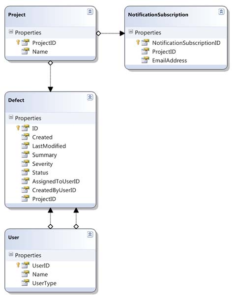
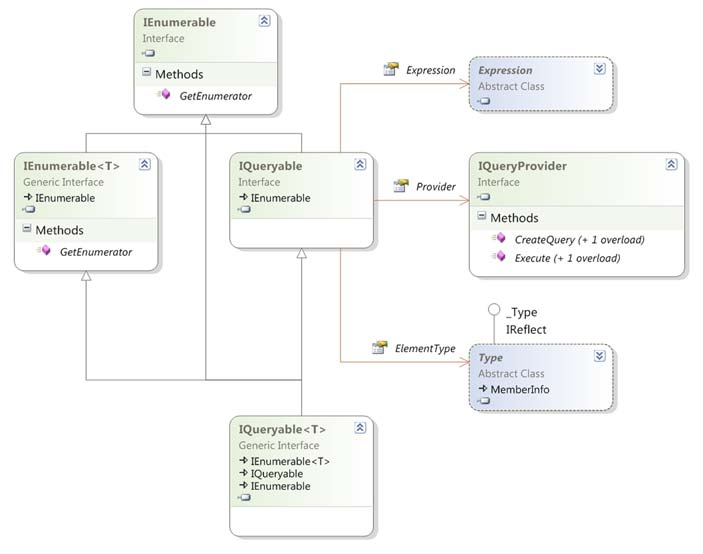
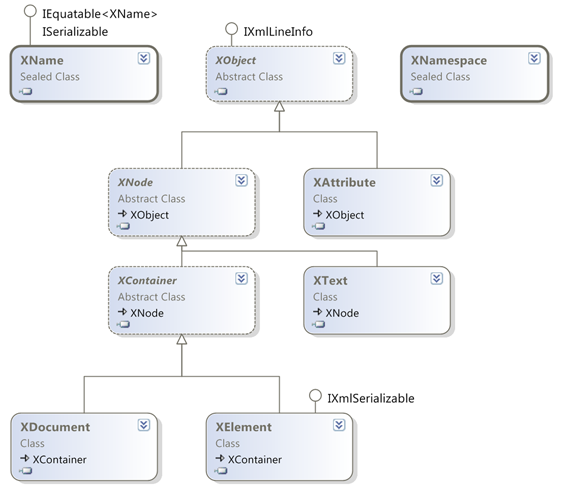
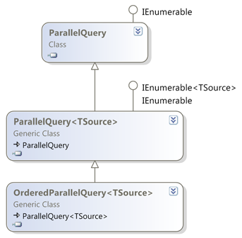

# Chapter 12: LINQ beyond collections

> Source: C# in Depth, Third Edition — Jon Skeet. Original PDF pages 359–401.

[← Table of contents](../README.md)

<!-- PDF page 359 -->

## LINQ beyond collections

This chapter covers
LINQ to SQL
IQueryable and expression tree queries
LINQ to XML
Parallel LINQ
Reactive Extensions for .NET
Writing your own operators
Suppose an alien visited you and asked you to describe culture. How could you cap-
ture the diversity of human culture in a short space of time? You might decide to
spend that time showing him culture rather than describing it in the abstract: a visit
to a New Orleans jazz club, opera in La Scala, the Louvre gallery in Paris, a Shake-
speare play in Stratford-upon-Avon, and so on.
Would this alien know everything about culture afterward? Could he compose a
tune, write a book, dance a ballet, craft a sculpture? Absolutely not. But he’d hope-
fully leave with a sense of culture—its richness and variety, its ability to light up peo-
ple’s lives.
So it is with this chapter. You’ve now seen all of the features of C# 3, but without
seeing more of LINQ, you don’t have enough context to really appreciate them.

<!-- PDF page 360 -->

Querying a database with LINQ to SQL
When the first edition of this book was published, not many LINQ technologies were
available, but now there’s a glut of them, both from Microsoft and from third parties.
That in itself hasn’t surprised me, but I’ve been fascinated to see the different natures
of these technologies.
We’ll look at various ways in which LINQ manifests itself, with an example of each.
I’ve chosen to demonstrate Microsoft technologies in the main, because they’re the
most typical ones. This isn’t meant to imply that third parties aren’t welcome in the
LINQ ecosystem: there are a number of projects, both commercial and open source,
providing access to varied data sources and building extra features on top of existing
providers.
In contrast to the rest of this book, we’ll only skim the surface of each of the topics
here—the point isn’t to learn the details, but to immerse yourself in the spirit of LINQ.
To investigate any of these technologies further, I recommend that you get a book
dedicated to the subject or read the relevant documentation carefully. I’ve resisted the
temptation to say, “There’s more to LINQ to [xxx] than this” at the end of each sec-
tion, but please take it as read. Each technology has many capabilities beyond query-
ing, but I’ve focused here on the areas that are directly related to LINQ.
Let’s start off with the provider that generally got the most attention when LINQ
was first introduced: LINQ to SQL.
12.1
Querying a database with LINQ to SQL
I’m sure by now you’ve absorbed the message that LINQ to SQL converts query expres-
sions into SQL, which is then executed on the database. It’s more than that—it’s a full
ORM solution—but I’ll concentrate on the query side of LINQ to SQL rather than go
into concurrency handling and the other details that an ORM has to deal with. I’ll
show you just enough so that you can experiment with it yourself—the database and
code are available on the book’s website (http://csharpindepth.com). The database is
in SQL Server 2005 format to make it easy to play with, even if you don’t have the latest
version of SQL Server installed, although obviously Microsoft has made sure that LINQ
to SQL works against newer versions too.
WHY LINQ TO SQL RATHER THAN THE ENTITY FRAMEWORK?
Speaking of “newer
versions,” you may be wondering why I’ve chosen to demonstrate LINQ to SQL
instead of the Entity Framework, which is now Microsoft’s preferred solution
(and which also supports LINQ). The answer is merely simplicity; the Entity
Framework is undoubtedly more powerful than LINQ to SQL in various ways,
but it requires extra concepts that would take too much space to explain
here. I’m trying to give you a sense of the consistency (and occasional incon-
sistency) that LINQ provides, and that’s as applicable to LINQ to SQL as to the
Entity Framework.
Before you start writing any queries, you need a database and a model to represent it
in code.

<!-- PDF page 361 -->

LINQ beyond collections
12.1.1 Getting started: the database and model
LINQ to SQL needs metadata about the database to know which classes correspond to
which database tables, and so on. There are various ways of representing that meta-
data, and this section will use the LINQ to SQL designer built into Visual Studio. You
can design the entities first and ask LINQ to create the database, or design your data-
base and let Visual Studio work out what the entities should look like. Personally, I
favor the second approach, but there are pros and cons for both ways.
CREATING THE DATABASE SCHEMA
The mapping from the classes in chapter 11 to database tables is straightforward. Each
table has an auto-incrementing integer ID column with an appropriate name:
ProjectID, DefectID, and so on. The references between tables simply use the same
name, so the Defect table has a ProjectID column, for instance, with a foreign key
constraint.
There are a few exceptions to this simple set of rules:

User is a reserved word in T-SQL, so the User class is mapped to the DefectUser
table.
The enumerations (status, severity, and user type) don’t have tables. Their val-
ues are mapped to tinyint columns in the Defect and DefectUser tables.
The Defect table has two links to the DefectUser table: one for the user who
created the defect and one for the current assignee. These are represented with
the CreatedByUserId and AssignedToUserId columns, respectively.
CREATING THE ENTITY CLASSES
Once your tables are created, generating the entity classes from Visual Studio is easy.
Simply open Server Explorer (View > Server Explorer) and add a data source to
the SkeetySoftDefects database (right-click on Data Connections and select Add Con-
nection). You should be able to see four tables: Defect, DefectUser, Project, and
NotificationSubscription.
You can then add a new item of type “LINQ to SQL classes” to the project. This
name will be the basis for a generated class representing the overall database model;
I’ve used the name DefectModel, which leads to a class called DefectModelData-
Context. The designer will open when you’ve created the new item.
You can then drag the four tables from Server Explorer into the designer, and it’ll
figure out all the associations. After that, you can rearrange the diagram and adjust
various properties of the entities. Here’s a list of what I changed:
I renamed the DefectID property to ID to match the previous model.
I renamed DefectUser to User (so although the table is still called DefectUser,
it’ll generate a class called User, just like before).
I changed the type of the Severity, Status, and UserType properties to their
enum equivalents (having copied those enumerations into the project).

<!-- PDF page 362 -->

Querying a database with LINQ to SQL
I renamed the parent and child properties used for the associations between
Defect and DefectUser—the designer guessed suitable names for the other
associations but had trouble here because there were two associations between
the same pair of tables. I named the relationships AssignedTo/Assigned-
Defects and CreatedBy/CreatedDefects.
Figure 12.1 shows the designer diagram after all of these changes. As you can see, it
looks much like the class diagram in figure 11.3, but without the enumerations.
If you look in the C# code generated by the designer (DefectModel.designer.cs),
you’ll find five partial classes: one for each of the entities, and the DefectModelData-
Context class I mentioned earlier. The fact that they’re partial is useful; in this case I
added extra constructors to match the ones from the original in-memory classes, so
the code from chapter 11 to create the sample data can be reused without much extra
work. For the sake of brevity, I didn’t include the insertion code here, but if you look
at PopulateDatabase.cs in the source code, you should be able to follow it easily
enough. Of course, you don’t have to run this yourself—the downloadable database is
already populated.
Now that you have a schema in SQL, an entity model in C#, and some sample data,
it’s time to get querying.

Figure 12.1
The LINQ to SQL classes
designer showing the rearranged and
modified entities

<!-- PDF page 363 -->

LINQ beyond collections
12.1.2 Initial queries
I’m sure you’ve guessed what’s coming, but hopefully that won’t make it any less
impressive. We’ll execute query expressions against the data source, watching LINQ to
SQL convert the query into SQL on the fly. For the sake of familiarity, we’ll use some of
the same queries we executed against the in-memory collections in chapter 11.
FIRST QUERY: FINDING DEFECTS ASSIGNED TO TIM
I’ll skip over the trivial examples from early in chapter 11 and start instead with the
query from listing 11.7 that checks for open defects assigned to Tim. Here’s the query
part of listing 11.7, for the sake of comparison:
User tim = SampleData.Users.TesterTim;
var query = from defect in SampleData.AllDefects
where defect.Status != Status.Closed
where defect.AssignedTo == tim
select defect.Summary;
The full LINQ to SQL equivalent of listing 11.7 is as follows.
Listing 12.1
Querying the database to find all Tim’s open defects
using (var context = new DefectModelDataContext())
{
context.Log = Console.Out;
Creates context
to work with
B
Enables console logging
C
Queries
database
to find Tim D
User tim = context.Users
.Where(user => user.Name == "Tim Trotter")
.Single();
var query = from defect in context.Defects
where defect.Status != Status.Closed
where defect.AssignedTo == tim
select defect.Summary;
Queries database
to find Tim’s
open defects
E
foreach (var summary in query)
{
Console.WriteLine(summary);
}
}
Listing 12.1 requires a certain amount of explanation, because it’s all new. First you
create a new data context to work with B. Data contexts are pretty multifunctional, tak-
ing responsibility for connection and transaction management, query translation,
tracking changes in entities, and dealing with identity. For the purposes of this chapter,
you can regard a data context as your point of contact with the database. I don’t show
the more advanced features here, but you do take advantage of one useful capability
here: you tell the data context to write out all the SQL commands it executes to the
console C. The model-related properties used in the code for this section (Defects,
Users, and so on) are all of type Table<T> for the relevant entity type. They act as the
data sources for your queries.

<!-- PDF page 364 -->

Querying a database with LINQ to SQL
You can’t use SampleData.Users.TesterTim to identify Tim in the main query
because that object doesn’t know the ID of the relevant row in the DefectUser table.
Instead, you use a separate query to load Tim’s user entity D. I used dot notation for
this, but a query expression would’ve worked just as well. The Single method just
returns a single result from a query, throwing an exception if there isn’t exactly one
element. In a real-life situation, you may have the entity as a product of other opera-
tions, such as logging in, and if you don’t have the full entity, you may have its ID,
which can be used equally well within the main query. As an alternative in this case,
you could’ve change the open defects query to filter based on the assignee’s name.
That wouldn’t have quite been in the spirit of the original query, though.
Within the query expression E, the only difference between the in-memory query
and the LINQ to SQL query is the data source—instead of using SampleData.All-
Defects, you use context.Defects. The final results are the same (although the
ordering isn’t guaranteed), but the work has been done on the database.
Because you asked the data context to log the generated SQL, you can see exactly
what’s going on when you run the code. The console output shows both of the queries
executed on the database, along with the query parameter values:1
SELECT [t0].[UserID], [t0].[Name], [t0].[UserType]
FROM [dbo].[DefectUser] AS [t0]
WHERE [t0].[Name] = @p0
-- @p0: Input String (Size = 11; Prec = 0; Scale = 0) [Tim Trotter]
SELECT [t0].[Summary]
FROM [dbo].[Defect] AS [t0]
WHERE ([t0].[AssignedToUserID] = @p0) AND ([t0].[Status] <> @p1)
-- @p0: Input Int32 (Size = 0; Prec = 0; Scale = 0) [2]
-- @p1: Input Int32 (Size = 0; Prec = 0; Scale = 0) [4]
Note how the first query fetches all of the properties of the user because you’re popu-
lating a whole entity, but the second query only fetches the summary, as that’s all you
need. LINQ to SQL has also converted the two separate where clauses in the second
query into a single filter on the database.
LINQ to SQL is capable of translating a wide range of expressions. Let’s try a
slightly more complicated query from chapter 11, just to see what SQL is generated.
SQL GENERATION FOR A MORE COMPLEX QUERY: A LET CLAUSE
The next query shows what happens when you introduce a sort of temporary variable
with a let clause. In chapter 11 we considered a bizarre situation, if you remember—
pretending that calculating the length of a string took a long time. Again, the query
expression here is exactly the same as in listing 11.11, with the exception of the data
source. The following listing shows the LINQ to SQL code.
1 Additional log output is generated showing some details of the data context, which I’ve omitted here to avoid
distracting from the SQL. The console output also contains the summaries printed by the foreach loop, of
course.

<!-- PDF page 365 -->

LINQ beyond collections
Listing 12.2
Using a let clause in LINQ to SQL
using (var context = new DefectModelDataContext())
{
context.Log = Console.Out;
var query = from user in context.Users
let length = user.Name.Length
orderby length
select new { Name = user.Name, Length = length };
foreach (var entry in query)
{
Console.WriteLine("{0}: {1}", entry.Length, entry.Name);
}
}
The generated SQL is close to the spirit of the sequences we saw in figure 11.5. The
innermost sequence (the first one in that diagram) is the list of users; that’s trans-
formed into a sequence of name/length pairs (as the nested select), and then the
no-op projection is applied, with an ordering by length:
SELECT [t1].[Name], [t1].[value]
FROM (
SELECT LEN([t0].[Name]) AS [value], [t0].[Name]
FROM [dbo].[DefectUser] AS [t0]
) AS [t1]
ORDER BY [t1].[value]
This is a good example of where the generated SQL is wordier than it needs to be.
Although you couldn’t reference the elements of the final output sequence when per-
forming an ordering on the query expression, you can in SQL. This simpler query
would’ve worked fine:
SELECT LEN([t0].[Name]) AS [value], [t0].[Name]
FROM [dbo].[DefectUser] AS [t0]
ORDER BY [value]
Of course, what’s important is what the query optimizer does on the database—the
execution plan displayed in SQL Server Management Studio Express is the same for
both queries, so it doesn’t look like you’re losing out.
The final set of LINQ to SQL queries we’ll look at are all joins.
12.1.3 Queries involving joins
We’ll try both inner joins and group joins, using the examples of joining notification
subscriptions against projects. I suspect you’re used to the drill now—the pattern of
the code is the same for each query, so from here on I’ll just show the query expres-
sion and the generated SQL, unless something else is going on.
EXPLICIT JOINS: MATCHING DEFECTS WITH NOTIFICATION SUBSCRIPTIONS
The first query is the simplest kind of join—an inner equijoin using a LINQ join
clause:

<!-- PDF page 366 -->

Querying a database with LINQ to SQL
// Query expression (modified from listing 11.12)
from defect in context.Defects
join subscription in context.NotificationSubscriptions
on defect.Project equals subscription.Project
select new { defect.Summary, subscription.EmailAddress }
-- Generated SQL
SELECT [t0].[Summary], [t1].[EmailAddress]
FROM [dbo].[Defect] AS [t0]
INNER JOIN [dbo].[NotificationSubscription] AS [t1]
ON [t0].[ProjectID] = [t1].[ProjectID]
Unsurprisingly, it uses an inner join in SQL. It’d be easy to guess at the generated SQL
in this case. How about a group join, though? This is where things get slightly more
hectic:
// Query expression (modified from listing 11.13)
from defect in context.Defects
join subscription in context.NotificationSubscriptions
on defect.Project equals subscription.Project
into groupedSubscriptions
select new { Defect = defect, Subscriptions = groupedSubscriptions }
-- Generated SQL
SELECT [t0].[DefectID] AS [ID], [t0].[Created],
[t0].[LastModified], [t0].[Summary], [t0].[Severity],
[t0].[Status], [t0].[AssignedToUserID],
[t0].[CreatedByUserID], [t0].[ProjectID],
[t1].[NotificationSubscriptionID],
[t1].[ProjectID] AS [ProjectID2], [t1].[EmailAddress],
(SELECT COUNT(*)
FROM [dbo].[NotificationSubscription] AS [t2]
WHERE [t0].[ProjectID] = [t2].[ProjectID]) AS [count]
FROM [dbo].[Defect] AS [t0]
LEFT OUTER JOIN [dbo].[NotificationSubscription] AS [t1]
ON [t0].[ProjectID] = [t1].[ProjectID]
ORDER BY [t0].[DefectID], [t1].[NotificationSubscriptionID]
That’s a major change in the amount of SQL generated! There are two important
things to notice. First, it uses a left outer join instead of an inner join, so you’d still see a
defect even if it didn’t have anyone subscribing to its project. If you want a left outer
join but without the grouping, the conventional way of expressing this is to use a
group join and then an extra from clause, using the DefaultIfEmpty extension
method on the embedded sequence. It looks odd, but it works well.
The second odd thing about the previous query is that it calculates the count for
each group within the database. This is effectively a trick performed by LINQ to SQL to
make sure that all the processing can be done on the server. A naive implementation
would have to perform the grouping in memory after fetching all the results. In some
cases, the provider could do tricks to avoid needing the count, simply spotting when
the grouping ID changes, but there are issues with this approach for some queries. It’s
possible that a later implementation of LINQ to SQL will be able to switch courses of
action depending on the exact query.

<!-- PDF page 367 -->

LINQ beyond collections
You don’t need to explicitly write a join in the query expression to see one in the
SQL. Our final queries will show joins implicitly created through property access
expressions.
IMPLICIT JOINS: SHOWING DEFECT SUMMARIES AND PROJECT NAMES
Let’s take a simple example. Suppose you want to list each defect, showing its sum-
mary and the name of the project it’s part of. The query expression is just a matter of
a projection:
// Query expression
from defect in context.Defects
select new { defect.Summary, ProjectName = defect.Project.Name }
-- Generated SQL
SELECT [t0].[Summary], [t1].[Name]
FROM [dbo].[Defect] AS [t0]
INNER JOIN [dbo].[Project] AS [t1]
ON [t1].[ProjectID] = [t0].[ProjectID]
Note how you navigate from the defect to the project via a property—LINQ to SQL has
converted that navigation into an inner join. It can use an inner join here because the
schema has a non-nullable constraint on the ProjectID column of the Defect table—
every defect has a project. Not every defect has an assignee, though, because the
AssignedToUserID field is nullable, so if you use the assignee in a projection instead, a
left outer join is generated:
// Query expression
from defect in context.Defects
select new { defect.Summary, Assignee = defect.AssignedTo.Name }
-- Generated SQL
SELECT [t0].[Summary], [t1].[Name]
FROM [dbo].[Defect] AS [t0]
LEFT OUTER JOIN [dbo].[DefectUser] AS [t1]
ON [t1].[UserID] = [t0].[AssignedToUserID]
Of course, if you navigate via more properties, the joins get more and more compli-
cated. I’m not going into the details here—the important thing is that LINQ to SQL
has to do a lot of analysis of the query expression to work out what SQL is required. In
order to perform that analysis, it clearly needs to be able to look at the query you’ve
specified.
Let’s move away from LINQ to SQL specifically, and think in general terms about
what LINQ providers of this kind need to do. This will apply to any provider that needs
to introspect the query, rather than just being handed a delegate. At long last, it’s time
to see why expression trees were added as a feature of C# 3.
12.2
Translations using IQueryable and IQueryProvider
In this section I’ll show you the basics of how LINQ to SQL manages to convert your
query expressions into SQL. This is the starting point for implementing your own

<!-- PDF page 368 -->

Translations using IQueryable and IQueryProvider
LINQ provider, should you wish to. (Please don’t underestimate the technical difficul-
ties involved in doing so—but if you like a challenge, implementing a LINQ provider is
certainly interesting.) This is the most theoretical section in the chapter, but it’s useful
to have some insight as to how LINQ decides whether to use in-memory processing, a
database, or some other query engine.
In all the query expressions we’ve looked at in LINQ to SQL, the source has been a
Table<T>. But if you look at Table<T>, you’ll see it doesn’t have a Where method, or
Select, or Join, or any of the other standard query operators. Instead, it uses the
same trick that LINQ to Objects does; just as the source in LINQ to Objects always
implements IEnumerable<T> (possibly after a call to Cast or OfType) and then uses
the extension methods in Enumerable, so Table<T> implements IQueryable<T> and
then uses the extension methods in Queryable. You’ll see how LINQ builds up an
expression tree and then allows a provider to execute it at the appropriate time.
Let’s start by looking at what IQueryable<T> consists of.
12.2.1 Introducing IQueryable<T> and related interfaces
If you look up IQueryable<T> in the documentation and see what members it con-
tains directly (rather than inheriting), you may be disappointed. There aren’t any.
Instead, it inherits from IEnumerable<T> and the nongeneric IQueryable, which in
turn inherits from the nongeneric IEnumerable. So IQueryable is where the new and
exciting members are, right? Well, nearly. In fact, IQueryable just has three proper-
ties: QueryProvider, ElementType, and Expression. The QueryProvider property is
of type IQueryProvider—yet another new interface to consider.
Lost? Perhaps figure 12.2 will help out—it’s a class diagram of all the interfaces
directly involved.
The easiest way of thinking about IQueryable is that it represents a query that’ll
yield a sequence of results when you execute it. The details of the query in LINQ terms
are held in an expression tree, as returned by the Expression property of the
IQueryable. The query is executed by iterating through the IQueryable (in other
words, calling the GetEnumerator method and then MoveNext on the result) or by call-
ing the Execute method on an IQueryProvider, passing in an expression tree.
Now that you have at least some grasp of what IQueryable is for, what’s IQuery-
Provider? You can do more with a query than just execute it; you can also use it to build
a bigger query, which is the purpose of the standard query operators in LINQ.2 To build
up a query, you need to use the CreateQuery method on the relevant IQueryProvider.3
Think of a data source as a simple query (SELECT * FROM SomeTable in SQL, for
instance)—calling Where, Select, OrderBy, and similar methods results in a different
2 Well, the ones that keep deferring execution, such as Where and Join. You’ll see what happens with the
aggregations such as Count in a while.
3 Both Execute and CreateQuery have generic and nongeneric overloads. The nongeneric versions make it
easier to create queries dynamically in code. Compile-time query expressions use the generic version.

<!-- PDF page 369 -->

LINQ beyond collections

Figure 12.2
Class diagram of the
interfaces involved in IQueryable<T>
query based on the first one. Given any IQueryable query, you can create a new query
by performing the following steps:
Ask the existing query for its query expression tree (using the Expression
property).
Build a new expression tree that contains the original expression and the extra
functionality you want (a filter, projection, or ordering, for instance).
Ask the existing query for its query provider (using the Provider property).
Call CreateQuery on the provider, passing in the new expression tree.
Of those steps, the only tricky one is creating the new expression tree. Fortunately,
there are a bunch of extension methods on the static Queryable class that can do all
that for you. Enough theory—let’s start implementing the interfaces so we can see all
this in action.
12.2.2 Faking it: interface implementations to log calls
Before you get too excited, you’re not going to build a full-fledged query provider in
this chapter. But if you understand everything in this section, you’ll be in a much bet-
ter position to build one if you ever need to—and possibly more important, you’ll
understand what’s going on when you issue LINQ to SQL queries. Most of the hard
work of query providers goes on at the point of execution, where they need to parse
an expression tree and convert it into the appropriate form for the target platform.

<!-- PDF page 370 -->

Translations using IQueryable and IQueryProvider
We’ll concentrate on the work that happens before that—how LINQ prepares to exe-
cute a query.
We’ll look at implementations of IQueryable and IQueryProvider and then try to
run a few queries against them. The interesting part isn’t the results—the queries
won’t do anything useful—but the series of calls made up to the point of execution.
We’ll focus on two types: FakeQueryProvider and FakeQuery. The implementation of
each interface method writes out the current expression involved, using a simple log-
ging method (not shown here).
Let’s look first at FakeQuery, as shown in the following listing.
Listing 12.3
A simple implementation of IQueryable that logs method calls
class FakeQuery<T> : IQueryable<T>
{
public Expression Expression { get; private set; }
public IQueryProvider Provider { get; private set; }
public Type ElementType { get; private set; }
Declares simple
automatic
properties
B
internal FakeQuery(IQueryProvider provider,
Expression expression)
{
Expression = expression;
Provider = provider;
ElementType = typeof(T);
}
internal FakeQuery() : this(new FakeQueryProvider(), null)
{
Expression = Expression.Constant(this);
}
Uses this query
as initial
expression
C
public IEnumerator<T> GetEnumerator()
{
Logger.Log(this, Expression);
return Enumerable.Empty<T>().GetEnumerator();
}
Returns empty
result sequence
D
IEnumerator IEnumerable.GetEnumerator()
{
Logger.Log(this, Expression);
return Enumerable.Empty<T>().GetEnumerator();
}
public override string ToString()
{
return "FakeQuery";
}
}
Overrides ToString
for the sake of
logging
E
The property members of IQueryable are implemented in FakeQuery with automatic
properties B, which are set by the constructors. There are two constructors: a param-
eterless one that’s used by the main program to create a plain source for the query,
and one that’s called by FakeQueryProvider with the current query expression.

<!-- PDF page 371 -->

LINQ beyond collections
The use of Expression.Constant(this) as the initial source expression C is just a
way of showing that the query initially represents the original object. (Imagine an
implementation representing a table, for example—until you apply any query opera-
tors, the query would just return the whole table.) When the constant expression is
logged, it uses the overridden ToString method, which is why you give a short, con-
stant description e. This makes the final expression much cleaner than it would’ve
been without the override. When you’re asked to iterate over the results of the query,
you always return an empty sequence D to make life easy. Production implementa-
tions would parse the expression here, or (more likely) call Execute on their query
provider and return the result.
As you can see, not a lot is going on in FakeQuery, and the following listing shows
that FakeQueryProvider is simple too.
Listing 12.4
An implementation of IQueryProvider that uses FakeQuery
class FakeQueryProvider : IQueryProvider
{
public IQueryable<T> CreateQuery<T>(Expression expression)
{
Logger.Log(this, expression);
return new FakeQuery<T>(this, expression);
}
public IQueryable CreateQuery(Expression expression)
{
Type queryType = typeof(FakeQuery<>).MakeGenericType(expression.Type);
object[] constructorArgs = new object[] { this, expression };
return (IQueryable)Activator.CreateInstance(queryType, constructorArgs);
}
public T Execute<T>(Expression expression)
{
Logger.Log(this, expression);
return default(T);
}
public object Execute(Expression expression)
{
Logger.Log(this, expression);
return null;
}
}
There’s even less to say about the implementation of FakeQueryProvider than there
was for FakeQuery<T>. The CreateQuery methods do no real processing but act as fac-
tory methods for the query. The only tricky bit is that the nongeneric overload still
needs to provide the right type argument for FakeQuery<T> based on the Type prop-
erty of the given expression. The Execute method overloads return empty results after
logging the call. This is where a lot of analysis would normally be done, along with the
actual call to the web service, database, or other target platform.

<!-- PDF page 372 -->

Translations using IQueryable and IQueryProvider
Even though you’ve done no real work, interesting things start to happen when
you start to use FakeQuery as the source in a query expression. I’ve already let slip that
you’re able to write query expressions without explicitly writing methods to handle
the standard query operators: it’s all about extension methods—this time the ones in
the Queryable class.
12.2.3 Gluing expressions together: the Queryable extension methods
Just as the Enumerable type contains extension methods on IEnumerable<T> to imple-
ment the LINQ standard query operators, the Queryable type contains extension
methods on IQueryable<T>. There are two big differences between the implementa-
tions in Enumerable and those in Queryable.
First, the Enumerable methods all use delegates as their parameters—the Select
method takes a Func<TSource,TResult>, for example. That’s fine for in-memory
manipulation, but for LINQ providers that execute the query elsewhere, you need a
format you can examine more closely—expression trees. For example, the correspond-
ing overload of Select in Queryable takes a parameter of type Expression<Func
<TSource,TResult>>. The compiler doesn’t mind at all—after query translation, it has
a lambda expression that it needs to pass as an argument to the method, and lambda
expressions can be converted to either delegate instances or expression trees.
This is how LINQ to SQL can work so seamlessly. The four key elements involved
are all new features of C# 3: lambda expressions, the translation of query expressions
into normal expressions that use lambda expressions, extension methods, and expres-
sion trees. Without all four, there’d be problems. If query expressions were always
translated into delegates, for instance, they couldn’t be used with a provider such as
LINQ to SQL, which requires expression trees. Figure 12.3 shows two possible paths
taken by query expressions; they differ only in what interfaces their data source
implements.
Note how in figure 12.3 the early parts of the compilation process are independent
of the data source. The same query expression is used, and it’s translated in exactly
the same way. It’s only when the compiler looks at the translated query to find the
appropriate Select and Where methods to use that the data source is truly important.
At that point, the lambda expressions can be converted to either delegate instances or
expression trees, potentially giving radically different implementations: typically in-
memory for the left path, and SQL executing against a database in the right path.
Just to hammer home a familiar point, the decision in figure 12.3 of whether to use
Enumerable or Queryable has no explicit support in the C# compiler. These aren’t the
only two possible paths, as you’ll see later with Parallel LINQ and Reactive LINQ. You
can create your own interface and implement extension methods following the query
pattern, or even create a type with appropriate instance methods.
The second big difference between Enumerable and Queryable is that the
Enumerable extension methods do the actual work associated with the corresponding
query operator (or at least they build iterators that do the work). There’s code in

<!-- PDF page 373 -->

LINQ beyond collections

from user in users
where user.Name.StartsWith("D")
select user.Name

Query expression translation

users.Where(user => user.Name.StartsWith("D"))
.Select(user => user.Name)

Overload resolution
IQueryable<T> implementation
Plain IEnumerable<T>
implementation

Extension methods on Enumerable
are chosen, which use delegates
as parameters
Extension methods on Queryable
are chosen, which use expression
trees as parameters

IL to create delegate instances,
with calls to Enumerable.Where
and Enumerable.Select
IL to create expression trees, with
calls to Queryable.Where and
Queryable.Select
Figure 12.3
A query taking two paths, depending on whether the data source
implements IQueryable or only IEnumerable
Enumerable.Where to execute the specified filter and only yield appropriate elements
as the result sequence, for example. By contrast, the query operator implementations
in Queryable do little: they just create a new query based on the parameters or they
call Execute on the query provider, as described at the end of section 12.2.1. In other
words, they’re only used to build up queries and request that they be executed—they
don’t contain the logic behind the operators. This means they’re suitable for any
LINQ provider that uses expression trees, but they’re useless on their own. They’re
the glue between your code and the details of the provider.
With the Queryable extension methods available and ready to use the IQueryable
and IQueryProvider implementations, it’s finally time to see what happens when you
use a query expression with your custom provider.
12.2.4 The fake query provider in action
Listing 12.5 shows a simple query expression, which (supposedly) finds all the strings
in the fake source, beginning with abc, and projects the results into a sequence listing
the lengths of the matching strings. You iterate through the results but don’t do any-
thing with them, as you know already that they’ll be empty. That’s because you have

<!-- PDF page 374 -->

Translations using IQueryable and IQueryProvider
no source data, and you haven’t written any code to do any real filtering—you’re just
logging which calls are made by LINQ in the course of creating the query expression,
and iterating through the results.
Listing 12.5
A simple query expression using the fake query classes
var query = from x in new FakeQuery<string>()
where x.StartsWith("abc")
select x.Length;
foreach (int i in query) { }
What would you expect the results of running listing 12.5 to be? In particular, what
would you like to be logged last, at the point where you’d normally expect to do some
real work with the expression tree? Here are the results, reformatted slightly for clarity:
FakeQueryProvider.CreateQuery
Expression=FakeQuery.Where(x => x.StartsWith("abc"))
FakeQueryProvider.CreateQuery
Expression=FakeQuery.Where(x => x.StartsWith("abc"))
.Select(x => x.Length)
FakeQuery<Int32>.GetEnumerator
Expression=FakeQuery.Where(x => x.StartsWith("abc"))
.Select(x => x.Length)
The two important things to note are that GetEnumerator is only called at the end, not
on any intermediate queries; by the time GetEnumerator is called, you have all the
information present in the original query expression. You haven’t manually had to
keep track of earlier parts of the expression in each step—a single expression tree cap-
tures all the information so far.
Don’t be fooled by the concise output, by the way—the actual expression tree is
deep and complicated, particularly due to the where clause including an extra
method call. This expression tree is what LINQ to SQL will examine to work out what
query to execute. LINQ providers could build up their own queries (in whatever form
they may need) when calls to CreateQuery are made, but usually looking at the final
tree when GetEnumerator is called is simpler, because all the necessary information is
available in one place.
The final call logged by listing 12.5 was to FakeQuery.GetEnumerator, and you may
be wondering why you also need an Execute method on IQueryProvider. Well, not all
query expressions generate sequences. If you use an aggregation operator such as Sum,
Count, or Average, you’re no longer really creating a source—you’re evaluating a
result immediately. That’s when Execute is called, as shown by the following listing
and its output.
Listing 12.6
IQueryProvider.Execute
var query = from x in new FakeQuery<string>()
where x.StartsWith("abc")
select x.Length;

<!-- PDF page 375 -->

LINQ beyond collections
double mean = query.Average();
// Output
FakeQueryProvider.CreateQuery
Expression=FakeQuery.Where(x => x.StartsWith("abc"))
FakeQueryProvider.CreateQuery
Expression=FakeQuery.Where(x => x.StartsWith("abc"))
.Select(x => x.Length)
FakeQueryProvider.Execute
Expression=FakeQuery.Where(x => x.StartsWith("abc"))
.Select(x => x.Length)
.Average()
The FakeQueryProvider can be quite useful when it comes to understanding what the
C# compiler is doing behind the scenes with query expressions. It’ll show the trans-
parent identifiers introduced within a query expression, along with the translated calls
to SelectMany, GroupJoin, and the like.
12.2.5 Wrapping up IQueryable
You haven’t written any of the significant code that a real query provider would need
in order to get useful work done, but hopefully this fake provider has given you
insight into how LINQ providers get their information from query expressions. It’s all
built up by the Queryable extension methods, given an appropriate implementation
of IQueryable and IQueryProvider.
We’ve gone into a bit more detail in this section than we will for the rest of the
chapter, as it involved the foundations that underpin the LINQ to SQL code we saw
earlier. Even though you’re unlikely to need to implement query interfaces yourself,
the steps involved in taking a C# query expression and (at execution time) running
some SQL on a database are quite profound and lie at the heart of the big features of
C# 3. Understanding why C# has gained these features will help keep you more in
tune with the language.
This is the end of our coverage of LINQ using expression trees. The rest of the chap-
ter involves in-process queries using delegates, but as you’ll see, there can still be a great
deal of variety and innovation in how LINQ can be used. Our first port of call is LINQ
to XML, which is “merely” an XML API designed to integrate well with LINQ to Objects.
12.3
LINQ-friendly APIs and LINQ to XML
LINQ to XML is by far the most pleasant XML API I’ve ever used. Whether you’re con-
suming existing XML, generating a new document, or a bit of both, it’s easy to use and
understand. Part of that is completely independent of LINQ, but a lot of it’s due to
how well it interacts with the rest of LINQ. As in section 12.1, I’ll give you just enough
introductory information to understand the examples, and then you’ll see how LINQ
to XML blends its own query operators with those in LINQ to Objects. By the end of
the section, you may have some ideas about how you can make your own APIs work in
harmony with the framework.

<!-- PDF page 376 -->

LINQ-friendly APIs and LINQ to XML
12.3.1 Core types in LINQ to XML
LINQ to XML lives in the System.Xml.Linq assembly, and most of the types are in the
System.Xml.Linq namespace too.4 Almost all of the types in that namespace have a
prefix of X, so whereas the normal DOM API has an XmlElement type, the LINQ to XML
equivalent is XElement. This makes it easy to spot when code is using LINQ to XML,
even if you’re not immediately familiar with the exact type involved. Figure 12.4 shows
the types you’ll use most often.

Figure 12.4
Class diagram for
LINQ to XML, showing the most
commonly used types
Here’s a brief rundown of the types shown:

XName is used for names of elements and attributes. Instances are usually cre-
ated using an implicit conversion from a string (in which case no namespace is
used) or via the +(XNamespace, string) overloaded operator.

XNamespace represents an XML namespace—a URI, basically. Instances are usu-
ally created by the implicit conversion from string.

XObject is the common ancestor of both XNode and XAttribute; unlike in the
DOM API, an attribute isn’t a node in LINQ to XML. Methods returning child
nodes don’t include attributes, for example.

XNode represents a node in the XML tree. It defines various members to manip-
ulate and query the tree. There are several other classes derived from XNode
that aren’t shown in figure 12.4, such as XComment and XDeclaration. These are
4 I used to forget whether it was System.Xml.Linq or System.Linq.Xml. If you remember that it’s an XML
API first and foremost, you should be okay.

<!-- PDF page 377 -->

LINQ beyond collections
used relatively infrequently—the most common node types are documents, ele-
ments, and text.

XAttribute is an attribute with a name and a value. The value is intrinsically
text, but there are explicit conversions to many other data types, such as int
and DateTime.

XContainer is a node in the XML tree that can have child content—it’s an ele-
ment or a document, basically.

XText is a text node, and a further derived type XCData is used to represent
CDATA text nodes. (A CDATA node is roughly equivalent to a verbatim string lit-
eral—less escaping is required.) XText is rarely instantiated directly in user
code; instead, when a string is used as the content of an element or document,
that’s converted into an XText instance.

XElement is an element. This is the most commonly used class in LINQ to XML,
along with XAttribute. Unlike in the DOM API, you can create an XElement
without creating a document to contain it. Unless you really need a document
object (for a custom XML declaration, perhaps), you can often just use elements.

XDocument is a document. Its root element is accessed using the Root prop-
erty—this is the equivalent to XmlDocument.DocumentElement. As noted earlier,
this often isn’t required.
More types are available even within the document model, and there are a few other
types for things such as loading and saving options—but this list covers the most
important ones. Of the preceding types, the only ones you regularly need to reference
explicitly are XElement and XAttribute. If you use namespaces, you’ll use XNamespace
as well, but most of the rest of the types can be ignored the rest of the time. It’s amaz-
ing how much you can do with so few types.
Speaking of amazing, I can’t resist showing you how the namespace support works
in LINQ to XML. We won’t use namespaces anywhere else, but it’s a good example of
how a well-designed set of conversions and operators can make life easier. It’ll also
ease us into our next topic: constructing elements.
If you only need to specify the name of an element or attribute without a
namespace, you can use a string. You won’t find any constructors for either type with
parameters of type string though—they all accept an XName. An implicit conversion
exists from string to XName, and also from string to XNamespace. Adding together a
namespace and a string also gives you an XName. There’s a fine line between operator
abuse and genius, but in this case LINQ to XML really makes it work.
Here’s some code to create two elements—one within a namespace and one not:
XElement noNamespace = new XElement("no-namespace");
XNamespace ns = "http://csharpindepth.com/sample/namespace";
XElement withNamespace = new XElement(ns + "in-namespace");
This makes for readable code even when namespaces are involved, which comes as a
welcome relief from some other APIs. But this just creates two empty elements. How
do you give them some content?

<!-- PDF page 378 -->

LINQ-friendly APIs and LINQ to XML
12.3.2 Declarative construction
Normally in the DOM API, you create an element and then add content to it. You can
do that in LINQ to XML via the Add method inherited from XContainer, but that’s not
the idiomatic LINQ to XML way of doing things.5 It’s still worth looking at the signa-
ture of XContainer.Add though, because it introduces the content model. You
might’ve expected a signature of Add(XNode) or perhaps Add(XObject), but it’s just
Add(object). The same pattern is used for the XElement (and XDocument) construc-
tor signatures. The XElement constructors all have one parameter for the name of the
element, but after that you can specify nothing (to create an empty element), a single
object (to create an element with a single child node), or an array of objects to create
multiple child nodes. In the multiple children case, a parameter array is used (the
params keyword in C#), which means the compiler will create the array for you—you
can just keep listing arguments.
The use of plain object for the content type may sound crazy, but it’s incredibly
useful. When you add content—whether it’s through a constructor or the Add
method—the following points are considered:
Null references are ignored.

XNode and XAttribute instances are added in a relatively straightforward man-
ner; they’re cloned if they already have parents, but otherwise no conversion is
required. (Some other sanity checks are performed, such as making sure you
don’t have duplicate attributes in a single element.)
Strings, numbers, dates, times, and so on are added by converting them into
XText nodes using standard XML formatting.
If the argument implements IEnumerable (and isn’t covered by anything else),
Add will iterate over its contents and add each value in turn, recursing where
necessary.
Anything that doesn’t have special-case handling is converted into text by just
calling ToString().
This means that you often don’t need to prepare your content in a special way before
adding it to an element—LINQ to XML does the right thing for you. The details are
explicitly documented, so you don’t need to worry about it being too magical—but it
really works.
Constructing nested elements leads to code that naturally resembles the hierarchi-
cal structure of the tree. This is best shown with an example. Here’s a snippet of LINQ
to XML code:
new XElement("root",
new XElement("child",
new XElement("grandchild", "text")),
new XElement("other-child"));
5 In some ways, it’s a shame that XElement doesn’t implement IEnumerable, as otherwise collection initializ-
ers would be another approach to construction. But using the constructor works neatly anyway.

<!-- PDF page 379 -->

LINQ beyond collections
And here’s the XML of the created element—note the visual similarity between the
code and the output:
<root>
<child>
<grandchild>text</grandchild>
</child>
<other-child />
</root>
So far, so good, but the important part is the fourth bullet in the earlier list, where
sequences are processed recursively, because that lets you build an XML structure out
of a LINQ query in a natural way. For example, the book’s website has some code to
generate an RSS feed from its database. The statement to construct the XML docu-
ment is 28 lines long—which I’d normally expect to be an abomination—but it’s
remarkably pleasant to read.6 That statement contains two LINQ queries—one to pop-
ulate an attribute value, and the other to provide a sequence of elements, each repre-
senting a news item. As you read the code, it’s obvious what the resulting XML will
look like.
To make this more concrete, let’s take two simple examples from the defect-
tracking system. I’ll demonstrate using the LINQ to Objects sample data, but you
could use almost identical queries to work with another LINQ provider instead. First,
you need to build an element containing all the users in the system. In this case, you
just need a projection, so the following listing uses dot notation.
Listing 12.7
Creating elements from the sample users
var users = new XElement("users",
SampleData.AllUsers.Select(user => new XElement("user",
new XAttribute("name", user.Name),
new XAttribute("type", user.UserType)))
);
Console.WriteLine(users);
// Output
<users>
<user name="Tim Trotter" type="Tester" />
<user name="Tara Tutu" type="Tester" />
<user name="Deborah Denton" type="Developer" />
<user name="Darren Dahlia" type="Developer" />
<user name="Mary Malcop" type="Manager" />
<user name="Colin Carton" type="Customer" />
</users>
If you want to make a slightly more complex query, it’s probably worth using a query
expression. The following listing creates another list of users, but this time only the
6 One contributing factor to the readability is an extension method I created to convert anonymous types into
elements, using the properties for child elements. If you’re interested, the code is freely available as part of
my MiscUtil project (see http://mng.bz/xDMt). It only helps when the XML structure you need fits a certain
pattern, but in that case it can reduce the clutter of XElement constructor calls significantly.

<!-- PDF page 380 -->

LINQ-friendly APIs and LINQ to XML
developers within SkeetySoft. For a bit of variety, this time each developer’s name is a
text node within an element instead of an attribute value.
Listing 12.8
Creating elements with text nodes
var developers = new XElement("developers",
from user in SampleData.AllUsers
where user.UserType == UserType.Developer
select new XElement("developer", user.Name)
);
Console.WriteLine(developers);
// Output
<developers>
<developer>Deborah Denton</developer>
<developer>Darren Dahlia</developer>
</developers>
This sort of thing can be applied to all the sample data, producing a document struc-
ture like this:
<defect-system>
<projects>
<project name="..." id="...">
<subscription email="..." />
</project>
</projects>
<users>
<user name="..." id="..." type="..." />
</users>
<defects>
<defect id="..." summary="..." created="..." project="..."
assigned-to="..." created-by="..." status="..."
severity="..." last-modified="..." />
</defects>
</defect-system>
You can see the code to generate all of this in XmlSampleData.cs in the downloadable
solution. It demonstrates an alternative to the one-huge-statement approach: each of
the elements under the top level is created separately, and then glued together like this:
XElement root = new XElement("defect-system", projects, users, defects);
We’ll use this XML to demonstrate the next LINQ integration point: queries. Let’s start
with the query methods available on a single node.
12.3.3 Queries on single nodes
You may be expecting me to reveal that XElement implements IEnumerable and that
LINQ queries come for free. It’s not quite that simple, because there are so many differ-
ent things that an XElement could iterate through. XElement contains a number of
axis methods that are used as query sources. If you’re familiar with XPath, the idea of an
axis will no doubt be familiar to you.

<!-- PDF page 381 -->

LINQ beyond collections
Here are the axis methods used directly for querying a single node, each of which
returns an appropriate IEnumerable<T>:

Ancestors

DescendantNodes

Annotations

Elements

Descendants

ElementsBeforeSelf

AncestorsAndSelf

DescendantNodesAndSelf

Attributes

ElementsAfterSelf

DescendantsAndSelf

Nodes
All of these are fairly self-explanatory (and the MSDN documentation provides more
details). There are useful overloads to retrieve only nodes with an appropriate name;
calling Descendants("user") on an XElement will return all user elements under-
neath the element you call it on, for instance.
In addition to these calls returning sequences, some methods return a single
result—Attribute and Element are the most important, returning the named attri-
bute and the first child element with the specified name, respectively. Additionally,
there are explicit conversions from an XAttribute or XElement to any number of
other types, such as int, string, and DateTime. These are important for both filtering
and projecting results. Each conversion to a non-nullable value type also has a conver-
sion to its nullable equivalent—these (and the conversion to string) return a null
value if you invoke them on a null reference. This null propagation means you don’t
have to check for the presence or absence of attributes or elements within the query—
you can use the query results instead.
What does this have to do with LINQ? Well, the fact that multiple search results are
returned in terms of IEnumerable<T> means you can use the normal LINQ to Objects
methods after finding some elements. The following listing shows an example of find-
ing the names and types of the users, this time starting off with the sample data in XML.
Listing 12.9
Displaying the users within an XML structure
XElement root = XmlSampleData.GetElement();
var query = root.Element("users").Elements().Select(user => new
{
Name = (string) user.Attribute("name"),
UserType = (string) user.Attribute("type")
});
foreach (var user in query)
{
Console.WriteLine ("{0}: {1}", user.Name, user.UserType);
}
After creating the data at the start, you navigate down to the users element and ask it
for its direct child elements. This two-step fetch could be shortened to just
root.Descendants("user"), but it’s good to know about the more rigid navigation so
you can use it where necessary. It’s also more robust in the face of changes to the

<!-- PDF page 382 -->

LINQ-friendly APIs and LINQ to XML
document structure, such as another (unrelated) user element being added else-
where in the document.
The rest of the query expression is merely a projection of an XElement into an
anonymous type. I’ll admit that this is slightly cheating with the user type: it’s kept as a
string instead of calling Enum.Parse to convert it into a proper UserType value. The
latter approach works perfectly well, but it’s quite long-winded when you only need
the string form, and the code becomes hard to format sensibly within the strict limits
of the printed page.
There’s nothing particularly special here—returning query results as sequences is
fairly common, after all. It’s worth noting how seamlessly you can go from domain-
specific query operators to general-purpose ones. That’s not the end of the story,
though. LINQ to XML has some extra extension methods to add as well.
12.3.4 Flattened query operators
You’ve seen how the result of one part of a query is often a sequence, and in LINQ to
XML it’s often a sequence of elements. What if you wanted to then perform an XML-
specific query on each of those elements? To present a somewhat contrived example,
you can find all the projects in the sample data with root.Element("projects")
.Elements(), but how can you find the subscription elements within them? You
need to apply another query to each element and then flatten the results. (Again, you
could use root.Descendants("subscription"), but imagine a more complex docu-
ment model where that wouldn’t work.)
This may sound familiar, and it is—LINQ to Objects already provides the Select-
Many operator (represented by multiple from clauses in a query expression) to do this.
You could write the query as follows:
from project in root.Element("projects").Elements()
from subscription in project.Elements("subscription")
select subscription
As there are no elements within a project other than subscription, you could use
the overload of Elements that doesn’t specify a name. I find it clearer to specify the
element name in this case, but it’s often just a matter of taste. (The same argument
could be made for calling Element("projects").Elements("project") to start with,
admittedly.)
Here’s the same query written using dot notation and an overload of SelectMany
that only returns the flattened sequence, without performing any further projections:
root.Element("projects").Elements()
.SelectMany(project => project.Elements("subscription"))
Neither of these queries are completely unreadable by any means, but they’re not
ideal. LINQ to XML provides a number of extension methods (in the System
.Xml.Linq.Extensions class), which either act on a specific sequence type or are
generic with a constrained type argument, to cope with the lack of generic interface
covariance prior to C# 4. There’s InDocumentOrder, which does exactly what it sounds

<!-- PDF page 383 -->

LINQ beyond collections
like, and most of the axis methods mentioned in section 12.4.3 are also available as
extension methods. This means that you can convert the previous query into this sim-
pler form:
root.Element("projects").Elements().Elements("subscription")
This sort of construction makes it easy to write XPath-like queries in LINQ to XML
without everything being a string. If you want to use XPath, that’s available too via
more extension methods, but the query methods have served me well more often
than not. You can also mix the axis methods with the operators of LINQ to Objects.
For example, to find all the subscriptions for projects with a name including Media,
you could use this query:
root.Element("projects").Elements()
.Where(project => ((string) project.Attribute("name"))
.Contains("Media"))
.Elements("subscription")
Before we move on to Parallel LINQ, let’s think about how the design of LINQ to XML
merits the “LINQ” part of its title, and how you could potentially apply the same tech-
niques to your own API.
12.3.5 Working in harmony with LINQ
Some of the design decisions in LINQ to XML seem odd if you take them in isolation
as part of an XML API, but in the context of LINQ they make perfect sense. The design-
ers clearly imagined how their types could be used within LINQ queries, and how they
could interact with other data sources. If you’re writing your own data access API, in
whatever context that might be, it’s worth taking the same things into account. If
someone uses your methods in the middle of a query expression, are they left with
something useful? Will they be able to use some of your query methods, then some
from LINQ to Objects, and then some more of yours in one fluent expression?
We’ve seen three ways in which LINQ to XML has accommodated the rest of LINQ:
It’s good at consuming sequences with its approach to construction. LINQ is
deliberately declarative, and LINQ to XML supports this with a declarative way of
creating XML structures.
It returns sequences from its query methods. This is probably the most obvious
step that data access APIs would already take: returning query results as
IEnumerable<T> or a class implementing it is pretty much a no-brainer.
It extends the set of queries you can perform on sequences of XML types; this
makes it feel like a unified querying API, even though some of it is XML-specific.
You may be able to think of other ways in which your own libraries can play nicely with
LINQ; these aren’t the only options you should consider, but they’re a good starting
point. Above all, I’d urge you to put yourself in the shoes of a developer wanting to
use your API within code that’s already using LINQ. What might such a developer want

<!-- PDF page 384 -->

Replacing LINQ to Objects with Parallel LINQ
to achieve? Can LINQ and your API be mixed easily, or are they really aiming for differ-
ent goals?
We’re roughly halfway through our whirlwind tour of different approaches to
LINQ. Our next stop is in some ways reassuring and in some ways terrifying: we’re back
to querying simple sequences, but this time in parallel…
12.4
Replacing LINQ to Objects with Parallel LINQ
I’ve been following Parallel LINQ for a long time. I first came across it when Joe Duffy
introduced it in his blog on September 2006 (see http://mng.bz/vYCO). The first
Community Technology Preview (CTP) was released in November 2007, and the over-
all feature set has evolved over time too. It’s now part of a wider effort called Parallel
Extensions, which is part of .NET 4, aiming to provide higher-level building blocks for
concurrent programming than the relatively small set of primitives we’ve had to work
with until now. There’s a lot more to Parallel Extensions than Parallel LINQ—or
PLINQ, as it’s often known—but we’ll only look at the LINQ aspect here.
The idea behind Parallel LINQ is that you should be able to take a LINQ to Objects
query that’s taking a long time and make it run faster by using multiple threads to take
advantage of multiple cores—with as few changes to the query as possible. As with any-
thing to do with concurrency, it’s not quite as simple as that, but you may be surprised
at what can be achieved. Of course, we’re still trying to think bigger than individual
LINQ technologies—we’re thinking about the different models of interaction
involved, rather than the precise details. But if you’re interested in concurrency, I
heartily recommend that you dive into Parallel Extensions—it’s one of the most prom-
ising approaches to parallelism that I’ve come across recently.
I’ll use a single example for this section: rendering a Mandelbrot set image (see
Wikipedia for an explanation of Mandelbrot sets: http://en.wikipedia.org/wiki/
Mandelbrot_set). Let’s start off by trying to get it right with a single thread before
moving into trickier territory.
12.4.1 Plotting the Mandelbrot set with a single thread
Before any mathematicians attack me, I should point out that I’m using the term Man-
delbrot set loosely here. The details aren’t really important, but these aspects are:
You’ll create a rectangular image, given various options such as width, height,
origin, and search depth.
For each pixel in the image, you’ll calculate a byte value that will end up as the
index into a 256-entry palette.
The calculation of one pixel value doesn’t rely on any other results.
The last point is absolutely crucial—it means this task is embarrassingly parallel. In
other words, there’s nothing in the task itself that makes it hard to parallelize. You
still need a mechanism for distributing the workload across threads and then gather-
ing the results together, but the rest should be easy. PLINQ will be responsible for the

<!-- PDF page 385 -->

LINQ beyond collections
distribution and collation (with a little help and care); you just need to express the
range of pixels, and how each pixel’s color should be computed.
For the purposes of demonstrating multiple approaches, I’ve put together an
abstract base class that’s responsible for setting things up, running the query, and dis-
playing the results; it also has a method to compute the color of an individual pixel.
An abstract method is responsible for creating a byte array of values, which are then
converted into the image. The first row of pixels comes first, left to right, then the sec-
ond row, and so on. Each example here is just an implementation of this method.
I should note that using LINQ really isn’t an ideal solution here—there are various
inefficiencies in this approach. Don’t focus on that side of things: concentrate on the
idea that we have an embarrassingly parallel query, and we want to execute it across
multiple cores.
The following listing shows the single-threaded version of the method in all its sim-
ple glory.
Listing 12.10
Single-threaded Mandelbrot generation query
var query = from row in Enumerable.Range(0, Height)
from column in Enumerable.Range(0, Width)
select ComputeIndex(row, column);
return query.ToArray();
You iterate over every row and every
column within each row, computing
the index of the relevant pixel. Calling
ToArray()
evaluates
the
resulting
sequence, converting it into an array.
Figure 12.5 shows the beautiful results.
This took about 5.5 seconds to gener-
ate on my old dual-core laptop. The
ComputeIndex method performs more
iterations than you really need, but it
makes the timing differences more obvi-
ous.7 Now that you have a benchmark in
terms of both timing and what the results
should look like, it’s time to parallelize
the query.

Figure 12.5
Mandelbrot image generated on a
single thread
12.4.2 Introducing ParallelEnumerable, ParallelQuery, and AsParallel
Parallel LINQ brings with it several new types, but in many cases you’ll never
see their names mentioned. They live in the System.Linq namespace, so you don’t
7 Proper benchmarking is hard, particularly when threading is involved. I haven’t attempted to do rigorous
measurements here. The timings given are just meant to indicate faster and slower; please take the numbers
with a pinch of salt.

<!-- PDF page 386 -->

Replacing LINQ to Objects with Parallel LINQ
even need to change using directives.
ParallelEnumerable is a static class, similar
to Enumerable—it mostly contains exten-
sion methods, the majority of which extend
a new ParallelQuery type.
This latter type has both nongeneric and
generic
forms
(ParallelQuery
and
ParallelQuery<TSource>), but most of the
time you’ll use the generic form, just as
IEnumerable<T> is more widely used than
IEnumerable. Additionally, there’s Ordered-
ParallelQuery<TSource>, which is the par-
allel equivalent of IOrderedEnumerable<T>.
The relationships between all of these types
are shown in figure 12.6.
As you can see, ParallelQuery<TSource>
implements IEnumerable<TSource>, so once
you’ve constructed a query appropriately, you can iterate through the results in the nor-
mal way. When you have a parallel query, the extension methods in Parallel-
Enumerable take precedence over the ones in Enumerable (because ParallelQuery<T>
is more specific than IEnumerable<T>; see section 10.2.3 if you need a reminder of the
rules); this is how the parallelism is maintained throughout a query. There’s a parallel
equivalent to all the LINQ standard query operators, but you should be careful if you’ve
created any of your own extension methods. You’ll still be able to call them, but they’ll
force the query to be single-threaded from that point onward.
How do you get a parallel query to start with? By calling AsParallel, an extension
method in ParallelEnumerable that extends IEnumerable<T>. This means you can
parallelize the Mandelbrot query incredibly simply, as shown in the following listing.

Figure 12.6
Class diagram for Parallel LINQ,
including relationship to normal LINQ
interfaces
Listing 12.11
First attempt at a multithreaded Mandelbrot generation query
var query = from row in Enumerable.Range(0, Height)
.AsParallel()
from column in Enumerable.Range(0, Width)
select ComputeIndex(row, column);
return query.ToArray();
Job done? Well, not quite. This query does run in parallel, but the results aren’t quite
what you need: it doesn’t maintain the order in which you process the rows. Instead of
the beautiful Mandelbrot image, we get something like figure 12.7, but the exact
details change every time, of course.
Oops. On the bright side, this rendered in about 3.2 seconds, so my machine was
clearly making use of its second core. But getting the right answer is pretty important.

<!-- PDF page 387 -->

LINQ beyond collections
You may be surprised to hear that this
is a deliberate feature of Parallel LINQ.
Ordering a parallel query requires more
coordination between the threads, and
the whole purpose of parallelization is to
improve performance, so PLINQ defaults
to an unordered query. It’s a bit of a nui-
sance in this case, though.

12.4.3 Tweaking parallel queries
Fortunately, there’s a way out of this—
you just need to force the query to be
treated as ordered, which can be done
with the AsOrdered extension method.
The following listing shows the fixed
code, which produces the original image.
It’s slightly slower than the unordered query, but still significantly faster than the sin-
gle-threaded version.
Figure 12.7
Mandelbrot image generated using
an unordered query, resulting in some sections
being incorrectly placed
Listing 12.12
Multithreaded Mandelbrot query maintaining ordering
var query = from row in Enumerable.Range(0, Height)
.AsParallel().AsOrdered()
from column in Enumerable.Range(0, Width)
select ComputeIndex(row, column);
return query.ToArray();
The nuances of ordering are beyond the scope of this book, but I recommend that
you read the “PLINQ Ordering” MSDN blog post (http://mng.bz/9x9U), which goes
into the gory details.
A number of other methods can be used to alter how the query behaves:

AsUnordered—Makes an ordered query unordered; if you only need results to
be ordered for the first part of a query, this allows later stages to be executed
more efficiently.

WithCancellation—Specifies a cancellation token to be used with this query.
Cancellation tokens are used throughout Parallel Extensions to allow tasks to
be canceled in a safe, controlled manner.

WithDegreeOfParallelism—Allows you to specify the maximum number of
concurrent tasks used to execute the query. You could use this to limit the num-
ber of threads used if you wanted to avoid swamping the machine, or to
increase the number of threads used for a query that wasn’t CPU-bound.

WithExecutionMode—Can be used to force the query to execute in parallel,
even if Parallel LINQ thinks it’d execute faster as a single-threaded query.

<!-- PDF page 388 -->

Inverting the query model with LINQ to Rx

WithMergeOptions—Allows you to tweak how the results are buffered. Dis-
abling buffering gives the shortest time before the first result is returned, but
also lower throughput; full buffering gives the highest throughput, but no
results are returned until the query has executed completely. The default is a
compromise between the two.
The important point is that aside from ordering, these methods shouldn’t affect the
results of the query. You can design your query and test it in LINQ to Objects, then par-
allelize it, work out your ordering requirements, and tweak it if necessary to perform
just how you want it to. If you showed the final query to someone who knew LINQ but
not PLINQ, you’d only have to explain the PLINQ-specific method calls—the rest of the
query would be familiar. Have you ever seen such an easy way to achieve concurrency?
(The rest of Parallel Extensions is aimed at achieving simplicity where possible too.)
PLAY WITH THE CODE YOURSELF
A couple of further points are demonstrated
in the downloadable source code. If you parallelize across the whole query of
pixels rather than just the rows, then an unordered query looks even weirder,
and there’s a ParallelEnumerable.Range method that gives PLINQ a bit
more information than calling Enumerable.Range(...).AsParallel(). I
used AsParallel() in this section, because that’s the more general way of
parallelizing a query; most queries don’t start with a range.
Changing the in-process query model from single-threaded to parallel is quite a small
conceptual leap, really. In the next section we’ll turn the model on its head.
12.5
Inverting the query model with LINQ to Rx
All of the LINQ libraries you’ve seen so far have one thing in common: you pull data
from them using IEnumerable<T>. At first sight, that seems so obvious that it’s not
worth saying—what would be the alternative? Well, how about if you push the data
instead of pulling it? Instead of the data consumer being in control, the provider can
be in the driving seat, letting the data consumer react when new data is available.
Don’t worry too much if this sounds dauntingly different; you actually know about
the fundamental concept already, in the form of events. If you’re comfortable with
the idea of subscribing to an event, reacting to it, and unsubscribing later, that’s a
good starting point.
Reactive Extensions for .NET is a Microsoft project (http://mng.bz/R7ip); there are
multiple versions available, including one targeting JavaScript. These days, the simplest
way of obtaining the latest version is via NuGet. You may hear Reactive Extensions going
by various names, but Rx and LINQ to Rx are the most common abbreviations, and
they’re the ones I’ll use here. Even more so than for the other technologies covered in
this chapter, we’ll barely scratch the surface here. Not only is there a lot to learn about
the library itself, but it’s a whole different way of thinking. There are loads of videos on
Channel 9 (see http://channel9.msdn.com/tags/Rx/)—some are based on the math-
ematical aspects, whereas others are more practical. In this section I’ll emphasize the
way that the LINQ concepts can be applied to this push model for data flow.

<!-- PDF page 389 -->

LINQ beyond collections
Enough of the introduction…let’s meet the two interfaces that form the basis of
LINQ to Rx.
12.5.1 IObservable<T> and IObserver<T>
The data model of LINQ to Rx is the mathematical dual of the normal IEnumerable<T>
model.8 When you iterate over a pull collection, you effectively start off by saying,
“Please give me an iterator” (the call to GetEnumerator) and then repeatedly ask, “Is
there another item? If so, I’d like it now” (via calls to MoveNext and Current). LINQ to
Rx reverses this. Instead of requesting an iterator, you provide an observer. Then,
instead of requesting the next item, your code is told when one is ready—or when an
error occurs or the end of the data is reached.
Here are the declarations of the two interfaces involved:
public interface IObservable<T>
{
IDisposable Subscribe(IObserver<T> observer);
}
public interface IObserver<T>
{
void OnNext(T value);
void OnCompleted();
void OnException(Exception error);
}
These interfaces are actually part of .NET 4 (in the System namespace), even though
the rest of LINQ to Rx is in a separate download. In fact, they’re IObservable<out T>
and IObserver<in T> in .NET 4, expressing the covariance of IObservable and the
contravariance of IObserver. You’ll learn more about generic variance in the next
chapter, but I’m presenting the interfaces here as if they were invariant for the sake of
simplicity. One concept at a time!
Figure 12.8 shows the duality in terms of how data flows in each model.
I suspect I’m not alone in finding the push model harder to think about, as it has
the natural ability to work asynchronously. But look at how much simpler it is than the
pull model, in terms of the flow diagram. This is partly due to the multiple method
approach of the pull model; if IEnumerator<T> just had a method with a signature of
bool TryGetNext(out T item), it’d be somewhat simpler.
Earlier I mentioned that LINQ to Rx is similar to the events you’re already familiar
with. Calling Subscribe on an observable is like using += with an event to register a
handler. The disposable value returned by Subscribe remembers the observer you
passed in; disposing of it is like using -= with the same handler. In many cases, you
don’t need to unsubscribe from the observable; this is just available in case you need
to unsubscribe halfway through a sequence—the equivalent of breaking out of a
foreach loop early. Failing to dispose of an IDisposable value may feel like anathema
8 For a more detailed examination of this duality—and the essence of LINQ itself—I recommend Bart de
Smet’s “The Essence of LINQ—MINLINQ” blog post at http://mng.bz/96Wh.

<!-- PDF page 390 -->

Inverting the query model with LINQ to Rx
Caller
IEnumerable<T>
IEnumerator<T>
Caller
IObservable<T>
IObserver<T>
GetEnumerator()
Subscribe(observer)
Return: IEnumerator<T>
Return: IDisposable
OnNext(first value)
MoveNext()
Return: true
Current
Return: first value
...(more items)...
...(more items)...
OnCompleted()
MoveNext()
Return: false
Pull model
Push model
Figure 12.8
Sequence diagram showing the duality of IEnumerable<T> and IObservable<T>
to you, but it’s often safe in LINQ to Rx. None of the examples in this chapter use the
return value of Subscribe.
That’s all there is to IObservable<T>, but what about the observer itself? Why does
it have three methods? Consider the normal pull model where for any MoveNext/
Current pair of calls, three things can happen:
You may be at the end of the sequence, in which case MoveNext returns false.
You may not have reached the end of the sequence, in which case MoveNext
returns true and Current returns the new value.
An error may occur—reading the next line from a network connection could
fail, for example. In this case, an exception would be thrown.
The IObserver<T> interface represents each of these options as a separate method.
Typically an observer will have its OnNext method called repeatedly, and then finally
OnCompleted, unless there’s an error of some kind, in which case OnError will be
called instead. After the sequence has completed or encountered an error, no further
method calls will be made. You rarely need to implement IObserver<T> directly,
though. There are many extension methods on IObservable<T>, including overloads
for Subscribe, and these allow you to subscribe to an observable by just providing
appropriate delegates. Usually you provide a delegate to be executed for each item,
and then optionally one to be executed on completion, on error, or both.
With that bit of theory out of the way, let’s look at some actual code using LINQ to Rx.

<!-- PDF page 391 -->

LINQ beyond collections
12.5.2 Starting simply (again)
We’ll demonstrate LINQ to Rx in the same way we started off with LINQ to Objects—
using a range. Instead of Enumerable.Range, we’ll use Observable.Range, which cre-
ates an observable range. Each time an observer subscribes to the range, the numbers
are emitted to that observer using OnNext, followed by OnCompleted. We’ll start off as
simply as we can, just printing out each value as it’s received, and printing a confirma-
tion message at the end or if an error occurs.
The following listing shows that this involves less code than you’d need for the pull
model.
Listing 12.13
First contact with IObservable<T>
var observable = Observable.Range(0, 10);
observable.Subscribe(x => Console.WriteLine("Received {0}", x),
e => Console.WriteLine("Error: {0}", e),
() => Console.WriteLine("Finished"));
In this case, it’s hard to see how you could get an error, but I’ve included the error
notification delegate for completeness. The results are as you’d expect:
Received 0
Received 1
...
Received 9
Finished
The observable returned by the Range method is known as a cold observable: it lies dor-
mant until an observer subscribes to it, at which point it’ll emit the values to that indi-
vidual observer. If you subscribe with another observer, that will see another copy of
the range. This isn’t quite the same as a normal event such as a button click, where
several observers could be subscribed to the same actual sequence of values, and the
values may be effectively yielded whether there are any observers or not. (You can
click a button even if there aren’t any event handlers attached, after all.) Sequences
like this are known as hot observables. It’s important to know which type you’re dealing
with, even though the same set of operations applies to both kinds.
Now that you’ve done the simplest thing possible, let’s try some familiar LINQ
operators.
12.5.3 Querying observables
By now I’m sure you’re familiar with the pattern—there are various extension meth-
ods in a static class (called Observable, somewhat predictably) that perform appropri-
ate transformations. We’ll look at just a few of the available operators and think a little
about what’s not available, and why it’s not.
FILTERING AND PROJECTING
Let’s jump straight into a query expression that takes a sequence of numbers, filters
out the odd ones, and squares anything that’s left. Then we’ll subscribe Console

<!-- PDF page 392 -->

Inverting the query model with LINQ to Rx
.WriteLine to the final result of the query, so that any items produced will be dis-
played. The following listing shows the code—look at how the query expression could
easily be a LINQ to Objects query.
Listing 12.14
Filtering and projecting in LINQ to Rx
var numbers = Observable.Range(0, 10);
var query = from number in numbers
where number % 2 == 0
select number * number;
query.Subscribe(Console.WriteLine);
For simplicity’s sake, I haven’t added handlers for completion or error, and using the
conversion from the Console.WriteLine method group to an Action<int> keeps the
code nice and short. This produces the same results it would in LINQ to Objects: 0, 4,
16 and so on. Let’s move on to grouping.
GROUPING
A group by query expression in LINQ to Rx produces a new IGroupedObservable<T>
for each group, although what you then do with the grouping isn’t always obvious. For
example, it’s not uncommon to have a nested subscription so that each time a new
group is produced, you subscribe an observer to that group. The results within each
group are produced as they’re received by the grouping construct—effectively it acts
as a sort of redirection choice, like an usher at a play examining each person’s ticket
as they arrive, and directing them to the relevant section of the theater. By contrast,
LINQ to Objects collects a whole group together before returning it, which means it
has to read to the end of the sequence, buffering all the results.
The following listing shows an example of this nested subscription, and also dem-
onstrates how group results are emitted.
Listing 12.15
Grouping numbers mod 3
var numbers = Observable.Range(0, 10);
var query = from number in numbers
group number by number % 3;
query.Subscribe(group => group.Subscribe
(x => Console.WriteLine("Value: {0}; Group: {1}", x, group.Key)));
The best way to understand this is probably to remember that dealing with groups in
LINQ to Objects often involves having a nested foreach loop—so you have nested sub-
scriptions in LINQ to Rx.
When in doubt, try to find the duality between the two data models. In LINQ to
Objects, you’d normally process each whole group in turn, whereas the order in LINQ
to Rx means the output of listing 12.15 looks like this:
Value: 0; Group: 0
Value: 1; Group: 1
Value: 2; Group: 2
Value: 3; Group: 0

<!-- PDF page 393 -->

LINQ beyond collections
Value: 4; Group: 1
Value: 5; Group: 2
Value: 6; Group: 0
Value: 7; Group: 1
Value: 8; Group: 2
Value: 9; Group: 0
This makes perfect sense when you think of the push model, and in some cases it
means that operations that would’ve required a lot of data buffering in LINQ to
Objects can be implemented in LINQ to Rx much more efficiently.
As a final example, let’s look at another operator that uses multiple sequences.
FLATTENING
LINQ to Rx supplies a few overloads of SelectMany, and the idea is still the same as in
LINQ to Objects: each item in the original sequence produces a new sequence, and
the result is the combination of all these new sequences, flattened. The following list-
ing shows this in action—it’s a little like listing 11.16, when we first discussed Select-
Many in LINQ to Objects.
Listing 12.16
SelectMany producing multiple ranges
var query = from x in Observable.Range(1, 3)
from y in Observable.Range(1, x)
select new { x, y };
query.Subscribe(Console.WriteLine);
Here are the results, which should be reasonably predictable:
{ x = 1, y = 1 }
{ x = 2, y = 1 }
{ x = 2, y = 2 }
{ x = 3, y = 1 }
{ x = 3, y = 2 }
{ x = 3, y = 3 }
In this case, the results are deterministic, but that’s only because, by default,
Observable.Range emits items on the current thread. It’s entirely possible to have
multiple sequences being produced on multiple threads.
For fun, you might want to change the second call to Observable.Range to specify
Scheduler.ThreadPool as a third argument. In that case, each of the inner sequences
comes out in order with respect to itself, but those separate sequences can be mixed
up among each other. Imagine a sports stadium with one official firing a starting pistol
for several different races in quick succession—even if you know the winner of each
race, you don’t know which race will finish first.
Apologies if this makes you want to go and lie down. If it’s any consolation, it gives
me the same feeling. I do find it fascinating at the same time though.
WHAT’S IN AND WHAT’S OUT?
You already know that a let clause works by just calling Select, so that naturally works
in LINQ to Rx, but not all LINQ to Objects operators are implemented in LINQ to Rx.

<!-- PDF page 394 -->

Inverting the query model with LINQ to Rx
The missing operators are generally the ones that would have to buffer all their out-
put and return a new observable. For example, there’s no Reverse method, and no
OrderBy. C# is quite happy with that—it just won’t let you use an orderby clause in a
query expression based on observables. There’s a Join method, but that doesn’t deal
with observables directly—it handles join plans. This is part of the Rx implementation
of the join-calculus, and it’s well beyond the scope of this book. Likewise there’s no
GroupJoin method, so join...into isn’t supported.
For the various LINQ standard query operators that aren’t covered by the query
expression syntax—and to see the range of extra methods it makes available—see the
System.Reactive documentation. Although you may start off being disappointed
about the familiar functionality from LINQ to Objects that’s missing in LINQ to Rx
(usually because it just doesn’t make sense), you may be surprised by how rich the set
of available methods really is. Many of the new methods are then ported to LINQ to
Objects in the System.Interactive assembly.
12.5.4 What’s the point?
I’m well aware that I haven’t provided any compelling reasons to use LINQ to Rx yet.
This is deliberate, as I don’t intend to show a full, useful example—it’s incidental to
the point of this chapter, and would take too much space. But Rx provides an elegant
way of thinking about all kinds of asynchronous processes, such as normal .NET events
(which can be viewed as an observable using Observable.FromEvent), asynchronous
I/O, and calls to web services. It provides a way of managing the complexity and con-
currency in an efficient manner. There’s no doubt that it is harder to get your head
around than LINQ to Objects, but if you’re in the kind of situation where it’d be use-
ful, you’re already facing a mountain of complexity.
The reason I wanted to cover Rx in this book, despite not being able to do it any
sort of justice, is because it shows why LINQ was designed the way it was. Although there
are conversion methods available between IEnumerable<T> and IObservable<T>,
there’s no inheritance relationship. If the language had made any requirement that
the types involved in LINQ had to be pull sequences, there would’ve been no query
expression support for Rx at all. It would’ve been even more disastrous if extension
methods had been limited to IEnumerable<T> in some way. Likewise, you’ve seen that
not all the normal LINQ operators are applicable to Rx, which is why it’s important that
the language specifies query translations in terms of a pattern that should be sup-
ported as far as it makes sense for the given provider. I hope you have a sense that even
though the push and pull models are very different to work with, LINQ acts as a sort of
unifying force where possible.
You may be relieved to hear that our last topic is a lot simpler—it’s back on the home
ground of LINQ to Objects, but this time we’re writing our own extension methods.

<!-- PDF page 395 -->

LINQ beyond collections
12.6
Extending LINQ to Objects
One of the nice things about LINQ is that it’s extensible. Not only can you come up
with your own query providers and data models, you can also add to existing ones. In
my experience, the most common situation where this is useful is with LINQ to
Objects. If you need a particular type of query that isn’t directly supported (or is awk-
ward or inefficient with the standard query operators), you can write your own. Of
course, writing a general-purpose generic method can be more challenging than just
solving your immediate problem, but if you find yourself writing similar code a few
times, it’s worth considering whether you could refactor it into a new operator.
Personally, I enjoy writing query operators. There are interesting technical chal-
lenges, but it rarely requires a huge amount of code, and the results can be elegant. In
this section, we’ll look at some of the ways you can make your custom operators
behave efficiently and predictably, followed by a full sample for selecting a random
element from a sequence.
12.6.1 Design and implementation guidelines
Most of these guidelines may seem fairly obvious, but this section can form a useful
checklist when you write an operator.
UNIT TESTS
It’s generally pretty easy to write a good set of unit tests for operators, although you
may be surprised at how many you end up with for what originally appeared to be sim-
ple code. Don’t forget to test corner cases, such as empty sequences, as well as invalid
arguments. MoreLINQ (http://code.google.com/p/morelinq/) has some helper
methods in its unit test project that you might want to use for your own tests.
ARGUMENT CHECKING
Good methods check their arguments, but there’s a problem when it comes to LINQ
operators. Many operators return another sequence, as you’ve already seen, and itera-
tor blocks are the easiest way to implement this functionality. But you should really
perform the argument checking as soon as your method is called, rather than waiting
until the caller decides to iterate over the results. If you’re going to use an iterator
block, split your method into two: perform argument checking in a public method
and then call a private method to do the iteration.
OPTIMIZATION
IEnumerable<T> itself is fairly weak in terms of the operations it supports, but the
execution-time type of a sequence you’re working on may have considerably more
functionality. For example, the Count() operator will always work, but it’ll generally
be an O(n) operation. If you call it on an implementation of ICollection<T>,
though, it can use the Count property directly, which will generally be O(1). In
.NET 4, this optimization is extended to cover ICollection as well. Likewise, retriev-
ing a specific element by index is slow in the general case, but can be efficient if the
sequence implements IList<T>.

<!-- PDF page 396 -->

Extending LINQ to Objects
If your operator can benefit from these optimizations, you can have different exe-
cution paths depending on the execution-time type. To test the slow path in unit tests,
you can always call Select(x => x) on a List<T> to retrieve a nonlist sequence.
LinkedList<T> can test the case where you want an ICollection<T> that doesn’t
implement IList<T>.
DOCUMENTATION
It’s important to document what your code will do with its inputs, and also the
expected performance of the operator. This is particularly important if your method
needs to work with multiple sequences: which one will be evaluated first, and how far?
Does your code stream its data, buffer it, or is it a mixture? Does it use deferred or
immediate execution? Can any parameters be null, and if so, does that have a special
meaning?
ITERATE ONCE WHERE POSSIBLE
At an interface level, IEnumerable<T> will let you iterate over the same sequence mul-
tiple times—you can have multiple iterators active at the same time over the same
sequence, potentially. But this is rarely a good idea within an operator. Wherever pos-
sible, it’s wise to iterate over your input sequences just once. This means your code will
work even for nonrepeatable sequences, such as lines read from a network stream. If
you do need to read the sequence multiple times (and you don’t want to buffer the
whole sequence, like Reverse does), you should draw particular attention to this in
the documentation.
REMEMBER TO DISPOSE OF ITERATORS
In most cases, you can use a foreach statement to iterate over your data source. But
it’s sometimes useful to treat the first item differently, in which case using an iterator
directly can lead to the simplest code. In that situation, remember to include a using
block for the iterator. You probably aren’t used to disposing of iterators yourself
because normally foreach does it for you, which can make it hard to spot the bug.
SUPPORT CUSTOM COMPARISONS
Many LINQ operators have overloads that allow you to specify an appropriate
IEqualityComparer<T> or IComparer<T>. If you’re building a general-purpose library
for others (potentially developers who you aren’t in contact with), it may be worth pro-
viding similar overloads yourself. On the other hand, if you’re the sole user, or it’s just
going to be members of your team using it, you can do this on a need-to-implement
basis. It’s easy, though: typically the simpler overloads just call a more complex one,
passing EqualityComparer<T>.Default or Comparer<T>.Default as the comparison.
Now that I’ve talked the talk, let’s check whether I can actually walk the walk.
12.6.2 Sample extension: selecting a random element
The aim of the extension method we’ll look at here is simple: given a sequence and
an instance of Random, return a random element from the sequence. You could add
an overload that doesn’t require the instance of Random, but I prefer to make the

<!-- PDF page 397 -->

LINQ beyond collections
dependency on a random number generator explicit. Randomness is a tricky topic
for various reasons, and rather than discuss it here, I’ve included an article on the
book’s website (see http://mng.bz/h483). Also for reasons of space, I haven’t
included the XML documentation or unit tests in the following listing, but of course
they’re in the downloadable code.
Listing 12.17
Extension method to choose a random element from a sequence
public static T RandomElement<T>(this IEnumerable<T> source,
Random random)
{
if (source == null)
{
throw new ArgumentNullException("source");
}
if (random == null)
{
throw new ArgumentNullException("random");
}
ICollection collection = source as ICollection;
if (collection != null)
{
int count = collection.Count;
if (count == 0)
{
throw new InvalidOperationException("Sequence was empty.");
}
int index = random.Next(count);
return source.ElementAt(index);
}
using (IEnumerator<T> iterator = source.GetEnumerator())
{
if (!iterator.MoveNext())
{
throw new InvalidOperationException("Sequence was empty.");
}
int countSoFar = 1;
T current = iterator.Current;
while (iterator.MoveNext())
{
countSoFar++;
if (random.Next(countSoFar) == 0)
{
current = iterator.Current;
}
}
return current;
}
}
Validates arguments
B
Optimizes for
collections
C
ElementAt
optimizes further
Handles
slow case
D
Replaces current guess
with appropriate
probability
E
Listing 12.17 doesn’t show the technique of splitting an extension method into argu-
ment validation and then implementation, because it doesn’t use an iterator block.
Look back at the implementation of the Where operator in section 10.3.3 for an

<!-- PDF page 398 -->

Summary
example of this. No custom comparisons are required either, but apart from that, every
item on the checklist is appropriate.
First you validate your arguments in the obvious way B. Things get more interest-
ing where the source sequence implements ICollection C.9 This allows you to take
the count cheaply and then generate a single random number to work out which ele-
ment to pick. You don’t explicitly handle the case where the source sequence imple-
ments IList<T>; instead, you rely on ElementAt to do that for you (as it’s documented
to do).
If you’re dealing with a noncollection sequence (such as the result of another
query operator), you want to avoid taking the count and then picking an element;
that would require you to either buffer the contents of the sequence or iterate over it
twice. Instead you step through it once, explicitly fetching the iterator D so that you
can test for an empty sequence easily. The clever bit10 is at E—you replace your cur-
rent idea of a random element with the element from the iterator with a probability of
1/n, where n is the number of elements you’ve seen so far. There’s a one-half chance
of replacing the first element with the second, a one-third chance of replacing the
result after two elements with the third element, and so on. The final result is that
each element in the sequence has an equal chance of being picked, and you’ve man-
aged to iterate just once.
Of course, the important point isn’t what this particular method does—it’s the
potential issues that had to be considered as you implemented it. Once you know what
to look for, it really doesn’t take much effort to implement a robust method like this,
and your personal toolbox will grow over time.
12.7
Summary
Phew! This chapter has been the exact opposite of most of the rest of the book.
Instead of focusing on a single topic in great detail, we’ve covered a range of LINQ
technologies, but at a shallow level.
I wouldn’t expect you to feel particularly familiar with any one of the specific tech-
nologies we’ve looked at here, but I hope you have a deeper understanding of why
LINQ is important. It’s not about XML, or in-memory queries, SQL queries, observ-
ables, or enumerators—it’s about consistency of expression, and giving the C# com-
piler the opportunity to validate your queries to at least some extent, regardless of
their final execution platform.
You should now appreciate why expression trees are so important that they’re
among the few framework elements that the C# compiler has direct intimate knowledge
of (along with strings, IDisposable, IEnumerable<T>, and Nullable<T>, for example).
They act as passports, allowing behavior to cross the border of the local machine,
expressing logic in whatever foreign tongue is catered for by a LINQ provider.
9 The downloadable code contains the same test for implementations of ICollection<T>, just like Count()
does in .NET 4. It’s exactly the same block of code, just with a different type and a different variable name.
10 I’m comfortable claiming this is clever because, even though it’s my implementation, it’s not my idea.

<!-- PDF page 399 -->

LINQ beyond collections
It’s not just expression trees—we’ve also relied on the query expression translation
employed by the compiler, and the way that lambda expressions can be converted to
both delegates and expression trees. But extension methods are also important, as
without them each provider would have to give implementations of all the relevant
methods. If you look back at all the new features of C#, you’ll find few that don’t con-
tribute significantly to LINQ in some way or another. That’s part of the reason for this
chapter’s existence: to show the connections between all the features.
I shouldn’t wax lyrical for too long, though. As well as the upsides of LINQ, we’ve
seen a few gotchas. LINQ won’t always allow you to express everything you need in a
query, nor does it hide all the details of the underlying data source. When it comes to
database LINQ providers, the impedance mismatches that have caused developers so
much trouble in the past are still with us: you can reduce their impact with ORM sys-
tems and the like, but without a proper understanding of the query being executed on
your behalf, you’re likely to run into significant issues. In particular, don’t think of
LINQ as a way of removing your need to understand SQL—think of it as a way of hiding
the SQL when you’re not interested in the details. Likewise, in order to plan an effec-
tive parallel query, you’ve got to know where ordering matters and where it doesn’t,
and perhaps help the framework along a bit by giving it more tuning information.
Since .NET 3.5 came out, I’ve been delighted to see how wholeheartedly the com-
munity has embraced LINQ. Likewise, there have been plenty of interesting uses of
the features of C# 4, which you’ll see in the next part of the book.

<!-- PDF page 400 -->

## Part 4

## C# 4: Playing nicely

## with others

## C# 4 is a funny beast. It doesn’t have the “several, almost unrelated, major

new features” feeling of C# 2, nor the “all in the cause of LINQ” feeling of C# 3.
Instead, the new features of C# 4 fall somewhere between the two. Interoperabil-
ity is a major theme, but many of the features are equally useful even if you never
need to work with other environments.
My personal favorite features from C# 4 are optional parameters and named
arguments. They’re relatively simple but can be put to good use in many places,
improving the readability of code and generally making life more pleasant. Do
you waste time working out which argument means what? Put some names on
them. Are you tired of writing endless overloads to avoid callers having to specify
everything? Make some parameters optional.
If you work with COM, C# 4 will be a breath of fresh air for you. To start with,
the features I just described make some APIs much simpler to work with, where
the component designers have pretty much assumed that you’ll be working with
a language supporting optional parameters and named arguments. Beyond that,
there’s a better deployment story, support for named indexers, and a helpful
shortcut to avoid having to pass arguments by reference everywhere. The biggest
feature of C# 4—dynamic typing—also makes COM integration easier.
We’ll look at all of these areas in chapter 13, along with the brain-busting
topic of generic variance applied to interfaces and delegates. Don’t worry; we’ll
take that reasonably slowly, and the best part is that most of the time you don’t

<!-- PDF page 401 -->

need to know the details—it just makes code work where you might’ve expected it to
in C# 3 anyway!
This is an enormous topic. I’ve concentrated on how the C# language implements
dynamic typing, but we’ll also look at a few examples of interoperating with dynamic
languages such as IronPython, and see examples of how a type can dynamically
respond to method calls, property accesses, and so on. It’s worth applying a little per-
spective here: the fact that this is a major feature doesn’t mean that you should expect
to see dynamic expressions cropping up all over your code base. This won’t be as per-
vasive as LINQ, for example, but when you do want dynamic typing, you’ll find it well
implemented in C# 4.
