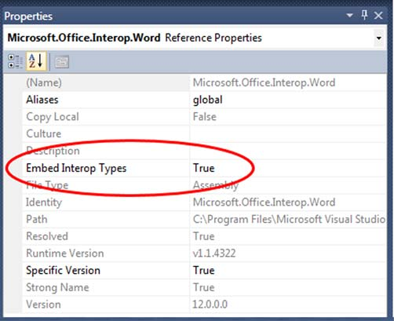

# Chapter 13: Minor changes to simplify code

> Source: C# in Depth, Third Edition — Jon Skeet. Original PDF pages 402–439.

[← Table of contents](../README.md)

<!-- PDF page 402 -->

## Minor changes

## to simplify code

This chapter covers
Optional parameters
Named arguments
Streamlining ref parameters in COM
Embedding COM Primary Interop Assemblies
Calling named indexers declared in COM
Generic variance for interfaces and delegates
Changes in locking and field-like events
Just as with previous versions, C# 4 has a few minor features that don’t merit indi-
vidual chapters to themselves. In fact, there’s only one really big feature in C# 4—
dynamic typing—which we’ll cover in the next chapter. The changes we’ll cover
here just make C# that little bit more pleasant to work with, particularly if you work
with COM on a regular basis. These features generally make code clearer, remove
drudgery from COM calls, or simplify deployment.

<!-- PDF page 403 -->

Minor changes to simplify code
Will any of these features make your heart race with excitement? It’s unlikely. But
they’re nice features all the same, and some of them may be widely applicable. Let’s
start by looking at how we call methods.
13.1
Optional parameters and named arguments
These are perhaps the Batman and Robin1 features of C# 4. They’re distinct, but usu-
ally seen together. I’ll keep them apart for the moment so we can examine each in
turn, but then we’ll use them together for some more interesting examples.
Parameters and arguments
This section obviously talks about parameters and arguments a lot. In casual conver-
sation, the two terms are often used interchangeably, but I’ll use them in line with
their formal definitions. Just to remind you, a parameter (also known as a formal
parameter) is the variable that’s part of the method or indexer declaration. An argu-
ment is an expression used when calling the method or indexer. For example, con-
sider this snippet:
void Foo(int x, int y)
{
// Do something with x and y
}
...
int a = 10;
Foo(a, 20);
Here the parameters are x and y, and the arguments are a and 20.
We’ll start by looking at optional parameters.
13.1.1 Optional parameters
Visual Basic has had optional parameters for ages, and they’ve been in the CLR from
.NET 1.0. The concept is as obvious as it sounds: some parameters are optional, so
their values don’t have to be explicitly specified by the caller. Any parameter that
hasn’t been specified as an argument by the caller is given a default value.
MOTIVATION
Optional parameters are usually used when several values are required for an opera-
tion, and the same values are used a lot of the time. For example, suppose you wanted
to read a text file; you might want to provide a method that allows the caller to specify
the name of the file and the encoding to use. The encoding is almost always UTF-8,
though, so it’s nice to be able to use that automatically if it’s all you need.
Historically the idiomatic way of allowing this in C# has been to use method over-
loading: declare one method with all the possible parameters, and others that call that
1 Or Cavalleria rusticana and Pagliacci if you’re feeling more highly cultured.

<!-- PDF page 404 -->

Optional parameters and named arguments
method, passing in default values where appropriate. For instance, you might create
methods like this:
public IList<Customer> LoadCustomers(string filename,
Encoding encoding)
{
...
}
Do real work here
public IList<Customer> LoadCustomers(string filename)
{
return LoadCustomers(filename, Encoding.UTF8);
}
Default to UTF-8
This works fine for a single parameter, but it becomes complicated when there are
multiple options, as each extra option doubles the number of possible overloads. If
two of them are of the same type, this approach would naturally lead to multiple
methods with the same signature, which is invalid. Often the same set of overloads is
also required for multiple parameter types. For example, the XmlReader.Create()
method can create an XmlReader from a Stream, a TextReader, or a string, but it also
provides the option of specifying an XmlReaderSettings and other arguments. Due to
this duplication, there are 12 overloads for the method.
This could be significantly reduced with optional parameters. Let’s see how it’s
done.
DECLARING OPTIONAL PARAMETERS AND OMITTING THEM WHEN SUPPLYING ARGUMENTS
Making a parameter optional is as simple as
supplying a default value for it, using what
looks like a variable initializer. Figure 13.1
shows a method with three parameters: two
are optional, one is required.
All this method does is print out the
arguments, but that’s enough to see what’s
going on. The following listing gives the full
code and calls the method three times, spec-
ifying a different number of arguments for
each call.
Required
parameter
Optional
parameters
void Dump(int x, int y = 20, int z = 30)
Default
values
Figure 13.1
Declaring optional
parameters
Listing 13.1
Declaring and calling a method with optional parameters
static void Dump(int x, int y = 20, int z = 30)
{
Console.WriteLine("x={0} y={1} z={2}", x, y, z);
}
...
Dump(1, 2, 3);
Dump(1, 2);
Dump(1);
Declares method
with optional
parameters
B
Calls method with
all arguments
C
Omits one argument
D
Omits two arguments
E

<!-- PDF page 405 -->

Minor changes to simplify code
The optional parameters are the ones with default values specified B. If the caller
doesn’t specify y, its initial value will be 20, and likewise z has a default value of 30.
The first call C explicitly specifies all the arguments; the remaining calls (D and E)
omit one or two arguments, respectively, so the default values are used. When there’s
one argument missing, the compiler assumes that the final parameter has been omit-
ted, then the penultimate one, and so on. The output is as follows:
x=1 y=2 z=3
x=1 y=2 z=30
x=1 y=20 z=30
Note that although the compiler could use some clever analysis of the types of the
optional parameters and the arguments in order to work out what’s been left out, it
doesn’t: it assumes that you’re supplying arguments in the same order as the parame-
ters.2 This means that the following code is invalid:

INVALID
static void TwoOptionalParameters(int x = 10,
string y = "default")
{
Console.WriteLine("x={0} y={1}", x, y);
}
...
TwoOptionalParameters("second parameter");
Error!
This tries to call the TwoOptionalParameters method specifying a string for the first
argument. There’s no overload with a first parameter that’s convertible from a string,
so the compiler issues an error. This is a good thing—overload resolution is tricky
enough (particularly when generic type inference gets involved) without the compiler
trying all kinds of different permutations to find something you might be trying to call.
If you want to omit the value for one optional parameter but specify a later one, you
need to use named arguments.
RESTRICTIONS ON OPTIONAL PARAMETERS
There are a few rules for optional parameters. All optional parameters must come
after required parameters. The exception to this is a parameter array (as declared with
the params modifier), which still has to come at the end of a parameter list, but can
come after optional parameters. A parameter array can’t be declared as an optional
parameter—if the caller doesn’t specify any values for it, an empty array will be used
instead. Optional parameters can’t have ref or out modifiers either.
An optional parameter can be of any type, but there are restrictions on the default
value specified. You can always use constants: numeric and string literals, null, const
members, enum members, and the default(T) operator. Additionally, for value types,
you can call the parameterless constructor, although this is equivalent to using the
default (...) operator anyway. There has to be an implicit conversion from the
specified value to the parameter type, but this must not be a user-defined conversion.
Table 13.1 shows some examples of valid parameter lists.
2 Unless you’re using named arguments, of course—you’ll learn about those soon.

<!-- PDF page 406 -->

Optional parameters and named arguments
Table 13.1
Valid method parameter lists using optional parameters
Declaration
Notes
Foo(int x, int y = 10)
Numeric literal used for default value
Foo(decimal x = 10)
Implicit built-in conversion from int to
decimal
Foo(string name = "default")
String literal used for default value
Foo(DateTime dt = new DateTime())
Zero value of DateTime
Foo(DateTime dt = default(DateTime))
Alternative syntax for the zero value
Foo<T>(T value = default(T))
Default value operator works with type param-
eters
Foo(int? x = null)
Nullable conversion
Foo(int x, int y = 10, params int[] z)
Parameter array after optional parameters
In contrast, table 13.2 shows some invalid parameter lists and explains why they’re not
allowed.
Table 13.2
Invalid method parameter lists using optional parameters
Declaration (invalid)
Notes
Foo(int x = 0, int y)
Required non-params parameter after optional
parameter
Foo(DateTime dt = DateTime.Now)
Default values must be constants
Foo(XName name = "default")
Conversion from string to XName is user-defined
Foo(params string[] names = null)
Parameter arrays can’t be optional
Foo(ref string name = "default")
ref/out parameters can’t be optional
The fact that the default value has to be constant is a pain in two different ways. One
of them is familiar from a slightly different context, as we’ll look at now.
VERSIONING AND OPTIONAL PARAMETERS
The restrictions on default values for optional parameters may remind you of the
restrictions on const fields or attribute values, and they behave very similarly. In both
cases, when the compiler references the value, it copies it directly into the output. The
generated IL acts exactly as if your original source code had contained the default
value. This means if you ever change the default value without recompiling everything
that references it, the old callers will still be using the old default value.
To make this concrete, imagine this set of steps:

<!-- PDF page 407 -->

Minor changes to simplify code
Create a class library (Library.dll) with a class like this:
public class LibraryDemo
{
public static void PrintValue(int value = 10)
{
System.Console.WriteLine(value);
}
}
Create a console application (Application.exe) that references the class library:
public class Program
{
static void Main()
{
LibraryDemo.PrintValue();
}
}
Run the application—it’ll print 10, predictably.
Change the declaration of PrintValue as follows, and then recompile just the
class library:
public static void PrintValue(int value = 20)
Rerun the application—it’ll still print 10. The value has been compiled directly
into the executable.
Recompile the application and rerun it—this time it’ll print 20.
This versioning issue can cause bugs that are hard to track down, because all the code
looks correct. Essentially, you’re restricted to using genuine constants that should
never change as default values for optional parameters.3 There’s one benefit of this
setup: it gives the caller a guarantee that the value it knew about at compile time is the
one that’ll be used. Developers may feel more comfortable with that than with a
dynamically computed value, or one that depends on the version of the library used at
execution time.
Of course, this also means you can’t use any values that can’t be expressed as con-
stants anyway. You can’t create a method with a default value of “the current time,” for
example.
MAKING DEFAULTS MORE FLEXIBLE WITH NULLITY
Fortunately, there’s a way around the restriction that default values must be constants.
Essentially, you introduce a magic value to represent the default, and then replace
that magic value with the real default within the method itself. If the phrase magic value
bothers you, I’m not surprised, but we’ll use null for the magic value, which already
represents the absence of a normal value. If the parameter type would normally be a
value type, we’ll simply make it the corresponding nullable value type, at which point
we can still specify that the default value is null.
3 Or you could just accept that you’ll need to recompile everything if you change the value. In many contexts
that’s a reasonable trade-off.

<!-- PDF page 408 -->

Optional parameters and named arguments
As an example of this, let’s look at a situation similar to the one I used to introduce
the whole topic: allowing the caller to supply an appropriate text encoding to a
method, but defaulting to UTF-8. You can’t specify the default encoding as
Encoding.UTF8 as that’s not a constant value, but you can treat a null parameter value
as “use the default.” To demonstrate how you can handle value types, let’s make the
method append a timestamp to a text file with a message. We’ll default the encoding
to UTF-8 and the timestamp to the current time. The following listing shows the com-
plete code and a few examples of using it.
Listing 13.2
Using null default values to handle nonconstant situations
static void AppendTimestamp(string filename,
string message,
Encoding encoding = null,
DateTime? timestamp = null)
{
Encoding realEncoding = encoding ?? Encoding.UTF8;
DateTime realTimestamp = timestamp ?? DateTime.Now;
using (TextWriter writer = new StreamWriter(filename,
true,
realEncoding))
{
writer.WriteLine("{0:s}: {1}", realTimestamp, message);
}
}
...
AppendTimestamp("utf8.txt", "First message");
AppendTimestamp("ascii.txt", "ASCII", Encoding.ASCII);
AppendTimestamp("utf8.txt", "Message in the future", null,
new DateTime(2030, 1, 1));
Two
required
parameters
Two
optional
parameters B
Null
coalescing
operator
for
convenience
C
Explicit use
of null
D
Listing 13.2 shows a few nice features of this approach. First, it solves the versioning
problem. The default values for the optional parameters are null B, but the effective val-
ues are “the UTF-8 encoding” and “the current date and time.” Neither of these could
be expressed as constants, and should you ever want to change the effective default—
for example, to use the current UTC time instead of the local time—you could do so
without having to recompile everything that called AppendTimestamp. Of course,
changing the effective default changes the behavior of the method; you need to take
the same sort of care with this as you would with any other code change. At this point,
you (as the library author) are in charge of the versioning story—you’re taking respon-
sibility for not breaking clients, effectively. At least it’s more familiar territory; you know
that all callers will experience the same behavior, regardless of recompilation.
This listing also introduces an extra level of flexibility. Not only do optional param-
eters mean you can make the calls shorter, but having a specific “use the default” value
means that should you ever wish to, you can explicitly make a call allowing the method
to choose the appropriate value. At the moment, this is the only way you know to spec-
ify the timestamp explicitly without also providing an encoding D, but that’ll change
when we look at named arguments.

<!-- PDF page 409 -->

Minor changes to simplify code
The optional parameter values are simple to deal with, thanks to the null coalesc-
ing operator C. This example uses separate variables for the sake of printed format-
ting, but in real code you’d probably use the same expressions directly in the calls to
the StreamWriter constructor and the WriteLine method.
There are two downsides to this approach: first, it means that if a caller accidentally
passes in null due to a bug, it’ll get the default value instead of an exception. In cases
where you’re using a nullable value type and callers will either explicitly use null or
have a non-nullable argument, that’s not much of a problem, but for reference types it
could be an issue.
On a related note, it requires that you don’t want to use null as a “real” value.4
There are occasions where you want null to mean null, and if you don’t want that to be
the default value, you’ll have to find a different constant or just leave the parameter as
a required one. But in other cases, where there isn’t an obvious constant value that’ll
clearly always be the right default, I recommend this approach to optional parameters
as one that’s easy to follow consistently and removes some of the normal difficulties.
We’ll need to look at how optional parameters affect overload resolution, but it
makes sense to wait until you’ve seen how named arguments work. Speaking of
which…
13.1.2 Named arguments
The basic idea of named arguments is that when you specify an argument value, you
can also specify the name of the parameter it’s supplying the value for. The compiler
then makes sure that there is a parameter of the right name and uses the value for that
parameter. Even on its own, this can increase readability in some cases. In practice,
named arguments are most useful in cases where optional parameters are also likely
to appear, but we’ll look at the simple situation first.
INDEXERS, OPTIONAL PARAMETERS, AND NAMED ARGUMENTS
You can use
optional parameters and named arguments with indexers as well as methods.
But this is only useful for indexers with more than one parameter: you can’t
access an indexer without specifying at least one argument anyway. Given this
limitation, I don’t expect to see the feature used much with indexers, and I
haven’t demonstrated it in the book. It works exactly as you’d expect it to,
though.
I’m sure you’ve seen code that looks something like this:
MessageBox.Show("Please do not press this button again", // text
"Ouch!"); // title
I’ve chosen a pretty tame example; it can get a lot worse when there are loads of argu-
ments, especially if a lot of them are the same type. But this is still realistic; even with
4 We almost need a second null-like special value, meaning “please use the default value for this parameter,”
and then we could allow that special value to be supplied either automatically for missing arguments or explic-
itly in the argument list. I’m sure this would cause dozens of problems, but it’s an interesting thought exper-
iment.

<!-- PDF page 410 -->

Optional parameters and named arguments
just two parameters, I’d find myself guessing which argument meant what based on
the text when reading this code, unless it had comments like the ones I have here.
There’s a problem though: comments can lie about the code they describe. Nothing is
checking them at all. In contrast, named arguments ask the compiler to help.
SYNTAX
All you need to do to the previous example to make the code clearer is prefix each
argument with the name of the corresponding parameter and a colon:
MessageBox.Show(text: "Please do not press this button again",
caption: "Ouch!");
Admittedly, you now don’t get to choose the name you find most meaningful (I prefer
title to caption), but at least you’ll know if you get something wrong.
Of course, the most common way in which you could get something wrong here is
to get the arguments the wrong way around. Without named arguments, this would be
a problem: you’d end up with the pieces of text switched in the message box. With
named arguments, the ordering becomes largely irrelevant. You can rewrite the previ-
ous code like this:
MessageBox.Show(caption: "Ouch!",
text: "Please do not press this button again");
You’d still have the right text in the right place, because the compiler would work out
what you meant based on the names.
For another example, look at the StreamWriter constructor call in listing 13.2.
The second argument is just true—what does this mean? Is it going to force a stream
flush after every write? Include a byte order mark? Append to an existing file instead
of creating a new one? Here’s the equivalent call using named arguments:
new StreamWriter(path: filename,
append: true,
encoding: realEncoding)
In both of these examples, you’ve seen how named arguments effectively attach
semantic meaning to values. In the never-ending quest to make code communicate bet-
ter with humans as well as computers, this is a definite step forward.
I’m not suggesting that named arguments should be used when the meaning is
already obvious, of course. Like all features, it should be used with discretion and
thought.
Named arguments with out and ref
If you want to specify the name of an argument for a ref or out parameter, you put
the ref or out modifier after the name and before the argument. Using int.Try-
Parse as an example, you might have code like this:
int number;
bool success = int.TryParse("10", result: out number);

<!-- PDF page 411 -->

Minor changes to simplify code
To explore some other aspects of the syntax, the following listing shows a method
with three integer parameters, just like the one we used to start looking at optional
parameters.
Listing 13.3
Simple examples of using named arguments
static void Dump(int x, int y, int z)
{
Console.WriteLine("x={0} y={1} z={2}", x, y, z);
}
...
Dump(1, 2, 3);
Dump(x: 1, y: 2, z: 3);
Dump(z: 3, y: 2, x: 1);
Dump(1, y: 2, z: 3);
Dump(1, z: 3, y: 2);
Declares method
as normal
B
Calls method
as normal
C
Specifies names for
all arguments
D
Specifies names for
some arguments
E
The output is the same for each call in listing 13.3: x=1, y=2, z=3. This code effec-
tively makes the same method call in five different ways. It’s worth noting that there
are no tricks in the method declaration B; you can use named arguments with any
method that has parameters. First, you call the method in the normal way, without
using any new features C. This is a sort of control point to make sure that the other
calls really are equivalent. You then make two calls to the method using just named
arguments D. The second of these calls reverses the order of the arguments, but the
result is still the same, because the arguments are matched up with the parameters by
name, not position. Finally, there are two calls using a mixture of named arguments
and positional arguments E. A positional argument is one that isn’t named, so every
argument in valid C# 3 code is a positional argument from the point of view of C# 4.
Figure 13.2 shows how the final line of code works.
All named arguments have to come after positional arguments—you can’t switch
between the styles. Positional arguments always refer to the corresponding parameter
in the method declaration—you can’t make positional arguments skip a parameter by
specifying it later with a named argument. This means that these method calls would
both be invalid:

Dump(z: 3, 1, y: 2)—Positional argu-
ments must come before named ones.
static void Dump(int x, int y, int z)

Dump(2, x: 1, z: 3)—x has already
been specified by the first positional
argument, so you can’t specify it again
with a named argument.
Dump(1, z: 3, y: 2)
Positional
argument
Named
arguments
Now, although in this particular case the method
calls are equivalent, that’s not always the case.
Let’s look at why reordering arguments might
change behavior.
Figure 13.2
Positional and named
arguments in the same call

<!-- PDF page 412 -->

Optional parameters and named arguments
ARGUMENT EVALUATION ORDER
You’re used to C# evaluating its arguments in the order they’re specified, which, until
C# 4, has always been the order in which the parameters have been declared too. In
C# 4, only the first part is still true: the arguments are still evaluated in the order
they’re written, even if that’s not the same as the order in which they’re declared as
parameters. This matters if evaluating the arguments has side effects.
It’s usually worth trying to avoid having side effects in arguments, but there are
cases where it can make the code clearer. A more realistic rule is to try to avoid side
effects that might interfere with each other. For the sake of demonstrating execution
order, we’ll break both of these rules. Please don’t treat this as a recommendation that
you do the same thing.
First we’ll create a relatively harmless example, introducing a method that logs its
input and returns it—a sort of logging echo. We’ll use the return values of three calls
to this to call the Dump method (which isn’t shown, as it hasn’t changed). The follow-
ing listing shows two calls to Dump that result in slightly different output.
Listing 13.4
Logging argument evaluation
static int Log(int value)
{
Console.WriteLine("Log: {0}", value);
return value;
}
...
Dump(x: Log(1), y: Log(2), z: Log(3));
Dump(z: Log(3), x: Log(1), y: Log(2));
The results of running listing 13.4 show what happens:
Log: 1
Log: 2
Log: 3
x=1 y=2 z=3
Log: 3
Log: 1
Log: 2
x=1 y=2 z=3
In both cases, the parameters x, y, and z in the Dump method still have the values 1, 2,
and 3, respectively. But you can see that although they were evaluated in that order in
the first call (which was equivalent to using positional arguments), the second call
evaluated the value used for the z parameter first.
You can make the effect even more significant by using side effects that change the
results of the argument evaluation, as shown in the following listing, again using the
same Dump method.

<!-- PDF page 413 -->

Minor changes to simplify code
Listing 13.5
Abusing argument evaluation order
int i = 0;
Dump(x: ++i, y: ++i, z: ++i);
i = 0;
Dump(z: ++i, x: ++i, y: ++i);
The results of listing 13.5 may be best expressed in terms of the blood spatter pattern
at a murder scene, after someone maintaining code like this has gone after the origi-
nal author with an axe. Yes, technically speaking the last line results are x=2 y=3 z=1,
but I’m sure you see what I’m getting at. Just say No to code like this.
By all means, reorder your arguments for the sake of readability. You may think
that laying out a call to MessageBox.Show with the title coming above the text in the
code itself reflects the onscreen layout more closely, for example. If you want to rely
on a particular evaluation order for the arguments, though, introduce some local vari-
ables to execute the relevant code in separate statements. The compiler won’t care
either way—it’ll follow the rules of the spec—but this reduces the risk of a “harmless
refactoring” that inadvertently introduces a subtle bug.
To return to cheerier matters, let’s combine the two features (optional parameters
and named arguments) and see how much tidier the code can be.
13.1.3 Putting the two together
Optional parameters and named arguments work in tandem with no extra effort
required on your part. It’s not uncommon to have a bunch of parameters where there
are obvious defaults, but where it’s hard to predict which ones a caller will want to
specify explicitly. Figure 13.3 shows just about every combination: a required parame-
ter, two optional parameters, a positional argument, a named argument, and a miss-
ing argument for an optional parameter.
Going back to an earlier example,
in listing 13.2 you wanted to append a
timestamp to a file using the default
encoding of UTF-8, but with a particu-
lar timestamp. That code used null
for the encoding argument, but now
you can write the same code more sim-
ply, as shown in the following listing.
static void Dump(int x, int y = 20, int z = 30)
Dump(10, z: 3)
Figure 13.3
Mixing named arguments and
optional parameters
Listing 13.6
Combining named arguments and optional parameters
static void AppendTimestamp(string filename,
string message,
Encoding encoding = null,
DateTime? timestamp = null)
{
Same
implementation
as before
}
...

<!-- PDF page 414 -->

Optional parameters and named arguments
AppendTimestamp("utf8.txt", "Message in the future",
timestamp: new DateTime(2030, 1, 1));
Encoding is omitted
Named timestamp
argument
In this fairly simple situation, the benefit isn’t particularly huge, but in cases where
you want to omit three or four arguments but specify the final one, it’s a real blessing.
You’ve seen how optional parameters reduce the need for huge long lists of over-
loads, but one specific pattern where this is worth mentioning is with respect to
immutability.
IMMUTABILITY AND OBJECT INITIALIZATION
One aspect of C# 4 that disappoints me somewhat is that it hasn’t done much explicitly
to make immutability easier. Immutable types are a core part of functional program-
ming, and C# has been gradually supporting the functional style more and more…
except for immutability. Object and collection initializers make it easy to work with
mutable types, but immutable types have been left out in the cold. (Automatically
implemented properties fall into this category too.) Fortunately, though they’re not
particularly designed to aid immutability, named arguments and optional parameters
allow you to write object initializer–like code that calls a constructor or other factory
method.
For instance, suppose you were creating a Message class, which required a from
address, a to address, and a body, with the subject and attachment being optional.
(We’ll stick with single recipients in order to keep the example as simple as possible.)
You could create a mutable type with appropriate writable properties, and construct
instances like this:
Message message = new Message {
From = "skeet@pobox.com",
To = "csharp-in-depth-readers@everywhere.com",
Body = "Hope you like the third edition",
Subject = "A quick message"
};
That has two problems: first, it doesn’t enforce the required data to be provided. You
could force those to be supplied to the constructor, but then (before C# 4) it wouldn’t
be obvious which argument meant what:
Message message = new Message(
"skeet@pobox.com",
"csharp-in-depth-readers@everywhere.com",
"Hope you like the third edition")
{
Subject = "A quick message"
};
The second problem is that this initialization pattern simply doesn’t work for immuta-
ble types. The compiler has to call a property setter after it has initialized the object.
But you can use optional parameters and named arguments to come up with some-
thing that has the nice features of the first form (only specifying what you’re interested

<!-- PDF page 415 -->

Minor changes to simplify code
in and supplying names) without losing the validation of which aspects of the message
are required or the benefits of immutability. The following listing shows a possible con-
structor signature and the construction step for the same message as before.
Listing 13.7
Using optional parameters and named arguments for immutability
public Message(string from, string to,
string body, string subject = null,
byte[] attachment = null)
{
Normal
initialization
code goes here
}
...
Message message = new Message(
from: "skeet@pobox.com",
to: "csharp-in-depth-readers@everywhere.com",
body: "I hope you like the third edition",
subject: "A quick message"
);
I really like this in terms of readability and general cleanliness. You don’t need hun-
dreds of constructor overloads—just one with some of the parameters being optional.
The same syntax will also work with static creation methods, unlike object initializers.
The only downside is that it really relies on your code being consumed by a language
that supports optional parameters and named arguments; otherwise callers will be
forced to write ugly code to specify values for all the optional parameters. Obviously
there’s more to immutability than getting values to the initialization code, but this is a
welcome step in the right direction nonetheless.
There are a couple of final points to make about these features before we move on
to COM—points concerning the details of how the compiler handles your code and
the difficulty of good API design.
OVERLOAD RESOLUTION
Clearly both named arguments and optional parameters affect how the compiler
resolves overloads—if there are multiple method signatures available with the same
name, which one should it pick? Optional parameters can increase the number of
applicable methods (if some methods have more parameters than the number of
specified arguments) and named arguments can decrease the number of applicable
methods (by ruling out methods that don’t have the appropriate parameter names).
For the most part, the changes are intuitive: to check whether any particular
method is applicable, the compiler tries to build a list of the arguments it would pass
in, using the positional arguments in order, and then matching the named arguments
up with the remaining parameters. If a required parameter hasn’t been specified or if
a named argument doesn’t match any remaining parameters, the method isn’t appli-
cable. The specification gives more detail about this in section 7.5.3, but there are two
situations I’d like to draw particular attention to.

<!-- PDF page 416 -->

Optional parameters and named arguments
First, if two methods are both applicable and one of them has been given all of its
arguments explicitly, whereas the other uses an optional parameter filled in with a
default value, the method that doesn’t use any default values will win. But this doesn’t
extend to just comparing the number of default values used—it’s a strict “does it use
default values or not” divide. For example, consider the following:
static void Foo(int x = 10) {}
static void Foo(int x = 10, int y = 20) {}
...
Foo();
Foo(1);
Foo(y: 2);
Foo(1, 2);
Error: ambiguous
B
Calls first overload
C
Calls second overload
D
Calls second overload
E
In the first call B, both methods are applicable because of their optional parameters.
But the compiler can’t work out which one you meant to call; it’ll raise an error. In the
second call C, both methods are still applicable, but the first overload is used because
it can be applied without using any default values, whereas the second overload uses
the default value for y. For both the third and fourth calls, only the second overload is
applicable. The third call D names the y argument, and the fourth call E has two
arguments; both of these mean the first overload isn’t applicable.
OVERLOADS AND INHERITANCE DON’T ALWAYS MIX NICELY
All of this assumes
that the compiler has gone as far as finding multiple overloads to choose
between. If some methods are declared in a base type, but there are applica-
ble methods in a more derived type, the latter will win. This has always been
the case, and it can cause some surprising results (see the book’s website for
more details and examples: http://mng.bz/aEmE), but now optional param-
eters mean there may be more applicable methods than you’d expect. I advise
you to avoid overloading a base class method within a derived class unless you
get a huge benefit.
The second point is that sometimes named arguments can be an alternative to casting
in order to help the compiler resolve overloads. Sometimes a call can be ambiguous
because the arguments can be converted to the parameter types in two different meth-
ods, but neither method is better than the other in all respects. For instance, consider
the following method signatures and call:
void Method(int x, object y) { ... }
void Method(object a, int b) { ... }
...
Method(10, 10);
Ambiguous call
Both methods are applicable, and neither is better than the other. There are two ways
to resolve this, assuming you can’t change the method names to make them unam-
biguous that way. (That’s my preferred approach. Make each method name more
informative and specific, which will improve the general readability of the code.) You

<!-- PDF page 417 -->

Minor changes to simplify code
can either cast one of the arguments explicitly, or use named arguments to resolve
the ambiguity:
void Method(int x, object y) { ... }
void Method(object a, int b) { ... }
...
Method(10, (object) 10);
Method(x: 10, y: 10);
Casting to resolve
ambiguity
Naming to resolve
ambiguity
Of course, this only works if the parameters have different names in the different
methods, but it’s a handy trick to know. Sometimes the cast will give more readable
code; sometimes the name will. It’s just an extra weapon in the fight for clear code.
Unfortunately, it does have a downside, along with named arguments in general:
it’s another thing to be careful about when you change parameter names.
THE SILENT HORROR OF CHANGING NAMES
In the past, parameter names haven’t mattered much if you’ve only been using C#.
Other languages may have cared, but in C# the only times that parameter names were
important were when you were looking at IntelliSense and when you were looking at
the method code itself. Now the parameter names of a method are effectively part of
the API even if you’re only using C#. If you change them at a later date, code can
break—anything that was using a named argument to refer to one of your parameters
will fail to compile if you decide to change it. This may not be much of an issue if your
code is only consumed by itself, but if you’re writing a public API, be aware that chang-
ing a parameter name is a big deal. It always has been, really, but if everything calling
the code was written in C#, you’ve been able to ignore that until now.
Renaming parameters is bad; switching the names around is worse. The calling
code may still compile, but with a different meaning. A particularly evil form of this is
to override a method and switch the parameter names in the overridden version. The
compiler will always look at the deepest override it knows about, based on the static
type of the expression used as the target of the method call. You don’t want to get into
a situation where calling the same method implementation with the same argument
list results in different behavior based on the static type of a variable.
IN CONCLUSION…
Named arguments and optional parameters are possibly two of the simplest-sounding
features of C# 4, and yet they have a fair amount of complexity, as you’ve seen. The
basic ideas are easily expressed and understood, and the good news is that most of the
time that’s all you need to care about. You can take advantage of optional parameters
to reduce the number of overloads you write, and named arguments can make code
much more readable when several easily confusable arguments are used.
The trickiest bit is probably deciding which default values to use, bearing in mind
potential versioning issues. Likewise, it’s now more obvious than before that parame-
ter names matter, and you need to be careful when overriding existing methods, to
avoid being evil to your callers.

<!-- PDF page 418 -->

Improvements for COM interoperability
Speaking of evil, let’s move on to the new features relating to COM. I’m only kid-
ding…mostly, anyway.
13.2
Improvements for COM interoperability
I readily admit to being far from a COM expert. When I tried to use it before .NET
came along, I always ran into issues that were no doubt partially caused by my lack of
knowledge and partially caused by the components I was working with being poorly
designed or implemented. My overall impression of COM as a sort of black magic has
lingered, though. I’ve been reliably informed that there’s a lot to like about it, but
unfortunately I haven’t found myself going back to learn it in detail—and there seems
to be a lot of detail to study.
THIS SECTION IS MICROSOFT-SPECIFIC
The changes for COM interoperability
won’t make sense for all C# compilers, and a compiler can still be deemed
compliant with the specification without implementing these features.
.NET has made COM somewhat friendlier in general, but until now there have been
distinct advantages to using it from Visual Basic instead of C#. The playing field has
been leveled significantly by C# 4, as you’ll see in this section. For the sake of familiar-
ity, I’ll use Word for the example in this chapter and Excel in the next chapter.
There’s nothing Office-specific about the new features, though; you should find the
experience of working with COM to be nicer in C# 4 whatever you’re doing.
13.2.1 The horrors of automating Word before C# 4
Our example is simple—it’s just going to start Word, create a document with a single
paragraph of text, save it, and then exit. Sounds easy, right? If only that were so. The
following listing shows the code required before C# 4.
Listing 13.8
Creating and saving a document in C# 3
object missing = Type.Missing;
Starts Word
B
Creates a new document
C
Application app = new Application { Visible = true };
app.Documents.Add(ref missing, ref missing,
ref missing, ref missing);
Document doc = app.ActiveDocument;
Paragraph para = doc.Paragraphs.Add(ref missing);
para.Range.Text = "Thank goodness for C# 4";
Saves the document
D
object filename = "demo.doc";
object format = WdSaveFormat.wdFormatDocument97;
doc.SaveAs(ref filename, ref format,
ref missing, ref missing, ref missing,
ref missing, ref missing, ref missing,
ref missing, ref missing, ref missing,
ref missing, ref missing, ref missing,
ref missing, ref missing);
Shuts down Word
E
doc.Close(ref missing, ref missing, ref missing);
app.Application.Quit(ref missing, ref missing, ref missing);

<!-- PDF page 419 -->

Minor changes to simplify code
Each step in this code sounds simple: first you create an instance of the COM type B
and make it visible using an object initializer expression; then you create and fill in a
new document C. The mechanism for inserting some text into a document isn’t quite
as straightforward as you might expect, but it’s worth remembering that a Word docu-
ment can have a fairly complex structure; this isn’t as bad as it might be. A couple of
the method calls here have optional by-reference parameters; you don’t need them,
so you pass a local variable by reference with a value of Type.Missing. If you’ve ever
done any COM work before, you’re probably very familiar with this pattern.
Next comes the really nasty bit: saving the document D. Yes, the SaveAs method
really does have 16 parameters, of which you’re only using 2. Even those 2 need to be
passed by reference, which means creating local variables for them. In terms of read-
ability, this is a complete nightmare. Don’t worry—we’ll soon sort it out.
Finally, you close the document and the application E. Aside from the fact that
both calls have three optional parameters that you don’t care about, there’s nothing
interesting here.
Let’s start off by using the features we’ve already seen in this chapter—they’re suf-
ficient in themselves to cut the example down significantly.
13.2.2 The revenge of optional parameters and named arguments
First things first: let’s get rid of all those arguments corresponding to optional param-
eters you’re not interested in. That also means you don’t need the missing variable.
That still leaves you with 2 parameters out of a possible 16 for the SaveAs method.
At the moment it’s obvious which is which based on the local variable names, but what
if you have them the wrong way around? All the parameters are weakly typed, so
you’re really going on guesswork. You can easily give the arguments names to clarify
the call. If you wanted to use one of the later parameters, you’d have to specify the
name anyway, just to skip the ones you’re not interested in.
The following listing shows the code—it looks a lot cleaner already.
Listing 13.9
Automating Word using normal C# 4 features
Application app = new Application { Visible = true };
app.Documents.Add();
Document doc = app.ActiveDocument;
Paragraph para = doc.Paragraphs.Add();
para.Range.Text = "Thank goodness for C# 4";
object filename = "demo.doc";
object format = WdSaveFormat.wdFormatDocument97;
doc.SaveAs(FileName: ref filename, FileFormat: ref format);
doc.Close();
app.Application.Quit();
That’s much better, although it’s still ugly to have to create local variables for the
SaveAs arguments you are specifying. Also, if you’ve been reading carefully, you may
be concerned about the optional parameters that have been removed. They were ref

<!-- PDF page 420 -->

Improvements for COM interoperability
parameters—but optional—which isn’t a combination C# normally supports. What’s
going on?
13.2.3 When is a ref parameter not a ref parameter?
C# normally takes a pretty strict line on ref parameters. You have to mark the argu-
ment with ref as well as the parameter, to show that you understand what’s going
on—that your variable may have its value changed by the method you’re calling.
That’s all fine in normal code, but COM APIs often use ref parameters for almost every-
thing, for perceived performance reasons—they usually don’t modify the variable you
pass in. Passing arguments by reference is slightly painful in C#. Not only do you have
to specify the ref modifier, you also must have a variable. You can’t just pass values by
reference.
In C# 4, the compiler makes this a lot easier by letting you pass an argument by
value into a COM method, even if it’s for a ref parameter. Consider a call like this,
where argument might happen to be a variable of type string, but the parameter is
declared as ref object:
comObject.SomeMethod(argument);
The compiler emits code that’s equivalent to this:
object tmp = argument;
comObject.SomeMethod(ref tmp);
Note that any changes made by SomeMethod are discarded, so the call really does
behave as if you were passing argument by value. This same process is used for
optional ref parameters; each involves a local variable initialized to Type.Missing
and passed by reference into the COM method. If you decompile the slimlined C#
code, you’ll see that the IL emitted is pretty bulky with all of those extra variables.
You can now apply the finishing touches to the Word example, as shown in the fol-
lowing listing.
Listing 13.10
Passing arguments by value in COM methods
Application app = new Application { Visible = true };
app.Documents.Add();
Document doc = app.ActiveDocument;
Paragraph para = doc.Paragraphs.Add();
para.Range.Text = "Thank goodness for C# 4";
doc.SaveAs(FileName: "test.doc",
FileFormat: WdSaveFormat.wdFormatDocument97);
doc.Close();
app.Application.Quit();
Arguments passed by value
As you can see, the final result is much cleaner code than you started with. With an
API like Word, you still need to work through a somewhat bewildering set of methods,
properties, and events in the core types, such as Application and Document, but at
least your code will be a lot easier to read.

<!-- PDF page 421 -->

Minor changes to simplify code
In terms of changes to source code, there’s one final aspect of the COM support to
look at before we move on to the deployment improvements available in C# 4.
13.2.4 Calling named indexers
Several aspects of C# 4 provide support for features that Visual Basic has enjoyed for a
long time, and this is another one. The CLR, COM, and Visual Basic all permit nonde-
fault properties with parameters—named indexers in C# terms. Until version 4, C# has
not only forbidden you to directly declare your own named indexers,5 but it hasn’t
provided a way of accessing them using property syntax either. The only indexer you
can use from C# is the one declared as the default property for the type. This hasn’t
been a great issue for .NET components written in Visual Basic, as named indexers are
generally discouraged. But COM components, such as those for Office, use them more
heavily. C# 4 allows you to call named indexers in a more natural fashion, but you still
can’t declare them for your own C# types.
TERMINOLOGY CLASHES AGAIN
I’ve used the term indexer throughout this sec-
tion to describe what in VB terms would be known as a parameterized property.
The CLI specification calls it an indexed property. Whatever the terminology, it’s
declared as a property in the IL, and it has parameters. The normal indexer
(as far as C# is concerned) is defined by the default member (or default property)
for the type—for example, the default member of StringBuilder is the
Chars property (which has an Int32 parameter). When I talk about named
indexers here, I’m talking about ones that aren’t the default for the type, so you
have to refer to them by name.
We’ll use Word for the example again, this time showing the different meanings for
words. The _Application type in Word defines an indexer called SynonymInfo with a
declaration like this:
SynonymInfo SynonymInfo[string Word,
ref object LanguageId = Type.Missing]
That’s not valid C# syntax, because you can’t declare a named indexer, but hopefully
it’s obvious what it means. The name of the indexer is SynonymInfo. It returns a refer-
ence to a SynonymInfo object and has two parameters, one of which is optional. (The
fact that the name of the indexer and the name of the return type are the same in this
case is entirely coincidental.)
The SynonymInfo can be used to find meanings for the word and synonyms for
each meaning. The following listing shows three different ways of using the indexer to
display the number of meanings for three different words.
5 Directly, anyway. You can apply System.Runtime.CompilerServices.IndexerNameAttribute manu-
ally, but it’s not something that C# is aware of as a language.

<!-- PDF page 422 -->

Improvements for COM interoperability
Listing 13.11
Using the SynonymInfo indexer to count word meanings
static void ShowInfo(SynonymInfo info)
{
Console.WriteLine("{0} has {1} meanings",
info.Word, info.MeaningCount);
}
...
Application app = new Application { Visible = false };
Uses earlier
C# syntax
B
object missing = Type.Missing;
ShowInfo(app.get_SynonymInfo("painful", ref missing));
D
Takes
advantage
of optional
parameter
ShowInfo(app.SynonymInfo["nice", WdLanguageID.wdEnglishUS]);
Uses indexer
with two
arguments
C
ShowInfo(app.SynonymInfo[Word: "features"]);
app.Application.Quit();
Even without named indexers, the previous features you’ve seen would’ve helped
alleviate
the
pain
of
the
earlier
C#
syntax B;
you
could’ve
called
app.get_SynonymInfo("better") and taken advantage of optional parameters, for
example. But you can see from the second and third ShowInfo calls (C and D) that
the indexer syntax looks less awkward than the get_ call. You could argue that this
should be a method call anyway, or that there should be a parameterless SynonymInfo
property that returns a collection with an appropriate default indexer. That’s one
case of the general argument given by the C# designers for not implementing full
support for named indexers, including declaring them within C#. But the point is
that it already is an indexer in Word, so it’s nice to be able to use it that way.6 The sec-
ond ShowInfo call C uses the implicit ref parameter feature from section 13.2.3,
and the third D omits the optional parameter and names the remaining argument
just for kicks.
There’s one slight twist to optional parameters and indexers: if all of the parame-
ters are optional, and you don’t want to specify any arguments, you have to omit the
square brackets. Instead of writing foo.Indexer[], you’d use foo.Indexer. All of this
applies both for getting from the indexer and setting to it.
So far, so good—but writing the code is only part of the battle. You usually need to
be able to deploy it onto other machines as well. Again, C# 4 makes this task easier.
13.2.5 Linking primary interop assemblies
When you build against a COM type, you use an assembly generated for the compo-
nent library. Usually you use a Primary Interop Assembly (PIA), which is the canonical
interop assembly for a COM library, signed by the publisher. You can generate these
using the Type Library Importer tool (tlbimp) for your own COM libraries. PIAs make
life easier in terms of having one true way of accessing the COM types, but they’re a
pain in other ways. They can be quite large, and the whole PIA needs to be present
6 It might’ve been more interesting to display the actual meanings, but that leads to interop problems that
aren’t relevant to this chapter.

<!-- PDF page 423 -->

Minor changes to simplify code

Figure 13.4
Linking PIAs in
Visual Studio 2010
even if you’re only using a small subset of the functionality. Also, you need to have the
same version of the PIA on the deployment machine as the one you compiled against.
This can be awkward in situations where licensing issues prevent you from redistribut-
ing the PIA itself, relying on the right version being installed already. If there are a
number of versions available, but they all expose the functionality you need, you
might have to ship different versions of your code to make the references work.
C# 4 allows a very different approach. Instead of referencing a PIA like any other
assembly, you can link it. In Visual Studio 2010 and higher, this is an option in the
properties of the assembly reference, as shown in figure 13.4.
Command-line fans can use the /l (or /link) option instead of /r (or /refer-
ence) to link instead of reference:
csc /l:Path\To\PIA.dll MyCode.cs
When you link a PIA, the compiler embeds just the bits it needs from the PIA directly
into your own assembly. It only takes the types it needs, and only the members within
those types. For example, the compiler creates these types for the code we’ve looked
at in this chapter:
namespace Microsoft.Office.Interop.Word
{
[ComImport, TypeIdentifier, CompilerGenerated, Guid("...")]
public interface _Application
[ComImport, TypeIdentifier, CompilerGenerated, Guid("...")]
public interface _Document
[ComImport, CompilerGenerated, TypeIdentifier, Guid("...")]
public interface Application : _Application
[ComImport, Guid("..."), TypeIdentifier, CompilerGenerated]
public interface Document : _Document

<!-- PDF page 424 -->

Improvements for COM interoperability
[ComImport, TypeIdentifier, CompilerGenerated, Guid("...")]
public interface Documents : IEnumerable
[TypeIdentifier("...", "WdSaveFormat"), CompilerGenerated]
public enum WdSaveFormat
}
If you look in the _Application interface, it looks like this:
[ComImport, TypeIdentifier, CompilerGenerated, Guid("...")]
public interface _Application
{
void_VtblGap 1_4();
Documents Documents { [...] get; }
void_VtblGap2_1();
Document ActiveDocument { [...] get; }
}
I’ve omitted the GUIDs and the property attributes here just for the sake of space, but
you can always use Reflector to look at the embedded types. These are just interfaces
and enums—there’s no implementation. Whereas a normal PIA has a CoClass repre-
senting the actual implementation (but proxying everything to the real COM type, of
course), when the compiler needs to create an instance of a COM type via a linked PIA,
it creates the instance using the GUID associated with the type. For example, the line
in the Word example that creates an instance of Application is translated into this
code when linking is enabled:7
Application application = (Application) Activator.CreateInstance(
Type.GetTypeFromCLSID (new Guid("...")));
Figure 13.5 shows how this works at execution time.
Compile
time
App.cs
PIA.dll
Referencing
Linking
App.exe
App.exe
Execution
time
PIA.dll
Figure 13.5
Comparing
referencing and linking
COM.dll
COM.dll
7 Well, nearly. The object initializer makes it slightly more complicated, because the compiler uses an extra tem-
porary variable.

<!-- PDF page 425 -->

Minor changes to simplify code
There are various benefits to embedding type libraries:
Deployment is easier: the original PIA isn’t needed, so you don’t have to rely on
the right version being present already, or have to ship the PIA yourself.
Versioning is simpler: as long as you only use members from the version of the
COM library that’s actually installed, it doesn’t matter if you compile against an
earlier or later PIA.
Variants are treated as dynamic types, reducing the amount of casting required.
Don’t worry about the last point for now—I need to explain dynamic typing before
it’ll make much sense. All will be revealed in the next chapter.
As you can see, Microsoft has really taken COM interoperability seriously for C# 4,
making the whole development process less painful. Of course, the degree of pain has
always been variable depending on the COM library you’re developing against—some
will benefit more than others from the new features.
The next feature is entirely separate from COM, named arguments, and optional
parameters, but again it eases development a bit.
13.3
Generic variance for interfaces and delegates
You may remember that in chapter 3 I mentioned that the CLR had some support for
variance in generic types, but that C# hadn’t exposed that support yet. That’s changed
with C# 4. C# has gained the syntax required to declare generic variance, and the
compiler now knows about the possible conversions for interfaces and delegates.
This isn’t a life-changing feature—it’s more a case of flattening some speed bumps
you may have hit occasionally. It doesn’t even remove all the bumps; there are various
limitations, mostly in the name of keeping generics absolutely type-safe. But it’s still a
nice feature to have up your sleeve.
Just in case you need a reminder of what variance is all about, let’s start with a
recap of the two basic forms it comes in.
13.3.1 Types of variance: covariance and contravariance
In essence, variance is about being able to use an object of one type as if it were
another, in a type-safe way. You’re used to variance in terms of normal inheritance: if a
method has a declared return type of Stream, you can return a MemoryStream from
the implementation, for example. Generic variance is the same concept, but applied
to generics, where it becomes a bit more complicated. The variance is applied to the
type parameters within the interfaces and delegate types. That’s the bit you need to
concentrate on.
Ultimately, it doesn’t matter whether you remember the terminology I’ll use in this
section. It’ll be useful while you’re reading the chapter, but you’re unlikely to find
yourself needing it in conversation. The concepts are far more important.
There are two types of variance: covariance and contravariance. They’re essentially
the same idea but are used in the context of values moving in different directions.
We’ll start with covariance, which is generally easier to understand.

<!-- PDF page 426 -->

Generic variance for interfaces and delegates
COVARIANCE: VALUES COMING OUT OF AN API
Covariance is all about values being returned from an operation back to the caller.
Let’s imagine a very simple generic interface representing the factory pattern. It has a
single method, CreateInstance, which will return an instance of the appropriate
type. Here’s the code:
interface IFactory<T>
{
T CreateInstance();
}
Now, T only occurs once in the interface (aside from the name). It’s only used as the
return value—it’s the output of the method. That means it makes sense to be able to
treat a factory of a specific type as a factory of a more general type. To put it in real-
world terms, you can think of a pizza factory as a food factory.
CONTRAVARIANCE: VALUES GOING INTO AN API
Contravariance is the opposite way around. It’s about values being passed into the API
by the caller: the API is consuming the values instead of producing them. Let’s imag-
ine another simple interface—one that can pretty-print a particular document type to
the console. Again, there’s just one method, this time called Print:
interface IPrettyPrinter<T>
{
void Print(T document);
}
This time T only occurs in the input positions in the interface, as a parameter. To put
this into concrete terms again, if you had an implementation of IPrettyPrinter
<SourceCode>, you should be able to use it as an IPrettyPrinter<CSharpCode>.
INVARIANCE: VALUES GOING BOTH WAYS
If covariance applies when values only come out of an API, and contravariance applies
when values only go into the API, what happens when a value goes both ways? In short:
nothing. That type would be invariant.
Here’s an interface representing a type that can serialize and deserialize a data
type:
interface IStorage<T>
{
byte[] Serialize(T value);
T Deserialize(byte[] data);
}
This time, if you have an instance of IStorage<T> for a particular type T, you can’t
treat it as an implementation of the interface for either a more or less specific type. If
you try to use it in a covariant way (for example, using an IStorage<Customer> as an
IStorage<Person>), you might make a call to Serialize with an object that it can’t
handle. Similarly, if you try to use it in a contravariant way, you might get an unex-
pected type out when you deserialized some data.

<!-- PDF page 427 -->

Minor changes to simplify code
If it helps, you can think of invariance as being like ref parameters; to pass a vari-
able by reference, it has to be exactly the same type as the parameter itself, because the
value goes into the method and effectively comes out again too.
13.3.2 Using variance in interfaces
C# 4 allows you to specify in the declaration of a generic interface or delegate that a
type parameter can be used covariantly by using the out modifier, or contravariantly
using the in modifier. Once the type has been declared, the relevant types of conver-
sion are available implicitly. This works exactly the same way in both interfaces and
delegates, but I’ll show them separately for clarity. Let’s start with interfaces, as they
may be a bit more familiar and we’ve used them already to describe variance.
VARIANT CONVERSIONS ARE REFERENCE CONVERSIONS
Any conversion using
variance or covariance is a reference conversion, which means that the same ref-
erence is returned after the conversion. It doesn’t create a new object; it just
treats the existing reference as if it matched the target type. This is the same
as casting between reference types in a hierarchy: if you cast a Stream to
MemoryStream (or use the implicit conversion the other way), there’s still just
one object. The nature of these conversions introduces some limitations, as
you’ll see later, but it means they’re efficient, and it makes the behavior easier
to understand in terms of object identity.
This time we’ll use familiar interfaces to demonstrate the ideas, with some simple
user-defined types for the type arguments.
EXPRESSING VARIANCE WITH IN AND OUT
There are two interfaces that demonstrate variance particularly effectively:
IEnumerable<T> is covariant in T, and IComparer<T> is contravariant in T. Here are
their new type declarations in .NET 4:
public interface IEnumerable<out T>
public interface IComparer<in T>
It’s easy enough to remember: if a type parameter is only used for output, you can use
out; if it’s only used for input, you can use in. The compiler doesn’t know whether you
can remember which form is called covariance and which is called contravariance!
Unfortunately, the framework doesn’t contain many inheritance hierarchies that
would help me demonstrate variance particularly clearly, so I’ll fall back to the stan-
dard object-oriented example of shapes. The downloadable source code includes the
definitions for IShape, Circle, and Square, which are fairly obvious. The interface
exposes properties for the bounding box of the shape and its area. I’ll use two lists a
lot in the following examples, so I’ll show their construction code just for reference:

<!-- PDF page 428 -->

Generic variance for interfaces and delegates
List<Circle> circles = new List<Circle>
{
new Circle(new Point(0, 0), 15),
new Circle(new Point(10, 5), 20),
};
List<Square> squares = new List<Square>
{
new Square(new Point(5, 10), 5),
new Square(new Point(-10, 0), 2)
};
The only important point concerns the types of the variables—they’re declared as
List<Circle> and List<Square> rather than List<IShape>. This can often be use-
ful—if you were to access the list of circles elsewhere, you might want to get at circle-
specific members without having to cast, for example. The actual values involved in
the construction code are entirely irrelevant; I’ll use the names circles and squares
elsewhere to refer to the same lists, but without duplicating the code.8
USING INTERFACE COVARIANCE
To demonstrate covariance, we’ll try to build a list of shapes from a list of circles and a
list of squares. The following listing shows two different approaches, neither of which
would’ve worked in C# 3.
Listing 13.12
Using variance to build a list of general shapes from specific lists
Adds lists directly
B
List<IShape> shapesByAdding = new List<IShape>();
shapesByAdding.AddRange(circles);
shapesByAdding.AddRange(squares);
C
Uses LINQ for concatenation
List<IShape> shapesByConcat = circles.Concat<IShape>(squares).ToList();
Effectively, listing 13.12 shows covariance in four places, each converting a sequence
of circles or squares into a sequence of general shapes, as far as the type system is con-
cerned. First you create a new List<IShape> and call AddRange to add the circle and
square lists to it B. (You could’ve passed one of them into the constructor instead,
and then called AddRange once.) The parameter for List<T>.AddRange is of type
IEnumerable<T>, so in this case you’re treating each list as an IEnumerable
<IShape>—something that wouldn’t have been possible before. AddRange could have
been written as a generic method with its own type parameter, but it wasn’t—doing
this would’ve made some optimizations hard or impossible.
Another way of creating a list that contains the data in two existing sequences is to
use LINQ C. You can’t directly call circles.Concat(squares), as it would confuse
the type inference mechanism, but by specifying the type argument explicitly, all is
well. Both circles and squares are implicitly converted to IEnumerable<IShape> via
covariance. This conversion isn’t actually changing the value—just how the compiler
8 In the full source code solution, these are exposed as properties on the static Shapes class, but in the snippets
version I’ve included the construction code where it’s needed, so you can tweak it easily if you want to.

<!-- PDF page 429 -->

Minor changes to simplify code
treats the value. It isn’t building a separate copy, which is the important point. Covari-
ance is particularly important in LINQ to Objects, because so much of the API is
expressed in terms of IEnumerable<T>—contravariance isn’t as important, because
fewer of the types involved are contravariant.
In C# 3 there would certainly have been other ways to approach the same problem.
You could’ve built
List<IShape> instances instead of
List<Circle> and
List<Square> for the original shapes; you could’ve used the LINQ Cast operator to
convert the specific lists to more general ones; you could’ve written your own list class
with a generic AddRange method. But none of these would’ve been as convenient or as
efficient as the alternatives offered here.
USING INTERFACE CONTRAVARIANCE
We’ll use the same shape types to demonstrate contravariance. This time we’ll only
use the list of circles, but a comparer that’s able to compare any two shapes by just
comparing the areas. We couldn’t do this before C# 4 because an IComparer<IShape>
couldn’t be used as an IComparer<Circle>, but the following listing shows contravari-
ance coming to the rescue.
Listing 13.13
Sorting circles using a general-purpose comparer and contravariance
Compares shapes by area
B
class AreaComparer : IComparer<IShape>
{
public int Compare(IShape x, IShape y)
{
return x.Area.CompareTo(y.Area);
}
}
...
IComparer<IShape> areaComparer = new AreaComparer();
circles.Sort(areaComparer);
Sorts using
contravariance
C
There’s nothing complicated here. The AreaComparer class B is about as simple as an
implementation of IComparer<T> can be; it doesn’t need any state, for example.
There’d normally be some null handling in the Compare method, but that’s not neces-
sary to demonstrate variance.
Once you have an IComparer<IShape>, you use it to sort a list of circles C. The
argument to circles.Sort needs to be an IComparer<Circle>, but contravariance
allows you to convert your comparer implicitly. It’s as simple as that.
SURPRISE, SURPRISE
If someone had presented you with this code as if it
were C# 3, you might’ve looked at it and expected it to work. It seems obvious
that it should be able to work, and this is a common feeling; the invariance in
C# 2 and 3 often is an unwelcome surprise. The new abilities of C# 4 in this
area aren’t introducing new concepts you’d never have thought of before;
they just allow you more flexibility.
These have both been simple examples using single-method interfaces, but the same
principles apply for more complex APIs. Of course, the more complex the interface is,

<!-- PDF page 430 -->

Generic variance for interfaces and delegates
the more likely that a type parameter will be used for both input and output, which
would make it invariant. We’ll come back to some tricky examples later, but first we’ll
look at delegates.
13.3.3 Using variance in delegates
Now that you’ve seen how to use variance with interfaces, applying the same knowl-
edge to delegates is easy. We’ll use some familiar types again:
delegate T Func<out T>()
delegate void Action<in T>(T obj)
These are really equivalent to the IFactory<T> and IPrettyPrinter<T> interfaces we
started off with. Using lambda expressions, we can demonstrate both of these easily,
and even chain the two together. The following listing shows an example using the
shape types.
Listing 13.14
Using variance with simple Func<T> and Action<T> delegates
Func<Square> squareFactory = () => new Square(new Point(5, 5), 10);
Func<IShape> shapeFactory = squareFactory;
Converts Func<T>
using covariance
B
Action<IShape> shapePrinter = shape => Console.WriteLine(shape.Area);
Action<Square> squarePrinter = shapePrinter;
Converts Action<T>
using contravariance
C
Sanity checking…
squarePrinter(squareFactory());
shapePrinter(shapeFactory());
Hopefully by now the code will need little explanation. The square factory always pro-
duces a square at the same position, with sides of length 10. Covariance allows you to
treat a square factory as a general shape factory with no fuss B. You then create a gen-
eral-purpose action that prints out the area of whatever shape is given to it. This time
you use a contravariant conversion to treat the action as one that can be applied to
any square C. Finally, you feed the square action with the result of calling the square
factory, and the shape action with the result of calling the shape factory. Both print
100, as you’d expect.
Of course, you’ve only used delegates with a single type parameter here. What
happens if you use delegates or interfaces with multiple type parameters? What about
type arguments that are themselves generic delegate types? Well, it can all get quite
complicated.
13.3.4 Complex situations
Before I try to make your head spin, I should provide a little comfort. Although we’ll
do some weird and wonderful things in this section, the compiler will stop you from
making mistakes. You may still get confused by the error messages if you’ve used
several type parameters in funky ways, but once you have it compiling, you should be

<!-- PDF page 431 -->

Minor changes to simplify code
safe. Complexity is possible in both the delegate and interface forms of variance,
although the delegate version is usually more concise to work with. Let’s start off with
a relatively simple example.
SIMULTANEOUS COVARIANCE AND CONTRAVARIANCE WITH CONVERTER<TINPUT,
TOUTPUT> The Converter<TInput, TOutput> delegate type has been around
since .NET 2.0. It’s effectively Func<T, TResult>, but with a clearer expected
purpose. In .NET 4 this becomes Converter<in TInput, out TOutput>,
which shows which type parameter has which kind of variance.
The following listing shows a few combinations of variance using a simple converter.
Listing 13.15
Demonstrating covariance and contravariance with a single type
Converter<object, string> converter = x => x.ToString();
Converter<string, string> contravariance = converter;
Converter<object, object> covariance = converter;
Converter<string, object> both = converter;
C
Converts
objects to
strings
B
Converts
strings to
objects
Listing 13.15 shows the variance conversions available on a delegate of type
Converter<object, string>—a delegate that takes any object and produces a string.
First you implement the delegate using a simple lambda expression that calls
ToString B. As it happens, you never actually call the delegate, so you could’ve used a
null reference, but I find it easier to think about variance if you can pin down a con-
crete action that would happen if you called it.
The next two lines are relatively straightforward, as long as you only concentrate on
one type parameter at a time. The TInput type parameter is only used in an input posi-
tion, so it makes sense that you can use it contravariantly, using a Converter<object,
string> as a Converter<Button, string>. In other words, if you can pass any object
reference into the converter, you can certainly hand it a Button reference. Likewise,
the TOutput type parameter is only used in an output position (the return type), so it
makes sense to use that covariantly; if the converter always returns a string reference,
you can safely use it where you only need to guarantee that it’ll return an object
reference.
The final line is just a logical extension of this idea C. It uses both contravariance
and covariance in the same conversion to end up with a converter that only accepts
buttons and only declares that it’ll return an object reference. Note that you can’t con-
vert this back to the original conversion type without a cast—you’ve essentially relaxed
the guarantees at every point, and you can’t tighten them up again implicitly.
Let’s up the ante a little and see just how complex things can get if you try hard
enough.
HIGHER-ORDER FUNCTION INSANITY
The really weird stuff starts happening when you combine variant types together. I
won’t go into a lot of detail here—I just want you to appreciate the potential for
complexity.

<!-- PDF page 432 -->

Generic variance for interfaces and delegates
Let’s look at four delegate declarations:
delegate Func<T> FuncFunc<out T>();
delegate void ActionAction<out T>(Action<T> action);
delegate void ActionFunc<in T>(Func<T> function);
delegate Action<T> FuncAction<in T>();
Each of these declarations is equivalent to nesting one of the standard delegates
inside another. For example, FuncAction<T> is equivalent to Func<Action<T>>. Both
represent a function that will return an Action that can be passed a T. But should this
be covariant or contravariant? Well, the function is going to return something to do
with T, so it sounds covariant, but that something then takes a T, so it sounds contravari-
ant. The answer is that the delegate is contravariant in T, which is why it’s declared
with the in modifier.
As a quick rule of thumb, you can think of nested contravariance as reversing the
previous variance, whereas covariance doesn’t, so whereas Action<Action<T>> is cova-
riant in T, Action<Action<Action<T>>> is contravariant. Compare that with Func<T>
variance, where you can write Func<Func<Func<...Func<T>...>>> with as many levels
of nesting as you like and still get covariance.
Just to give a similar example using interfaces, imagine you have something that
can compare sequences. If it can compare two sequences of arbitrary objects, it can
certainly compare two sequences of strings, but not vice versa. Converting this to code
(without implementing the interface!), you can see this as follows:
IComparer<IEnumerable<object>> objectsComparer = ...;
IComparer<IEnumerable<string>> stringsComparer = objectsComparer;
This conversion is legal: IEnumerable<string> is a “smaller” type than IEnumerable
<object> due to the covariance of IEnumerable<T>. The contravariance of IComparer
<T> then allows the conversion from a comparer of a “bigger” type to a comparer of a
smaller type.
Of course, we’ve only looked at delegates and interfaces with a single type parame-
ter in this section—it can all apply to multiple type parameters too. Don’t worry,
though: you’re unlikely to need this sort of brain-busting variance very often, and
when you do, you have the compiler to help you. I really just wanted to make you
aware of the possibilities.
On the flip side, there are some things you may expect to be able to do, but that
aren’t supported.
13.3.5 Restrictions and notes
The variance support provided by C# 4 is mostly limited by what’s provided by the
CLR. It’d be hard for the language to support conversions that were prohibited by the
underlying platform. This can lead to a few surprises.

<!-- PDF page 433 -->

Minor changes to simplify code
NO VARIANCE FOR TYPE PARAMETERS IN CLASSES
Only interfaces and delegates can have variant type parameters. Even if you have a
class that only uses the type parameter for input (or only uses it for output), you can’t
specify the in or out modifiers. For example, Comparer<T>, the common implementa-
tion of IComparer<T>, is invariant—there’s no conversion from Comparer<IShape> to
Comparer<Circle>.
Aside from any implementation difficulties that this might’ve incurred, I’d say it
makes a certain amount of sense conceptually. Interfaces represent a way of looking at
an object from a particular perspective, whereas classes are more rooted in the
object’s actual type. This argument is weakened somewhat by inheritance letting you
treat an object as an instance of any of the classes in its inheritance hierarchy, admit-
tedly. Either way, the CLR doesn’t allow it.
VARIANCE ONLY SUPPORTS REFERENCE CONVERSIONS
You can’t use variance between two arbitrary type arguments just because there’s a
conversion between them. It has to be a reference conversion. Basically, that limits it to
conversions that operate on reference types and that don’t affect the binary represen-
tation of the reference. This is so that the CLR can know that operations will be type-
safe without having to inject any actual conversion code anywhere. As I mentioned in
section 13.3.2, variant conversions are themselves reference conversions, so there
wouldn’t be anywhere for the extra code to go anyway.
In particular, this restriction prohibits any conversions of value types and user-
defined conversions. For example, the following conversions are all invalid:

IEnumerable<int> to IEnumerable<object>—Boxing conversion

IEnumerable<short> to IEnumerable<int>—Value type conversion

IEnumerable<string> to IEnumerable<XName>—User-defined conversion
User-defined conversions aren’t likely to be a problem as they’re relatively rare, but
you may find the restriction around value types a pain.
OUT PARAMETERS AREN’T OUTPUT POSITIONS
This one came as a surprise to me, although it makes sense in retrospect. Consider a
delegate with the following definition:
delegate bool TryParser<T>(string input, out T value)
You might expect that you could make T covariant—after all, it’s only used in an out-
put position…or is it?
The CLR doesn’t really know about out parameters. As far as it’s concerned, they’re
just ref parameters with an [Out] attribute applied to them. C# attaches special
meaning to the attribute in terms of definite assignment, but the CLR doesn’t. ref
parameters mean data going both ways, so if you have a ref parameter of type T, that
means T is invariant.

<!-- PDF page 434 -->

Generic variance for interfaces and delegates
In fact, even if the CLR did support out parameters natively, it still wouldn’t be safe,
because it can be used in an input position within the method itself; after you’ve writ-
ten to the variable, you can read from it as well. It’d be okay if out parameters were
treated as “copy value at return time,” but it essentially aliases the argument and
parameter, which would cause problems if they weren’t exactly the same type. It’s
slightly fiddly to demonstrate, but there’s an example on the book’s website.
Delegates and interfaces using out parameters are rare, so this may never affect
you anyway, but it’s worth knowing about just in case.
VARIANCE HAS TO BE EXPLICIT
When I introduced the syntax for expressing variance—applying the in or out modifi-
ers to type parameters—you may have wondered why you needed to bother at all. The
compiler is able to check that whatever variance you try to apply is valid, so why doesn’t
it just apply it automatically?
It could do that—at least, in many cases—but I’m glad it doesn’t. Normally you can
add methods to an interface and only affect implementations rather than callers. But
if you’ve declared that a type parameter is variant and you then want to add a method
that breaks that variance, all the callers are affected too. I can see this causing a lot of
confusion. Variance requires some thought about what you might want to do in the
future, and forcing developers to explicitly include the modifier encourages them to
plan carefully before committing to variance.
There’s less of an argument for this explicit nature when it comes to delegates; any
change to the signature that would affect the variance would probably break existing
uses anyway. But there’s a lot to be said for consistency—it would feel odd if you had
to specify the variance in interfaces but not in delegate declarations.
BEWARE OF BREAKING CHANGES
Whenever new conversions become available, there’s the risk of your current code
breaking. For instance, if you rely on the results of the is or as operators not allowing
for variance, your code will behave differently when running under .NET 4. Likewise,
there are cases where overload resolution will choose a different method due to there
being more applicable options now. This is another reason for variance to be explicitly
specified: it reduces the risk of breaking your code.
These situations should be quite rare, and the benefit from variance is more signif-
icant than the potential drawbacks. You do have unit tests to catch subtle changes,
right? In all seriousness, the C# team takes code breakage very seriously, but some-
times there’s no way of introducing a new feature without breaking code.
MULTICAST DELEGATES AND VARIANCE DON’T MIX
Normally, generics make sure that unless you have casts involved, you won’t run into
type-safety issues at execution time. Unfortunately, there’s a nasty situation with variant
delegate types when it comes to combining them together. This is best demonstrated
in code:

<!-- PDF page 435 -->

Minor changes to simplify code
Func<string> stringFunc = () => "";
Func<object> objectFunc = () => new object();
Func<object> combined = objectFunc + stringFunc;
This compiles with no problem because there’s a covariant reference conversion
from an expression of type Func<string> to Func<object>. But the object itself is
still a Func<string>, and the Delegate.Combine method that does the work requires
its arguments to be the same type—otherwise it doesn’t know what type of delegate
it’s meant to create. The preceding code will throw an ArgumentException at execu-
tion time.
This problem was found relatively late in the .NET 4 release cycle, but Microsoft is
aware of it, and there’s hope that it may be fixed for the majority of cases in a future
release (it wasn’t fixed in .NET 4.5). Until then, there’s a workaround: you can create a
new delegate object of the correct type based on the variant one, and combine that
with another delegate of the same type. For example, you can modify the preceding
code slightly to make it work:
Func<string> stringFunc = () => "";
Func<object> defensiveCopy = new Func<object>(stringFunc);
Func<object> objectFunc = () => new object();
Func<object> combined = objectFunc + defensiveCopy;
Fortunately, this is rarely an issue, in my experience.
NO CALLER-SPECIFIED OR PARTIAL VARIANCE
This is really a matter of interest and comparison rather than anything else, but it’s
worth noting that C#’s variance is very different from Java’s system. Java’s generic vari-
ance manages to be extremely flexible by approaching it from the other side: instead
of the type itself declaring the variance, code using the type can express the variance it
needs.
WANT TO KNOW MORE?
This book isn’t about Java generics, but if this little
teaser has piqued your interest, you may want to check out Angelika Langer’s
“Java Generics FAQs” (http://mng.bz/3qgO). Be warned: it’s a huge and
complex topic!
For example, the List<T> interface in Java is roughly equivalent to IList<T> in C#. It
contains methods to both add items and fetch them, so clearly in C# it’s invariant, but
in Java you can decorate the type at the calling code to explain what variance you
want. The compiler then stops you from using the members that go against that vari-
ance. For example, the following code would be perfectly valid:
List<Shape> shapes1 = new ArrayList<Shape>();
List<? super Square> squares = shapes1;
squares.add(new Square(10, 10, 20, 20));
Declaration using
contravariance
List<Circle> circles = new ArrayList<Circle>();
circles.add(new Circle(10, 10, 20));
List<? extends Shape> shapes2 = circles;
Shape shape = shapes2.get(0);
Declaration using
covariance

<!-- PDF page 436 -->

Teeny tiny changes to locking and field-like events
For the most part, I prefer generics in C# to Java, and type erasure in particular can be
a pain in many cases. But I find this treatment of variance really interesting. I don’t
expect to see anything similar in future versions of C#, so think carefully about how
you can split your interfaces to allow for flexibility, but without introducing more com-
plexity than is really warranted.
Just before I close the chapter, there are two almost trivial changes to cover—how
the C# compiler handles lock statements and field-like events.
13.4
Teeny tiny changes to locking and field-like events
I don’t want to make too much of these changes; chances are they’ll never affect you.
But if you’re ever looking at compiled code and wondering why it looks the way it
does, it’s helpful to know what’s going on.
13.4.1 Robust locking
Let’s consider a simple piece of C# code that uses a lock. The details of what happens
inside the block aren’t important, but I’ve included a single statement just for the sake
of clarity:
lock (listLock)
{
list.Add("item");
}
Prior to C# 4—and including C# 4 if you’re targeting anything earlier than .NET 4—
that would effectively be compiled into this code:
object tmp = listLock;
Monitor.Enter(tmp);
try
{
list.Add("item");
}
finally
{
Monitor.Exit(tmp);
}
Copies reference
for locking
B
Acquires lock
before try
Releases lock
whatever Add does
This is nearly okay—in particular, it avoids a couple of problems. You want to make
sure that you release the same monitor you acquire, so first you copy the reference
into a temporary local variable B. This also means that the locking expression is only
evaluated once. Next you acquire the lock before the try block. This is so that you don’t
try to release the lock in the finally block if the thread is aborted without success-
fully acquiring it in the first place. That leads to a different problem: now if the thread
is aborted after the lock is acquired but before you enter the try block, you won’t have
released the lock. That could feasibly lead to a deadlock—another thread could be
waiting eternally for this one to release the lock. Though the CLR has historically tried
hard to stop this from happening, it’s not quite impossible.

<!-- PDF page 437 -->

Minor changes to simplify code
What you want is some way of atomically acquiring the lock and knowing that it was
acquired. Fortunately that’s exposed in .NET 4 via a new overload to Monitor.Enter,
which the C# 4 compiler uses in this way:
bool acquired = false;
object tmp = listLock;
try
{
Monitor.Enter(tmp, ref acquired);
list.Add("item");
}
finally
{
if (acquired)
{
Monitor.Release(tmp);
}
}
Acquires lock inside try block
Conditionally
releases lock
Now the lock will be released if and only if you successfully acquired it in the first
place, consistently.
It should be noted that in some cases a deadlock isn’t the worst result; occasionally
it’s more dangerous for an application to continue at all than for it to simply halt.9 But
it’d be ridiculous to rely on the deadlock condition; better to avoid aborting threads if
at all possible. (Aborting the currently executing thread is somewhat better, as you’re
more in control—this is what Response.Redirect does in ASP.NET, for example, but
I’d still generally suggest finding better forms of flow control.)
There’s one last tweak to cover before we move on to the really big feature of C# 4.
13.4.2 Changes to field-like events
There are two changes to the way field-like events are implemented in C# 4 that are
worth mentioning briefly. They’re unlikely to affect you, although they’re potentially
breaking changes.
Just to recap, field-like events are events that are declared as if they’re fields, with
no explicit add/remove blocks, like this:
public event EventHandler Click;
First, the way that thread safety is achieved has been changed. Before C# 4, field-like
events resulted in code that would lock on either this (for instance events) or the
declaring type (for static events). As of C# 4, the compiler achieves thread-safe, atomic
subscription and unsubscription using Interlocked.CompareExchange<T>. Unlike
the previous change to the lock statement, this applies even when targeting earlier
versions of the .NET Framework.
9 Eric Lippert has an excellent blog post on this topic, entitled “Locks and exceptions do not mix”: http://
mng.bz/Qy7p.

<!-- PDF page 438 -->

Summary
Second, the meaning of the event’s name within the declaring class has changed. Pre-
viously, if you subscribed to (or unsubscribed from) the event within the class that
contained the declaration—such as with Click += DefaultClickHandler;—that
would go straight to the backing field, skipping the add/remove implementation
completely. Now it doesn’t; when you’re using += or -=, the name of the event refers
to the event itself, not the backing field. When the name is used for any other purpose
(typically assignment or invocation), it still refers directly to the backing field.
These are both sensible changes that make everything neater, although you proba-
bly wouldn’t have noticed them in daily use. Chris Burrows goes into the topic in
detail in his blog, if you want to know more (see http://mng.bz/Kyr4).
13.5
Summary
This has been a bit of a pick-and-mix chapter, with various distinct areas. Having said
that, COM greatly benefits from named arguments and optional parameters, so there’s
some overlap between them.
I suspect it’ll take a while for C# developers to get the hang of how best to use the
new features for parameters and arguments. Overloading still provides extra portabil-
ity for languages that don’t support optional parameters, and named arguments may
look strange in some situations until you get used to them. The benefits can be signif-
icant, though, as I demonstrated with the example of building instances of immutable
types. You’ll need to take some care when assigning default values to optional parame-
ters, but I hope that you’ll find the suggestion of using null as a “default default
value” to be a useful and flexible one that effectively sidesteps some of the limitations
and pitfalls you might otherwise encounter.
Working with COM has come a long way in C# 4. I still prefer to use purely managed
solutions where they’re available, but at least the code calling into COM is a lot more
readable now, as well as having a better deployment story. We haven’t looked at all of
the improvements to COM interop yet, as the dynamic typing features we’ll discuss in
the next chapter have an impact on COM too, but even without taking that into
account, we’ve seen a short sample become a lot more pleasant just by applying a few
simple steps.
The last major topic in this chapter was the generic variance now available for
interfaces and delegates. Sometimes you may end up using variance without even
knowing it, and I think most developers are more likely to use the variance declared
in the framework interfaces and delegates rather than creating their own. I apologize
if it occasionally became tricky, but it’s good to know just what’s out there. If it’s any
consolation to you, former C# team member Eric Lippert has publicly acknowledged
in a blog post (see http://mng.bz/79d8) that higher-order functions make even his
head hurt, so you’re in good company. Eric’s post is one in a long series about vari-
ance (see http://mng.bz/94H3), which is, as much as anything, a dialogue about the

<!-- PDF page 439 -->

Minor changes to simplify code
design decisions involved. If you haven’t had enough of variance by now, it’s an excel-
lent read.
For the sake of completeness, we also took a quick peek at the changes to how the
C# compiler handles locking and field-like events.
This chapter dealt with relatively small changes to C#. Chapter 14 deals with some-
thing far more fundamental: the ability to use C# in a dynamic manner.
