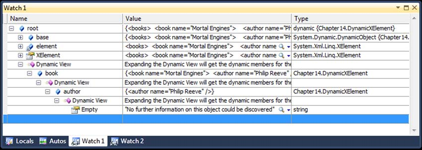

# Chapter 14: Dynamic binding in a static language

> Source: C# in Depth, Third Edition — Jon Skeet. Original PDF pages 440–493.

[← Table of contents](../README.md)

<!-- PDF page 440 -->

## Dynamic binding

## in a static language

This chapter covers
What it means to be dynamic
How to use dynamic typing in C# 4
Examples with COM, Python, and reflection
How dynamic typing is implemented
Reacting dynamically
C# has always been a statically typed language, with no exceptions. There have
been a few areas where the compiler has looked for particular names rather than
interfaces, such as finding appropriate Add methods for collection initializers, but
there’s been nothing truly dynamic in the language beyond normal polymorphism.
That changes with C# 4—at least partially. The simplest way of explaining it is that
there’s a new static type called dynamic, which you can try to do almost anything
with at compile time and let the framework sort it out at execution time. Of course,
there’s more to it than that, but that’s the executive summary.
Given that C# is still a statically typed language everywhere that you’re not using
dynamic, I don’t expect fans of dynamic programming to suddenly become C#

<!-- PDF page 441 -->

Dynamic binding in a static language
advocates. That’s not why the feature was introduced: it’s aimed primarily at interop-
erability. When dynamic languages such as IronRuby and IronPython joined the .NET
ecosystem, it would have been crazy not to be able to call into C# code from IronPy-
thon and vice versa. Likewise, developing against COM APIs used to be awkward in C#,
with an abundance of casts cluttering the code. Dynamic typing addresses all of these
concerns. On the other hand, there are plenty of projects that use dynamic typing
within C# to make data access boundaries simpler.
One word of warning that I’ll repeat throughout the chapter—it’s worth being
careful with dynamic typing. It’s fun to explore, and it’s been well implemented, but I
still recommend that you think carefully before using it heavily. Just like any other new
feature, weigh the pros and cons rather than rushing into it just because it’s neat
(which it undoubtedly is). The framework does a fine job of optimizing dynamic code,
but it’ll be slower than static code in most cases. More important, you lose a lot of
compile-time safety. Whereas unit testing will help you find a lot of the mistakes that
can crop up when the compiler isn’t able to help you much, I still prefer the immedi-
ate feedback of the compiler telling me if I’m trying to use a method that doesn’t exist
or can’t be called with a given set of arguments.
On the other hand, there are situations where the level of safety given to you by
the compiler isn’t very strong to start with. For example, there are far more things that
can go wrong with code that uses reflection than just the errors a compiler can spot. If
you’re trying to invoke a method with its name, does that method exist? Is it accessible
to your code? Are you providing appropriate arguments? The compiler can’t help you
with any of that. The equivalent dynamic code still can’t spot those errors at compile
time, but at least the code may be considerably easier to read and understand. It’s all a
matter of using the most appropriate approach for the particular problem you’re
working on.
Dynamic behavior can be useful in situations where you’re naturally dealing with
dynamic environments or data, but if you’re really looking to write large chunks of
your code dynamically, I suggest you use a language where that’s the normal style
instead of the exception. C# is still a language that was designed for static typing; lan-
guages that have been dynamic from the start often have various features to help you
work more productively with dynamic behavior. Now that you can easily call into such
languages from C#, you can separate the parts of your code that benefit from a largely
dynamic style from those where static typing works better.
I don’t want to put too much of a damper on things. Where dynamic typing is use-
ful, it can be a lot simpler than the alternatives. In this chapter we’ll look at the basic
rules of dynamic typing in C# 4, and then dive into some examples: using COM dynam-
ically, calling into some IronPython code, and making reflection a lot simpler. You can
do all of this without knowing the details, but once you have the flavor of dynamic typ-
ing, we’ll look at what’s going on under the hood. In particular, we’ll discuss the
Dynamic Language Runtime and what the C# compiler does when it encounters
dynamic code. Finally, you’ll see how you can make your own types respond dynami-
cally to method calls, property accesses, and the like. But first, let’s take a step back.

<!-- PDF page 442 -->

What? When? Why? How?
14.1
What? When? Why? How?
Before we get to any code showing off this new feature of C# 4, it’s worth getting a bet-
ter handle on why it was introduced in the first place. I don’t know any other lan-
guages that have gone from being purely static to partially dynamic; this is a
significant step in C#’s evolution, whether you use it often or only occasionally.
We’ll start by taking a fresh look at what dynamic and static mean, considering some
of the major use cases for dynamic typing in C#, and then we’ll delve into how it’s
implemented in C# 4.
14.1.1 What is dynamic typing?
In chapter 2 I explained the characteristics of a type system and described how C# has
previously been a statically typed language. The compiler knows the type of expres-
sions in the code and knows the members available on any type. It applies a fairly com-
plex set of rules to determine which exact member should be used when. This
includes overload resolution; the only choice left until later is to pick the implementa-
tion of virtual methods depending on the execution-time type of the object. The pro-
cess of working out which member to use is called binding, and in a statically typed
language it occurs at compile time.
In a dynamically typed language, all of this binding occurs at execution time. A
compiler or parser can check that the code is syntactically correct, but it can’t check
that the methods you call and the properties you access are actually present. It’s a bit
like a word processor with no dictionary: it may be able to check your punctuation,
but not your spelling, so if you’re to have any sort of confidence in your code, you
really need a good set of unit tests. Some dynamic languages are always interpreted,
with no compiler involved at all. Others provide both an interpreter and a compiler,
to allow rapid development with a REPL—a read, evaluate, print loop.
REPL AND C#
Strictly speaking, REPL isn’t solely associated with dynamic lan-
guages. Some statically typed languages have interpreters that compile on the
fly. Notably, F# comes with a tool called F# Interactive, which does exactly this.
But interpreters are much more common for dynamic languages than static
ones.
C# does have similar tools: the expression evaluator underlying the Watch
and Immediate windows in Visual Studio can be considered a form of REPL,
and Mono has a C# Shell (see www.mono-project.com/CsharpRepl).
It’s worth noting that the new dynamic features of C# 4 don’t include interpreting C#
source code at execution time; there’s no direct equivalent to the JavaScript eval
function, for example. To execute code based on data in strings, you need to use
either the CodeDOM API (and CSharpCodeProvider in particular) or simple reflec-
tion to invoke individual members. The Roslyn project is another option here,
although it’s still in Community Technology Preview as I write this.

<!-- PDF page 443 -->

Dynamic binding in a static language
Of course, the same kind of work has to be done at some point in time, no matter
what approach you’re taking. By asking the compiler to do more work before execu-
tion, static systems usually perform better than dynamic ones. Given the downsides
I’ve mentioned so far, you might be wondering why anyone would want to bother with
dynamic typing in the first place.
14.1.2 When is dynamic typing useful, and why?
Dynamic typing has two important points in its favor. First, if you know the name of a
member you want to call, the arguments you want to call it with, and the object you
want to call it on, that’s all you need. That may sound like all the information you
could have anyway, but the C# compiler would normally want to know more. Crucially,
in order to identify the member exactly (modulo overriding), it’d need to know the
type of the object you’re calling it on and the types of the arguments. Sometimes you
don’t know those types at compile time, even though you do know enough to be sure
that the member will be present and correct when the code runs.
For example, if you know that the object you’re using has a Length property you
want to use, it doesn’t matter whether it’s a String, a StringBuilder, an Array, a
Stream, or any of the other types with that property. You don’t need that property to
be defined by some common base class or interface, which can be useful if there isn’t
such a type. This is called duck typing, from the notion that “if it walks like a duck and
quacks like a duck, I’d call it a duck.”1 Even when there is a type that offers everything
you need, it can sometimes be irritating to tell the compiler exactly which type you’re
talking about. This is particularly relevant when using Microsoft Office APIs via COM.
Many methods and properties are declared to just return VARIANT, which means that
C# code using these calls is often peppered with casts. Duck typing allows you to omit
all of these casts, as long as you’re confident about what you’re doing.
The second important feature of dynamic typing is the ability of an object to
respond to a call by analyzing the name and arguments provided to it. It can behave as
if the member had been declared by the type in the normal way, even if the member
names couldn’t possibly be known until execution time. For example, consider the
following call:
books.FindByAuthor("Joshua Bloch")
Normally this would require the FindByAuthor member to be declared by the
designer of the type involved. In a dynamic data layer, there can be a single smart
piece of code to analyze calls like this. It can detect that there’s an Author property in
the associated data (whether that’s from a database, XML document, hardcoded data,
or anything else) and act accordingly.
1 The Wikipedia article on duck typing has more information about the history of the term: http://en.wikipe-
dia.org/wiki/Duck_typing.

<!-- PDF page 444 -->

What? When? Why? How?
In this case, it would decide that you want to perform a query using the specified
argument as the author. In some ways, that’s just a more complex way of writing some-
thing like this:
books.Find("Author", "Joshua Bloch")
But the first snippet feels more appropriate; the calling code knows the Author part
statically, even if the receiving code doesn’t. This approach can be used to mimic
domain-specific languages (DSLs) in some situations. It can also be used to create a
natural API for exploring data structures such as XML trees.
Another feature of programming with dynamic languages tends to be an experi-
mental style of programming using an appropriate interpreter, as I mentioned earlier.
This isn’t directly relevant to C# 4, but the fact that C# 4 can interoperate richly with
dynamic languages running on the Dynamic Language Runtime (DLR) means that if
you’re dealing with a problem that would benefit from this style, you’ll be able to use
the results directly from C# instead of having to port them to C# afterward.
We’ll look at these scenarios in more depth, and at some concrete examples, when
we’ve discussed the basics of C# 4’s dynamic abilities. It’s worth briefly pointing out
that if these benefits don’t apply to you, dynamic typing is more likely to be a hin-
drance than a help. Many developers won’t need to use dynamic typing much in their
day-to-day coding, and even when it is required, it may only be for a small part of the
code. Just like any feature, it can be overused. In my view, it’s usually worth thinking
carefully about whether any alternative designs would allow static typing to solve the
same problem elegantly. But I’m biased due to having a background in statically typed
languages—it’s worth reading books on dynamically typed languages such as Python
and Ruby to see a wider variety of benefits than the ones I present in this chapter.
You’re probably getting anxious to see some real code by now, so we’ll just get a
brief overview of what’s going on, and then dive into some examples.
14.1.3 How does C# 4 provide dynamic typing?
C# 4 introduces a new type called dynamic. The compiler treats this type differently
than any normal CLR type.2 Any expression that uses a dynamic value causes the com-
piler to change its behavior radically. Instead of trying to work out exactly what the
code means, binding each member access appropriately, performing overload resolu-
tion, and so on, the compiler just parses the source code to work out what kind of
operation you’re trying to perform, its name, what arguments are involved, and any
other relevant information. Instead of emitting IL to execute the code directly, the
compiler generates code that calls into the DLR with all the required information. The
rest of the work is performed at execution time.
2 In fact, dynamic doesn’t represent a specific CLR type. It’s really just System.Object in conjunction with
System.Dynamic.DynamicAttribute. We’ll look at this in more detail in section 14.4, but for the moment
you can pretend it’s a real type.

<!-- PDF page 445 -->

Dynamic binding in a static language
In many ways, this is similar to the different kinds of code generated by lambda
expression conversions. These can either result in code to perform the required
actions (when converting to a delegate type) or result in code that builds a description
of the required actions (when converting to an expression tree). You’ll see later that
expression trees are extremely important in the DLR, and often the C# compiler will
use expression trees to describe the code. (In the simplest cases, where there’s noth-
ing but a member invocation, there’s no need for an expression tree.)
When the DLR comes to bind the relevant call at execution time, it goes through a
complicated process to determine what should happen. This not only has to take into
account the normal C# rules for method overloads and so on, but also the possibility
that the object itself will want to be part of the decision, as you saw in the FindBy-
Author example earlier.
Most of this happens under the hood—the source code you write to use dynamic
typing can be really simple.
14.2
The five-minute guide to dynamic
Do you remember how many new bits of syntax were involved when you learned about
LINQ? Well, dynamic typing is just the opposite: there’s a single contextual keyword,
dynamic, which you can use in most places where you’d use a type name. That’s all the
new syntax that’s required, and the main rules about dynamic are easily expressed, if
you don’t mind a bit of hand-waving to start with:
An implicit conversion exists from almost any CLR type to dynamic.
An implicit conversion exists from any expression of type dynamic to almost any
CLR type.
Expressions that use a value of type dynamic are usually evaluated dynamically.
The static type of a dynamically evaluated expression is usually deemed to be
dynamic.
The detailed rules are more complicated, as you’ll see in section 14.4, but for the
moment let’s stick with the simplified version.
The following listing provides a complete example demonstrating each point.
Listing 14.1
Using dynamic to iterate through a list, concatenating strings
dynamic items = new List<string> { "First", "Second", "Third" };
dynamic valueToAdd = "!";
foreach (dynamic item in items)
{
string result = item + valueToAdd;
Console.WriteLine(result);
}
The result of listing 14.1 shouldn’t come as much of a surprise: it prints First!,
Second!, and Third!. You could easily have specified the types of the items and
valueToAdd variables explicitly in this case, and it would all have worked in the normal

<!-- PDF page 446 -->

The five-minute guide to dynamic
way, but imagine that the variables are getting their values from other data sources
instead of having them hardcoded. What would happen if you wanted to add an inte-
ger instead of a string?
The next listing is just a slight variation. The declaration of valueToAdd hasn’t been
changed; just the assignment expression.
Listing 14.2
Adding integers to strings dynamically
dynamic items = new List<string> { "First", "Second", "Third" };
dynamic valueToAdd = 2;
foreach (dynamic item in items)
{
string result = item + valueToAdd;
Console.WriteLine(result);
}
string + int
concatenation
This time the first result is First2, which is hopefully what you’d expect. Using static
typing, you’d have to explicitly change the declaration of valueToAdd from string to
int. The addition operator is still building a string, though.
What if you changed the items to be integers as well? Let’s try that one simple
change, as shown in the following listing.
Listing 14.3
Adding integers to integers
dynamic items = new List<int> { 1, 2, 3 };
dynamic valueToAdd = 2;
foreach (dynamic item in items)
{
string result = item + valueToAdd;
Console.WriteLine(result);
}
int + int addition
Disaster! You’re still trying to convert the result of the addition to a string. The only
conversions that are allowed are the same ones that are present in C# normally, so
there’s no conversion from int to string. The result is an exception (at execution
time, of course):
Unhandled Exception:
Microsoft.CSharp.RuntimeBinder.RuntimeBinderException:
Cannot implicitly convert type 'int' to 'string'
at CallSite.Target(Closure , CallSite , Object )
at System.Dynamic.UpdateDelegates.UpdateAndExecute1[T0,TRet]
(CallSite site, T0 arg0)
...
Unless you’re perfect, you’re likely to encounter RuntimeBinderException a lot when
you start using dynamic typing. It’s the new NullReferenceException in some ways;
you’re bound to come across it, but with any luck it’ll be in the context of unit tests
rather than customer bug reports. Anyway, you can fix it by changing the type of
result to dynamic, so that the conversion isn’t required.

<!-- PDF page 447 -->

Dynamic binding in a static language
Come to think of it, why bother with the result variable in the first place? You could
just call Console.WriteLine immediately. The following listing shows the changes.
Listing 14.4
Adding integers to integer—but without the exception
dynamic items = new List<int> { 1, 2, 3 };
dynamic valueToAdd = 2;
foreach (dynamic item in items)
{
Console.WriteLine(item + valueToAdd);
}
Calls overload
with int argument
This prints 3, 4, and 5, as you’d expect. Changing the input data would now not only
change the operator that was chosen at execution time—it would also change which
overload of Console.WriteLine was called. With the original data, it would call
Console.WriteLine(string); with the updated variables, it would call Console
.WriteLine(int). The data could even contain a mixture of values, making the exact
call change on every iteration!
You can also use dynamic as the declared type for fields, parameters, and return
types. This is in stark contrast to the use of var, which is restricted to local variables.
DIFFERENCES BETWEEN VAR AND DYNAMIC
In many of the examples so far,
when you’ve really known the types at compile time, you could’ve used var to
declare the variables. At first glance, the two features look very similar. In
both cases, it looks like you’re declaring a variable without specifying its type,
but by using dynamic you’re explicitly setting the type to be dynamic. You can
only use var when the compiler is able to infer the type you mean statically,
and the type system really does remain entirely static. Of course, if you use
var for a variable that’s initialized with an expression of type dynamic, the
variable ends up being (statically) typed to be dynamic too. Given the confu-
sion this could cause, I strongly caution against it.
The compiler is smart about the information it records, and the code that then uses
that information at execution time is clever too: it’s a mini C# compiler in its own
right. It uses whatever static type information was known at compile time to make the
code behave as intuitively as possible.
Other than a few details of what you can’t do with dynamic typing, that’s all you
really need to know in order to start using it in your own code. Later on we’ll come
back to those restrictions, as well as details of what the compiler is actually doing, but
first let’s see dynamic typing doing something genuinely useful.
14.3
Examples of dynamic typing
Dynamic typing is a bit like unsafe code, or interoperability with native code using
P/Invoke. Many developers will have no need for it, or will use it once in a blue
moon. For other developers—particularly those dealing with Microsoft Office—it’ll
give a huge productivity boost, either by making their existing code simpler or by
allowing radically different approaches to their problems.

<!-- PDF page 448 -->

Examples of dynamic typing
This section isn’t meant to be exhaustive by any means. Since the second edition of
this book was published, several open source projects have used dynamic typing to
great effect, including Massive (https://github.com/robconery/massive), Dapper
(http://code.google.com/p/dapper-dot-net/), and Json.NET (http://json.code-
plex.com). These examples are all at data boundaries—whether that’s when talking to
a database, or serializing and deserializing JSON. That’s not to say that dynamic typing
is only useful at data boundaries, of course, and I’m loathe to predict what novel uses
the community may come up with in the future.
We’ll look at three examples here: working with Excel, calling into Python, and
using normal managed .NET types in a more flexible way.
14.3.1 COM in general, and Microsoft Office in particular
You’ve already seen most of the new features C# 4 brings to COM interop, but there
was one that we couldn’t cover in chapter 13 because you hadn’t seen dynamic typing
yet. If you choose to embed the interop types you’re using into the assembly (by using
the /l compiler switch, or setting the Embed Interop Types property to true), then
anything in the API that would otherwise be declared as object is changed to
dynamic. This makes it much easier to work with somewhat weakly typed APIs such as
those exposed by Office. (Although the object model in Office is reasonably strong in
itself, many properties are exposed as variants because they can deal with numbers,
strings, dates, and so on.)
Again, I’ll just show you a short example here—one that does even less than the
Word example in chapter 13. The dynamic aspect is easy to understand from this one
scenario. We’ll set the first 20 cells of the top row of a new Excel worksheet to the
numbers 1 to 20. The following listing shows an initial, statically typed piece of code to
achieve this.
Listing 14.5
Setting a range of values with static typing
var app = new Application { Visible = true };
app.Workbooks.Add();
Worksheet worksheet = (Worksheet) app.ActiveSheet;
Range start = (Range) worksheet.Cells[1, 1];
Range end = (Range) worksheet.Cells[1, 20];
worksheet.Range[start, end].Value = Enumerable.Range(1, 20)
.ToArray();
Open Excel with an
active worksheet
B
Determine start and end cells
C
Fill the range
with [1, 20]
D
This code relies on a using directive for the Microsoft.Office.Interop.Excel
namespace (not shown here), so this time the Application type refers to Excel, not
Word. You’re still using the new features of C# 4 by not specifying an argument for the
optional parameter in the Workbooks.Add() call while you’re setting things up B and
also by using a named indexer C.
When Excel is up and running, you work out the start and end cells of the overall
range. In this case they’re both on the same row, but you could’ve created a rectangu-
lar range instead by selecting two opposite corners. You could have created the range

<!-- PDF page 449 -->

Dynamic binding in a static language
in a single call to Range["A1:T1"], but I personally find it easier to work with just
numbers. Cell names like B3 are great for humans, but harder to use in a program.
Once you have the range, you set all the values in it by setting the Value property
with an array of integers D. You can use a one-dimensional array, as you’re only set-
ting a single row; to set a range spanning multiple rows you’d need to use a rectangu-
lar array.
This all works, but you’ve had to use three casts in six lines of code. The indexer
you call via Cells and the ActiveSheet property are both declared to return object
normally. (Various parameters are also declared as type object, but that doesn’t mat-
ter as much because there’s an implicit conversion from any nonpointer type to
object—only coming the other way requires the cast.) This code doesn’t close Excel
at the end of the listing, just so you can see the open worksheet at the end.
With the primary interop assembly set to embed the required types into your own
binary, all of these examples become dynamic. With the implicit conversion from
dynamic to other types, you can remove all the casts, as shown in the following listing.
Listing 14.6
Using implicit conversions from dynamic in Excel
var app = new Application { Visible = true };
app.Workbooks.Add();
Worksheet worksheet = app.ActiveSheet;
Range start = worksheet.Cells[1, 1];
Range end = worksheet.Cells[1, 20];
worksheet.Range[start, end].Value = Enumerable.Range(1, 20)
.ToArray();
This is exactly the same code as listing 14.5, but without the casts.
It’s worth noting that the conversions are still checked at execution time. If you
changed the declaration of start to be Worksheet, the conversion would fail and an
exception would be thrown. Of course, you don’t have to perform the conversion. You
could just leave everything as dynamic, as shown in the following listing.
Listing 14.7
Using dynamic everywhere
var app = new Application { Visible = true };
app.Workbooks.Add();
dynamic worksheet = app.ActiveSheet;
dynamic start = worksheet.Cells[1, 1];
dynamic end = worksheet.Cells[1, 20];
worksheet.Range[start, end].Value = Enumerable.Range(1, 20)
.ToArray();
Which is clearer? I’m an old-fashioned static typing fan, so I prefer the version in list-
ing 14.6. It states the types I expect on each line, so if there are any problems, I get to
find out immediately rather than waiting until I try to use a value in a way that may not
be supported.
In terms of productivity when initially developing, there are pros and cons to both
approaches. Using dynamic, you don’t need to work out which particular type you

<!-- PDF page 450 -->

Examples of dynamic typing
expect; you can just use the value, and as long as all the necessary operations are sup-
ported, you’re okay. On the other hand, by using static typing, you can see what’s avail-
able at every stage via IntelliSense. You’re still using dynamic typing to provide the
implicit conversion to Worksheet and Range—you’re just using it for one step at a
time rather than wholesale. The change from static typing to dynamic may not look
like much to start with, because the example is relatively simple, but as the complexity
of the code increases, so does the readability benefit of removing all those casts.
In some ways this has all been a blast from the past—COM is a relatively old technol-
ogy. Now we’ll jump to interoperating with something much more recent: IronPython.
14.3.2 Dynamic languages such as IronPython
In this section I’ll only use IronPython as an example, but that’s certainly not the only
dynamic language available for the DLR. It’s arguably the most mature, but there are
already alternatives such as IronRuby and IronScheme. One of the stated aims of the
DLR is to make it easier for budding language designers to create a working language
that has access to the huge .NET Framework libraries as well as good interoperability
with other DLR languages and the traditional .NET languages such as C#.
WHY WOULD I WANT TO USE IRONPYTHON FROM C#?
There are many reasons you might want to interoperate with a dynamic language, just
as it’s been beneficial to interoperate with other managed languages from .NET’s
infancy. It’s clearly useful for a VB developer to be able to use a class library written in
C# and vice versa, so why would the same not be true of dynamic languages? I asked
Michael Foord, one of the authors of Iron Python in Action (Manning, 2009), to come
up with a few ideas for using IronPython within a C# application. Here’s his list:
User scripting
Writing a layer of your application in IronPython
Using Python as a configuration language
Using Python as a rules engine with rules stored as text (even in a database)
Using a library that’s available in Python, but has no .NET equivalent
Putting a live interpreter into your application for debugging
If you’re still skeptical, you might want to consider that embedding a scripting lan-
guage in a mainstream application is far from uncommon—Sid Meier’s Civilization IV
computer game3 is scriptable with Python. This isn’t just an afterthought for modifica-
tions, either—a lot of the core gameplay is written in Python. Once they’d built the
engine, the developers found it to be a more powerful development environment
than they’d originally imagined.
For this chapter I’ll work with the single example of using Python as a configura-
tion language. Just as with the COM example, I’ll keep it simple, but hopefully it’ll pro-
vide enough of a starting point for you to experiment more with it if you’re interested.
3 Or way of life, depending on how you view the world and your level of addiction to playing the game.

<!-- PDF page 451 -->

Dynamic binding in a static language
GETTING STARTED: EMBEDDING “HELLO, WORLD”
There are various types available if you want to host or embed another language within a
C# application, depending on the level of flexibility and control you want to achieve.
We’ll only use ScriptEngine and ScriptScope here, because our requirements are
primitive. In this example, you know you’re always going to use Python, so you can ask
the IronPython framework to create a ScriptEngine directly; in more general situa-
tions, you can use a ScriptRuntime to pick language implementations dynamically by
name. More demanding scenarios may require you to work with ScriptHost and
ScriptSource, as well as use more of the features of the other types, too.
Not content with merely printing hello, world once, this initial example will do
so twice, first by using text passed directly into the engine as a string, and then by load-
ing a file called HelloWorld.py. The following listing shows everything you need.
Listing 14.8
Printing hello, world twice using Python embedded in C#
ScriptEngine engine = Python.CreateEngine();
engine.Execute("print 'hello, world'");
engine.ExecuteFile("HelloWorld.py");
You may find this listing either quite dull or very exciting, both for the same reason.
It’s simple to understand, requiring little explanation. It does little, in terms of actual
output…and yet the fact that it is so easy to embed Python code into C# is a cause for
celebration. True, the level of interaction is somewhat minimal so far, but it really
couldn’t be much easier than this.
PYTHON’S MANY STRING LITERAL FORMS
The Python file contains a single line:
print "hello, world". Note the double quotes in the file, compared with
the single quotes in the string literal that were passed into engine.Execute().
Either would’ve been fine in either source. Python has various string literal
representations, including triple single quotes or triple double quotes for
multiline literals. I only mention this because it’s useful not to have to escape
double quotes any time you want to put Python code into a C# string literal.
The next type we’ll look at is ScriptScope, which will be crucial to the configuration
script.
STORING AND RETRIEVING INFORMATION FROM A SCRIPTSCOPE
The execution methods we’ve used both have overloads with a second parameter—a
scope. In its simplest terms, this can be regarded as a dictionary of names and values.
Scripting languages often allow variables to be assigned without any explicit declara-
tion, and when this is done in the top level of a program (instead of in a function or
class), this usually affects a global scope.
When a ScriptScope instance is passed into an execution method, that’s used as
the global scope for the script you’ve asked the engine to execute. The script can
retrieve existing values from the scope and create new values, as shown in the follow-
ing listing.

<!-- PDF page 452 -->

Examples of dynamic typing
Listing 14.9
Passing information between a host and a script using ScriptScope
string python = @"
text = 'hello'
output = input + 1
";
ScriptEngine engine = Python.CreateEngine();
ScriptScope scope = engine.CreateScope();
scope.SetVariable("input", 10);
engine.Execute(python, scope);
Console.WriteLine(scope.GetVariable("text"));
Console.WriteLine(scope.GetVariable("input"));
Console.WriteLine(scope.GetVariable("output"));
Python code embedded
as a C# string literal
B
Sets variable for
Python code to use
C
Fetches variables
back from scope
D
In this code the Python source code is embedded into the C# code as a verbatim
string literal B rather than putting it in a file, so that it’s easier to see all the code in
one place. I don’t recommend that you do this in production code, partly because
Python is sensitive to whitespace—reformatting the code in a seemingly harmless way
can make it fail completely at execution time.
The SetVariable and GetVariable methods simply put values into the scope C
and fetch them out again D in the obvious way. They’re declared in terms of object
rather than dynamic, as you might’ve expected. But GetVariable also allows you to
specify a type argument, which acts as a conversion request.
This isn’t quite the same as casting the result of the nongeneric method, as the lat-
ter just unboxes the value, which means you need to cast it to exactly the right type.
For example, you can put an integer into the scope, but retrieve it as a double:
Converts successfully to double
B
scope.SetVariable("num", 20)
double x = scope.GetVariable<double>("num")
double y = (double) scope.GetVariable("num");
Unboxing throws exception
C
The first call succeeds: you’re explicitly telling GetVariable what type you want B, so
it knows to coerce the value appropriately. The second call C will throw an Invalid-
CastException, just as it would in any other situation where you try to unbox a value
using the wrong type.
The scope can also hold functions, which you can retrieve and then call dynami-
cally, passing arguments and returning values. The easiest way of doing this is to use
the dynamic type, as shown in the following listing.
Listing 14.10
Calling a function declared in a ScriptScope
string python = @"
def sayHello(user):
print 'Hello %(name)s' % {'name' : user}
";
ScriptEngine engine = Python.CreateEngine();
ScriptScope scope = engine.CreateScope();
engine.Execute(python, scope);
dynamic function = scope.GetVariable("sayHello");
function("Jon");

<!-- PDF page 453 -->

Dynamic binding in a static language
Configuration files might not often need this ability, but it can be useful in other situ-
ations. For example, you could easily use Python to script a graph-drawing program by
providing a function to be called on each input point. A simple example of this can be
found on the book’s website at http://mng.bz/6yGi.
There are a number of situations in which it’s useful to have some sort of expres-
sion evaluator running user code entered at execution time, such as evaluating busi-
ness rules for discounts, shipping costs, and so on. It can also be useful to be able to
change these rules in text form without having to recompile or redeploy binaries. List-
ing 14.10 is quite tame—another example in the downloadable source code weaves in
and out of the two languages rather more tortuously, showing that the calls can go
both ways: from C# to IronPython, as you’ve seen, and from IronPython to C#.
PUTTING IT ALL TOGETHER
Now that you can get values into your scope, you’re essentially done. You could poten-
tially wrap the scope in another object, providing access via an indexer, or even access
the values dynamically using the techniques shown in section 14.5. The application
code might look something like this:
static Configuration LoadConfiguration()
{
ScriptEngine engine = Python.CreateEngine();
ScriptScope scope = engine.CreateScope();
engine.ExecuteFile("configuration.py", scope);
return Configuration.FromScriptScope(scope);
}
The exact form of the Configuration type will depend on your application, but it’s
unlikely to be terribly exciting code. I’ve provided a sample dynamic implementation
in the full source that allows you to retrieve values as properties and call functions
directly too. Of course, you’re not limited to using primitive types in your configura-
tion: the Python code could be arbitrarily complex, building collections, wiring up
components and services, and so forth. It could perform a lot of the roles of a normal
dependency injection or inversion of control container.
The important thing is that you now have a configuration file that’s active instead
of the traditional passive XML and .ini files. Of course, you could’ve embedded your
own programming language into previous configuration files, but the result would
probably have been less powerful and would’ve taken a lot more effort to implement.
As an example of where this could be useful in a simpler situation than full depen-
dency injection, you might want to configure the number of threads to use for some
background processing component in your application. You might normally use as
many threads as you have processors in the system, but occasionally reduce it in order
to help another application run smoothly on the same system. The configuration file
would simply change from something like this
agentThreads = System.Environment.ProcessorCount
agentThreadName = 'Processing agent'

<!-- PDF page 454 -->

Examples of dynamic typing
to this
agentThreads = 1
agentThreadName = 'Processing agent (single thread only)'
This change wouldn’t require the application to be rebuilt or redeployed—you’d just
need to edit the file and restart the application. Particularly smart applications could
even choose to reconfigure themselves on the fly. (I’ve found that usually this ability is
more painful to implement than the extra value it brings, but in certain places it can
make a big difference. The ability to change logging levels either for a particular bit of
code or even just a specific user who’s having difficulties can make debugging much
easier.)
Other than executing functions, we haven’t really looked at using Python in a par-
ticularly dynamic way. The full power of Python is available, and by using the dynamic
type in your C# code, you can take advantage of metaprogramming and all the other
dynamic features. The C# compiler is responsible for representing your code in an
appropriate fashion, and the script engine is responsible for taking that code and
working out what it means for Python. Just don’t feel you have to be doing anything
particularly clever for it to be worth embedding the script engine in your application.
It’s a simple step toward a more powerful application.
HOW MUCH POWER DO YOU WANT TO GIVE TO YOUR SCRIPT AUTHORS?
If you’re
executing arbitrary code, particularly code entered by external users of the
system, you should think seriously about security, and possibly run the script
in some sort of sandboxed environment. Discussion of this topic is outside the
scope of this book, but it needs to be considered carefully.
So far our examples have been interoperating with other systems. Dynamic typing can
make sense even within a purely managed system, though. Let’s visit a few examples.
14.3.3 Dynamic typing in purely managed code
You’ve almost certainly used something like dynamic typing in the past, even if it
wasn’t your own code that had to do the work. Data binding is the simplest example of
this—any time you specify something like ListControl.DisplayMember, you’re asking
the framework to find a property at execution time based on its name. If you’ve ever
used reflection directly in your own code, you’re again using information that’s only
available at execution time.
In my experience, reflection is error-prone, and even when it works, you may need
to put in extra effort to optimize it. In some cases, dynamic typing can completely
replace that reflection-based code; it may be faster too, depending on exactly what
you’re doing.
It’s particularly tricky to use generic types and methods from reflection. For
instance, if you have an object that you know implements IList<T> for some type
argument T, it can be difficult to work out exactly what T is. If the only reason for dis-
covering T is to then call another generic method, you really want to just ask the

<!-- PDF page 455 -->

Dynamic binding in a static language
compiler to call whatever it would have called if you knew the actual type. Of course,
that’s exactly what dynamic typing does. I’ll use this scenario as our first example.
EXECUTION-TIME TYPE INFERENCE
If you want to do more than just call a single method, it’s often best to wrap all the
additional work in a generic method. You can then call the generic method dynami-
cally, but write all the rest of the code using static typing. Listing 14.11 shows a simple
example of this.
Pretend you’ve been given a list of some type and a new element by some other
part of the system. You’ve been promised that they’re compatible, but you don’t know
their types statically. There are various reasons this could happen—this could be the
result of deserialization elsewhere, for example. Anyway, your code is meant to add
the new element to the end of the list, but only if there are fewer than 10 elements in
the list at the moment. The method returns whether or not the element was actually
added. Obviously, in real life the business logic would be more complicated, but the
point is that you’d really like to be able to use the strong types for these operations.
The following listing shows the statically typed method and the dynamic call into it.
Listing 14.11
Using dynamic type inference
private static bool AddConditionallyImpl<T>(IList<T> list, T item)
{
if (list.Count < 10)
{
list.Add(item);
return true;
}
return false;
}
Normal statically
typed code
B
public static bool AddConditionally(dynamic list, dynamic item)
{
return AddConditionallyImpl(list, item);
}
...
object list = new List<string> { "x", "y" };
object item = "z";
AddConditionally(list, item);
Calls helper method
dynamically
C
Eventually calls
AddConditionallyImpl<string>
The public method has dynamic parameters; in previous versions of C# it would per-
haps have taken IEnumerable and Object, relying on complicated checks with reflec-
tion to work out the type of the list and then invoke the generic method with
reflection. With dynamic typing, you can just call a strongly typed implementation B
using the dynamic arguments C, isolating the dynamic access to the single call in the
wrapper method. Of course, the call could still fail, but you’ve been saved the effort of
trying to determine the appropriate type argument.
You could also expose the strongly typed method publicly to avoid the dynamic
typing for callers who knew their list types statically. It’d be worth keeping the names
different in that case, to avoid accidentally calling the dynamic version due to a slight

<!-- PDF page 456 -->

Examples of dynamic typing
mistake with the static types of the arguments. (It’s also a lot easier to make the right
call within the dynamic version when the names are different!)
As another example of dynamic typing in purely managed code, I’ve already
bemoaned the lack of generic operator support in C#. There’s no concept of specify-
ing a constraint saying “T must have an operator that allows me to add two values of
type T together.” You saw this in our initial demonstration of dynamic typing (see list-
ing 14.4), so mentioning it here should come as no surprise. Let’s take the Sum query
operator from LINQ and make it dynamic.
COMPENSATING FOR THE LACK OF GENERIC OPERATORS
Have you ever looked at the list of overloads for Enumerable.Sum? It’s pretty long.
Admittedly, half of the overloads are due to a projection, but even so there are 10
overloads, each of which just takes a sequence of elements and adds them together,
and that doesn’t even cover summing unsigned values, or bytes, or shorts. Why not use
dynamic typing to try to do it all in one method?
Even though we’ll use dynamic typing internally, the method shown in listing 14.12
is statically typed. You could declare it as a nongeneric method summing an
IEnumerable <dynamic>, but that wouldn’t work well due to the limitations of covari-
ance. I named the method DynamicSum rather than Sum to avoid clashing with the
methods in Enumerable. The compiler will pick a nongeneric overload over a generic
one where both signatures have the same parameter types, and it’s simpler to avoid the
collision in the first place.
Listing 14.12
Summing an arbitrary sequence of elements dynamically
public static T DynamicSum<T>(this IEnumerable<T> source)
{
dynamic total = default(T);
foreach (T element in source)
{
total = (T) (total + element);
}
return total;
}
...
byte[] bytes = new byte[] { 1, 2, 3 };
Console.WriteLine(bytes.DynamicSum());
Dynamically typed
for later use
B
Chooses addition
operator dynamically
Prints 6
The code is mostly straightforward; it looks almost exactly the same as any of the
implementations of the normal Sum overloads would. It omits checking whether
source is null just for brevity, but most of the rest is simple enough. There are a cou-
ple of interesting points.
First, you use default(T) to initialize total, which is declared as dynamic so that
you get the desired dynamic behavior B. You have to start off with an initial value
somehow; you could try to use the first value in the sequence, but then you’d be stuck
if the sequence were empty. For non-nullable value types, default(T) is almost always
an appropriate value anyway: it’s a natural zero. For reference types, you’ll end up

<!-- PDF page 457 -->

Dynamic binding in a static language
adding the first element of the sequence to null, which may or may not be appropri-
ate. For nullable value types, you’ll end up trying to add the first element to the null
value for that type, which certainly won’t be appropriate.
Second, you cast the result of the addition back to T, even though it’s then assigned
to a dynamic variable. This may seem odd, but you need to think about the results of
summing two bytes together. The C# compiler would normally promote each operand
to int before performing the addition. Without the cast, the total variable would
end up storing an int value, which would then cause an exception when the return
statement attempted to convert it back to byte.
Both of these points lead to deeper questions, but that’s not the point of this sec-
tion. I’ve written up a more detailed investigation of dynamic summation on the
book’s website (see http://mng.bz/0N37).
Just to prove that our code is capable of more than arithmetic on normal numbers,
listing 14.13 shows an example of summing TimeSpan values.
Listing 14.13
Summing a list of TimeSpan elements dynamically
var times = new List<TimeSpan>
{
2.Hours(), 25.Minutes(), 30.Seconds(),
45.Seconds(), 40.Minutes()
};
Console.WriteLine(times.DynamicSum());
The TimeSpan values are created using extension methods for convenience, but the
summation is entirely dynamic, resulting in a total span of 3 hours, 6 minutes, and 15
seconds.
DUCK TYPING
Sometimes you know that a member with a particular name will be available at execu-
tion time, but you can’t tell the compiler exactly which member you’re talking about
because it’ll depend on the type. In some ways this is a more general example of the
same problem that we’ve just solved, except using normal methods and properties
instead of operators.
There is a difference: usually you’d try to capture the commonality in an interface
or abstract base class. You can’t do this with operators, but it’s the normal approach
for methods and properties. Unfortunately it doesn’t always work—particularly if mul-
tiple libraries are involved. The .NET Framework is mostly consistent here, but you’ve
already seen one example where it doesn’t quite work. In chapter 12 we looked at the
optimizations available for counting a sequence and saw that both ICollection and
ICollection<T> have a Count property—but they have no common ancestor inter-
face with that property, so you have to handle them separately.
Duck typing lets you just access Count without performing the type checking your-
self, as shown in the following listing.

<!-- PDF page 458 -->

Examples of dynamic typing
Listing 14.14
Accessing a Count property with duck typing
static void PrintCount(IEnumerable collection)
{
dynamic d = collection;
int count = d.Count;
Console.WriteLine(count);
}
...
PrintCount(new BitArray(10));
PrintCount(new HashSet<int> { 3, 5 });
PrintCount(new List<int> { 1, 2, 3 });
The PrintCount method is restricted to implementations of IEnumerable for the
same reason that collection initializers are: it’s a pretty good indication that the Count
property you end up using is an appropriate one. The test collections are a BitArray
(which only implements ICollection), a HashSet<int> (which only implements
ICollection<int>), and a List<int> (which implements both). In all cases, the cor-
rect property is found at execution time.
Explicit interface implementation and dynamic don’t mix well
When I first tried to test this code, I used an int[], which is implicitly convertible to
both of the interfaces involved. I was therefore surprised when the PrintCount
method failed at execution time…until I thought about it more closely. The execution-
time binding is performed using the actual type of the object, which in this case is an
int[]. Array types don’t publicly expose a Count property—they use explicit interface
implementation for that. You can only use Count when you view an array object in a
particular way.
This is just one example where dynamic typing can behave in a way that’s logical but
can be unexpected unless you’re careful. I’m collecting an ongoing list of such oddi-
ties on the book’s website (see http://mng.bz/5y7M); please let me know if you find
any new ones.
We’ll stick with the example of retrieving the count of items, but this time we’ll look at
how execution-time overload resolution can offer an alternative to explicit type testing.
MULTIPLE DISPATCH
With static typing, C# uses single dispatch: at execution, the exact method called only
depends on the actual type of the target of the method call, through overriding. Over-
loading is decided at compile time. Occasionally multiple dispatch is useful to find the
most specialized implementation of a method based on the execution-time types of
the arguments—again, this is what dynamic typing provides.
The following listing demonstrates how multiple dispatch would allow for a more
varied and robust implementation of optimized counting.

<!-- PDF page 459 -->

Dynamic binding in a static language
Listing 14.15
Counting different types efficiently using multiple dispatch
private static int CountImpl<T>(ICollection<T> collection)
{
return collection.Count;
}
private static int CountImpl(ICollection collection)
{
return collection.Count;
}
private static int CountImpl(string text)
{
return text.Length;
}
private static int CountImpl(IEnumerable collection)
{
int count = 0;
foreach (object item in collection)
{
count++;
}
return count;
}
public static void PrintCount(IEnumerable collection)
{
dynamic d = collection;
int count = CountImpl(d);
Console.WriteLine(count);
}
...
PrintCount(new BitArray(5));
PrintCount(new HashSet<int> { 1, 2 });
PrintCount("ABC");
PrintCount("ABCDEF".Where(c => c > 'B'));
You know that at least one overload of CountImpl will be appropriate at execution time
because the parameter for PrintCount is of type IEnumerable. You rely on dynamic
typing to perform the same job as the explicit “if it’s an ICollection<T>, use this
implementation; if it’s an ICollection, use this implementation” steps we used when
picking a random element in listing 12.17. As an example of how this is more than just
using the Count property if it’s available, listing 14.15 includes an optimization for
strings, where you can use the Length property to obtain the right result quickly.
Even using multiple dispatch here, you could still run into problems at execu-
tion time: what if the actual type implemented both ICollection<string> and
ICollection<int> via explicit interface implementation? There would be two possi-
ble results depending on which Count implementation was picked. In this case the
binding would be ambiguous, leading to an exception. Fortunately such pathologi-
cal cases are likely to be rare.

<!-- PDF page 460 -->

Looking behind the scenes
These are just a few examples of areas where you might want to use dynamic typing
even if you’re not trying to interoperate with anything else. Next, we’ll delve into how
all these effects are achieved, before we finish off the chapter by implementing our
own dynamic behavior.
I should warn you that things are about to get tricky. In fact, it’s all extremely ele-
gant, but it’s complicated because programming languages provide a rich set of oper-
ations, and representing all the necessary information about those operations as data
and then acting on it appropriately are complex jobs. The good news is that you
don’t need to understand it all intimately. As ever, you’ll get more out of dynamic typ-
ing the more familiar you are with the machinery behind it, but even if you just use
the techniques you’ve seen so far, there may be situations where it makes you a lot
more productive.
14.4
Looking behind the scenes
Despite the warning of the previous paragraph, I won’t go into huge amounts of detail
about the inner workings of dynamic typing. That would be a lot of ground to cover,
with reference to both the framework and language changes. It’s not often that I shy
away from the nitty-gritty of specifications, but in this case I truly believe there’s not
much to be gained from learning it all. I’ll cover the most important (and interesting)
points, and I can thoroughly recommend Sam Ng’s blog (http://blogs.msdn.com/b/
samng/), the C# language specification, and the DLR project page (http://mng.bz/
0M6A) for more information if you need to dig into a particular scenario.
My eventual goal is to help you understand what the C# compiler is doing and the
code it emits to achieve dynamic binding at execution time. Unfortunately, none of
the generated code will make any sense until you see the mechanism that underpins it
all—the DLR. You might like to think of a statically typed program as a conventional
stage play with a fixed script, and a dynamically typed program as more like an impro-
visation show. The DLR takes the place of the actors’ brains frantically coming up with
something to say in response to audience suggestions. Let’s meet our quick-thinking
star performer.
14.4.1 Introducing the Dynamic Language Runtime
I’ve been bandying the acronym DLR around for a while now, occasionally expanding
it to Dynamic Language Runtime, but never explaining what it is. This has been delib-
erate: I’ve been trying to get across the nature of dynamic typing and how it affects
developers, rather than the details of the implementation. But that excuse was never
going to last until the end of the chapter, so here we are. In its barest terms, the
Dynamic Language Runtime is a library that all dynamic languages and the C# com-
piler use to execute code dynamically.
Amazingly enough, it really is just a library. Despite its name, it isn’t at the same
level as the CLR (Common Language Runtime)—it doesn’t deal in JIT compilation,
native API marshaling, garbage collection, and so forth. But it builds on a lot of the

<!-- PDF page 461 -->

Dynamic binding in a static language

Python apps
Ruby apps
C# apps
VB apps

IronPython
IronRuby

Binders
(e.g. C#, VB,
Microsoft.CSharp)
Dynamic
Language
Runtime
(DLR)
Other .NET libraries
(WCF, WPF,
ASP.NET, etc.)
.NET 4.0
System libraries
(mscorlib, System, System.Core, etc.)
Common Language Runtime
(JIT, GC, etc.)
Figure 14.1
How the components of .NET 4 fit together, allowing static and dynamic
languages to execute on the same underlying platform
work in .NET 2.0 and 3.5, particularly the DynamicMethod and Expression types. The
expression tree API has been expanded in .NET 4 to allow the DLR to express more
concepts, too. Figure 14.1 shows how it all fits together.
In addition to the DLR, figure 14.1 shows another library that may be new to you.
One of the assemblies in the binders part of the diagram is Microsoft.CSharp. It con-
tains a number of types that are referenced by the C# compiler when you use dynamic
in your code. Confusingly, this doesn’t include the existing Microsoft.CSharp
.Compiler and Microsoft.CSharp.CodeDomProvider. (They’re not even in the same
assembly as each other!) You’ll see exactly what the new types are used for in section
14.4.2, where we’ll decompile some code written using dynamic.
One other important aspect differentiates the DLR from the rest of the .NET
Framework: it’s provided as open source. The complete code lives in a CodePlex proj-
ect (http://dlr.codeplex.com), so you can download it and see the inner workings.
One of the benefits of this approach is that the DLR hasn’t had to be reimplemented
for Mono (http://mono-project.com): the same code runs on both .NET and its cross-
platform cousin.
Although the DLR doesn’t handle native code directly, you can think of it as doing
a job similar to the CLR in one sense: just as the CLR converts IL (Intermediate Lan-
guage) into native code, the DLR converts code represented using binders, call sites,
meta-objects, and various other concepts into expression trees that can then be com-
piled down into IL and eventually native code by the CLR. Figure 14.2 shows a simpli-
fied view of the lifecycle of a single evaluation of a dynamic expression.

<!-- PDF page 462 -->

Looking behind the scenes
Code.cs
Code.cs

... ...
d.Foo();
...
Source code

C# compiler

Call site
Binding
IL

(Create once and reuse these objects)
C
(Cr
C ea e once and reu
t
ate o

e thes
h
e objbje tcts)

DLR + dynamic objects + C# binders

Call site
Binder
Objects with cache
of behavior
Caches
(IL + rules)
Caches
(Rules)
JIT (of IL in cache)

Call site
We have native code —
we can run it!
(At last...)
Binder
Caches
(IL + native code
+ rules)
Caches
(Rules)
Figure 14.2
Lifecycle of a
dynamic expression
Next time... if the cache is hit, just execute the native code.
As you can see, one of the important aspects of the DLR is a multilevel cache. This is
crucial for performance reasons, but to understand that and the other concepts I’ve
already mentioned, we’ll need to dive one layer deeper.
14.4.2 DLR core concepts
We can summarize the purpose of the DLR in very general terms as taking a high-level
representation of code and executing that code, based on various pieces of informa-
tion that may only be known at execution time. In this section I’ll introduce a lot of
terminology to describe how the DLR works, but it’s all contributing to that common
aim.
CALL SITES
The first concept we need is a call site. This is sort of the atom of the DLR—the smallest
piece of code that can be considered as a single executable unit. One expression may
contain a lot of call sites, but the behavior is built up in the natural way, evaluating one
call site at a time.
For the rest of the discussion, we’ll only consider a single call site. It’ll be useful to
have a small example of a call site to refer to, so here’s a simple one, where d is a vari-
able of type dynamic:
d.Foo(10);

<!-- PDF page 463 -->

Dynamic binding in a static language
The call site is represented in code as a System.Runtime.CompilerServices.Call-
Site<T>. You’ll see a full example of how call sites are created and used in the next sec-
tion, when we look at what the C# compiler does at compile time, but here’s an example
of the code that might be called to create the site for the previous snippet:
CallSite<Action<CallSite, object, int>>.Create(Binder.InvokeMember(
CSharpBinderFlags.ResultDiscarded, "Foo", null, typeof(Test),
new CSharpArgumentInfo[] {
CSharpArgumentInfo.Create(CSharpArgumentInfoFlags.None, null),
CSharpArgumentInfo.Create(CSharpArgumentInfoFlags.Constant |
CSharpArgumentInfoFlags.UseCompileTimeType,
null) }));
Now that we have a call site, can we execute the code? Not quite.
RECEIVERS AND BINDERS
As well as a call site, we need something to decide what it means and how to execute it.
In the DLR, two entities can decide this: the receiver of a call and the binder. The
receiver of a call is simply the object that a member is called on. In our sample call
site, the receiver is the object that d refers to at execution time. The binder will
depend on the calling language and is part of the call site—in this case, you can see
that the C# compiler emits code to create a binder using Binder.InvokeMember. The
Binder class, in this case, is Microsoft.CSharp.RuntimeBinder.Binder, so it really is
C#-specific. The C# binder is also COM-aware and will perform appropriate COM bind-
ing if the receiver is an IDispatch object.
The DLR always gives precedence to the receiver: if it’s a dynamic object that knows
how to handle the call, then it’ll use whatever execution path the object provides. An
object can advertise itself as being dynamic by implementing the new IDynamicMeta-
ObjectProvider interface. The name is a mouthful, but it only contains a single mem-
ber: GetMetaObject. You’ll need to be an expression-tree ninja and know the DLR
quite well to implement GetMetaObject correctly. But in the right hands, this can be a
powerful tool, giving you lower-level interaction with the DLR and its execution cache.
If you need to implement dynamic behavior in a high-performance fashion, it’s worth
the investment to learn the details.
There are two public implementations of IDynamicMetaObjectProvider included
in the framework to make it easy to implement dynamic behavior in situations where
performance isn’t quite as critical. We’ll look at all of this in more detail in section
14.5, but for now you just need to be aware of the interface itself, and that it repre-
sents the ability of an object to react dynamically.
If the receiver isn’t dynamic, the binder gets to decide how the code should be exe-
cuted. In C# code, it would apply C#-specific rules to the code and work out what to
do. If you were creating your own dynamic language, you could implement your own
binder to decide how it should behave in general (when the object doesn’t override
the behavior). That lies well beyond the scope of this book, but it’s an interesting
topic in and of itself; one of the aims of the DLR is to make it easier to implement your
own languages.

<!-- PDF page 464 -->

Looking behind the scenes
RULES AND CACHES
The decision about how to execute a call is represented as a rule. Fundamentally, this
consists of two elements of logic: the circumstances under which the call site should
behave this way, and the behavior itself.
The first part is really for optimization. Suppose you have a call site that represents
addition of two dynamic values, and the first time it’s evaluated, both values are of
type byte. The binder has gone to a fair amount of effort to work out that this means
both operands should be promoted to int, and the result should be the sum of those
integers. It can reuse that operation any time the operands turn out to both be byte.
Checking a set of previous results for validity can save a lot of time. The rule I’ve used
as an example (the operand types must be exactly the same as the ones I’ve just seen)
is a common one, but the DLR supports other rules too.
The second part of a rule is the code to use when the rule matches, and it’s repre-
sented as an expression tree. It could have been stored as a compiled delegate to call,
but keeping the expression tree representation means the cache can optimize heavily.
There are three levels of cache in the DLR: L0, L1, and L2. The caches store informa-
tion in different ways, and with a different scope. Each call site has its own L0 and L1
caches, but an L2 cache may be shared between several similar call sites, as shown in
figure 14.3.
The set of call sites that share an L2 cache is determined by their binders—each
binder has an L2 cache associated with it. The compiler (or whatever is creating the
call sites) decides how many binders it wants to use. It can only use a binder for multi-
ple call sites that represent very similar code, where, if the context is the same at exe-
cution time, the call sites should execute in the same way. In fact, the C# compiler
doesn’t use this facility—it creates a new binder for every call site,4 so there’s not
much difference between the L1 and L2 caches for C# developers. Genuinely dynamic
languages, such as IronRuby and IronPython, make more use of it, though.
The caches themselves are executable, which takes a while to understand. The C#
compiler generates code to simply execute the call site’s L0 cache (which is a delegate
accessed through the Target property). That’s it! The L0 cache has a single rule,

Call site

Binder
L0 cache:
delegate
L2 cache:
rules (many)
L1 cache:
rules (few)

...
Call site
Call site
Figure 14.3
Relationships between
dynamic caches and call sites
Call sites with the same semantics
4 A lot of information is specific to a particular call site, as the binding rules will be different depending on
things like which class it’s being called from.

<!-- PDF page 465 -->

Dynamic binding in a static language
which it checks when it’s called. If the rule matches, it executes the associated behav-
ior. If the rule doesn’t match (or if this is the first call, so it doesn’t have even one
rule), it calls into the L1 cache, which in turn calls into the L2 cache. If the L2 cache
can’t find any matching rules, it asks the receiver or the binder to resolve the call. The
results are then put into the cache for next time.
In the case of our earlier snippet, the execution part would look something like
this:
callSite.Target(callSite, d, 10);
The L1 and L2 caches look through their rules in a fairly standard way—each has a col-
lection of rules, and each rule is asked whether or not it matches. The L0 cache is
somewhat different. The two parts of its behavior (checking its rule and delegating to
the L1 cache) are combined into a single method that is then JIT compiled. Updating
the L0 cache consists of rebuilding the method from the new rule.
The result of all of this is that typical call sites that see similar context repeatedly
are very fast; the dispatch mechanism is about as lean as you could make it if you
hand-coded the tests yourself. Of course, this has to be weighed against the cost of all
the dynamic code generation involved, but the multilevel cache is complicated pre-
cisely because it tries to achieve a balance across various scenarios.
Now that you know a bit about the machinery in the DLR, you’ll be able to under-
stand what the C# compiler does to set it all in motion.
14.4.3 How the C# compiler handles dynamic
The main jobs of the C# compiler when it comes to dynamic code are to work out when
dynamic behavior is required, and to capture all the necessary context so that the
binder and receiver have enough information to resolve the call at execution time.
IF IT USES DYNAMIC, IT’S DYNAMIC!
One situation is obviously dynamic: when the target of a member call is dynamic. The
compiler has no way of knowing how that’ll be resolved. It may be a truly dynamic
object that’ll perform the resolution itself, or it may end up with the C# binder resolv-
ing it with reflection later. Either way, there’s no opportunity for the call to be resolved
statically.
But when the dynamic value is being used as an argument for the call, there are
some situations where you might expect the call to be resolved statically—particularly
if there’s a suitable overload that has a parameter type of dynamic. The rule is that if
any part of a call is dynamic, the call becomes dynamic and will resolve the overload
with the execution-time type of the dynamic value. The following listing demonstrates
this using a method with two overloads, and invoking it in a number of different ways.

<!-- PDF page 466 -->

Looking behind the scenes
Listing 14.16
Experimenting with method overloading and dynamic values
static void Execute(string x)
{
Console.WriteLine("String overload");
}
static void Execute(dynamic x)
{
Console.WriteLine("Dynamic overload");
}
...
dynamic text = "text";
Execute(text);
dynamic number = 10;
Execute(number);
Prints "String overload"
Prints "Dynamic overload"
Both calls to Execute are bound dynamically. At execution time, they’re resolved
using the types of the actual values, namely, string and int. The parameter of type
dynamic is treated as if it were declared with type object everywhere except within the
method itself—if you look at the compiled code, you’ll see it is a parameter of type
object, just with an extra attribute applied. This also means you can’t have two meth-
ods whose signatures differ just by dynamic/object parameter types.
That’s an example of resolving method calls, but there are plenty of other expres-
sions to consider. Sometimes the situation isn’t quite as straightforward as I’ve led you
to believe…
IT’S DYNAMIC…EXCEPT WHEN IT ISN’T
When I introduced dynamic in 14.2 I had to be careful not to generalize too far,
because there are exceptions to almost every rule. Although you should know about
these, you don’t need to worry about them—they’re unlikely to cause you any prob-
lems.
Let’s get them out of the way quickly.
Conversions between CLR types and dynamic
The conversions between CLR types and dynamic are restricted in the same way that
you can’t convert from every CLR type to object; the exceptions are types such as
pointers and System.TypedReference. Given that dynamic is just object at the CLR
level, it’s not surprising that these types are excluded.
You may have also noticed that I wrote about a conversion “from an expression of
type dynamic” to a CLR type, not a conversion from the dynamic type itself. This sub-
tlety helps during type inference and other situations that need to consider implicit
conversions between types; in general, life gets unpleasant when there are two types
with implicit conversions both ways. It basically limits the situations in which the con-
version is considered. For example, consider this implicitly typed array:
dynamic d = 0;
string x = "text";
var array = new[] { d, x };

<!-- PDF page 467 -->

Dynamic binding in a static language
What should the inferred type of array be? If there were an implicit conversion from
dynamic to string, then it could be either string[] or dynamic[], so you’d end up
with ambiguity and a compile-time error. But as the conversion only exists from a
dynamic expression, the compiler sees a conversion from string to dynamic but not the
other way, and array is of type dynamic[]. It’s probably best not to worry about this
subtlety unless you’re trying to work through a particular scenario with the specifica-
tion beside you.
Expressions using dynamic aren’t always evaluated dynamically
There are some cases where the CLR is quite capable of evaluating an expression using
the normal static execution paths, even if one of the subexpressions is dynamic. For
example, consider the as operator:
dynamic d = GetValueDynamically();
string x = d as string;
There’s nothing that can happen dynamically here—either the value of d is a refer-
ence to a string or it isn’t. User-defined conversions aren’t applied when the as opera-
tor is used, so the C# compiler can use exactly the same IL that it would if the variable
were of type object.
Dynamically evaluated expressions aren’t always of type dynamic
In some cases, the compiler doesn’t know exactly how it’s going to evaluate an expres-
sion, but it knows the exact type of the result (assuming an exception isn’t thrown). For
example, consider making a constructor call using a dynamic value as an argument:
dynamic d = GetValueDynamically();
SomeType x = new SomeType(d);
The constructor call itself has to be evaluated dynamically. There may be several over-
loads to be resolved at execution time, but the result is always going to be a SomeType
reference. The assignment to x can therefore happen without a dynamic conversion.
There are a few other cases like this; using a dynamic array index into a statically
typed array can only result in a value of the array element type, for example. But you
shouldn’t assume it’ll always happen where you might expect it to. You could have sev-
eral overloads of a method, all of which have the same static return type, but the type
of that method invocation expression will still be dynamic.
That’s enough about when dynamic evaluation doesn’t happen, or doesn’t result in
a dynamic value—let’s get back to the situations where it does and see what the C#
compiler does to make it all work.
CREATING CALL SITES AND BINDERS
You don’t need to know the exact details of what the compiler does with dynamic
expressions in order to use them, but it can be instructive to see what the compiled
code looks like. In particular, if you need to decompile your code for any other rea-
son, you won’t be surprised by what the dynamic parts look like. My tool of choice for
this kind of work is Reflector (see http://mng.bz/pMXJ), but you could use ildasm if
you wanted to read the IL directly.

<!-- PDF page 468 -->

Looking behind the scenes
We’re only going to look at a single example—I’m sure I could fill a whole chap-
ter by looking at implementation details, but the idea is only to give you the gist of
what the compiler is up to. If you find this example interesting, you may want to
experiment more on your own. Just remember that the exact details are implementa-
tion-specific; they may change in future compiler versions, so long as the behavior is
equivalent.
Here’s the sample snippet, which exists in a Main method in the normal manner
for Snippy:
string text = "text to cut";
dynamic startIndex = 2;
string substring = text.Substring(startIndex);
Pretty simple, right? But it actually contains two dynamic operations—one to call
Substring, and one (implicit) to dynamically convert the result (which is just
dynamic at compile time) to a string. Listing 14.17 shows the decompiled code for
the Snippet class.5 I’ve omitted the class declaration itself and the implicit parameter-
less constructor to save space, and I’ve reformatted the code with less whitespace for
the same reason.
Listing 14.17
The results of compiling dynamic code
Call-sites storage
B
[CompilerGenerated]
private static class <Main>o__SiteContainer0 {
public static CallSite<Func<CallSite, object, string>> <>p__Site1;
public static CallSite<Func<CallSite, string, object, object>>
<>p__Site2;
}
private static void Main() {
string text = "text to cut";
object startIndex = 2;
if (<Main>o__SiteContainer0.<>p__Site1 == null) {
<Main>o__SiteContainer0.<>p__Site1 =
CallSite<Func<CallSite, object, string>>.Create(
new CSharpConvertBinder(typeof(string),
CSharpConversionKind.ImplicitConversion, false));
}
if (<Main>o__SiteContainer0.<>p__Site2 == null) {
<Main>o__SiteContainer0.<>p__Site2 =
CallSite<Func<CallSite, string, object, object>>.Create(
new CSharpInvokeMemberBinder(CSharpCallFlags.None,
"Substring", typeof(Snippet), null,
new CSharpArgumentInfo[] {
new CSharpArgumentInfo(
CSharpArgumentInfoFlags.UseCompileTimeType, null),
new CSharpArgumentInfo(
CSharpArgumentInfoFlags.None, null) }));
}
string substring =
Creates
conversion call site
C
Creates
substring call site
D
Preserves
text type E
Invocation of
both calls
F
5 Just as a reminder, Snippet is the class generated by Snippy automatically.

<!-- PDF page 469 -->

Dynamic binding in a static language
<Main>o__SiteContainer0.<>p__Site1.Target.Invoke(
<Main>o__SiteContainer0.<>p__Site1,
<Main>o__SiteContainer0.<>p__Site2.Target.Invoke(
<Main>o__SiteContainer0.<>p__Site2, text, startIndex));
}
I don’t know about you, but I’m glad that I never have to write or encounter code like
that, other than for the purpose of learning about what’s going on. There’s nothing
new about that, though—the generated code for iterator blocks, expression trees, and
anonymous functions can be pretty gruesome too.
A nested static class is used to store all the call sites B for the method, as they only
need to be created once. (If they were created each time, the cache would be useless!)
It’s possible that the call sites could be created more than once due to multithreading,
but if that happens it’s just slightly inefficient, and it means the lazy creation is
achieved with no locking at all. It doesn’t really matter if one call site instance is
replaced with another. Each method using dynamic binding has a separate site con-
tainer; this has to be the case for generic methods, as the call site needs to vary based
on the type arguments. Another compiler implementation could choose to use one
site container for all the nongeneric methods, one for all generic methods with a sin-
gle type parameter, and so on.
After the call sites are created (C and D), they’re invoked. The Substring call is
invoked first (read the code from the innermost part of the statement outward) and
then the conversion is invoked on the result F. At this point, you have a statically
typed value again, so you can assign it to the substring variable.
I’d like to highlight one more aspect of the code: the way that some static type
information is preserved in the call site. The type information itself is present in the
delegate signature used for the type argument of the call site (Func<CallSite,
string, object, object>), and a flag in the corresponding CSharpArgumentInfo
indicates that this type information should be used in the binder E. (Even though
this is the target of the method, it’s represented as an argument; instance methods are
treated as static methods with an implicit first parameter of this.) This is a crucial
part of making the binder behave as if it were just recompiling your code at execution
time. Let’s look at why this is so important.
14.4.4 The C# compiler gets even smarter
C# 4 lets you straddle the static/dynamic boundary not only by having some of your
code bound statically and some bound dynamically, but also by combining the two
ideas within a single binding. It remembers everything it needs to know within the call
site, and then cleverly merges this information with the types of the dynamic values at
execution time.
PRESERVING COMPILER BEHAVIOR AT EXECUTION TIME
The ideal model for working out how the binder should behave is to imagine that
instead of having a dynamic value in your source code, you have a value of exactly the

<!-- PDF page 470 -->

Looking behind the scenes
right type: the type of the actual value at execution time.6 This only applies to dynamic
values within the expression; any types that are known at compile time are still used
for lookups, such as member resolution. I’ll give two examples of where this makes a
difference.
The following listing shows a simple overloaded method in a single type.
Listing 14.18
Dynamic overload resolution within a single type
static void Execute(dynamic x, string y)
{
Console.WriteLine("dynamic, string");
}
static void Execute(dynamic x, object y)
{
Console.WriteLine("dynamic, object");
}
...
object text = "text";
dynamic d = 10;
Execute(d, text);
Prints
"dynamic, object"
The important variable here is text. Its compile-time type is object, but at execution time
its value is a string reference. The call to Execute is dynamic because you’re using the
dynamic variable d as one of the arguments, but the overload resolution uses the static
type of text, so the result is dynamic, object. If the text variable had been declared
as dynamic as well, it would’ve used the other overload.
The next listing is similar, but this time it’s the receiver of the call that matters.
Listing 14.19
Dynamic overload resolution within a class hierarchy
class Base
{
public void Execute(object x)
{
Console.WriteLine("object");
}
}
class Derived : Base
{
public void Execute(string x)
{
Console.WriteLine("string");
}
}
...
Base receiver = new Derived();
dynamic d = "text";
receiver.Execute(d);
Prints "object"
6 It’s slightly more complicated than that—what if the actual type is internal to another assembly? You wouldn’t
want that to be used as the type argument of a generic method via type inference, for example. The binder
has the notion of a “best accessible type” based on the calling context and the actual type.

<!-- PDF page 471 -->

Dynamic binding in a static language
In listing 14.19 the type of receiver is Derived at execution time, so you might’ve
expected the overload introduced in Derived to be called. But the compile-time type
of receiver is Base, so the binder restricts the set of methods it considers to just the
ones that would have been available if you’d been binding the method statically.
Despite all of these decisions that have to be taken later, some compile-time checks
are available, even for code that’ll be fully bound at execution time.
COMPILE-TIME ERRORS FOR DYNAMIC CODE
As I said near the start of this chapter, one of the disadvantages of dynamic typing is
that some errors that would normally be detected by the compiler are delayed until
execution time, at which point an exception is thrown. There are many situations
where the compiler has to just hope you know what you’re doing, but where it can
help you, it will.
The simplest example of this is when you try to call a method with a statically typed
receiver (or a static method) and none of the overloads can possibly be valid, whatever
type the dynamic value has at execution time. The following listing shows three exam-
ples of invalid calls, two of which are caught by the compiler.
Listing 14.20
Catching errors in dynamic calls at compile time
string text = "cut me up";
dynamic guid = Guid.NewGuid();
text.Substring(guid);
text.Substring("x", guid);
text.Substring(guid, guid, guid);
Here you have three calls to string.Substring. The compiler knows the exact set of
possible overloads, because it knows the type of text statically. It doesn’t complain at
the first call, because it can’t tell what type guid will be—if it turns out to be an inte-
ger, all will be well. But the final two lines throw up errors—there are no overloads
that take a string as the first argument, and there are no overloads with three parame-
ters. The compiler can guarantee that these would fail at execution time, so it’s reason-
able for it to fail at compile time instead.
A slightly trickier example is with type inference. If a dynamic value is used to infer
a type argument in a call to a generic method, the actual type argument won’t be
known until execution time and no validation can occur beforehand. But any type
argument that would be inferred without using any dynamic values can cause type
inference to fail at compile time. The following listing shows an example of this.
Listing 14.21
Generic type inference with mixed static and dynamic values
void Execute<T>(T first, T second, string other) where T : struct
{
}
...
dynamic guid = Guid.NewGuid();
Execute(10, 0, guid);

<!-- PDF page 472 -->

Looking behind the scenes
Execute(10, false, guid);
Execute("hello", "hello", guid);
Again, the first call compiles but would fail at execution time. The second call won’t
compile because T can’t be both int and bool, and there are no conversions between
the two of them. The third call won’t compile because T is inferred to be string,
which violates the constraint that it must be a value type.
The compiler is conservative: it’ll only fail with an error if it can tell that some code
can’t possibly succeed, and it only performs relatively simple tests on this front. There
are some situations where it may be obvious (and provable) to a human that the code
won’t work, but where the compiler allows the code through. Of course, if a particular
line of code will never work, then a single unit test that executes it will fail, so the sim-
plistic nature of the compiler’s checking doesn’t matter if you have good code cover-
age. Think of it as a bonus in the cases where it does spot a problem.
That covers the most important points in terms of what the compiler can do for
you. But you can’t use dynamic absolutely everywhere. There are limitations, some of
which are painful, but most of which are quite obscure.
14.4.5 Restrictions on dynamic code
You can mostly use dynamic wherever you’d normally use a type name, and then write
normal C#. But there are a few exceptions. This isn’t an exhaustive list, but it covers
the cases you’re most likely to run into.
EXTENSION METHODS AREN’T RESOLVED DYNAMICALLY
The compiler emits some of the context of the call into the call site, as you’ve already
seen. In particular, the site knows the static types that the compiler was aware of. But
in current versions of C#, it doesn’t know which using directives occurred in the source
file containing the call. That means it doesn’t know which extension methods are
available at execution time.
Not only does that mean that you can’t call extension methods on dynamic val-
ues—it means you can’t pass them in to extension methods as arguments either.
There are two workarounds, both of which are helpfully suggested by the compiler. If
you know which overload you want, you can cast the dynamic value to the right type
within the method call. Otherwise, assuming you know which static class contains the
extension method, you can call it as a normal static method. The following listing
shows an example of a failing call and both workarounds.
Listing 14.22
Calling extension methods with dynamic arguments
dynamic size = 5;
var numbers = Enumerable.Range(10, 10);
var error = numbers.Take(size);
var workaround1 = numbers.Take((int) size);
var workaround2 = Enumerable.Take(numbers, size);
Compile-time error

<!-- PDF page 473 -->

Dynamic binding in a static language
Both approaches will work if you want to call the extension method with the dynamic
value as the implicit this value, too, although the cast becomes pretty ugly in that case.
DELEGATE CONVERSION RESTRICTIONS WITH DYNAMIC
The compiler has to know the exact delegate (or expression) type involved when con-
verting a lambda expression, an anonymous method, or a method group. You can’t
assign any of these to a plain Delegate or object variable without casting, and the
same is true for dynamic. But a cast is enough to keep the compiler happy. This could
be useful in some situations if you want to execute the delegate dynamically later. You
can also use a delegate with a dynamic type as one of its parameters, if that’s useful.
Listing 14.23 shows some examples that’ll compile, and some that won’t.
Listing 14.23
Dynamic types and lambda expressions
dynamic badMethodGroup = Console.WriteLine;
dynamic goodMethodGroup = (Action<string>) Console.WriteLine;
dynamic badLambda = y => y + 1;
dynamic goodLambda = (Func<int, int>) (y => y + 1);
dynamic veryDynamic = (Func<dynamic, dynamic>) (d => d.SomeMethod());
Note that because of the way overload resolution works, this means you can’t use
lambda expressions in dynamically bound calls at all without casting—even if the only
method that could possibly be invoked has a known delegate type at compile time. For
example, this code won’t compile:
void Method(Action<string> action, string value)
{
action(value);
}
...
dynamic text = "error";
Method(x => Console.WriteLine(x), text);
Compile-time error
It’s worth pointing out that all is not lost in terms of LINQ and dynamic interacting.
You can have a strongly typed collection with an element type of dynamic, at which
point you can still use extension methods, lambda expressions, and even query
expressions. The collection can contain objects of different types, and they’ll behave
appropriately at execution time, as shown in the following listing.
Listing 14.24
Querying a collection of dynamic elements
var list = new List<dynamic> { 50, 5m, 5d };
var query = from number in list
where number > 4
select (number / 20) * 10;
foreach (var item in query)
{
Console.WriteLine(item);
}

<!-- PDF page 474 -->

Looking behind the scenes
This prints 20, 2.50, and 2.5. I deliberately divided by 20 and then multiplied by 10 to
show the difference between decimal and double: the decimal type keeps track of
precision without normalizing, which is why 2.50 is displayed instead of 2.5. The first
value is an integer, so integer division is used; hence the value of 20 instead of 25.
CONSTRUCTORS AND STATIC METHODS
You can call constructors and static methods dynamically in the sense that you can
specify dynamic arguments, but you can’t resolve a constructor or static method
against a dynamic type. There’s just no way of specifying which type you mean.
If you run into a situation where you want to be able to do this dynamically in some
way, try to think of ways to use instance methods instead, such as by creating a factory
type. You may find that you can get the dynamic behavior you want using simple poly-
morphism or interfaces, but within static typing.
TYPE DECLARATIONS AND GENERIC TYPE PARAMETERS
You can’t declare that a type has a base class of dynamic. You also can’t use dynamic in
a type parameter constraint, or as part of the set of interfaces that your type imple-
ments. You can use it as a type argument for a base class, or when you’re specifying an
interface for a variable declaration. For example, these declarations are invalid:

class BaseTypeOfDynamic : dynamic

class DynamicTypeConstraint<T> where T : dynamic

class DynamicTypeConstraint<T> where T : List<dynamic>

class DynamicInterface : IEnumerable<dynamic>
But these are valid:

class GenericDynamicBaseClass : List<dynamic>

IEnumerable<dynamic> variable;
Most of these restrictions around generics are the result of the dynamic type not really
existing as a .NET type. The CLR doesn’t know about it—any uses in your code are
translated into objects with the DynamicAttribute applied appropriately. (For types
such as List<dynamic> or Dictionary<string, dynamic>, the attribute indicates
exactly which parts of the type are dynamic.) DynamicAttribute is only applied when
the dynamic nature needs to be represented in metadata; local variables don’t require
the attribute, as nothing needs to inspect them after compilation to spot their
dynamic nature.
All the dynamic behavior is achieved through compiler cleverness in deciding how
the source code should be translated, and library cleverness at execution time. This
equivalence between dynamic and object is evident in various places, but it’s perhaps
most obvious if you look at typeof(dynamic) and typeof(object), which return the
same reference. In general, if you find you can’t do what you want with the dynamic
type, remember what it looks like to the CLR and see if that explains the problem. It
may not suggest a solution, but at least you’ll get better at predicting what’ll work
ahead of time.

<!-- PDF page 475 -->

Dynamic binding in a static language
That’s all the detail I’ll give about how C# 4 treats dynamic, but there’s another
aspect of the dynamic typing picture that we really need to look at to get a well-
rounded view of the topic: reacting dynamically. It’s one thing to be able to call code
dynamically, but it’s another to be able to respond dynamically to those calls.
Of course, if you’re just calling into third-party code dynamically—or even using
techniques such as multiple dispatch, shown earlier—you don’t need to worry about
this. I understand if you feel you’ve already had your fill of dynamic typing, at least for
the moment; we’ve already covered an awful lot of ground. You can safely skip the
next section and come back to it another time—nothing in the rest of the book relies
on it. On the other hand, it’s kind of fun.
14.5
Implementing dynamic behavior
The C# language doesn’t offer any specific help in implementing dynamic behavior,
but the framework does. A type has to implement IDynamicMetaObjectProvider in
order to react dynamically, but there are two built-in implementations that can take a
lot of the work away in many cases. We’ll look at both of these, as well as a very simple
implementation of IDynamicMetaObjectProvider, just to show you what’s involved.
These three approaches are really different, and we’ll start with the simplest of them:
ExpandoObject.
14.5.1 Using ExpandoObject
System.Dynamic.ExpandoObject looks like a funny beast at first glance. Its single pub-
lic constructor has no parameters. It has no public methods, unless you count the
explicit implementation of various interfaces—crucially, IDynamicMetaObject-
Provider and IDictionary<string, object>. (The other interfaces it implements
are all due to IDictionary<,> extending other interfaces.) Oh, and it’s sealed, so it’s
not a matter of deriving from it to implement useful behavior. No, ExpandoObject is
only useful if you refer to it via dynamic or one of the interfaces it implements.
SETTING AND RETRIEVING INDIVIDUAL PROPERTIES
The dictionary interface gives a hint as to its purpose—it’s basically a way of storing
objects via names. But those names can also be used as properties via dynamic typing.
The following listing shows this working both ways.
Listing 14.25
Storing and retrieving values with ExpandoObject
dynamic expando = new ExpandoObject();
IDictionary<string, object> dictionary = expando;
expando.First = "value set dynamically";
Console.WriteLine(dictionary["First"]);
dictionary["Second"] = "value set with dictionary";
Console.WriteLine(expando.Second);

<!-- PDF page 476 -->

Implementing dynamic behavior
Listing 14.25 just uses strings as the values for convenience—you can use any object, as
you’d expect with an IDictionary<string, object>. If you specify a delegate as the
value, you can then call the delegate as if it were a method on the expando, as follows.
Listing 14.26
Faking methods on an ExpandoObject with delegates
dynamic expando = new ExpandoObject();
expando.AddOne = (Func<int, int>) (x => x + 1);
Console.Write(expando.AddOne(10));
Although this looks like a method access, you can also think of it as a property access
that returns a delegate, and then an invocation of the delegate. If you created a stati-
cally typed class with an AddOne property of type Func<int, int>, you could use
exactly the same syntax. The C# generated to call AddOne does in fact use an “invoke
member” operation rather than trying to access it as a property and then invoke it, but
ExpandoObject knows what to do. You can also access the property to retrieve the del-
egate if you want to.
Let’s move on to a slightly larger example, although we’re still not going to do any-
thing particularly tricky.
CREATING A DOM TREE
We’ll create a tree of expandos that mirrors an XML DOM tree. This is a pretty crude
implementation, designed for simplicity of demonstration rather than real-world use.
In particular, it assumes we don’t have any XML namespaces to worry about.
Each node in the tree has two name/value pairs that’ll always be present:
XElement, which stores the original LINQ to XML element used to create the node,
and ToXml, which stores a delegate that just returns the node as an XML string. You
could just call node.XElement.ToString(), but this way gives another example of how
delegates work with ExpandoObject. One point to mention is that we’ll use ToXml
instead of ToString, because setting the ToString property on an expando doesn’t
override the normal ToString method. This could lead to confusing bugs, so we’ll use
the different name instead.
The interesting part isn’t the fixed names; it’s the ones that depend on the real
XML. We’ll ignore attributes completely, but any elements in the original XML that are
children of the original element are accessible via properties of the same name. For
instance, consider the following XML:
<root>
<branch>
<leaf />
</branch>
</root>
Assuming a dynamic variable called root representing the root element, you could
access the leaf node with two simple property accesses, which can occur in a single
statement:
dynamic leaf = root.branch.leaf;

<!-- PDF page 477 -->

Dynamic binding in a static language
If an element occurs more than once within a parent, the property refers to the first
element with that name. To make the other elements accessible, each element will
also be exposed via a property using the element name with a suffix of List, which
returns a List<dynamic> containing each of the elements with that name in docu-
ment order. In other words, the access could also be represented as root
.branchList[0].leaf, or perhaps root.branchList[0].leafList[0]. Note that the
indexer here is being applied to the list—you can’t define your own indexer behavior
for expandos.
The implementation of all of this is remarkably simple, with a single recursive
method doing all the work, as shown in the following listing.
Listing 14.27
Implementing a simplistic XML DOM conversion with ExpandoObject
public static dynamic CreateDynamicXml(XElement element)
{
dynamic expando = new ExpandoObject();
expando.XElement = element;
expando.ToXml = (Func<string>)element.ToString;
Assigns a simple property
B
Converts a method
group to delegate
to use as property
C
IDictionary<string, object> dictionary = expando;
foreach (XElement subElement in element.Elements())
{
dynamic subNode = CreateDynamicXml(subElement);
string name = subElement.Name.LocalName;
string listName = name + "List";
if (dictionary.ContainsKey(name))
{
((List<dynamic>) dictionary[listName]).Add(subNode);
}
else
{
dictionary[name] = subNode;
dictionary[listName] = new List<dynamic> { subNode };
}
}
return expando;
}
Recursively
processes
subelement
D
Adds
repeated
element
to list
E
Creates new list
and sets properties
F
Without the list handling, listing 14.27 would’ve been even simpler. You set the
XElement and ToXml properties dynamically (B and C), but you can’t do that for the
elements or their lists, because you don’t know the names at compile time.7 You use
the dictionary representation instead (E and F), which also allows you to check for
repeated elements easily. You can’t tell whether an expando contains a value for a par-
ticular key just by accessing it as a property; any attempt to access a property that
hasn’t already been defined results in an exception. The recursive handling of subele-
ments is as straightforward in dynamic code as it’d be in statically typed code; you just
7 There’s a certain irony here—the names you know statically can be set dynamically, but the names you know
dynamically have to use static typing.

<!-- PDF page 478 -->

Implementing dynamic behavior
call the method recursively D with each subelement, using its result to populate the
appropriate properties.
You’ll need some XML to use as an example, but it’s helpful to picture it graphi-
cally as well as in its raw format. We’ll use a simple structure representing books. Each
book has a single name represented as an attribute, and may have multiple authors,
each with their own element. Figure 14.4 shows the whole file as a tree; the following
text is the raw XML:
<books>
<book name="Mortal Engines">
<author name="Philip Reeve" />
</book>
<book name="The Talisman">
<author name="Stephen King" />
<author name="Peter Straub" />
</book>
<book name="Rose">
<author name="Holly Webb" />
<excerpt>
Rose was remembering the illustrations from
Morally Instructive Tales for the Nursery.
</excerpt>
</book>
</books>

book
name="..."
author
name="..."

author
name="..."

book
name="..."
books

author
name="..."

author
name="..."

book
name="..."

Figure 14.4
Tree
structure of sample
XML file
excerpt

(Text node)

<!-- PDF page 479 -->

Dynamic binding in a static language
The following listing shows a brief example of how the expando code can be used with
this XML document, including the ToXml and XElement properties. The books.xml file
contains the XML document shown in the figure.
Listing 14.28
Using a dynamic DOM created from expandos
XDocument doc = XDocument.Load("books.xml");
dynamic root = CreateDynamicXml(doc.Root);
Console.WriteLine(root.book.author.ToXml());
Console.WriteLine(root.bookList[2].excerpt.XElement.Value);
Listing 14.28 should hold no surprises, unless you’re unfamiliar with the XElement
.Value property, which simply returns the text within an element. The output of the
listing is as you’d expect:
<author name="Philip Reeve" />
Rose was remembering the illustrations from
Morally Instructive Tales for the Nursery.
This is all good, but there are a few issues with the DOM we’ve used:
It doesn’t handle attributes at all.
Two properties are required for each element name, due to the need to repre-
sent lists.
It’d be nice to override ToString() instead of adding an extra property.
The result is mutable—there’s nothing to stop code from adding its own prop-
erties afterward.
Although the expando is mutable, it won’t reflect any changes to the underly-
ing XElement (which is also mutable).
There are many opportunities for naming clashes, such as a node containing
elements Foo and FooList, or elements called XElement or ToXml.
The entire tree is populated up front, which is a lot of work if you only need a
few nodes.
Fixing these issues requires more control than just being able to set properties. Enter
DynamicObject.
14.5.2 Using DynamicObject
DynamicObject is a more powerful way of interacting with the DLR than using
ExpandoObject, but it’s a lot simpler than implementing IDynamicMetaObject-
Provider. Although it’s not actually an abstract class, you really need to derive from it
to do anything useful—and the only constructor is protected, so it might as well be
abstract for all practical purposes.
There are four kinds of methods that you might want to override:

TryXXX() invocation methods, representing dynamic calls to the object

GetDynamicMemberNames(), which can return a list of the available members

<!-- PDF page 480 -->

Implementing dynamic behavior
The normal Equals(), GetHashCode(), and ToString() methods, which can be
overridden as usual

GetMetaObject(), which returns the meta-object used by the DLR
We’ll look at all but the last of these to improve the XML DOM representation, and
we’ll discuss meta-objects in the next section when we implement IDynamicMeta-
ObjectProvider from scratch. In addition, it can be useful to create new members in
a derived type, even if callers are likely to use instances as dynamic values. Before we
take any of these steps, we’ll need a class to hold all these members.
GETTING STARTED
As we’re deriving from DynamicObject instead of just calling methods on it, we need
to start with a class declaration. The following listing shows the basic skeleton that
we’ll flesh out.
Listing 14.29
Skeleton of DynamicXElement
public class DynamicXElement : DynamicObject
{
private readonly XElement element;
XElement that this
instance wraps
B
private DynamicXElement(XElement element)
{
this.element = element;
}
Private constructor
preventing direct
instantiation
C
public static dynamic CreateInstance(XElement element)
{
return new DynamicXElement(element);
}
}
Public method
to create
instances
D
The DynamicXElement class just wraps an XElement B. This will be all the state you
have, which is a significant design decision in itself. In the ExpandoObject earlier, you
recursed into its structure and populated a whole mirrored tree. You really had to do
that, because you couldn’t intercept property accesses with custom code later on. Obvi-
ously this is more expensive than the DynamicXElement approach, where you’ll only
ever wrap the elements of the tree when you actually have to. Additionally, it means
that any changes to the XElement after you’ve created the expando are effectively lost;
if you add more subelements, for example, they won’t appear as properties because
they weren’t present when you took the snapshot. The lightweight wrapping approach
is always “live”—any changes you make in the tree will be visible through the wrapper.
The disadvantage of this is that you no longer provide the same idea of identity that
you had before. With the expando, the expression root.book.author would evaluate
to the same reference if you used it twice. Using DynamicXElement, each time the
expression is evaluated it’ll create new instances to wrap the subelements. You could
implement some sort of smart caching to get around this, but it could end up getting
very complicated, very quickly.

<!-- PDF page 481 -->

Dynamic binding in a static language
In listing 14.29 the constructor of DynamicXElement is private C, and there’s a
public static method to create instances D. The method has a return type of dynamic,
because that’s how you expect developers to use the class. A slight alternative would’ve
been to create a separate public static class with an extension method to XElement,
and to keep DynamicXElement itself internal. The class itself is an implementation
detail; there’s not much point in using it unless you’re working dynamically.
With this skeleton in place, you can start adding features. We’ll start with really sim-
ple stuff: adding methods and indexers as if this were a normal class.
DYNAMICOBJECT SUPPORT FOR SIMPLE MEMBERS
When we discussed expandos, there were two members we always added: the ToXml
method and the XElement property. This time you don’t need a new method to convert
the object to a string representation; you can override the normal ToString() method.
You can also provide the XElement property as if you were writing any other class.
One of the nice things about DynamicObject is that when some behavior doesn’t
need to be truly dynamic, you don’t have to implement it dynamically. Before the asso-
ciated meta-object uses any of the TryXXX methods, it checks whether the member
already exists as a straightforward CLR member. If it does, that member will be called.
This makes life significantly simpler.
We’ll have two indexers in DynamicXElement as well, to provide access to attributes
and replace the element lists. The following listing shows the new code to be added to
the class.
Listing 14.30
Adding nondynamic members to DynamicXElement
public override string ToString()
{
return element.ToString();
}
Overrides ToString()
as normal
B
public XElement XElement
{
get { return element; }
}
Returns
wrapped
element
C
public XAttribute this[XName name]
{
get { return element.Attribute(name); }
}
Indexer
retrieving
an attribute
D
public dynamic this[int index]
{
get
{
XElement parent = element.Parent;
if (parent == null)
{
if (index != 0)
{
throw new ArgumentOutOfRangeException();
}
Indexer
retrieving a
sibling element
E
Is this a root element?
F

<!-- PDF page 482 -->

Implementing dynamic behavior
Find
appropriate
sibling
G
return this;
}
XElement sibling = parent.Elements(element.Name)
.ElementAt(index);
return element == sibling ? this
: new DynamicXElement(sibling);
}
}
There’s a fair amount of code in listing 14.30, but most of it is straightforward. You
override ToString()B by proxying the call to the XElement, and if you wanted to
implement value equality, you could do something similar for Equals() and GetHash-
Code(). The property returning the underlying element C and the indexer for attri-
butes D are also simple, although it’s worth noting that you only need to use an XName
for the parameter to the attribute indexer; if you provide a string at execution time,
DynamicObject will take care of calling the implicit conversion to XName for you.
The trickiest part of the code is understanding what the indexer with the int
parameter E is meant to be doing. It’s probably easiest to explain this in terms of
expected usage. The idea is to avoid having the extra list property by making an ele-
ment act as both a single element and a list of child elements of the same name. Fig-
ure 14.5 shows the previous sample XML with a few expressions to reach different
nodes within it.

book
name="..."
author
name="..."

root.book.author["name"]
ro

author
name="..."

book
name="..."
books

author
name="..."
root.book[1].author[1]

author
name="..."

book
name="..."

excerpt
(Text node)

root.book[2]
root.book[2].excerpt.XElement.Value
Figure 14.5
Selecting data using DynamicXElement

<!-- PDF page 483 -->

Dynamic binding in a static language
Once you understand what the indexer is meant to do, the implementation is fairly
simple, complicated only by the possibility that you could already be at the top of the
tree F. Otherwise you just have to ask the element for all its siblings, and then pick
the one you’ve been asked for G.
So far we haven’t looked at anything dynamic except in terms of the return type of
CreateInstance()—none of these examples will work because you haven’t written
the code to fetch subelements. Let’s fix that now.
OVERRIDING TRYXXX METHODS
In DynamicObject you respond to calls dynamically by overriding one of the TryXXX
methods. There are 12 of them, representing different types of operations, as shown
in table 14.1.
Table 14.1
Virtual TryXXX methods in DynamicObject
Name
Type of call represented (where x is the dynamic object)
TryBinaryOperation
Binary operation, such as x + y
TryConvert
Conversions, such as (Target) x
TryCreateInstance
Object creation expressions; no equivalent in C#
TryDeleteIndex
Indexer removal operation; no equivalent in C#
TryDeleteMember
Property removal operation; no equivalent in C#
TryGetIndex
Indexer getter, such as x[10]
TryGetMember
Property getter, such as x.Property
TryInvoke
Direct invocation treating x like a delegate, such as x(10)
TryInvokeMember
Invocation of a member, such as x.Method()
TrySetIndex
Indexer setter, such as x[10] = 20
TrySetMember
Property setter, such as x.Property = 10
TryUnaryOperation
Unary operation, such as !x or -x
Each of these methods has a Boolean return type to indicate whether the binding was
successful. Each takes an appropriate binder as the first parameter, and if the opera-
tion logically has arguments (for instance, the arguments to a method, or the indexes
for an indexer), these are represented as an object[]. Finally, if the operation might
have a return value (which includes everything except the set and delete operations),
there’s an out parameter of type object to capture that value.
The exact type of the binder depends on the operation; there’s a different binder
type for each of the operations. For example, the full signature of TryInvokeMember is
public virtual bool TryInvokeMember(InvokeMemberBinder binder,
object[] args, out object result)

<!-- PDF page 484 -->

Implementing dynamic behavior
You only need to override the methods representing operations you support dynami-
cally. In this case, you have dynamic read-only properties (for the elements) so you
need to override TryGetMember(), as shown in the following listing.
Listing 14.31
Implementing a dynamic property with TryGetMember()
public override bool TryGetMember(GetMemberBinder binder,
out object result)
{
XElement subElement = element.Element(binder.Name);
if (subElement != null)
{
result = new DynamicXElement(subElement);
return true;
}
return base.TryGetMember(binder, out result);
}
Find first matching
subelement
B
If found,
build a new
dynamic
element C
Otherwise use base
implementation
D
The implementation in listing 14.31 is simple. The binder contains the name of the
requested property, so you look for the appropriate subelement in the tree B. If there
is one, you create a new DynamicXElement with it, assign that to the output parameter
result, and return true to indicate that the call was bound successfully C. If there
was no subelement with the right name, you just call the base implementation of Try-
GetMember()D. The base implementation of each of the TryXXX methods just returns
false and sets the output parameter to null, if there is one. You could easily have
done this explicitly, but you’d have had two separate statements: one to set the output
parameter and one to return false. If you prefer the slightly longer code, there’s no
reason not to write it—the base implementations are just slightly convenient in terms
of doing everything required to indicate that the binding failed.
I’ve sidestepped one bit of complexity: the binder has another property (Ignore-
Case) that indicates whether the property should be bound in a case-insensitive way.
For example, Visual Basic is case-insensitive, so its binder implementation would
return true for this property, whereas C#’s would return false. In this situation, it’s
slightly awkward. Not only would it be more work for TryGetMember to find the ele-
ment in a case-insensitive manner (“more work” is always unpleasant, but it’s not a
good reason not to implement it), but there’s the more philosophical problem of
what happens when you then use the indexer (by number) to select siblings. Should
the object remember whether it’s case-sensitive, and select siblings in the same way
later on? You could easily get into situations where the behavior is both hard to pre-
dict and hard to explain in documentation. This sort of impedance mismatch is likely
to happen in other similar situations too. If you aim for perfection, you’re likely to tie
yourself up in knots. Instead, find a pragmatic solution that you’re confident you can
implement and maintain, and then document the restrictions.
With all this in place, you can test DynamicXElement, as shown in the following
listing.

<!-- PDF page 485 -->

Dynamic binding in a static language
Listing 14.32
Testing DynamicXElement
XDocument doc = XDocument.Load("books.xml");
dynamic root = DynamicXElement.CreateInstance(doc.Root);
Console.WriteLine(root.book[2]["name"]);
Console.WriteLine(root.book[1].author[1]);
Console.WriteLine(root.book);
You could add more complexity to the class, of course. You could add a Parent prop-
erty to go back up the tree, or you might want to change the code to use methods to
access subelements and make property access represent attributes. The principle
would be exactly the same: where you know the name in advance, implement it as a
normal class member. If you need it to be dynamic, override the appropriate
DynamicObject method.
There’s one more piece of polish to apply to DynamicXElement before we leave it.
It’s time to advertise what you’ve got to offer.
OVERRIDING GETDYNAMICMEMBERNAMES
Some languages, such as Python, allow you to ask an object what names it knows
about. For example, you can use the dir function in Python to output a list. This
information is useful in a REPL environment, and it can also be handy when you’re
debugging in an IDE. The DLR makes this information available through the Get-
DynamicMemberNames() method of both DynamicObject and DynamicMetaObject
(you’ll meet the latter in a minute). All you have to do is override this method to pro-
vide a sequence of the dynamic member names, and your object’s properties are more
discoverable. The following listing shows the implementation for DynamicXElement.
Listing 14.33
Implementing GetDynamicMemberNames in DynamicXElement
public override IEnumerable<string> GetDynamicMemberNames()
{
return element.Elements()
.Select(x => x.Name.LocalName)
.Distinct()
.OrderBy(x => x);
}
As you can see, all you need is a simple LINQ query. That won’t always be the case, but
I suspect many dynamic implementations will be able to use LINQ in this way.
You need to make sure that you don’t return the same value more than once if
there’s more than one element with any particular name, and the results are sorted for
consistency. In the Visual Studio 2010 debugger, you can expand the Dynamic View of
a dynamic object and see the property names and values, as shown in figure 14.6.
You can drill down through the dynamic object, showing the Dynamic View at each
level. For figure 14.6 I’ve drilled down from the document, to the first book, to the
author. The Dynamic View of the author shows that there’s no further information in
the hierarchy.

<!-- PDF page 486 -->

Implementing dynamic behavior

Figure 14.6
Visual Studio 2010 displaying dynamic properties of a DynamicXElement
We’ve now finished the DynamicXElement class, at least as far as we’re going to take it
in this book. I believe that DynamicObject hits a sweet spot between control and sim-
plicity: it’s fairly easy to get it right, and it has far fewer restrictions than Expando-
Object. But if you really need total control over binding, you’ll need to implement
IDynamicMetaObjectProvider directly.
14.5.3 Implementing IDynamicMetaObjectProvider
I won’t go into a lot of detail here, but I really want to show at least one example of
low-level dynamic behavior. The tough bit of implementing IDynamicMetaObject-
Provider isn’t the interface itself—it’s creating the DynamicMetaObject to return
from the interface’s sole method. DynamicMetaObject is a bit like DynamicObject in
that it contains a lot of methods, and you override individual ones to affect the behav-
ior; where you’ve previously overridden DynamicObject.TryGetMember, you’d over-
ride DynamicMetaObject.BindGetMember. But within the overridden methods, instead
of taking the required action directly, the idea is to build up an expression tree describ-
ing the required action and the circumstances in which that action should be taken.
That extra level of indirection is why it’s a meta-object.
I’ll leap straight into an example, and then leap out with only a brief explanation.
I really want to get across the difference in level of interaction here—it’s a bit like tin-
kering with the guts of the JIT compiler. Most C# developers won’t need to know the
details, and if you do need to do this, it probably means you’re trying to write a library
that responds dynamically but has to perform well too. Alternatively, it may mean that
you’re trying to build your own dynamic language. If that’s the case, then good luck—
and please find a more comprehensive resource than this meager example.
The example isn’t meant to be clever; it’s a Rumpelstiltskin type. We’ll create an
instance of Rumpelstiltskin with a given name (stored in a perfectly ordinary string
variable) and call methods on the object until we call a method with the right name.

<!-- PDF page 487 -->

Dynamic binding in a static language
The object will write out appropriate responses based on our guesses.8 Just to make
this concrete, the following listing shows the code you’ll eventually run.
Listing 14.34
The final aim: calling methods dynamically until you hit the right name
dynamic x = new Rumpelstiltskin("Hermione");
x.Harry();
x.Ron();
x.Hermione();
The object won’t be called Rumpelstiltskin—that would be too obvious. Instead, you’ll
use some other magicians, even though none of them is particularly famous for
alchemy. The aim is for the first two method calls to result in denials, and the third to
admit defeat. You’ll also make your method calls return a Boolean value to indicate
whether the guess was successful, but for brevity we won’t use the result here.
Let’s look at the Rumpelstiltskin type first. Don’t forget that this isn’t the meta-
object—that’ll come later. The next listing shows the complete code.
Listing 14.35
The Rumpelstiltskin type, without its meta-object code
public sealed class Rumpelstiltskin : IDynamicMetaObjectProvider
{
private readonly string name;
public Rumpelstiltskin(string name)
{
this.name = name;
}
Constructs a new instance
B
public DynamicMetaObject GetMetaObject(Expression expression)
{
return new MetaRumpelstiltskin(expression, this);
}
Exposes
dynamic
behavior
C
private object RespondToWrongGuess(string guess)
{
Console.WriteLine("No, I'm not {0}! (I'm {1}.)",
guess, name);
return false;
}
Responds
to guesses
D
private object RespondToRightGuess()
{
Console.WriteLine("Curses! Foiled again!");
return true;
}
}
There are three aspects to this class. There’s construction B, which is perfectly ordi-
nary. There’s the implementation of IDynamicMetaObjectProvider’s sole method C,
and then there are two methods you’ll use to perform the real work D.
8 If you’re not familiar with the fairy tale of Rumpelstiltskin, look at its Wikipedia article (http://en.wikipe-
dia.org/wiki/Rumpelstiltskin). The example will make more sense afterward!

<!-- PDF page 488 -->

Implementing dynamic behavior
The meta-object constructed at C needs to know which instance it’s responding to
and which expression tree refers to the instance within the calling code. You’re given
the expression tree as a parameter, and you know your own instance via the this ref-
erence, so you just pass those on in the constructor.
WHY DO THE METHODS RETURN OBJECT?
You may be wondering why the meth-
ods are declared to return object rather than bool. My original implementa-
tion actually had void methods, but unfortunately dynamic method
invocations are expected to return something, and the binder always expects
object, in my experience. (There’s a ReturnType property you can check.)
That makes a call to a void method throw an exception at execution time,
and the same is true for a bool method; you need to perform the boxing your-
self to make the types match up properly. You could build the boxing into the
expression tree, but that’s more painful than changing the return type of the
method. These are the kinds of subtleties you’ll need to deal with if you ever
implement IDynamicMetaObjectProvider in real life.
Strictly speaking, you don’t need the two response methods. When you build up the
behavior to react to the incoming method calls, you could express that logic directly in
an expression tree. But it’d be relatively painful to do so, compared with just return-
ing an expression tree that calls the right method. More to the point, though, it
wouldn’t be too hard in this case; in other situations it could be much worse. You’ll
effectively create a bridge between the static and dynamic worlds, responding to
dynamic method calls by redirecting them to static ones with appropriate arguments.
This leads to simpler code in the meta-object.
Speaking of which, let’s finally look at the code for MetaRumpelstiltskin—it’s in
the following listing, and it’s a private nested class inside Rumpelstiltskin.
Listing 14.36
The real dynamic guts of Rumpelstiltskin—its meta-object
private class MetaRumpelstiltskin : DynamicMetaObject
{
private static readonly MethodInfo RightGuessMethod =
typeof(Rumpelstiltskin).GetMethod("RespondToRightGuess",
BindingFlags.Instance | BindingFlags.NonPublic);
Obtains
methods by
reflection
B
private static readonly MethodInfo WrongGuessMethod =
typeof(Rumpelstiltskin).GetMethod("RespondToWrongGuess",
BindingFlags.Instance | BindingFlags.NonPublic);
Delegates
construction
to base class
C
internal MetaRumpelstiltskin
(Expression expression, Rumpelstiltskin creator)
: base(expression, BindingRestrictions.Empty, creator)
{}
Responds
to member
invocation
D
public override DynamicMetaObject BindInvokeMember
(InvokeMemberBinder binder, DynamicMetaObject[] args)
{
Rumpelstiltskin targetObject = (Rumpelstiltskin)base.Value;
Expression self = Expression.Convert(base.Expression,
E
Recalls
the “real”
object

<!-- PDF page 489 -->

Dynamic binding in a static language
typeof(Rumpelstiltskin));
Determines
appropriate behavior
F
Expression targetBehavior;
if (binder.Name == targetObject.name)
{
targetBehavior = Expression.Call(self, RightGuessMethod);
}
else
{
targetBehavior = Expression.Call(self, WrongGuessMethod,
Expression.Constant(binder.Name));
}
G
Responds with
behavior and
restrictions
var restrictions = BindingRestrictions.GetInstanceRestriction
(self, targetObject);
return new DynamicMetaObject(targetBehavior, restrictions);
}
}
As I type this, I can almost see your eyes glazing over. Listing 14.36 is dense code, and
it looks like an awful lot of work to get a simple job done. Just remember: you’re
unlikely to ever need to do this, so just relax and let the general flavor of the code sink
in while the details wash over you.
The first half of the code is genuinely easy. You stash the MethodInfo for the two
response methods in static variables B (they don’t change for different instances)
and declare a constructor that does nothing but pass its parameters up to the base
class C. All of the real work is done in BindInvokeMember D, which has to work out
two things—how the object should react to the method call, and the circumstances in
which that decision is valid.
You want to react by calling either RespondToRightGuess or RespondToWrongGuess
based on whether the name of the method call is the same as the name of the object.
The meta-object knows what the real instance is, because you passed it in to the con-
structor. You access it again using the Value property and remember it using the
targetObject variable E. You also need the expression tree that was originally used
to create the meta-object, so that you can bind the appropriate method call entirely
within expression trees. The Expression.Convert method is the expression-tree
equivalent of the cast in the previous line.
Once you know the real object, you can check its name against the method call
that you’re binding, which is available via the InvokeMemberBinder.Name property.
You build a call to the appropriate method using Expression.Call, passing in the
name of the method as an argument if the guess was wrong F. Again, I’d like to stress
that at this point you’re not actually calling the method—you’re describing the
method call.
The restrictions in this case are simple: this call will always be bound in the same
way if it’s calling the same argument, but it’d be bound differently if it were called on
a different object, because it could have a different name. GetInstanceRestriction
returns an appropriate restriction; if you wanted to always behave the same way

<!-- PDF page 490 -->

Summary
regardless of which instance the method was called on, you might use GetType-
Restriction instead, to indicate that the call would be handled the same way for any
instance of Rumpelstiltskin. The full source code includes an alternative implemen-
tation that does exactly this, by always passing in the actual method name, putting the
condition testing inside the normal method.
Finally, you create a new DynamicMetaObject representing the results of the bind-
ing G. It’s fairly confusing for the result to be of the same type as the object that’s
working out the binding, but that’s how the DLR works.
At this point, you’re done—cross your fingers, run the code, and see if it works…
Then debug it a few times to work out exactly what’s wrong, if you’re anything like
me. As I’ve said, this isn’t something that most developers will need to take on—it’s a
bit like LINQ, in that far more people will use LINQ than implement their own
IQueryable-based LINQ provider. It’s useful to get a peek at how it all works instead
of treating it as magic, but most of the time you can just sit back and enjoy the hard
work of the DLR team.
14.6
Summary
It feels like we’ve come a long way from mainstream, statically typed C#. We’ve looked
at some situations where dynamic typing can be useful, at how C# 4 makes it possible
(both in terms of the code you write and how it works under the surface), and at how
to respond dynamically to calls. Along the way, you’ve seen a bit of COM, a bit of
Python, some reflection, and you’ve learned a little about the Dynamic Language
Runtime.
This has not been a complete guide to how the DLR works, or even how C# oper-
ates with it. The truth is, this is a deep topic with many dark corners. Many of the
problems are obscure enough that you won’t bump into them—and most developers
won’t even use the simple scenarios often. I’m sure whole books will be written about
the DLR, but I hope I’ve given enough detail here to let 99 percent of C# developers
get on with their jobs without needing any more information. If you want to know
more, the documentation on the DLR website is a good starting point (see http://
mng.bz/0M6A).
If you never use the dynamic type, you can pretty much ignore dynamic typing
entirely. I recommend that you do exactly that for the majority of your code—in par-
ticular, I wouldn’t use it as a crutch to avoid creating appropriate interfaces, base
classes, and so on. Where you do need dynamic typing, I’d use it as sparingly as possi-
ble. Don’t take the attitude, “I’m using dynamic in this method, so I might as well
make everything dynamic.”
I don’t want to sound too negative. If you find yourself in a situation where
dynamic typing is helpful, I’m sure you’ll be thankful that it’s present in C# 4. Even if
you never need it for production code, I’d encourage you to give it a try for the fun of
it—I’ve found it fascinating to delve into. You may also find the DLR useful without
really using dynamic typing; most of this chapter’s Python example didn’t use any

<!-- PDF page 491 -->

features of dynamic typing, but it used the DLR to execute the Python script contain-
ing the configuration data.
Between this chapter and the previous one, that covers all the new features in C# 4.
Next up, C# 5, which has an even narrower focus than C# 4 did with dynamic typing.
It’s really all about asynchrony…

<!-- PDF page 492 -->

## Part 5

## C# 5: Asynchrony

## made simple

## It’s simple to describe C# 5: it has exactly one big feature (asynchronous

functions) and two tiny ones.
feature (often just called async/await for short) is to make asynchronous pro-
gramming easy…or at least easier than it was before. It doesn’t try to remove the
inherent complexity of asynchrony; you still need to consider the consequences of
operations completing in an unexpected order, or the user pressing another
button before the first operation has completed, but it removes a lot of the inci-
dental complexity. This allows you to see the wood for the trees, and build
robust, readable solutions to those inherent complexities.
In the past, asynchronous code has often turned into spaghetti, with the logi-
cal execution path jumping from method to method as one asynchronous call
completes and starts another one. With asynchronous functions, you can write
code that looks synchronous, with familiar control structures such as loops and
try/catch/finally blocks, but with an asynchronous execution flow triggered
by a new contextual keyword (await). The difference in readability is simply
staggering, in my experience. We’ll go into a lot of depth on this topic, not just
in terms of how the language behaves, but how it’s implemented by the Micro-
soft C# compiler.
That just leaves the two features covered in chapter 16: a slight change to the
irritating foreach behavior you saw in chapter 5, and some new attributes that
work with the optional parameters feature from C# 4 to allow the line number,

<!-- PDF page 493 -->

member name, and source file of a piece of code to be automatically provided by the
compiler. I’ll then wrap up this edition of the book in my customary way with a few
closing thoughts.
You may be forgiven for thinking that this doesn’t sound like a lot, particularly as
I’ve been deliberately dismissive of the features covered in chapter 16. Don’t be
fooled; asynchronous functions are a really big deal, particularly if you’re writing any
Windows Store applications using WinRT. The API exposed by WinRT is built around
asynchrony, in order to combat unresponsive user interfaces. Without asynchronous
functions, it would be a huge pain to use. With the features of C# 5, you still need to
think, but the code can be as clear as I can imagine asynchronous code ever becom-
ing. So, rather than more description of how wonderful it is, let’s get on and meet the
feature…
